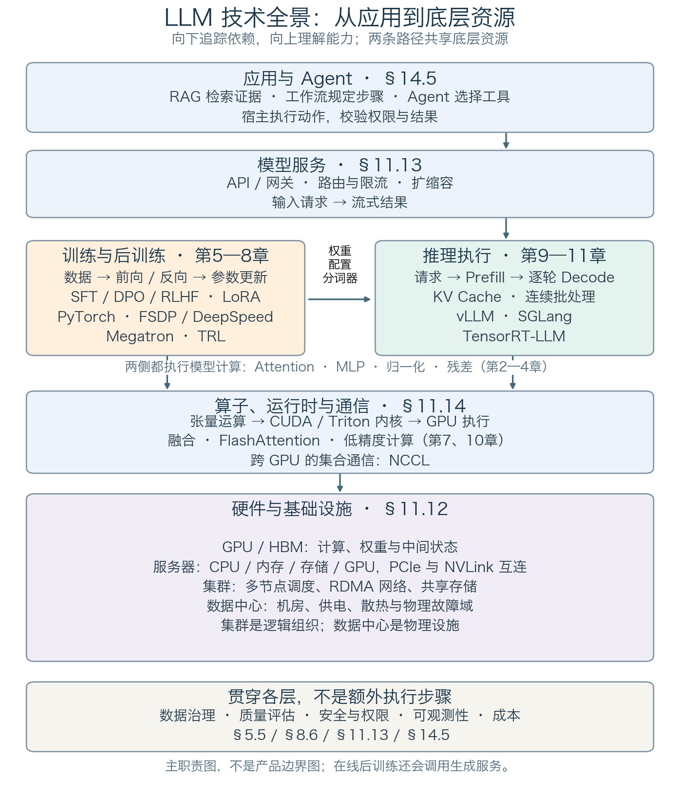

## 1.0 技术全景：从 GPU 到 Agent

大模型系统是一摞分层的依赖：硬件提供算力与显存，运行时把张量运算变成 GPU 上的计算函数，模型规定算什么，训练与推理是共用算子、管理不同状态的两条路径，服务与应用建在它们之上。遇到一项新技术，先判断它改的是哪一层、解的是哪一种瓶颈，再看具体实现；排障同样按层定位，一种优化治不了所有层的问题。图 1-0 把这些层次放进同一张地图，后文各章都能在图上找到位置。

### 1.0.1 先看层次，再看两条工作路径

图 1-0：从应用需求向下追踪依赖。纵向箭头表示依赖关系，横向箭头表示训练制品交给推理系统加载，基础设施框内是组织关系。[绘图源文件](https://github.com/yeasy/llm_internals/blob/main/tools/figures/llm_technology_map.py)

**自下而上看能力。** GPU 执行计算，显存保存权重与中间状态；服务器组合计算、主机内存和输入输出设备；集群把多台服务器组织成可调度的资源；数据中心提供机房、供电和散热。集群是逻辑上的资源组织，数据中心是物理设施，二者并非一一对应。软件在这些资源之上实现算子、模型执行、在线服务与应用。

**沿两条路径看工作。** 训练读取样本，经前向、损失、反向和参数更新产生模型。推理加载模型，分两个阶段：Prefill 把整段输入一次送入模型并预测首个新词元，Decode 此后每轮只送入上一轮生成的那一个词元、预测下一个。词元（Token）是模型处理文本的最小单元，可以是一个词、子词片段或单个字符。两条路径共享算子与硬件，管理的状态不同：训练要保存梯度、优化器状态与恢复点；推理要管理请求队列和 KV 缓存，即各层为已处理词元保存、供后续各轮直接读取的中间结果。这几个术语的正式定义见 [1.4.3 节](1.4_transformer_idea.md)。RLHF 等在线后训练会反复调用生成服务，两条路径并不隔绝。

**三个量级。** 每 10 亿参数的 FP16 权重约占 2 GB 显存。Llama 3 8B 每处理一个词元，KV 缓存增加约 128 KiB（见 [10.2 节](../10_inference_optimization/10.2_kv_cache.md)）。Decode 每生成一个词元，要把全部权重从显存读一遍（见 [10.1 节](../10_inference_optimization/10.1_bottleneck.md)）。第一个数决定模型放不放得下，第二个数决定一张卡能同时保留多少上下文，第三个数说明逐词元生成的速度受显存带宽限制多于受算力限制。

**区分模型与框架。** Transformer 定义计算结构，PyTorch 等框架组织计算，vLLM 等引擎组织高效生成，Agent 宿主组织工具与任务，它们不相互替代。图按主要职责定位，实际软件可以跨层，例如 vLLM 同时提供服务入口、调度与模型执行（见 [vLLM 架构说明](https://docs.vllm.ai/en/latest/design/arch_overview/)）。

### 1.0.2 图中的技术，到哪里学

下表按地图位置列出各项技术解决的问题和讲解入口，各格中的术语在所链接的章节定义。

| 地图位置 | 核心技术与解决的问题 | 机制与实践入口 |
| --- | --- | --- |
| 硬件与基础设施 | GPU／HBM 提供计算和显存；PCIe／NVLink 连接设备；RDMA 网络与存储连接节点；数据中心提供运行条件 | 机制详解：[硬件](../11_serving/11.12_hardware.md#gpu-hardware)、[显存算账](../06_training_techniques/6.4_batch_sequence.md#7b-memory-budget)；概念简介：[集群](../11_serving/11.12_hardware.md#cluster)、[数据中心](../11_serving/11.12_hardware.md#data-center) |
| 算子与运行时 | CUDA 管理 GPU 编程与执行；Triton 编写分块内核；融合减少中间读写；NCCL 实现跨 GPU 通信 | 机制与算例：[内核执行](../11_serving/11.14_gpu_software.md#gpu-kernels)、[融合与 Graph](../11_serving/11.14_gpu_software.md#kernel-fusion)、[NCCL](../11_serving/11.14_gpu_software.md#nccl)、[7.1 集合通信](../07_distributed_training/7.1_data_parallel.md) |
| 模型计算 | Attention、MLP、归一化、残差和位置编码共同把词元变成预测 | [3.8 完整推理过程](../03_components/3.8_gpt_inference_flow.md)、[第四章 位置编码](../04_position_encoding/README.md) |
| 预训练与分布式执行 | 数据流水线、损失与优化器决定学什么；DDP、FSDP／ZeRO、张量／流水线并行决定如何分摊计算与状态 | 机制详解：[5.5 数据](../05_pretraining/5.5_data_pipeline.md)、[第六章 优化](../06_training_techniques/README.md)、[第七章 分布式](../07_distributed_training/README.md)；实践配方：[DDP／FSDP2、Megatron-Core／DeepSpeed](../appendix/a7_framework_recipes.md#distributed-frameworks) |
| 后训练 | SFT 用示范监督，DPO 用偏好对，RLHF／GRPO 用奖励反馈；LoRA 是可与这些方法组合的参数更新方式 | [第八章 对齐](../08_alignment/README.md)、[A.6 核心计算实验](../appendix/a6_practice_path.md)、[A.7 框架配方](../appendix/a7_framework_recipes.md) |
| 推理执行 | GQA／MQA 减少 KV 头数，KV Cache 避免重复计算；FlashAttention 减少注意力访存；FP8 等量化降低表示开销；投机解码尝试减少串行等待 | [GQA／MQA](../02_attention/2.3_multi_head.md)、[KV Cache](../10_inference_optimization/10.2_kv_cache.md)、[FlashAttention](../10_inference_optimization/10.3_flash_attention.md)、[FP8 与量化](../10_inference_optimization/10.4_quantization.md)、[投机解码](../10_inference_optimization/10.6_speculative_decoding.md) |
| 推理引擎 | PagedAttention 管理分页 KV 的访问，Continuous Batching 动态组织请求；vLLM、SGLang、TensorRT-LLM 集成执行机制 | 机制详解：[连续批处理](../11_serving/11.2_continuous_batching.md)、[KV 管理](../11_serving/11.4_kv_memory_management.md)、[vLLM](../11_serving/11.10_vllm_internals.md)、[SGLang](../11_serving/11.11_sglang_internals.md)；执行路径与选型：[TensorRT-LLM](../11_serving/11.1_engines_overview.md#tensorrt-llm)；实践配方：[A.7](../appendix/a7_framework_recipes.md) |
| 模型服务 | API、网关、词元感知路由、限流和扩缩容，将引擎能力变成可用服务 | [11.13 服务最佳实践](../11_serving/11.13_best_practices.md) |
| 应用与 Agent | RAG 把外部证据带入上下文；工作流规定步骤；Agent 在约束下选择工具与下一步，由宿主执行 | 机制与算例：[检索与重排](../12_encoder_models/12.3_longformer_bigbird.md)、[RAG 闭环](../14_future_trends/14.5_agent_tool_use.md#rag-workflow-agent)、[工具调用](../14_future_trends/14.5_agent_tool_use.md#agent-tool-call) |
| 贯穿各层 | 数据治理、质量评估、安全、可观测性和成本决定系统能否持续使用，不是最后才增加的一层 | [5.5 数据治理](../05_pretraining/5.5_data_pipeline.md)、[8.6 评估](../08_alignment/8.6_evaluation.md)、[11.13 运行治理](../11_serving/11.13_best_practices.md)、[14.5 工具权限](../14_future_trends/14.5_agent_tool_use.md) |

选型的次序是先定需要的机制，再选能支持该机制、模型与硬件的实现。PyTorch、FSDP、DeepSpeed、Megatron 和 TRL 的职责与组合方式集中在[附录 A.7](../appendix/a7_framework_recipes.md)。

### 1.0.3 用一个问题串起整张地图

假设用户询问“公司的差旅住宿上限是多少”。模型已在服务启动时加载，本次请求按以下顺序执行：

1. **应用整理任务。** RAG 检索当前用户有权读取的制度片段，把来源与问题放入上下文；固定的检索问答流程不一定需要 Agent。
2. **服务接收请求。** 网关校验身份和配额，路由到可用的模型实例。这一层处理的是请求，不是矩阵。
3. **Prefill：处理整段输入。** 引擎安排批次与 KV 空间，把问题和制度片段送入模型；模型计算各层表示、建立 KV 缓存，用最后位置的输出预测首个新词元。
4. **Decode：继续生成。** 每轮输入上一轮生成的词元，读取并更新 KV 缓存，预测下一个词元；结果可以立即流式返回。重复到满足停止条件后回收请求状态，可复用的前缀缓存按引擎策略保留。
5. **应用检查并交付。** 应用展示答案与引用；若要执行报销等动作，须另行校验参数、权限与授权，模型生成的调用不是执行许可。

步骤 3、4 每次都走同一条计算链：模型张量运算，GPU 内核与必要的跨卡通信，计算结果。内核（kernel）是指在 GPU 上执行的一个计算函数，例如一次矩阵乘法。读显存和跨节点传输都发生在 Prefill 与 Decode 内部，不是生成结束后的另外两个阶段。各步的矩阵形状与 KV 缓存的更新见 [3.8 节](../03_components/3.8_gpt_inference_flow.md)。

这次问答不更新权重：权重在上线前由训练路径产生。检索到新制度、复用 KV 缓存和把知识训练进模型，是三个不同的过程。

排障沿同一张地图定位。答案依据错误，先查检索与生成；首词元慢，把排队与 Prefill 拆开看；逐词元输出慢，查 Decode、访存和通信；扩卡不增吞吐，查切分与互连。具体判据见 [11.13 节](../11_serving/11.13_best_practices.md)。
