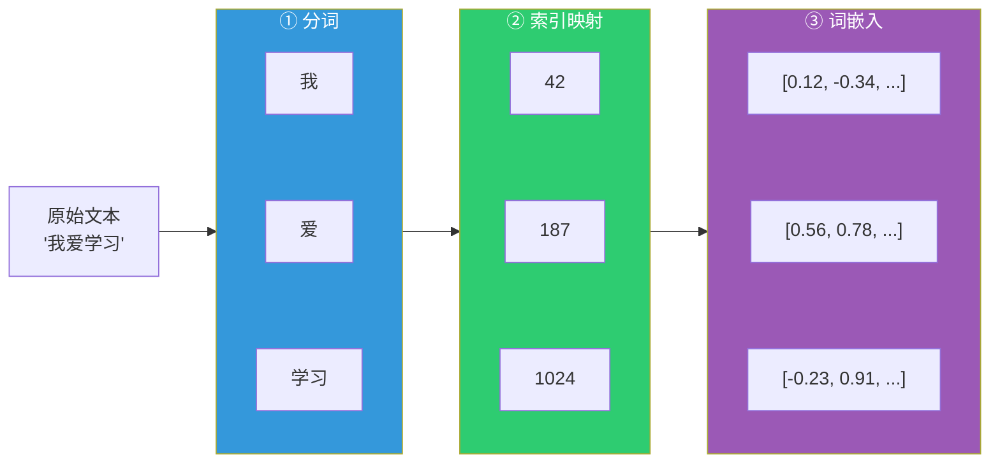

## 1.1 序列建模的根本挑战

语言模型给整条序列一个概率，链式法则把它拆成逐个预测下一个词元；这是恒等式，不含任何假设，训练目标就是每词元的平均交叉熵。衡量一个序列模型看三件事：能否接受变长输入，两个位置之间的信息要走几步，计算要花多少。第三件必须拆成总计算量与必须排队的顺序步数，两者可以方向相反，GPU 上决定训练速度的往往是后者。本节立起这把尺子，1.2 到 1.4 节用它逐个衡量 RNN、CNN、注意力与 Transformer。

### 1.1.1 什么是序列建模

序列建模（Sequence Modeling）是指让计算机处理有序数据的任务。自然语言是最典型的序列数据：“猫追狗”和“狗追猫”用词完全相同，含义相反。语言建模、机器翻译、文本分类、序列标注和文本生成都属于这一类，模型必须同时利用元素的顺序和元素之间的依赖。

**语言模型的形式化。** 全书的训练目标、解码策略和评测指标都建立在语言建模之上。一个语言模型给整条序列 $$x_1 \ldots x_T$$ 赋一个概率，按条件概率的链式法则拆成 $$T$$ 个一步预测：

$$
P(x_1,\ldots,x_T)=\prod_{t=1}^{T} P(x_t \mid x_{<t})
$$

这条恒等式把“给一整句话打分”换成“反复预测下一个词元”。分解对任何顺序都成立，选从左到右是为了让训练目标与逐词生成的过程一致，后文的因果掩码由这一选择而来（见 [1.4.3 节](1.4_transformer_idea.md)）。词元（Token）是模型处理文本的最小单元，可以暂且理解为一个词，定义见 1.1.4。训练时把联合概率取对数再取负、除以长度，得到每词元平均交叉熵：

$$
L = -\frac{1}{T}\sum_{t=1}^{T}\log P(x_t \mid x_{<t})
$$

正确词元的概率越接近 1，$$-\log P$$ 越接近 0，最小化 $$L$$ 就是让模型给每个正确词元的概率尽量大。对数取自然对数时，$$L$$ 的单位是 nat。它的指数是**困惑度**（Perplexity，PPL）$$= e^{L}$$，可以读作“模型平均在多少个等概率候选之间犹豫”。

**一格算术。** 设某条 4 个词元的序列，模型给正确词元的概率依次是 0.5、0.25、0.4、0.1。联合概率是 $$0.5 \times 0.25 \times 0.4 \times 0.1 = 0.005$$，即 $$1/200$$。四个 $$-\ln p$$ 依次是 0.693、1.386、0.916、2.303，平均得 $$L = 1.325$$ nat，$$\mathrm{PPL} = e^{1.325} = 3.76$$，也等于 $$200^{1/4}$$：困惑度是逐步概率几何平均的倒数。联合概率随长度指数衰减，长短不同的句子无法比较；困惑度做了长度归一，因此可比。低概率步的代价很重：只看前三步，困惑度是 2.71，把 0.1 那一步算进来就升到 3.76。

困惑度依赖分词方式，词表不同的模型不能直接比。这条限制与交叉熵的另外两种读法（压缩视角、与真实分布的 KL 距离）见 [5.1 节](../05_pretraining/5.1_autoregressive.md)和 [6.1 节](../06_training_techniques/6.1_loss_optimizer.md)。

### 1.1.2 三条评判轴

2017 年之前的序列模型按三条轴比较，后四节反复用到。

**第一，变长输入。** 句子长度从一个词到数千词不等。全连接网络要求输入维度固定，解法是让同一组参数在所有位置上复用。

**第二，长距离依赖。** “那个昨天在公园里遇到的穿红色外套的女孩，今天又来了”，主语和谓语之间隔了十几个词。衡量这一项的量是**信息路径长度**：两个位置之间的信息要经过多少次变换才能相遇。路径越长，信号在正向传播中被稀释、在反向传播中被衰减得越厉害。

**第三，计算效率。** 这一项要拆成两个量：

- **总计算量**：处理一条长度 $$n$$ 的序列共需多少次浮点运算。
- **顺序步数**：这些运算里有多少步必须严格排队，不能同时做。

两者可以背道而驰。循环网络的总计算量随 $$n$$ 线性增长，但顺序步数也是 $$n$$，每一步都要等上一步算完。自注意力的打分与读取随 $$n$$ 平方增长，顺序步数却是常数，整条序列一次算完。GPU 上决定训练速度的往往是后者：顺序步数多意味着每步只有一小批数据，数千个计算核心大部分时间在空转。表 1-2 与表 1-4 分列的正是这两个量。

模型规模上去之后，还要再看两条。一是推理时要携带的状态有多大：RNN 只带一个固定大小的向量，Transformer 的 KV 缓存随长度线性增长（见 [1.2.5 节](1.2_rnn_cnn_limits.md)）。二是先验的强弱：循环与卷积自带“邻近位置更相关”的归纳偏置，数据少时占优；先验弱的模型要用更多数据来补（见 [1.4.5 节](1.4_transformer_idea.md)与 [1.5.2 节](1.5_milestones.md)的 ViT）。

### 1.1.3 从统计方法到神经网络

N-gram 败在组合数随窗口指数增长，神经语言模型把词变成向量，让相似的词共享统计强度，参数量随窗口只线性增长。

**N-gram 语言模型**用前 $$N-1$$ 个词预测第 $$N$$ 个词，把链式分解里的条件截断到固定窗口，再用语料中的频次直接估计每一项：

$$
P(w_t \mid w_{<t}) \approx P(w_t \mid w_{t-N+1},\ldots,w_{t-1})
= \frac{\mathrm{count}(w_{t-N+1},\ldots,w_t)}{\mathrm{count}(w_{t-N+1},\ldots,w_{t-1})}
$$

问题出在分子上。**一格算术**：词表 $$V = 10^5$$ 时，三元组的可能取值有 $$V^3 = 10^{15}$$ 种；一份 $$10^{10}$$ 词的语料最多含 $$10^{10}$$ 个互不相同的三元组，只覆盖全部取值的 $$10^{-5}$$。窗口每加宽一个词，可能的取值再乘 $$10^5$$，覆盖率再掉五个数量级。绝大多数组合的计数是 0，概率估计也是 0，这就是**数据稀疏**。平滑与回退能缓解 0 概率，改变不了这个量级，N-gram 实际能用的窗口因此停在 5 到 6 个词。

神经语言模型不再为每个组合单独存一个计数，而是把每个词映射成一个低维向量，由网络从向量算出概率。[Bengio 等 2003](https://www.jmlr.org/papers/volume3/bengio03a/bengio03a.pdf) 在 AP News 上的配置（词表 17,964、六元模型、词向量 100 维、隐层 60 个单元）共约 1,190 万个参数，同阶的计数表有 $$17{,}964^6 \approx 3.4 \times 10^{25}$$ 项，相差 18 个数量级。从这一步起，“表示”成了可学习的参数。

### 1.1.4 从文字到向量：模型看到的是什么

神经网络只处理数值。一段文本要经过三步才能进入计算，这条管线对 RNN 和 Transformer 是同一条。

**第一步，分词（Tokenization）。** 把原始文本切成基本单元，称为**词元**（Token）。“我爱学习”可能被切为“我”“爱”“学习”；英文的 tokenization 可能被切为 token 与 ization 两个子词。**子词分词**是当代大语言模型的通行做法，在两个极端之间取折中：词级切分的词表要覆盖所有词形，未登录词无法表示；字符级切分的词表极小，但同一句话的词元数会翻好几倍，而计算量与词元数直接挂钩。子词切分让常见词保持一个词元，罕见词拆成若干已知片段，任何字符串都能被表示（见 [3.1 节](../03_components/3.1_tokenization.md)）。

**第二步，索引映射。** 每个词元在预先构建的**词汇表**（Vocabulary）里有唯一的整数索引，分词器据此把词元序列转成整数序列。

**第三步，词嵌入（Embedding）。** 模型持有一个**嵌入矩阵** $$E$$，形状 $$[V, d]$$，每一行是一个词元的向量。查表就是按索引取行：一条长度 $$T$$ 的 ID 序列查表后得到 $$X$$，形状 $$[T, d]$$。

| 模型 | 词表 $$V$$ | 宽度 $$d$$ | 嵌入表 $$E$$ 的形状 | 参数量 |
| --- | ---: | ---: | --- | ---: |
| GPT-3 Small | 50,257 | 768 | `[50257, 768]` | 38,597,376 |
| GPT-3 175B | 50,257 | 12,288 | `[50257, 12288]` | 617,558,016 |
| Llama 3 8B | 128,256 | 4,096 | `[128256, 4096]` | 525,336,576 |

表 1-1：三个公开模型的嵌入表，参数量为 $$V \times d$$。一个 80 亿参数的模型，查表这一步就占约 5.25 亿个参数；词表矩阵占总参数的比例见 [3.2.4 节](../03_components/3.2_embedding.md)，逐项对账见[附录 A.3](../appendix/a3_model_reference.md)。

下图展示这条管线：

图 1-1：从原始文本到向量表示的三步管线

用一组连续数值而非单一符号承载词义，称为**分布式表示**（Distributed Representation）。嵌入矩阵初始化时是随机的，“语义相近的词向量也相近”是训练之后才出现的经验性质：它在 2013 年 [Word2Vec](https://arxiv.org/abs/1301.3781) 一类静态词向量上最明显（如 $$\vec{\text{king}} - \vec{\text{man}} + \vec{\text{woman}} \approx \vec{\text{queen}}$$），在大语言模型的输入嵌入上弱得多，因为那里的语义区分主要由后续各层的上下文计算完成，同一个词在不同上下文里得到不同的向量，即**上下文化嵌入**（Contextualized Embedding，见 [3.2 节](../03_components/3.2_embedding.md)）。

有了输入表示，接下来的问题是怎样处理这串向量。第一个突破固定窗口限制的方案是循环神经网络。
