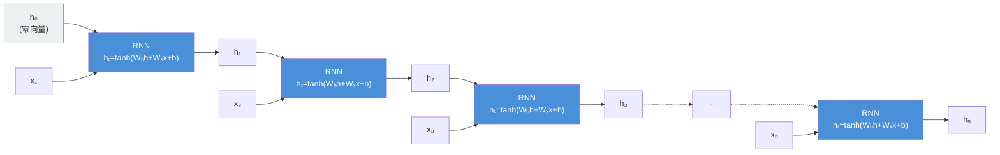
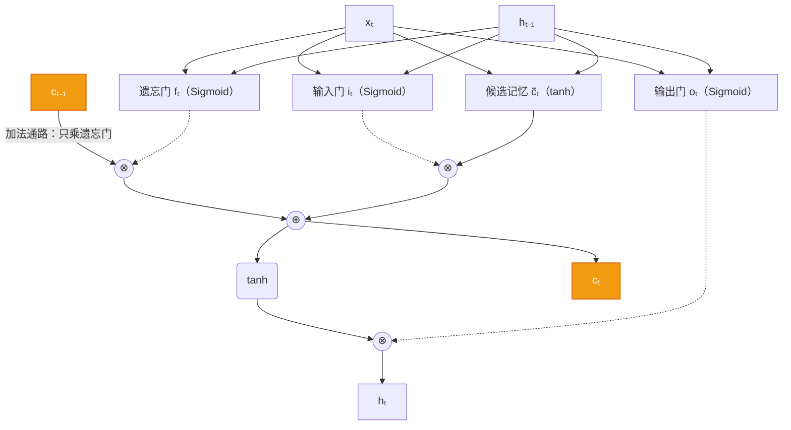
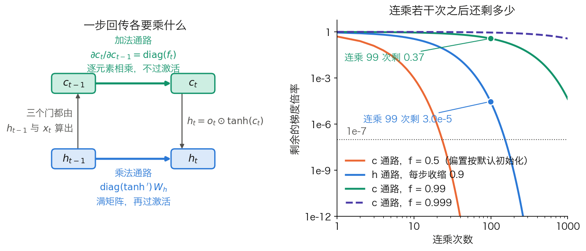

## 1.2 RNN 与 CNN：成就与瓶颈

RNN 用一组共享参数的递推解决了变长输入，留下两个问题。其一，梯度沿时间回传要连乘同一种雅可比，远处位置对梯度的贡献按几何级数缩小；LSTM 另开一条只做加法的通路，这条通路上的一步雅可比是遗忘门本身，不经过权重矩阵和激活导数，前提是遗忘门贴近 1。其二，第 $$t$$ 步必须等第 $$t-1$$ 步，顺序步数是 $$O(n)$$，每次矩阵乘的批量因此很小，GPU 的算术强度上不去。卷积把顺序步数降到常数，但两个位置要隔很多层才能相遇。RNN 至今仍占优的只有一项：推理时状态大小固定，这也是状态空间模型想拿回去的东西。

### 1.2.1 循环神经网络：用“记忆”处理序列

循环神经网络（Recurrent Neural Network，RNN）逐个处理序列元素，并维护一个**隐藏状态**（Hidden State）来积累已看过的信息。在每个时间步 $$t$$，它接收当前输入 $$x_t$$ 和上一步的隐藏状态 $$h_{t-1}$$，算出新的隐藏状态：

$$h_t = \tanh(W_h h_{t-1} + W_x x_t + b)$$

若输入宽 $$d_x$$、隐藏宽 $$d_{\text{hid}}$$，则 $$W_x$$ 的形状是 $$[d_{\text{hid}}, d_x]$$，$$W_h$$ 是 $$[d_{\text{hid}}, d_{\text{hid}}]$$。本节与 [1.3 节](1.3_attention_birth.md)沿用原论文的列向量写法（$$Wx$$），第二章起改用行向量（见 [2.1.1 节](../02_attention/2.1_qkv_intuition.md)）。所有时间步共享同一组 $$W_h$$、$$W_x$$、$$b$$：参数量与序列长度无关，任意长度的序列都能处理，第一条轴就此解决。

下图将 RNN 沿时间展开（$$h_0$$ 初始化为零向量）：

图 1-2：RNN 沿时间展开示意图，每个时间步共享同一组参数 $$(W_h, W_x, b)$$

序列结束时的末状态可用于分类，每一步的隐藏状态可用于序列标注或生成下一个输出。问题出现在序列变长、模型变大之后。

### 1.2.2 单向视野：无法“预知未来”

从左到右处理时，位置 $$i$$ 的隐藏状态只汇总了位置 1 到 $$i$$ 的输入。这对逐位置表示是硬伤：给“I arrived in London yesterday”做序列标注，编码到 arrived 时还不知道后面是地点还是时间。

**双向 RNN**（Bidirectional RNN）同时跑正向和逆向两个 RNN，位置 $$i$$ 的表示取两个方向隐藏状态的拼接 $$[\vec{h}_i; \overleftarrow{h}_i]$$，宽度为 $$2d_{\text{hid}}$$。它的前提是逆向一路先看到完整输入，所以只能用于理解类任务和 Seq2Seq 的编码器，不能用于逐词生成：生成第 $$t$$ 个词时，第 $$t+1$$ 个词还不存在。同一条约束后来区分了双向的 BERT 与用因果掩码生成的 GPT（见 [3.7 节](../03_components/3.7_full_architecture.md)）。双向既不解决梯度消失，也不解决串行。

### 1.2.3 梯度消失：连乘的必然结果

RNN 的训练依赖**时间反向传播**（Backpropagation Through Time，BPTT）：把网络沿时间展开成一个很深的前馈网络，再跑标准反向传播。

**雅可比矩阵**（Jacobian）是指向量对向量求导得到的矩阵：$$\partial h_t / \partial h_{t-1}$$ 的第 $$(a, b)$$ 元是 $$h_t$$ 的第 $$a$$ 个分量对 $$h_{t-1}$$ 的第 $$b$$ 个分量的偏导，它描述 $$h_{t-1}$$ 的微小变化怎样传到 $$h_t$$。梯度从时间步 $$T$$ 回传到时间步 1，要连乘 $$T-1$$ 个一步雅可比：

$$
\frac{\partial h_T}{\partial h_1} = \prod_{t=2}^{T} \frac{\partial h_t}{\partial h_{t-1}}
= \prod_{t=2}^{T} \operatorname{diag}(\tanh'(z_t))\,W_h
$$

其中 $$z_t = W_h h_{t-1} + W_x x_t + b$$，连乘按时间倒序排列，靠后的时间步在左。每一项都是“一个对角矩阵乘同一个固定矩阵”：$$\tanh$$ 逐分量作用，导数是对角矩阵；$$z_t$$ 对 $$h_{t-1}$$ 的导数是 $$W_h$$。若每一项的范数稳定在 $$\rho$$ 附近，连乘之后的倍率约为 $$\rho^{T-1}$$。

**一格算术。** 取 $$\rho = 0.9$$，回传 100 步剩 $$0.9^{99} = 3.0 \times 10^{-5}$$，回传 1000 步剩 $$1.9 \times 10^{-46}$$。远处位置对梯度的贡献比近处小四到五个数量级，被近处的梯度和小批量的随机波动淹没，优化器实际只看得到近处几十步的信号，远处的依赖学不到。反方向同样成立：$$\rho = 1.1$$ 时 100 步后放大到 $$1.3 \times 10^{4}$$，一次更新就会把参数推出正常范围。工程上还有一层更硬的限制：实际训练把回传截断在固定窗口内（截断 BPTT），可学到的依赖长度先被这个窗口封顶。

[Pascanu 等 2013](https://arxiv.org/abs/1211.5063) 给出了准确的条件。设激活函数导数的绝对值上界为 $$\gamma$$（tanh 取 1，Sigmoid 取 1/4），$$\lambda_1$$ 为 $$W_h$$ 的谱半径：$$\lambda_1 < 1/\gamma$$ 是梯度消失的**充分**条件，$$\lambda_1 > 1/\gamma$$ 只是梯度爆炸的**必要**条件。谱半径大于 1 并不保证爆炸，tanh 在饱和区的导数远小于 1，实际倍率可能仍然收缩。

同一篇论文给出了爆炸一侧的对策，**梯度范数裁剪**（gradient norm clipping）：梯度的范数超过阈值就整体缩放回阈值，方向不变。它至今仍用于大模型训练（见 [6.1 节](../06_training_techniques/6.1_loss_optimizer.md)）。裁剪治不了消失：把一个 $$10^{-5}$$ 的梯度放大回来，放大的是噪声。

### 1.2.4 LSTM 与 GRU：给梯度另开一条通路

**长短期记忆网络**（Long Short-Term Memory，LSTM，Hochreiter 与 Schmidhuber 1997）在隐藏状态之外再开一条**记忆单元通路**（Cell State）$$c_t$$，只用逐元素的乘与加更新（$$\odot$$ 表示逐元素相乘）：

$$c_t = f_t \odot c_{t-1} + i_t \odot \tilde{c}_t$$
$$h_t = o_t \odot \tanh(c_t)$$

遗忘门 $$f_t$$、输入门 $$i_t$$、输出门 $$o_t$$ 结构相同：各自对 $$x_t$$ 与 $$h_{t-1}$$ 做仿射变换后过 Sigmoid，得到与 $$c_t$$ 同维、各分量在 0 到 1 之间的向量，逐分量决定旧记忆保留多少、新内容写入多少、对外暴露多少。候选记忆 $$\tilde{c}_t$$ 由同样的输入过 tanh 得到，提供待写入的内容。下图画出这些连接。

图 1-3：LSTM 单元结构，记忆单元 $$c_t$$ 通过线性通路传递信息

**加法通路的雅可比是遗忘门本身。** 把第一式对 $$c_{t-1}$$ 求偏导，直接通路上的项是

$$
\frac{\partial c_t}{\partial c_{t-1}} = \operatorname{diag}(f_t)
$$

与 1.2.3 的 $$\operatorname{diag}(\tanh')W_h$$ 相比，这里没有权重矩阵，也没有激活函数的导数。连乘 $$T$$ 步之后的倍率是 $$\prod_t f_t$$，由门自己决定，与 $$W_h$$ 的谱无关。$$h$$ 通路并没有消失：$$c_{t-1}$$ 还会经 $$h_{t-1}$$ 进入各个门与候选记忆，这些通路每一步仍要乘权重矩阵与激活导数，照旧衰减。总梯度是所有通路的贡献之和，直接通路这一项只要不衰减，远处的信号就能传回来。

图 1-4：一步回传各要乘什么，以及连乘若干次之后还剩多少（[生成脚本](https://github.com/yeasy/llm_internals/blob/main/tools/figures/ch01_gradient_paths.py)）。左幅蓝色是 h 通路、青绿是 c 通路；右幅只有蓝色一条是 h 通路，其余三条是 c 通路在 $$f$$ 取 0.5、0.99、0.999 时的衰减，横纵轴均为对数刻度。

**前提是遗忘门贴近 1。** $$f = 0.99$$ 时，回传 100 步剩 $$0.99^{99} = 0.37$$；$$f = 0.999$$ 时，回传 1000 步剩 $$0.999^{999} = 0.37$$，比 $$\rho = 0.9$$ 的 $$3.0 \times 10^{-5}$$ 高四个数量级。一旦 $$f = 0.9$$，连乘的就是同一个 $$0.9^{99}$$，与普通 RNN 没有区别。按常规的小随机数初始化，Sigmoid 的输出在 0.5 附近，$$0.5^{99} = 1.6 \times 10^{-30}$$，所以遗忘门偏置 $$b_f$$ 要初始化为 1 或 2，让门的初值靠近 1（[Jozefowicz 等 2015](https://proceedings.mlr.press/v37/jozefowicz15.pdf)，做法源自 Gers 等 2000）。[1997 年的原始 LSTM](https://www.bioinf.jku.at/publications/older/2604.pdf) 没有遗忘门，$$c_t$$ 的自环权重固定为 1：梯度完全不衰减，记忆也无法重置。Gers 等 2000 把它换成可学习的 $$f_t$$，用可控的衰减换来可重置。

起作用的是带门的加法通路，$$c$$ 与 $$h$$ 分开只是 LSTM 的一种实现。2014 年的**门控循环单元**（Gated Recurrent Unit，GRU）把遗忘门与输入门合并为一个更新门，不设独立的 $$c_t$$，效果与 LSTM 相近。代价在参数：LSTM 有三个门加一个候选记忆共四组权重，单层参数量是同宽普通 RNN 的 4 倍，GRU 是 3 倍。同一条思路后来出现在残差网络里，旁路是恒等映射，系数恒为 1，不带门（见 [3.5 节](../03_components/3.5_residual.md)）。

LSTM 缓解了衰减，没有消除它。[Khandelwal 等 2018](https://arxiv.org/abs/1805.04623) 在 LSTM 语言模型上测得：模型平均只用得上约 200 个词元的上下文，其中只有最近约 50 个词元的词序起作用，更远的内容只留下大致的主题。LSTM 与 GRU 在 2014 至 2017 年间主导了 NLP，也进了生产系统：[GNMT](https://arxiv.org/abs/1609.08144) 用 8 层编码器加 8 层解码器的 LSTM 上线翻译服务，WMT 英法模型要用 96 块 K80 GPU 训练约 6 天。限制规模继续放大的，是下一小节的问题。

### 1.2.5 串行计算：顺序步数卡住了吞吐

无论基础 RNN、LSTM 还是 GRU，$$h_t$$ 的计算都必须等 $$h_{t-1}$$ 完成。按 [1.1.2 节](1.1_seq_challenge.md)的两个量看，问题不在总计算量，而在顺序步数压低了每一步的算术强度，即每从显存读 1 字节所做的运算次数。

对长度 $$n = 1000$$、宽度 $$d$$ 的一条序列，RNN 训练一步要发射 1000 次小矩阵乘 $$[B, d] \times [d, d]$$；Transformer 的同一步把它们合成一次 $$[B \cdot n, d] \times [d, d]$$（按批量实现的行布局书写，$$B$$ 条序列各占一行）。两者的乘加次数同阶，差别在于前者是 1000 个依次排队的内核、每个只有 $$B$$ 行数据，后者是一个内核、$$B \times 1000$$ 行数据。同样读一遍权重，行数越少摊到的运算越少，GPU 的算力就越闲（这条判据在 [10.1 节](../10_inference_optimization/10.1_bottleneck.md)展开为 Roofline 分析）。顺序步数 $$O(n)$$ 因此不只是延迟问题。

| 特性 | RNN/LSTM | 理想方案 |
|------|----------|----------|
| 每层总计算量 | $$O(n \cdot d^2)$$ | 越低越好 |
| 顺序步数 | $$O(n)$$ | $$O(1)$$ |
| 并行度 | 低（串行） | 高（全并行） |
| 长距离依赖路径 | $$O(n)$$ 步 | $$O(1)$$ 步 |
| GPU 利用率 | 低 | 高 |
| 推理时每步的状态大小 | $$O(d)$$，不随已读长度增长 | 越小越好 |

表 1-2：RNN/LSTM 与“理想方案”在六个量上的对照

最后一行是 RNN 唯一一项至今仍占优的指标。推理时，RNN 只需携带一个固定大小的 $$h_t$$（LSTM 再加一个 $$c_t$$），每生成一个词元的计算量是 $$O(d^2)$$，与已读长度无关。Transformer 为避免重算历史，要保存随长度线性增长的 KV 缓存（定义见 [1.4.3 节](1.4_transformer_idea.md)）。线性注意力与状态空间模型近年回潮，出发点正是这笔取舍：它们想拿回 RNN 的恒定状态，同时保住 Transformer 的并行训练（见 [14.3 节](../14_future_trends/14.3_ssm_hybrid.md)）。

对并行的需求推动了两个方向：把 CNN 引入序列建模，以及注意力机制的诞生。

### 1.2.6 CNN 在序列建模中的尝试

一维卷积用固定宽度的核在序列上滑动提取局部特征，不同位置的卷积互不依赖，顺序步数是 $$O(1)$$。2017 年的 [ConvS2S](https://arxiv.org/abs/1705.03122) 证明纯卷积架构也能胜任机器翻译，训练速度远快于 RNN。

代价是**感受野**（Receptive Field）有限。核宽 $$k$$ 的普通卷积每叠一层，感受野扩大 $$k-1$$，堆 $$L$$ 层后为 $$1 + L(k-1)$$。**一格算术**：$$k = 3$$ 时感受野是 $$2L+1$$，要让相距 1000 的两个位置相互覆盖，需要 $$L = 500$$ 层。**空洞卷积**（Dilated Convolution）是指核内相邻采样点之间留出间隔的卷积，间隔的倍数称为扩张率。若扩张率逐层按 $$k$$ 倍增长，$$L$$ 层的覆盖是 $$k^L$$：$$\log_3 1000 = 6.29$$，7 层即可（$$3^7 = 2187$$）。[Vaswani 等 2017](https://arxiv.org/abs/1706.03762) 把这两种情形分开写：连续核需要 $$O(n/k)$$ 层，空洞卷积需要 $$O(\log_k n)$$ 层。两个数字相差近两个数量级，引用时要说明用的是哪一种。

ConvS2S 每层都带残差连接，深度本身不必然带回梯度消失；多出来的层的代价在于两个位置之间的信息路径变长，每多一层就多一次有损的压缩与混合。

卷积核在各个位置提取的是同一种模式，不带绝对位置信息。ConvS2S 因此显式加了可学习的位置嵌入，去掉后验证 BLEU 从 21.7 降到 21.2；循环模型不需要它，因为递推本身带着“走到第几步”。[BLEU](https://aclanthology.org/P02-1040/) 是机器翻译的自动评分，按译文与参考译文的 n 元组重合程度计算，通常按 0 到 100 报告，越高越接近参考译文，[1.3 节](1.3_attention_birth.md)与 [1.4 节](1.4_transformer_idea.md)的翻译结果都用它比较。位置信息的问题在 [1.4 节](1.4_transformer_idea.md)会再次出现，自注意力的处境比卷积更极端。

RNN 的串行瓶颈与 CNN 的局部视野指向同一个需求：一种机制，既让顺序步数降到常数，又让任意两个位置之间的路径长度降到常数。答案是[注意力机制](1.3_attention_birth.md)。
