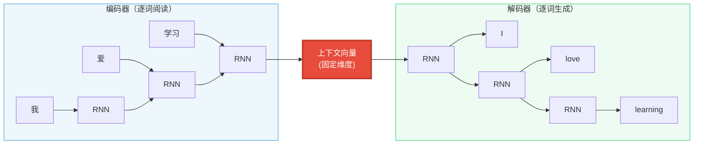
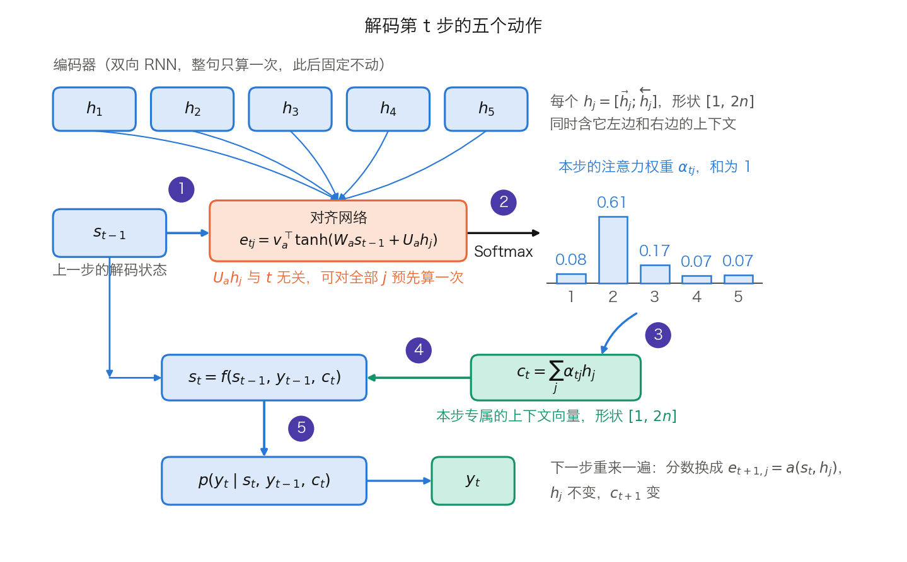

## 1.3 注意力的诞生：让模型学会“看哪里”

Seq2Seq 的瓶颈在时机而不在容量：编码器必须在不知道解码器将要问什么的时候，把整句压成一份摘要。注意力把“读哪里”推迟到解码的每一步：拿当前的解码状态与每个源位置打分，归一成权重，按权重混合各位置的内容；整个过程可导，匹配标准因此是学出来的。源位置到输出的路径长度由此从 $O(n)$ 降到 1，代价是可被读取的状态必须全部留着，每一步还要对全部位置打分，这与后文 KV 缓存的账是同一笔。把打分从小网络换成点积之后，注意力的全部计算都落在矩阵乘法上。这一阶段的注意力仍嫁接在 RNN 之上，串行瓶颈要到 [1.4 节](1.4_transformer_idea.md)才被拆掉。

### 1.3.1 编码器-解码器：理解与生成的分离

2014 年，[Sutskever 等提出的**序列到序列**](https://arxiv.org/abs/1409.3215)（Sequence-to-Sequence，Seq2Seq）模型把机器翻译交给两个 RNN。翻译的输入与输出长度不同，也没有逐词对齐，模型必须先读完再写。**编码器**（Encoder）逐词读入源句并更新隐藏状态，末状态被当作整句的摘要，称为**上下文向量**（Context Vector）。**解码器**（Decoder）以它为初始状态，每一步生成一个词元，并把这个词元作为下一步的输入。该文用两个 LSTM 而不是一个，理由是这样能以很小的计算代价增加参数量，并便于同时训练多个语言对。

训练与推理在这里并不对称。训练时用的是**教师强制**（Teacher Forcing）：第 $t$ 步的输入取自真实目标句的第 $t-1$ 个词，而不是模型自己上一步的输出，因此整条目标句的监督信号可以一次算出。推理时没有真实答案，只能把模型自己的输出接回输入，一步接一步。这条不对称贯穿全书，Transformer 也没有改变它（见 [1.4.3 节](1.4_transformer_idea.md)与 [9.1 节](../09_decoding/9.1_autoregressive_decode.md)）。

下图中间那个固定大小的上下文向量是唯一的通道：编码器的全部“理解”都要压进它，解码器对输入的全部了解也只来自它。

图 1-5：Seq2Seq 编码器-解码器架构，所有信息必须通过中间的固定维度向量

**“比特装不下”不成立。** Sutskever 等的配置是 4 层 LSTM、每层 1000 个单元，一句话由 8000 个实数表示（4 层 × $c$ 与 $h$ 两份 × 1000）。8000 个 float32 是 $8000 \times 32 = 256{,}000$ bit，合 31 KiB。再按该文的词表给句子的信息量估一个上界：源端取最高频的 160,000 词，每个词最多 $\log_2 160{,}000 = 17.3$ bit，50 个词的句子不超过 $50 \times 17.3 = 865$ bit，只占 256,000 bit 的 0.34%。自然语言每词的实际熵远低于这个上界，差距只会更大。瓶颈另有来源。

实际的约束有两条。其一，编码器必须在**不知道解码器将要问什么**的前提下完成压缩：同一个向量要同时支持“第一个目标词该译什么”“第十个目标词该译什么”等所有询问，只能编码一份折中的摘要。其二，这份摘要必须以一个 RNN 能逐步解出的形式存在，而 RNN 的末状态天然偏向最近读到的输入。Sutskever 等正是因此把源句倒序输入，让源句开头与目标句开头靠近，测试困惑度从 5.8 降到 4.7，BLEU 从 25.9 升到 30.6。一个靠调整输入顺序就能多拿 4.7 个 BLEU 点的架构，问题出在“什么时候决定读哪里”，而不是“能存多少比特”。

实证指向同一处。[Cho 等 2014](https://arxiv.org/abs/1409.1259) 报告这类模型在短句上表现尚可，性能随句长与未登录词数量迅速下滑。[Bahdanau 等 2015](https://arxiv.org/abs/1409.0473) 给出了直接对照：同在不超过 50 词的句子上训练，带注意力的 RNNsearch-50 在全部测试句上的 BLEU 是 26.75，固定向量的 RNNencdec-50 是 17.82；前者在 50 词以上的句子上也没有出现性能退化。

### 1.3.2 Bahdanau 注意力：把“读哪里”推迟到解码时

Bahdanau 等的解法是：解码每个词时不再只看那一个固定向量，而是回头读编码器在每个位置留下的隐藏状态 $h_j$，并由模型自己决定各读多少。读隐藏状态而不读原始词向量，是因为 $h_j$ 已经融合了上下文。该文的编码器是双向 RNN，$h_j = [\vec{h}_j; \overleftarrow{h}_j]$ 同时含左右两侧的信息，宽度是单向的两倍，正是 1.2.2 所说双向结构的用处。

**解码一步的五个动作。** 第 $i$ 步依次做：

1. 用**上一步**的解码状态 $s_{i-1}$ 与每个 $h_j$ 算对齐分数 $e_{ij} = a(s_{i-1}, h_j)$
2. 对 $j$ 归一化得到权重 $\alpha_{ij} = \dfrac{\exp(e_{ij})}{\sum_{k=1}^{T_x}\exp(e_{ik})}$
3. 加权求和得到本步专属的上下文向量 $c_i = \sum_j \alpha_{ij} h_j$
4. 更新解码状态 $s_i = f(s_{i-1},\, y_{i-1},\, c_i)$
5. 输出分布 $p(y_i \mid y_{<i}, x) = g(y_{i-1},\, s_i,\, c_i)$

第 1 步只能用 $s_{i-1}$：$c_i$ 是算 $s_i$ 的输入之一，打分时 $s_i$ 还不存在。

图 1-6：解码第 $t$ 步的五个动作（[生成脚本](https://github.com/yeasy/llm_internals/blob/main/tools/figures/ch01_bahdanau_step.py)）。蓝色是随输入变化的数据，橙色是权重，青绿是本步新产生的量；柱状图里的权重由脚本中的五个分数经 Softmax 算出。图中用 $t$ 记解码步，与正文的 $i$ 同义。

与 Seq2Seq 的区别在下标：那里的上下文向量只有一个，对所有解码步相同；这里每一步都重算一个 $c_i$，相当于每次带着不同的问题重新翻阅原文。

**打分函数是学出来的。** 该文用的加性打分是

$$
e_{ij} = v_a^{\top} \tanh(W_a s_{i-1} + U_a h_j)
$$

这是一个单隐层网络：$W_a$ 与 $U_a$ 把解码状态和源端状态各自变换到同一个 $n'$ 维空间后相加，经 tanh，再由 $v_a$ 读成一个标量分数。什么样的组合算“相关”没有预先规定，由这三组权重在训练中学出。该文取隐层宽度 $n = 1000$、对齐网络宽度 $n' = 1000$，三个权重的形状是 $W_a[n', n]$、$U_a[n', 2n]$、$v_a[n']$，其中 $2n$ 来自双向拼接。$U_a h_j$ 不依赖 $i$，可以对全部 $j$ 预先算一次，每个解码步只需重算 $W_a s_{i-1}$。

**一格算术：三个源位置。** 把维度缩到 2。设 $s = [1, 2]$，三个源位置的表示为 $h_1 = [2, 0]$、$h_2 = [0, 2]$、$h_3 = [1, 1]$，打分改用最简单的点积 $e_j = s \cdot h_j$：

- 分数：$e_1 = 1 \times 2 + 2 \times 0 = 2$，$e_2 = 1 \times 0 + 2 \times 2 = 4$，$e_3 = 1 \times 1 + 2 \times 1 = 3$
- 取指数：$e^2 = 7.389$，$e^4 = 54.598$，$e^3 = 20.086$，行和 $= 82.073$
- 权重：$7.389/82.073 = 0.090$，$54.598/82.073 = 0.665$，$20.086/82.073 = 0.245$
- 加权求和：第 1 个分量 $(0.090 \times 2 + 0.665 \times 0 + 0.245 \times 1) = 0.425$，第 2 个分量 $(0 + 0.665 \times 2 + 0.245 \times 1) = 1.575$，即 $c = [0.425,\ 1.575]$

分数只差 1 和 2，权重却拉开到 0.090 与 0.665，这是指数放大的结果。第二章的 Q/K/V 做的是同一套算术，只是把 $s$ 换成 Query、把 $h_j$ 同时当作 Key 和 Value（见 [2.1 节](../02_attention/2.1_qkv_intuition.md)）。

把 $\alpha_{ij}$ 排成矩阵，可以看到翻译每个目标词时模型读了源句的哪些位置。这是诊断工具：权重说明信息从哪里被取走，不说明模型为何做出该预测（见 [2.3.6 节](../02_attention/2.3_multi_head.md)）。

### 1.3.3 从加性注意力到点积注意力

[Luong 等 2015](https://arxiv.org/abs/1508.04025) 把三种打分形式并列写出。下式按该文的记号：$h_t$ 是解码器状态，相当于上一小节的 $s$；$\bar{h}_s$ 是源端状态，相当于 $h_j$。

$$
\operatorname{score}(h_t, \bar{h}_s) =
\begin{cases}
h_t^{\top} \bar{h}_s & \textit{dot} \\
h_t^{\top} W_a \bar{h}_s & \textit{general} \\
v_a^{\top} \tanh(W_a [h_t; \bar{h}_s]) & \textit{concat}
\end{cases}
$$

**两种打分的取舍。** 点积（dot）没有可学习参数，能写成一次矩阵乘法；前提是两端维度相同，维度不同时要退回 general 形式，靠 $W_a$ 转接。加性（concat）多一组参数和一次 tanh，对两端维度没有要求，在高维下更稳。后一点的原因是：点积是 $d_k$ 个乘积之和（$d_k$ 是参与点积的向量的维度），分数的方差随维度线性增长，Softmax 容易落进输出接近 one-hot、梯度极小的饱和区。把上一小节的三个分数同乘 4，权重就从 0.090/0.665/0.245 变成 0.0003/0.982/0.018。Transformer 的对策是给点积除以 $\sqrt{d_k}$（见 [2.2 节](../02_attention/2.2_scaled_dot_product.md)）。

点积也不等于方向相似度。$q \cdot k = \|q\|\|k\|\cos\theta$ 同时取决于两个模长，只有先归一化才只剩夹角；上面“同乘一个倍数”的演示就是模长在起作用。

两篇论文的另一处差别是时序。Bahdanau 用上一步的状态 $s_{i-1}$ 打分，上下文向量参与算出 $s_i$；Luong 用当前步的状态 $h_t$ 打分，再把上下文向量与 $h_t$ 拼接后过一层 tanh 用于预测。Transformer 不再有解码状态的递推，这个差别随之消失，留下来的是点积这种打分形式：注意力的全部计算都能落在矩阵乘法上，而矩阵乘法正是 GPU 最擅长的算子。

### 1.3.4 注意力带来的变化与它的代价

回到 [1.1.2 节](1.1_seq_challenge.md)的三条轴，注意力改变了其中两条，代价落在第三条上。

**第一，固定向量不再是唯一通道。** 解码器可以访问编码器每个位置的完整表示，能取多少信息不再受一个向量的宽度限制。

**第二，路径长度从 $O(n)$ 降到 $O(1)$。** 在 Seq2Seq 中，源句第一个词的信息要依次经过所有编码时间步、再经过解码时间步才能影响当前输出；有了注意力，解码器一跳就能读到任意源位置。

**代价：存储。** 编码器的全部隐藏状态 $h_j$ 都要保留。源句 50 个词、$n = 1000$ 的双向编码器，这组状态的形状是 $[50, 2000]$，共 100,000 个实数，是那 8000 个数的 12.5 倍，并且随源句长度线性增长。Seq2Seq 的 $O(1)$ 存储换成了 $O(n)$。

**代价：计算。** 每个解码步要对全部 $n$ 个源位置各打一次分，生成 $m$ 个目标词共 $n \times m$ 次打分；源 50 词、目标 60 词即 3000 次。

这笔“用随长度增长的存储与计算，换路径长度降到 1”的账，与后文 KV 缓存的账是同一笔（见 [10.2 节](../10_inference_optimization/10.2_kv_cache.md)）：只要允许任意位置被直接读取，就得把可被读取的东西全部留着。

还有一处细节是下一节的引子：$h_j$ 在这里身兼两职，既是算分数的依据（决定读多少），又是被取走的内容（决定读到什么）。两种角色用同一个向量承担，“容易被找到”和“携带有用内容”就必须妥协在同一组数里。

这一阶段的编码器和解码器依旧是 LSTM 或 GRU，顺序步数仍是 $O(n)$。既然注意力已能直接连接任意两个位置，还需要 RNN 吗？
