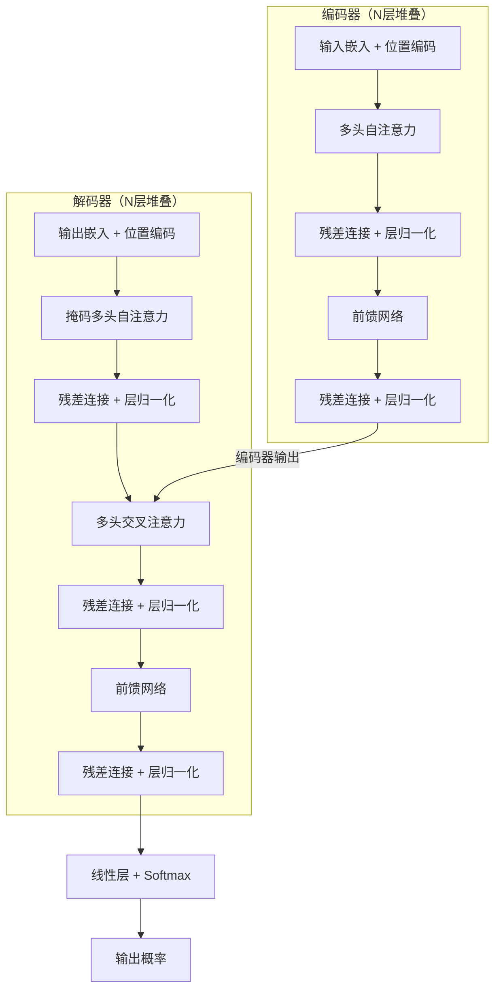
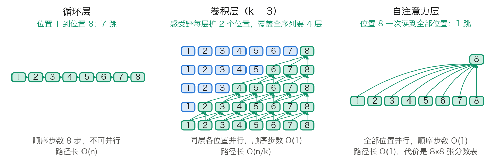

## 1.4 Transformer 的提出与核心思想

2017 年 6 月，[Vaswani 等的《Attention Is All You Need》](https://arxiv.org/abs/1706.03762)把上一节剩下的循环结构整个拿掉。Transformer 把一层的工作分成两件：注意力在位置之间搬运信息，逐位置的前馈网络就地加工，同构的层靠残差与归一化叠深。拿掉循环换来两样东西：任意两个位置一跳可达，训练时所有位置一次算完；同时欠下两笔：顺序信息要另外注入，深层训练要靠残差与归一化稳住。并行只在训练和 Prefill 成立，生成仍是一个词元一个词元地算，KV 缓存和第十、十一章的推理优化由此而来。一层的运算量约为 $24nd^2 + 2n^2d$：常见长度下它并不比同宽的循环网络省运算，快在顺序步数是常数。

### 1.4.1 “完全基于注意力”的设计理念

Transformer 没有发明新的数学工具，它做的是一个**架构决策**：不用循环也不用卷积，只用注意力和逐位置前馈网络搭出整个模型。逐位置前馈网络是指对每个位置的向量独立施加同一个两层全连接网络：先升到 $d_{\text{ff}}$ 维，再降回原宽度（见 [3.4 节](../03_components/3.4_feedforward.md)）。层内的分工由此固定：注意力是位置之间唯一的信息通道，前馈网络只在位置内部加工，残差连接是各层共用的一条通路。后文的 KV 缓存、MoE 与可解释性分析都以这条分工为前提。

这个决策对应前两节的不足：去掉循环后，编码器与训练时的解码器可以一次算完所有位置，顺序步数从 $O(n)$ 降到 $O(1)$；自注意力让每个位置直接读取任意位置，路径长度为 $O(1)$；整个模型由同构的层堆叠而成。拿掉循环之后有两处要补：顺序信息没有了，必须显式注入；深层堆叠的训练稳定性要靠残差与归一化维持。

### 1.4.2 自注意力：从“看别人”到“看自己”

[1.3 节](1.3_attention_birth.md)的注意力发生在解码器与编码器之间，称为**交叉注意力**（Cross-Attention）。**自注意力**（Self-Attention）让序列中的每个位置去看同一个序列中的所有位置（包括自己）。

自注意力此前已被用于阅读理解、摘要等任务，该文的贡献是第一个完全依赖自注意力、不用 RNN 或卷积的模型：贡献在“只用”，不在“引入”。

句子 “The animal didn't cross the street because it was too tired” 中的代词 it 指向 animal 还是 street，要在同一个句子内部建立词与词的关系才能判断。自注意力让每个词向其余所有词发问，并按相关性更新自己的表示。

**一身两职被拆成三个投影。** 1.3.4 指出 Bahdanau 的 $h_j$ 同时充当打分依据与被取走的内容。改成自注意力后，每个位置既要向别人发问、又要被别人匹配、还要提供内容，三种角色全落在同一个向量上。解法是给同一个向量乘三个不同的矩阵，分别得到 Query、Key、Value：发问用 Query，被匹配用 Key，被取走的内容用 Value。模型由此可以学出“容易被找到”与“携带有用内容”两套不同的表示。三个投影的形状与算法见 [2.1 节](../02_attention/2.1_qkv_intuition.md)与 [3.8.3 节](../03_components/3.8_gpt_inference_flow.md)。

### 1.4.3 整体架构与两种运行模式

Transformer 采用编码器-解码器结构，内部完全由注意力与前馈网络构成：

图 1-7：Transformer 编码器-解码器整体架构

每个编码器层含两个子层：多头自注意力，逐位置前馈网络。每个解码器层含三个：掩码多头自注意力（只看自己和左边），多头交叉注意力（读编码器输出），逐位置前馈网络。每个子层都套上残差连接与层归一化，原论文写作 $\text{LayerNorm}(x + \text{Sublayer}(x))$，即归一化在子层之后，称为 Post-Norm。残差连接把子层的输入直接加到输出上，给梯度留一条不经过子层的通路，与 [1.2.4 节](1.2_rnn_cnn_limits.md)中 LSTM 的 $c$ 通路同理（见 [3.5 节](../03_components/3.5_residual.md)）；层归一化把每个位置的向量调整到固定的尺度（见 [3.6 节](../03_components/3.6_layer_norm.md)）。

编码器与解码器的输入都要加上**位置编码**（Positional Encoding）。自注意力对位置是置换等变的：把输入位置重排，输出只会跟着重排。不加位置信息时，“猫追狗”与“狗追猫”里的“追”读到的是同一组向量，算出的表示完全相同。卷积核至少还携带局部的相对顺序，自注意力连这一点都没有。设计方案见[第四章](../04_position_encoding/README.md)。

**训练时并行，生成时仍然串行。** “完全并行”只对编码器和**训练时**的解码器成立，这是理解后半本书的前提。训练时用教师强制：解码器的输入是真实目标句右移一位的结果，因果掩码保证位置 $i$ 只能看到位置 $1$ 到 $i$，于是一次前向就能同时算出所有位置的预测。推理时没有真实答案，第 $i$ 个词元必须等第 $i-1$ 个选出来才能作为输入，生成 $m$ 个词元仍需 $m$ 次顺序前向。Transformer 消掉的是**训练**的顺序步数，没有消掉**生成**的。整条推理轨迹见 [3.8 节](../03_components/3.8_gpt_inference_flow.md)。

**推理侧的四个术语。** 两种运行方式引出四个后文反复使用的术语，在此定义。以下按后文主要讨论的仅解码器模型叙述，编码器-解码器的差别见 [2.4.4 节](../02_attention/2.4_self_cross_causal.md)。

- **因果掩码**（Causal Mask）是指打分时屏蔽右侧位置的规则：位置 $i$ 只能读取位置 $1$ 到 $i$。算法见 [2.4.2 节](../02_attention/2.4_self_cross_causal.md)。
- **Prefill** 是指推理的第一阶段：把整段提示一次送入模型，所有位置并行计算，形状与训练时的一次前向相同，由最后一个位置的输出得到首个新词元。
- **Decode** 是指此后的阶段：每轮只送入上一轮生成的那一个词元，得到下一个词元，直到满足停止条件。
- **KV 缓存**（KV Cache）是指各层为已处理位置保存的 Key 与 Value。因果掩码下，旧位置读不到后来的词元，它们的 Key、Value 不会改变，存下来就不必重算；Decode 每轮只为新位置算一行，并把这一行的 Key、Value 追加进缓存。缓存因此随已处理的长度线性增长。

两个阶段要读的权重一样多，效率却相差很大。Prefill 一次处理整段提示，同一遍权重读取换来很多位置的计算。Decode 每轮只算一个位置，却要把全部权重和已有的 KV 缓存从显存读一遍，速度受显存带宽（每秒能从显存读出的字节数）限制。量化的对比见 [10.1 节](../10_inference_optimization/10.1_bottleneck.md)。

原论文给出了两组配置：

| 超参数 | base | big |
| --- | ---: | ---: |
| 层数 $N$（编码器与解码器各） | 6 | 6 |
| $d_{\text{model}}$ | 512 | 1,024 |
| 前馈中间层 $d_{\text{ff}}$ | 2,048 | 4,096 |
| 头数 $h$ | 8 | 16 |
| 每头宽度 $d_k = d_v$ | 64 | 64 |
| 训练时长（8 块 P100） | 12 小时 | 3.5 天 |
| 参数量 | 65M | 213M |

表 1-3：原论文 base 与 big 的配置。两组配置都满足 $h \times d_k = d_{\text{model}}$：头不是额外加出来的宽度，而是把 $d_{\text{model}}$ 分给各个头。

### 1.4.4 参数都在哪里：把 65M 拆开

参数的三分之二在前馈网络，窄模型还有三成在词嵌入。按“只数矩阵乘、不计偏置与 LayerNorm”的口径，65M 可以自己算出来：

- 编码器层：自注意力的 Q、K、V、O 四个投影各 $d^2$，共 $4d^2$；前馈的两个矩阵各 $d \cdot d_{\text{ff}}$，共 $2 d\, d_{\text{ff}}$。
- 解码器层：多一个交叉注意力子层，注意力部分翻倍为 $8d^2$；前馈同上。
- 词嵌入：EN-DE 用的是源目标共享的 BPE 词表，约 37,000 个词元，故为 $37{,}000 \times d$。

代入 base（$N = 6$，$d = 512$，$d_{\text{ff}} = 2048$）：

$$
\underbrace{6(4d^2 + 2d\,d_{\text{ff}})}_{18{,}874{,}368}
+ \underbrace{6(8d^2 + 2d\,d_{\text{ff}})}_{25{,}165{,}824}
+ \underbrace{37{,}000 \times 512}_{18{,}944{,}000}
= 62{,}984{,}192
$$

约 63M，与论文的 65M 相差不到 4%，差额来自偏置、LayerNorm 参数与词表大小的取整。big 同法得 214M，论文记 213M。

这个拆分说明两件事。其一，base 有 30% 的参数在词嵌入上，模型越窄这一块的占比越高（见 [3.2.4 节](../03_components/3.2_embedding.md)）。其二，抛开嵌入，前馈网络比注意力更吃参数：编码器层里是 $8d^2$ 对 $4d^2$；仅解码器模型没有交叉注意力，同样是 2 比 1，前馈占每层参数的三分之二。

MoE（混合专家：把前馈子层换成多组专家，每个词元只激活少数几组，见 [1.5.3 节](1.5_milestones.md)）稀疏化的是前馈而不是注意力，原因有两层。结构上，前馈网络逐位置独立，把不同词元交给不同的专家不影响其他位置；注意力是位置之间唯一的通道，各位置要读同一套 Key 与 Value，按词元拆开就破坏了这条通道。数量上，前馈占参数的大头，稀疏化它的收益最大（见 [14.2 节](../14_future_trends/14.2_moe.md)）。

### 1.4.5 三种架构的对照，以及交叉点在哪

图 1-8 把同一段长度为 8 的序列放在三种层下，看首尾两个位置要几跳才能相遇。

图 1-8：同一段长度 $n = 8$ 的序列，循环层、卷积层（$k = 3$）与自注意力层各自的信息路径（[生成脚本](https://github.com/yeasy/llm_internals/blob/main/tools/figures/ch01_path_and_steps.py)）。青绿标出信息实际走过的位置；卷积层的层数由 $\lceil (n-1)/(k-1) \rceil$ 算出。

| 指标 | 循环层 | 卷积层 | 自注意力层 |
|------|-----|-----|-------------|
| 单层计算复杂度 | $O(n \cdot d^2)$ | $O(k \cdot n \cdot d^2)$ | $O(n^2 \cdot d)$ |
| 顺序依赖步数 | $O(n)$ | $O(1)$ | $O(1)$ |
| 任意两位置的最长路径 | $O(n)$ | 连续核 $O(n/k)$；空洞卷积 $O(\log_k n)$ | $O(1)$ |

表 1-4：三种层的对照（$n$：序列长度，$d$：模型维度，$k$：卷积核大小），取自 Vaswani 等 2017 的表 1。第一行只数了各层的核心算子（循环单元、卷积、注意力的打分与读取），不含 Q/K/V/O 投影与前馈网络。

上表只比核心算子。真实的 Transformer 层里，Q/K/V/O 四个投影与前馈网络都是 $O(n d^2)$，总量远大于打分与读取，要按整层重新计数。

**计数约定。** 全书数计算量时，一次乘法加一次加法记 2 次浮点运算（FLOPs）。一次 `[a, b] × [b, c]` 的矩阵乘法要做 $abc$ 次乘法和几乎同样多的加法，记作约 $2abc$ 次。按这一约定，并取前馈中间层 $d_{\text{ff}} = 4d$，一层的前向计算量约为

$$
\underbrace{24\,n d^2}_{\text{与权重相乘}} + \underbrace{2\,n^2 d}_{\text{打分与读取}}
$$

两项的来历如下。

- $24nd^2$ 是数据与权重相乘的部分。Q、K、V 三个投影各是一次 `[n, d] × [d, d]`，各 $2nd^2$，共 $6nd^2$；输出投影同样是 $2nd^2$；前馈的两个矩阵是 `[n, d] × [d, 4d]` 与 `[n, 4d] × [4d, d]`，各 $8nd^2$，共 $16nd^2$。前馈占这一项的三分之二。
- $2n^2d$ 来自两个操作数都是数据的那两步：打分（每个位置的 Query 与所有位置的 Key 做点积，第二章写作 $QK^{\top}$）与读取（按权重混合所有位置的 Value，写作 $AV$）。把各个头合在一起，打分相当于 `[n, d] × [d, n]`，读取相当于 `[n, n] × [n, d]`，各约 $2n^2d$，合计 $4n^2d$。因果掩码下各只需算下三角那一半，折半为 $2n^2d$。

两项之比是 $2n^2d / (24nd^2) = n/(12d)$，在 $n = 12d$ 时持平；编码器自注意力不带掩码，二次项加倍为 $4n^2d$，持平点降到 $n = 6d$。base 的 $d = 512$，持平点是 $n = 6{,}144$（编码器 3,072），而 WMT 的句子普遍在百词以内。$n = 8192$、$d = 4096$ 时二次项只占线性项的 16.7%，到 $n = 32{,}768$ 才升到 66.7%（更多长度见 [2.5.3 节](../02_attention/2.5_complexity_limits.md)）。

在常见长度下，Transformer 的总计算量并不比同宽的循环网络少，它快在顺序步数是 $O(1)$：所有位置合成一次大矩阵乘，算术强度高、GPU 利用率高。$O(n^2)$ 的瓶颈出现在超长上下文，那时二次项才成为主导项（见[第十四章](../14_future_trends/README.md)）。

**边界与失效情形。** 三条挑战没有一条被彻底解决。

- **“任意长度”有前提。** 计算逻辑与长度无关，效果却不是。原始正弦位置编码的外推能力有限，超出训练长度后质量下降；长上下文需要专门的位置编码设计与训练（见[第四章](../04_position_encoding/README.md)与 [14.7 节](../14_future_trends/14.7_long_context.md)）。
- **$n \times n$ 的分数矩阵要占显存。** $n = 8192$ 时单头 FP16 就是 $8192^2 \times 2$ 字节 = 128 MiB，乘上头数与批大小迅速失控。FlashAttention 不把这张矩阵写回显存，针对的就是这一项（见 [10.3 节](../10_inference_optimization/10.3_flash_attention.md)）。
- **弱归纳偏置要用数据补。** 循环与卷积自带“邻近位置更相关”的先验，自注意力没有。数据不足时，Transformer 未必胜过 LSTM 或 CNN，[1.5 节](1.5_milestones.md)的 ViT 是这条规律最直接的证据。
- **Post-Norm 在深层不好训。** 原论文的写法需要学习率预热（训练初期让学习率从很小的值逐步升到峰值，见 [6.2 节](../06_training_techniques/6.2_lr_schedule.md)）才能稳住，层数继续加深时容易发散；当代大模型普遍改用 Pre-Norm（预归一化，把归一化移到子层之前，见 [3.6 节](../03_components/3.6_layer_norm.md)）。

### 1.4.6 原始论文的实验数字

论文在 WMT 2014 英德与英法翻译上验证，同时报告 BLEU 与训练所用的浮点运算总量，这比“训练了多久”更可比。结论是：base 以 GNMT 约七分之一的训练成本超过了它，big 以相同的成本超过了当时全部已发表的结果。

| 模型 | EN-DE BLEU | EN-FR BLEU | EN-DE 训练成本（FLOPs） |
| --- | ---: | ---: | ---: |
| GNMT + RL | 24.6 | 39.92 | $2.3 \times 10^{19}$ |
| ConvS2S | 25.16 | 40.46 | $9.6 \times 10^{18}$ |
| GNMT + RL 集成 | 26.30 | 41.16 | $1.8 \times 10^{20}$ |
| Transformer (base) | 27.3 | 38.1 | $3.3 \times 10^{18}$ |
| Transformer (big) | 28.4 | 41.8 | $2.3 \times 10^{19}$ |

表 1-5：论文表 2 中的五行，末列是 EN-DE 的训练成本，由训练时长、GPU 数与单卡算力粗估。base 比 GNMT + RL 高 2.7 BLEU，成本是它的 $3.3 \times 10^{18} / 2.3 \times 10^{19} \approx 1/7$；big 以相同的 $2.3 \times 10^{19}$ 拿到 28.4。

消融实验里，头数在 8 到 16 之间是一段平缓的最优区间（见 [2.3.5 节](../02_attention/2.3_multi_head.md)）；正弦编码与可学习的位置嵌入几乎没有差别（BLEU 25.8 对 25.7），论文选正弦是期望它能外推到更长的序列，这一预期后来被证明相当乐观（见 [4.1 节](../04_position_encoding/4.1_sinusoidal.md)）。

**留下了什么，换掉了什么。** 2017 年这套设计留到今天的是骨架：注意力加逐位置前馈，残差与归一化，同构层的堆叠。零件几乎逐项换过。公开配置的当代模型（Llama 3 起的各代、Qwen、gpt-oss 等，见[第十三章](../13_decoder_models/README.md)与[附录 A.3](../appendix/a3_model_reference.md)）有五处共同的改动：

- 只保留解码器一侧，没有编码器和交叉注意力（原因见 [5.3.7 节](../05_pretraining/5.3_encoder_decoder.md)）。
- 归一化用 Pre-Norm，算子从 LayerNorm 换成 RMSNorm（见 [3.6 节](../03_components/3.6_layer_norm.md)）。
- 位置信息从输入端相加的正弦编码，换成在每层注意力内部旋转 Query 与 Key 的 RoPE（见 [4.3 节](../04_position_encoding/4.3_rope.md)）。
- 前馈的激活从 ReLU 换成带门控的 SwiGLU，矩阵从两个变成三个（见 [3.4.5 节](../03_components/3.4_feedforward.md)）。
- Key 与 Value 的头数少于 Query 的头数，即 GQA，用来缩小 KV 缓存（见 [2.3.7 节](../02_attention/2.3_multi_head.md)）。

逐项对照见 [3.7.4 节](../03_components/3.7_full_architecture.md)。这套形态之外还有两类常见偏离：DeepSeek 自 V2 起用 MLA 而不是 GQA 压缩 KV 缓存（见 [10.2.7 节](../10_inference_optimization/10.2_kv_cache.md)），DeepSeek-V3、Llama 4 与 gpt-oss 的前馈换成了 MoE。

上面的实验数字来自 2014 年的翻译任务，规模比当代大模型小三到四个数量级。下一节看同一副骨架在规模扩大之后发生了什么。
