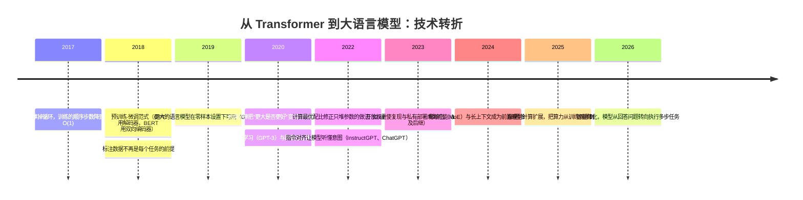

## 1.5 里程碑时刻：从学术论文到产业变革

2018 年之后架构基本定型，从 6500 万参数的翻译模型到今天这套系统，进步来自三处。一是自监督预训练：文本自带监督信号，最贵的一步只做一次，下游复用。二是规模定律：损失对参数、数据、算力呈幂律，训练算力约为 $$6ND$$，“再大一点会怎样”可以先算后练。三是用法与系统：指令对齐、开放权重、稀疏化、长上下文、推理时计算、智能体化，每一步解决上一步的问题并留下新代价。Transformer 胜出，靠的是规模上去之后表现更好，以及它的计算形态正好是 GPU 最擅长的稠密矩阵乘。具体型号与日期是易变事实，本节只保留少数作为量级锚点的公开配置，其余见[第十三章](../13_decoder_models/README.md)与[附录 A.5](../appendix/a5_volatile_facts.md)。

图 1-9：从 Transformer 到大语言模型的技术转折。每一栏写的是该阶段解决了什么问题，对应的代表模型、发布日期与规格见第十三章与附录 A.5。

### 1.5.1 预训练革命：把最贵的一步只做一次

文本本身带着免费的监督信号，用它把整个网络预训练一次，下游任务只需少量标注做微调。在此之前，通行的做法是只预训练词向量这一层（见 [1.1.4 节](1.1_seq_challenge.md)），其余各层按任务从头训练：高质量标注稀缺且不能跨任务复用，单个任务的数据量也不足以让模型学到语法、语义与常识。

**GPT（[2018 年 6 月](https://openai.com/index/language-unsupervised/)）** 用多层 Transformer 解码器做语言模型预训练，再在下游任务上微调。预训练目标就是 [1.1.1 节](1.1_seq_challenge.md)的链式分解：给定前文预测下一个词。这个任务迫使模型习得语法、语义乃至世界知识，而训练数据（普通文本）近乎无限。

**BERT（2018 年 10 月）** 走了相反方向：用 Transformer 编码器，通过**掩码语言模型**（Masked Language Model，MLM）做双向预训练。随机遮住一部分词元，让模型根据左右上下文还原。双向性让每个位置都能同时利用两侧信息，该文在 11 项基准上刷新了最佳结果。

[GPT-1](https://cdn.openai.com/research-covers/language-unsupervised/language_understanding_paper.pdf) 与 [BERT](https://arxiv.org/abs/1810.04805)-base 的层数、宽度、头数完全相同（表 1-6），差别只在训练目标与注意力掩码。两种目标的信号密度不同：自回归目标下，一条长 512 的序列每个位置都产生一次损失；MLM 只在被选中的 15% 位置上计损，512 个位置里约 77 个，相差约 6.7 倍，BERT 论文也提到 MLM 因此可能需要更多步数才能收敛。完整对比见 [5.1 节](../05_pretraining/5.1_autoregressive.md)与 [5.2 节](../05_pretraining/5.2_masked_lm.md)。

2019 年的后续工作落在四处：可用上下文（Transformer-XL，见 [4.4.2 节](../04_position_encoding/4.4_alibi_others.md)），训练配方（RoBERTa，见 [12.2.1 节](../12_encoder_models/12.2_roberta_albert.md)），参数效率（ALBERT，见 [12.2.2 节](../12_encoder_models/12.2_roberta_albert.md)），预训练目标（XLNet，见 [12.1 节](../12_encoder_models/12.1_bert.md)；T5 与 BART，见 [13.4 节](../13_decoder_models/13.4_t5_bart.md)）。

### 1.5.2 规模定律：把“更大是否更好”变成可外推的公式

**规模定律**（Scaling Laws）是指损失与参数量、数据量、算力之间可预测的幂律关系。有了它，“再大一点会怎样”从经验直觉变成了可以先算后练的工程问题。

[Kaplan 等 2020](https://arxiv.org/abs/2001.08361) 给出的形式是，当性能只受参数量限制时

$$
L(N) = \left(\frac{N_c}{N}\right)^{\alpha_N},\quad \alpha_N \approx 0.076,\ N_c \approx 8.8 \times 10^{13}
$$

其中 $$N$$ 是非嵌入参数量，$$L$$ 是测试集上的每词元交叉熵，单位 nat，即 [1.1.1 节](1.1_seq_challenge.md)的 $$L$$。指数很小，收益缓慢但稳定：参数翻倍，损失乘 $$2^{-0.076} = 0.95$$。该文对数据量给出同型的式子（$$\alpha_D \approx 0.095$$），并指出这些关系跨越 $$N$$ 的六个数量级、算力的八个数量级，对深度、宽度、头数这些形状参数不敏感。

稳健的是幂律这个函数形式，指数和常数都不普适。它们依赖数据、分词方式、拟合区间、参数是否计入嵌入，以及拟合式是否带不可约损失项：Chinchilla 的拟合带常数项，参数与数据两个指数是 0.34 与 0.28，比 Kaplan 的 0.076 与 0.095 大数倍（见 [5.4 节](../05_pretraining/5.4_data_scaling.md)）。外推时要用同一套数据与分词下拟合出的系数。

同一篇论文给出了算力的估算式，它是后文一切成本估算的基础：

$$
C \approx 6ND
$$

$$N$$ 是非嵌入参数量，$$D$$ 是训练词元数。系数 6 的来历是：前向时每个参数对每个词元做一次乘法加一次加法，记 2 次（[1.4.5 节](1.4_transformer_idea.md)的计数约定）；反向要分别求对输入和对权重的梯度，各相当于一次同规模的矩阵乘，约 4 次。

**一格算术：GPT-3 训练用了多少算力。** [GPT-3 论文](https://arxiv.org/abs/2005.14165)给出 175B 模型的参数量 174,600M、训练词元 300B。代入：

$$
6 \times 1.746 \times 10^{11} \times 3 \times 10^{11} = 3.14 \times 10^{23}\ \text{FLOPs}
$$

与该文报告的数值一致。[1.4.6 节](1.4_transformer_idea.md)里 Transformer big 的训练成本是 $$2.3 \times 10^{19}$$，三年之间差了四个数量级。参数量也能自己估：非嵌入参数约为 $$12 L d^2$$（每层 $$4d^2$$ 的注意力投影加 $$8d^2$$ 的前馈），代入 GPT-3 175B 的 $$L = 96$$、$$d = 12288$$ 得 $$1.74 \times 10^{11}$$，与 1746 亿吻合。

| 模型 | 层数 | $$d_{\text{model}}$$ | 头数 | 参数量 | 上下文长度 | 训练词元 |
| --- | ---: | ---: | ---: | ---: | ---: | ---: |
| GPT-1 | 12 | 768 | 12 | 117M | 512 | — |
| GPT-2 XL | 48 | 1,600 | — | 1,542M | 1,024 | — |
| GPT-3 Small | 12 | 768 | 12 | 125M | 2,048 | 300B |
| GPT-3 175B | 96 | 12,288 | 96 | 174,600M | 2,048 | 300B |
| BERT-base | 12 | 768 | 12 | 110M | 512 | — |
| BERT-large | 24 | 1,024 | 16 | 340M | 512 | — |

表 1-6：两年之间的规模变化。从 GPT-1 到 GPT-3 175B，层数是 8 倍，宽度是 16 倍，参数量约 1,500 倍。横向比较时注意词表不同：GPT-2 与 GPT-3 是 50,257，BERT 是 30,000。

**Chinchilla 的修正。** Kaplan 的结论被普遍读成“算力优先给参数”，GPT-3 的 175B 配 300B 词元正是这种配比。[Hoffmann 等 2022](https://arxiv.org/abs/2203.15556) 训练了 400 多个模型重新拟合，结论是计算最优时参数量与词元数应当**等比例**放大：模型大一倍，数据也要大一倍。他们按同样的算力预算训练了 700 亿参数、1.4 万亿词元的 Chinchilla，在大量下游任务上超过 2800 亿参数的 Gopher。这个配比约为每个参数 20 个词元，按它衡量，GPT-3 这一代模型是训练不足的。20 这个值并非常数，拟合的争议与把推理成本算进来之后的再修正见 [5.4 节](../05_pretraining/5.4_data_scaling.md)。

**Transformer 跨出 NLP，以及它的数据前提。** [ViT](https://arxiv.org/abs/2010.11929) 把图像切成补丁序列，直接送进 Transformer 编码器。它的结论常被简化成“打败了 CNN”，论文的表述要严格得多：在 ImageNet 这类中等规模数据上不加强正则地训练，ViT 的准确率比同等规模的 ResNet 低几个百分点，原因是它缺少 CNN 自带的平移等变性与局部性等归纳偏置。只有先在 ImageNet-21k 或 JFT-300M（3.03 亿张图）上预训练，它才追平或超过当时最好的卷积网络。这印证了 [1.4.5 节](1.4_transformer_idea.md)列出的边界：弱先验要用大数据来补。

### 1.5.3 六次技术转折：每一步解决了上一步的什么问题

2022 年之后，架构本身的变化远小于用法与系统的变化。六次转折有一个共同的前提：GPT-3 表明，足够大的语言模型不经梯度更新，只凭提示里的任务描述和几个示例就能完成新任务，即上下文学习（in-context learning，见 [13.1.3 节](../13_decoder_models/13.1_gpt_series.md)）。适配任务的手段由此从“预训练加微调”转向“预训练加提示”：同一份权重服务所有任务，任务信息放在输入里。下面按“解决了什么、代价是什么”逐条看。

**一、指令对齐：把“会续写”变成“会照做”。** 预训练模型的目标函数是续写文本，不是满足意图；提示里稍有歧义，它就可能续写出一段格式正确但答非所问的内容。[InstructGPT](https://arxiv.org/abs/2203.02155) 的做法是先用人工示范做监督微调，再用人类对输出排序训练奖励模型、以强化学习优化。人类评测中，13 亿参数的 InstructGPT 的输出比 1750 亿参数的 GPT-3 更受偏好，参数少 100 倍。代价是引入了一条依赖人工标注的新流水线，以及奖励模型被过度优化的风险（见 [8.2 节](../08_alignment/8.2_rlhf.md)）。ChatGPT（2022 年 11 月）是这条路线的产品化，它把对话历史当作输入的一部分，上下文长度从此成为硬指标。

**二、开放权重：把复现权从少数机构手里拿出来。** 前沿模型只提供 API 时，学术界无法研究其内部，企业也无法私有部署。[LLaMA](https://arxiv.org/abs/2302.13971)（2023 年 2 月）给出了两个结论：只用公开数据集也能训出有竞争力的模型；130 亿参数的 LLaMA-13B 在多数基准上超过 1750 亿的 GPT-3。微调、量化、本地部署的整套工具链都建立在开放权重之上（见 [13.2 节](../13_decoder_models/13.2_llama.md)）。代价是安全与滥用的控制手段从“服务端拒绝”退化为“训练时对齐”，后者可被下游微调抹掉（见 [8.5 节](../08_alignment/8.5_practice.md)）。

**三、稀疏化：让参数量与每词元计算量脱钩。** 稠密模型每处理一个词元都要用上全部参数，$$C \approx 6ND$$ 里的 $$N$$ 既是容量也是成本。**混合专家**（Mixture of Experts，MoE）把前馈子层换成一组专家，路由器为每个词元只激活其中少数几个，总参数（容量）可以远大于激活参数（成本）。它稀疏化的是前馈而不是注意力，原因见 [1.4.4 节](1.4_transformer_idea.md)：前馈逐位置独立，又占每层参数的三分之二。代价是显存要装下全部专家、路由要做负载均衡、通信模式从规整变得不规整（见 [14.2 节](../14_future_trends/14.2_moe.md)与 [11.8 节](../11_serving/11.8_multi_gpu_inference.md)）。

**四、长上下文：把外部信息搬进输入。** 上下文从 GPT-3 的 2,048 扩到百万级，整个代码库、整份合同可以直接放进提示。三处必须同时动：位置编码要能外推（见[第四章](../04_position_encoding/README.md)），注意力的 $$O(n^2)$$ 要设法回避（见 [14.1 节](../14_future_trends/14.1_efficient_attention.md)），KV 缓存随长度线性增长的显存要管起来（见 [11.4 节](../11_serving/11.4_kv_memory_management.md)）。代价不止成本：窗口写着百万，不等于模型能可靠用到窗口中部的信息（见 [14.7 节](../14_future_trends/14.7_long_context.md)）。

**五、推理时计算扩展：把算力从训练侧挪到生成侧。** 规模定律描述的是训练算力与损失的关系，前提是每个问题只做一次前向。让模型先生成一段推理过程、或生成多条候选再择优，等于在**生成时**追加算力。这条路线用强化学习训练出稳定的长推理行为，在数学与编程类任务上收益明显。代价直接体现在账单与延迟上：输出词元数可能增加一个数量级，而 Decode 正是受显存带宽限制的那一段（见 [1.4.3 节](1.4_transformer_idea.md)、[9.5 节](../09_decoding/9.5_test_time_scaling.md)与 [14.6 节](../14_future_trends/14.6_test_time_scaling.md)）。

**六、智能体化：从生成文本到执行动作。** 模型调用工具、读取返回结果、再决定下一步，把单轮生成变成多步循环。这让它能接触训练数据之外的实时信息，也能改变外部状态。代价是错误会沿步数累乘：单步成功率 0.95 时，十步全对的概率是 $$0.95^{10} = 0.60$$；同时新增了提示注入等安全面（见 [14.5 节](../14_future_trends/14.5_agent_tool_use.md)）。服务侧的请求变成长度差异极大的多轮，调度与前缀复用的重要性随之上升（见 [11.3 节](../11_serving/11.3_scheduler_loop.md)与 [11.5 节](../11_serving/11.5_prefix_reuse.md)）。

### 1.5.4 为什么是 Transformer

同期并非没有并行方案，ByteNet 与 ConvS2S 也把顺序步数降到了 $$O(1)$$。Transformer 胜出的原因有三条，前两条有直接证据。

**第一，它在规模上的表现更好。** Kaplan 等 2020 在同样的数据与上下文长度下训练了 LSTM 与 Transformer：LSTM 在上下文靠前的词元上与 Transformer 打平，在靠后的词元上追不上。差距出现在需要长距离信息的位置上。LSTM 的固定大小状态要在不知道以后会被问什么的情况下保存全部历史（见 [1.3.1 节](1.3_attention_birth.md)），到达远处信息的路径又是 $$O(n)$$；Transformer 把历史全部留着，一跳可达。

**第二，它的计算形态与硬件匹配。** 拿掉循环之后，一层里的主要开销是几个大矩阵乘（[1.4.5 节](1.4_transformer_idea.md)的 $$24nd^2$$），算术强度高，能把 GPU 的运算单元喂饱；RNN 的 $$O(n)$$ 个小批量矩阵乘做不到这一点（见 [1.2.5 节](1.2_rnn_cnn_limits.md)与 [10.1 节](../10_inference_optimization/10.1_bottleneck.md)）。这一优势并非架构固有，它来自与当时最快的硬件原语吻合。若主流硬件的强项不是稠密矩阵乘，这笔账会得出不同的结论。

**第三，结构简洁，变体成本低。** 深度、宽度、头数是三个可独立调节的旋钮，编码器、解码器可以拆开或组合使用。这一条是工程便利，没有前两条那样的实证。

它的代价是注意力的平方项、随长度增长的 KV 缓存和对数据量的依赖，后续各章逐项处理。
