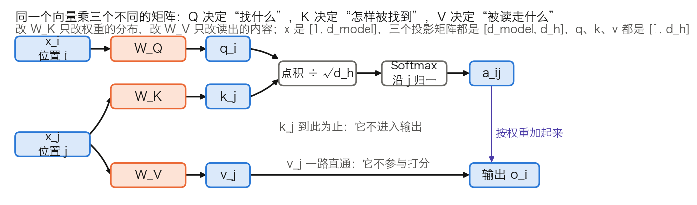

## 2.1 查询-键-值：一种信息检索的直觉

注意力是一次可导的软查表：查询与每个键打分，按分数混合各个值；因为可导，“什么算匹配”是学出来的。输入要先经三套投影分出查询、键、值，理由有两条：不投影时分数矩阵必然对称，而且各位置范数相同时每个位置给自己的分最高。真正被学到的是两个乘积：$W^Q (W^K)^\top$ 决定从哪里读，秩不超过 $d_k$；$W^V W^O$ 决定读到什么、写到哪里，所以单个 Q 或 K 的维度没有含义。今天的标准做法是三套独立投影。标准多头注意力一层 $4d^2$ 个参数，前馈取 $4d$ 时约占一层的三分之一；当代模型用 GQA 与 SwiGLU，注意力只占约五分之一（Llama 3 8B 为 19%）。K 与 V 只在为压缩 KV 缓存时才耦合（MLA）。

本节只讲一个头内部的三路投影，多个头怎样切分与拼接见 [2.3 节](2.3_multi_head.md)，完整的两头数值手算见 [3.8.3 节](../03_components/3.8_gpt_inference_flow.md)。

### 2.1.1 三种角色，三套投影

**查询**（Query）、**键**（Key）、**值**（Value）这套术语来自信息检索：用搜索词比对每个网页的关键词，命中后取回网页的内容。注意力做的是软匹配，按匹配程度对所有项加权混合；权重连续可导，匹配标准随训练一起被学出来。[1.3.4 节](../01_introduction/1.3_attention_birth.md)的 $h_j$ 同时充当打分依据与被取走的内容，自注意力把三种角色交给三个矩阵：

$$Q = XW^Q, \quad K = XW^K, \quad V = XW^V$$

其中 $X \in \mathbb{R}^{n \times d_{\text{model}}}$ 是输入矩阵（$n$ 个位置，每个位置 $d_{\text{model}}$ 维），$W^Q, W^K \in \mathbb{R}^{d_{\text{model}} \times d_k}$，$W^V \in \mathbb{R}^{d_{\text{model}} \times d_v}$。形状写作 `X[n, d_model] × W_Q[d_model, d_k] → Q[n, d_k]`，与 [3.8.3 节](../03_components/3.8_gpt_inference_flow.md)一致。

从本章起，全书统一用行向量写法：每个位置的向量是矩阵的一行，乘在权重左边（$xW$），权重的形状是 [输入宽, 输出宽]。第一章的 RNN 与早期注意力公式沿用各篇原论文的列向量写法（$Wx$），同一个权重在两种写法下互为转置。

图 2-1 把三条路径分开画。它们并不对称：键只参与打分，从不进入输出；值只进入输出，从不参与打分。

图 2-1：三路投影各自流向哪里（[生成脚本](https://github.com/yeasy/llm_internals/blob/main/tools/figures/ch02_qkv_roles.py)）。蓝色是随输入变化的数据，橙色是训练好就固定的权重，与 [3.8 节](../03_components/3.8_gpt_inference_flow.md)各图的配色一致。

由此可得：改动 $W^K$ 只改变权重的分布，改动 $W^V$ 只改变被读出的内容，两者互不干扰。

### 2.1.2 不投影会怎样：一个 3×3 的反例

不投影时直接用输入向量打分，即 $s_{ij} = x_i x_j^\top$。取三个二维的单位向量作为三个位置的表示：

$$X = \begin{bmatrix} 1 & 0 \\ 0.8 & 0.6 \\ 0 & 1 \end{bmatrix}$$

一格的算术是逐分量相乘再相加，例如位置 1 对位置 2 的分数 $s_{12} = 1 \times 0.8 + 0 \times 0.6 = 0.8$。对九个位置对重复，得到

$$XX^\top = \begin{bmatrix} 1 & 0.8 & 0 \\ 0.8 & 1 & 0.6 \\ 0 & 0.6 & 1 \end{bmatrix}$$

这张表有两处病症，都与具体取值无关。

第一，矩阵必然对称：$x_i x_j^\top = x_j x_i^\top$。“位置 1 关注位置 2 的强度”被迫等于“位置 2 关注位置 1 的强度”。语言里的依赖关系很少对称，代词指向先行词，先行词并不同等地指向代词。

第二，各位置范数相同时，对角线必然是每行最大：由柯西-施瓦茨不等式 $x_i x_j^\top \leq \|x_i\|\|x_j\| = \|x_i\|^2 = x_i x_i^\top$，“看自己”总是排第一。除以 $\sqrt{d_k} = \sqrt{2}$ 再取 Softmax（缩放的原因见 [2.2.3 节](2.2_scaled_dot_product.md)；除以同一个正数不改变每行谁最大），三行权重分别是 `[0.424, 0.368, 0.209]`、`[0.331, 0.381, 0.287]`、`[0.219, 0.335, 0.445]`，每一行的最大值都落在对角线上。

加上投影，两处病症同时消失。取

$$W^Q = \begin{bmatrix} 0 & 1 \\ 0 & 0 \end{bmatrix}, \quad W^K = \begin{bmatrix} 1 & 0 \\ 0 & 1 \end{bmatrix}$$

这个 $W^Q$ 把输入的第 1 个分量搬到查询的第 2 个分量：$[a, b]\,W^Q = [0, a]$。$W^K$ 是单位阵，键就是输入本身。分数因此变成 $s_{ij} = x_{i1} x_{j2}$，即位置 $i$ 用自己的第 1 个分量去比对位置 $j$ 的第 2 个分量，发问与被匹配用的不再是同一组数。位置 1 的查询是 $x_1 W^Q = [0, 1]$，位置 2 的键是 $x_2 W^K = [0.8, 0.6]$，分数 $s_{12} = 0 \times 0.8 + 1 \times 0.6 = 0.6$；反过来，位置 2 的查询是 $[0, 0.8]$，位置 1 的键是 $[1, 0]$，分数 $s_{21} = 0$。同一对位置，两个方向的分数不再相等：

$$XW^Q (XW^K)^\top = \begin{bmatrix} 0 & 0.6 & 1 \\ 0 & 0.48 & 0.8 \\ 0 & 0 & 0 \end{bmatrix}$$

除以 $\sqrt{2}$ 再 Softmax，第一行是 `[0.219, 0.335, 0.445]`：位置 1 把最大的权重给了位置 3，而不是自己。投影换来的就是这两样：方向不对称，以及不必先看自己。

### 2.1.3 查询与键的投影只以乘积出现

把两个投影代回分数式，可以看出它们从不单独起作用：

$$s_{ij} = (x_i W^Q)(x_j W^K)^\top = x_i \underbrace{W^Q (W^K)^\top}_{d_{\text{model}} \times d_{\text{model}}} x_j^\top$$

分数是关于 $x_i$ 与 $x_j$ 的**双线性型**（bilinear form），中间那个矩阵才是被学到的对象。它有两个性质。

其一，秩不超过 $d_k$。乘积 $W^Q (W^K)^\top$ 由 `[d_model, d_k] × [d_k, d_model]` 得到，中间那一维是瓶颈。以 GPT-3 6.7B 的配置（`d_model = 4096`、`d_k = 128`，见 [3.8.7 节](../03_components/3.8_gpt_inference_flow.md)的表 3-25）为例，它是一个 `4096 × 4096` 的矩阵，秩至多 128。单头能表达的打分方式因此受限，[2.3.5 节](2.3_multi_head.md)用这一点解释头宽度的取值。

其二，单个 Q/K 维度没有固定含义。对任意可逆矩阵 $R$，把 $W^Q$ 换成 $W^Q R$、把 $W^K$ 换成 $W^K (R^{-1})^\top$，乘积不变，分数也不变：$W^Q R\,\big(W^K (R^{-1})^\top\big)^\top = W^Q R R^{-1} (W^K)^\top = W^Q (W^K)^\top$。“第 3 个 Query 维度代表什么”这类问题没有答案，能被解释的是乘积。

同样的道理适用于 $W^V$ 与输出投影 $W^O$：值向量算出后立刻被 $W^O$ 读走，两者也只以乘积 $W^V W^O$ 出现。

> [!NOTE]
> **进阶：QK 回路与 OV 回路。** [Transformer 电路框架](https://transformer-circuits.pub/2021/framework/index.html)把这两个乘积分别称作 QK 回路与 OV 回路，Q、K、V 向量只是计算这两个低秩矩阵时的中间结果。该文用列向量约定，写作 $W_Q^\top W_K$ 与 $W_O W_V$，与本书的写法互为转置。

### 2.1.4 键与值为什么分开

键与值可以共用一套投影，只是要付出代价。四种绑定方案并排看（每层每头的参数以 `d_model × d_k` 为单位计）：

| 绑定方案 | 每个头的投影参数 | 换来了什么 | 失去了什么 | 谁在用 |
| --- | ---: | --- | --- | --- |
| Q、K、V 全独立 | 3 份 | 三种角色各自优化 | 参数最多 | 标准 Transformer |
| K = V（共用一套） | 2 份 | 省一份投影 | “怎样被找到”与“提供什么内容”被迫同向 | 少见 |
| Q = K（共享 QK） | 2 份 | 省一份投影，键可复用为查询 | 分数近乎对称（归一化后不严格对称），且需专门禁止位置读取自身 | [Reformer](https://arxiv.org/abs/2001.04451) |
| K、V 由同一隐向量上投影 | 低秩的 2 份 | 缓存只存一份压缩隐向量 | 多一次上投影，结构更复杂 | MLA，见 [10.2.7 节](../10_inference_optimization/10.2_kv_cache.md) |

表 2-1：键与值的四种绑定方案。Reformer 用局部敏感哈希把相近的向量分进同一个桶、只在桶内打分，为此令查询与键共用一个空间；共享后每个位置与自身的分数总是最高，必须把“读取自身”单独屏蔽。MLA 不让 K 与 V 相等，而让两者从同一个压缩隐向量各自上投影，目的是压缩 KV 缓存而非省参数。

$W^K$ 与 $W^V$ 分开是标准做法，因为耦合会把“如何被找到”与“提供什么内容”压进同一组参数；为推理显存可以让步，MLA 就是例子。交叉注意力里两者的分工更明显：键帮助解码器定位源序列中的相关位置，值提供这些位置的内容（见 [2.4.4 节](2.4_self_cross_causal.md)）。

### 2.1.5 形状、参数量与实现里的名字

形状上只有一条硬约束：查询与键必须同维，因为两者要做点积；值的维度 $d_v$ 在数学上可以不同。实践中取 $d_k = d_v$，便于拼接后由 $W^O$ 投回 $d_{\text{model}}$。

**记号。** $n_h$ 是 Query 头数，$d_h$ 是每头宽度，$n_{kv}$ 是 K/V 头数。标准多头注意力中 $n_{kv} = n_h$；GQA（分组查询注意力，多个 Query 头共用一套 K/V）下 $n_{kv}$ 更小（见 [2.3.7 节](2.3_multi_head.md)）。本章推导沿用原论文的 $n$ 与 $d_k$、$d_v$，即全书形状清单里的 `T` 与 $d_h$，对照见 [3.8.7 节](../03_components/3.8_gpt_inference_flow.md)的表 3-28。

**参数账。** 一层注意力有四个矩阵：$W^Q$、$W^K$、$W^V$ 各把 $d_{\text{model}}$ 投到 $n_h \times d_h = d_{\text{model}}$，$W^O$ 再投回来。不计偏置，一层共 $4d_{\text{model}}^2$ 个参数，与头数无关。前馈网络取 $d_{\text{ff}} = 4d_{\text{model}}$ 时有 $8d_{\text{model}}^2$，注意力占一层的三分之一：GPT-3 6.7B 一层注意力 67,108,864 个参数，前馈 134,217,728 个。每个参数对每个词元做一次乘加，按 [1.4.5 节](../01_introduction/1.4_transformer_idea.md)的约定记 2 次运算，这 $4d_{\text{model}}^2$ 个参数对应每词元 $8d_{\text{model}}^2$ 次，是该节 $24nd^2$ 里注意力投影的那一份。

每头宽度可以单独设定，不必等于 $d_{\text{model}} / n_h$。Qwen3-4B 的公开配置是宽度 2560、32 个头、每头 128 维，`32 × 128 = 4096` 不等于 2560，由 $W^O$ 把 4096 投回 2560。

读源码时最容易看错的一处：PyTorch 的 `nn.Linear` 按“输出 × 输入”存放权重，与正文 $XW$ 的 `[输入, 输出]` 互为转置。各框架的模块名与权重布局见[附录 A.7](../appendix/a7_framework_recipes.md)。

下一节补完打分这一步：点积算出来之后，为什么要除以 $\sqrt{d_k}$。
