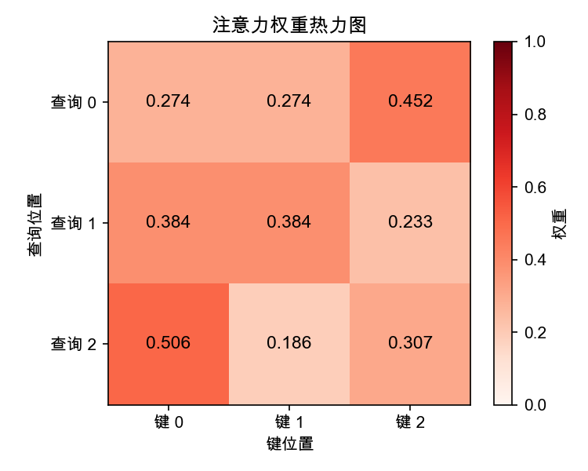

## 2.2 缩放点积注意力：为什么要除以根号 d

除以 $\sqrt{d_k}$，是为了让分数的尺度不随头的宽度变化：点积是 $d_k$ 个独立项之和，标准差按 $\sqrt{d_k}$ 增长，不缩放时 Softmax 落进饱和区，梯度 $a(1-a)$ 趋于零。这只是一次静态的尺度校准，管到训练起点为止；训练中分数还会漂移，要靠 QK-Norm 一类的手段全程约束。Softmax 有两条性质要记住：两个位置的权重比只取决于分数差，等于 $e^{\Delta}$；行和为 1，同样的分数优势在长序列里被稀释，要保住同样的权重，分数差得随 $\ln n$ 增长。生产代码调用融合内核，Softmax 在 FP32 下计算，预训练多不用注意力 dropout。

### 2.2.1 完整公式与计算流程

缩放点积注意力（Scaled Dot-Product Attention）的计算公式为：

$$\text{Attention}(Q, K, V) = \text{softmax}\left(\frac{QK^T}{\sqrt{d_k}}\right)V$$

整个计算分为四步，形状按 [3.8.3 节](../03_components/3.8_gpt_inference_flow.md)的写法给出：

1. **打分**：$S = QK^T$，即 `Q[n, d_k] × Kᵀ[d_k, n] → S[n, n]`。$S_{ij}$ 是第 $i$ 个查询与第 $j$ 个键的点积。
2. **缩放**：$S' = S / \sqrt{d_k}$，逐格除以同一个数，使分数的尺度与 $d_k$ 无关（见 2.2.3）。
3. **归一化**：$A = \text{softmax}(S')$，逐行归一，`S'[n, n] → A[n, n]`，每行之和为 1。
4. **读取**：$\text{Output} = AV$，即 `A[n, n] × V[n, d_v] → Output[n, d_v]`。

第 1、4 步是两次矩阵乘法，两个操作数都是数据而非权重，代价随序列长度平方增长（见 [2.5 节](2.5_complexity_limits.md)）；第 2 步是逐格除法，第 3 步是逐行归一。

### 2.2.2 点积为什么能衡量相关性

点积 $q \cdot k = \|q\| \|k\| \cos\theta$ 同时取决于两个模长与夹角，不等于方向相似度（见 [1.3.3 节](../01_introduction/1.3_attention_birth.md)）；经过投影，该被读取的键会被学得与查询方向接近。原论文选点积而不选加性打分，理由是工程性的：两者理论复杂度相近，点积能写成一次矩阵乘法，更快也更省空间。它同时报告了点积的短板：$d_k$ 较大时，不加缩放的点积注意力不如加性注意力。缩放因子补的就是这个短板。

### 2.2.3 为什么必须缩放：Softmax 的饱和

**点积的方差随 $d_k$ 线性增长。** 设 $q$ 与 $k$ 的各分量相互独立、均值为 0、方差为 1（原论文脚注用的就是这组假设，不要求正态分布）。每一项 $q_i k_i$ 的方差是 $E[q_i^2]\,E[k_i^2] = 1$，$d_k$ 个独立项之和的方差是 $d_k$，标准差是 $\sqrt{d_k}$。$d_k = 128$ 是当代大模型最常见的每头宽度，未缩放分数的标准差约 11.3。

**幅度变大为什么有害。** Softmax 的雅可比矩阵是

$$\frac{\partial a_i}{\partial z_j} = a_i(\delta_{ij} - a_j)$$

其中 $\delta_{ij}$ 在 $i = j$ 时为 1、否则为 0。对角元 $a_i(1 - a_i)$ 在 $a_i \to 1$ 或 $a_i \to 0$ 时都趋于 0，非对角元 $-a_i a_j$ 同理。分布越接近 one-hot，整个雅可比越接近零矩阵，回传到 $Q$、$K$ 的梯度也随之消失。

代入数字。取同一组方向，使缩放后的三个分数为 `[1, 0, −1]`；若 $d_k = 64$ 且不缩放，同样的方向会给出 8 倍大的分数 `[8, 0, −8]`。

| 分数 | Softmax 权重 | 最大项的 $a_1(1 - a_1)$ |
| --- | --- | ---: |
| `[1, 0, −1]`（已缩放） | `[0.665, 0.245, 0.090]` | 0.223 |
| `[8, 0, −8]`（$d_k = 64$，未缩放） | `[0.99966, 0.00034, ≈0]` | 0.000335 |

表 2-2：同一组方向在缩放前后的 Softmax 与梯度尺度。后者的雅可比对角元只有前者的约 1/664，回传的梯度小了两个多数量级。

**缩放保证的是“与 $d_k$ 无关”，不是“等于 1”。** 方差恰好为 1 只在单位方差的假设下成立。实际的小方差初始化不满足它：按 GPT-2 的初始化标准差 0.02、$d_{\text{model}} = 768$、输入各分量单位方差估算，$q$ 的每个分量方差约 0.31，缩放后分数的标准差约 0.3，初始的注意力接近均匀，离饱和很远。缩放真正提供的是：分数尺度不随每头宽度变化，同一套初始化和学习率才能跨宽度使用。

> [!NOTE]
> **减最大值与除以 $\sqrt{d_k}$ 解决的是两个问题。** Softmax 对输入整体平移不变（$\text{softmax}(z) = \text{softmax}(z - c)$），实现时先按行减去最大值再取指数，防的是 $e^{z_i}$ **数值上溢**：FP16 能表示的最大值是 65,504，$\ln 65{,}504 = 11.09$，不减最大值时任何一个分数超过 11 左右就溢出。除以 $\sqrt{d_k}$ 防的是**梯度消失**。前者是恒等变形，不改变结果；后者改变结果，是模型定义的一部分。

**这个修正只管到初始化。** 训练开始后，$Q$ 与 $K$ 由同一份输入经两个正在学习的矩阵得到，分量既不独立也不再保持初始的方差；注意力 logits 会随训练持续增长，大模型上尤其明显。$1/\sqrt{d_k}$ 管住的是训练第一步的尺度，管不住其后的漂移。全程约束分数尺度的手段有三种：QK-Norm 在打分前对 $q$、$k$ 做归一化，再乘一个可学习的温度；logit soft-cap 用 $\tanh$ 把分数压进固定区间；QK-clip 在优化器更新之后回缩 $W^Q$、$W^K$（见 [6.3.6 节](../06_training_techniques/6.3_regularization.md)）。z-loss 约束的是输出层 Softmax 的配分函数，与这里不是一回事。

$1/\sqrt{d_k}$ 也可以读成一个固定的温度：它与 [9.3.1 节](../09_decoding/9.3_sampling.md)的采样温度是同一个旋钮，只是一个作用在注意力的 Softmax 上、在训练前定死，另一个作用在输出词表的 Softmax 上、在生成时调节。

> [!NOTE]
> **进阶：其他缩放方案。** 把缩放藏进初始化（按 $1/\sqrt{d_k}$ 缩小 $W^Q$、$W^K$ 的初始方差）在初始时刻等价，但学习率与初始化从此耦合，调参更难。μP（最大更新参数化）用 $1/d_k$ 而非 $1/\sqrt{d_k}$，目的是让超参数在宽度变化时可迁移，代价是整套初始化和学习率都要一起改。

### 2.2.4 Softmax：指数放大与长度稀释

Softmax 做两件事。一是归一化，把任意实数分数变成非负且和为 1 的权重。二是按指数放大差距：两个位置的分数差 $\Delta$ 对应的权重比恰好是 $e^{\Delta}$，与其他位置无关。分数差 1 对应 2.72 倍，差 5 对应 148 倍。放大不等于通吃：五个分数 `[2.0, 1.0, 0.1, −0.5, −1.0]` 的最高分只拿到 60.6% 的权重，最低的一项仍有 3%。

**候选一多，同样的优势会被稀释。** 设某个位置的分数比其余所有位置都高出 5，其余位置彼此相同，它的权重是 $e^5 / (e^5 + n - 1)$：$n = 512$ 时为 0.225，$n = 8{,}192$ 时为 0.018，$n = 131{,}072$ 时为 0.001。分数差固定时，权重随 $n$ 近似反比下降。反过来，要保住同样的权重，分数差要随 $\ln n$ 增长：从 512 到 131,072，长度乘 256，分数差要多出 $\ln 256 = 5.5$。分数差是训练出来的，能否在长序列上学出这么大的差距，是长上下文训练要解决的问题之一（见 [2.5.5 节](2.5_complexity_limits.md)）。

### 2.2.5 完整的计算示例

假设序列长度 $n=3$，维度 $d_k = 4$：

$$Q = \begin{bmatrix} 1 & 0 & 1 & 0 \\ 0 & 1 & 0 & 1 \\ 1 & 1 & 0 & 0 \end{bmatrix}, \quad K = \begin{bmatrix} 1 & 1 & 0 & 0 \\ 0 & 0 & 1 & 1 \\ 1 & 0 & 1 & 0 \end{bmatrix}, \quad V = \begin{bmatrix} 1 & 0 & 0 & 1 \\ 0 & 1 & 1 & 0 \\ 1 & 1 & 0 & 0 \end{bmatrix}$$

1. **计算点积** $S = QK^T$。第 1 行第 3 列由 $Q$ 的第 1 行与 $K$ 的第 3 行逐项相乘再相加：$1\times1 + 0\times0 + 1\times1 + 0\times0 = 2$。
   $$S = \begin{bmatrix} 1 & 1 & 2 \\ 1 & 1 & 0 \\ 2 & 0 & 1 \end{bmatrix}$$
2. **缩放**（除以 $\sqrt{d_k} = \sqrt{4} = 2$）：
   $$S' = \begin{bmatrix} 0.5 & 0.5 & 1.0 \\ 0.5 & 0.5 & 0 \\ 1.0 & 0 & 0.5 \end{bmatrix}$$
3. **Softmax 归一化**（按行操作）。第 1 行取指数得 `[1.649, 1.649, 2.718]`，行和 6.016，各项除以行和即得该行权重：
   $$A = \text{softmax}(S') \approx \begin{bmatrix} 0.274 & 0.274 & 0.452 \\ 0.384 & 0.384 & 0.233 \\ 0.506 & 0.186 & 0.307 \end{bmatrix}$$
4. **加权求和**计算输出 $\text{Output} = AV$：
   $$\text{Output} \approx \begin{bmatrix} 0.726 & 0.726 & 0.274 & 0.274 \\ 0.616 & 0.616 & 0.384 & 0.384 \\ 0.814 & 0.494 & 0.186 & 0.506 \end{bmatrix}$$

每个输出位置的向量是所有位置值向量的加权组合，维度是 $d_v$；多头拼接后再由输出投影回到 $d_{\text{model}}$。可运行的实现见[附录 A.2](../appendix/a2_pytorch_examples.md)。

图 2-2：上例权重矩阵 $A$ 的热力图（[生成脚本](https://github.com/yeasy/llm_internals/blob/main/tools/figures/attention_heatmap.py)）。颜色越深权重越高；每一行之和为 1。图中行列下标从 0 起，正文从 1 起，「查询 0」即上式中的第 1 行。

### 2.2.6 对到真实实现

生产代码很少手写这四步，而是调用融合内核，例如 PyTorch 的 `scaled_dot_product_attention`。它在多个后端之间选择，融合实现不把 `[n, n]` 分数矩阵写回显存（见 [10.3 节](../10_inference_optimization/10.3_flash_attention.md)），掩码、缩放、dropout 与 GQA 都作为参数传入。接口各参数与正文四步的对应见[附录 A.7](../appendix/a7_framework_recipes.md)。实现中有三处数值细节。

**Softmax 在 FP32 下计算。** 半精度输入下，实现把 Softmax 整步升到 FP32（减每行最大值、取指数、求和归一），算完再转回原精度。减最大值防溢出；升精度是为了指数与求和的精度：一行要累加的项随序列长度增多，半精度的舍入误差随之累积。BF16 的指数范围与 FP32 相同，溢出风险小得多，但尾数更短，求和同样要升精度。

**注意力 dropout 的位置容易记错。** 它丢弃的是注意力权重，不是值向量，丢弃后行和不再为 1。GPT-2 设为 0.1；现代大模型的预训练多把它设为 0，微调时才可能启用。

**分数矩阵是数据，不是权重。** 它随输入变化，每层每个头各一张，训练时还要留到反向传播，是朴素实现下长上下文显存的主要开销，也是 FlashAttention 要绕开的东西（见 [2.5.1 节](2.5_complexity_limits.md)）。
