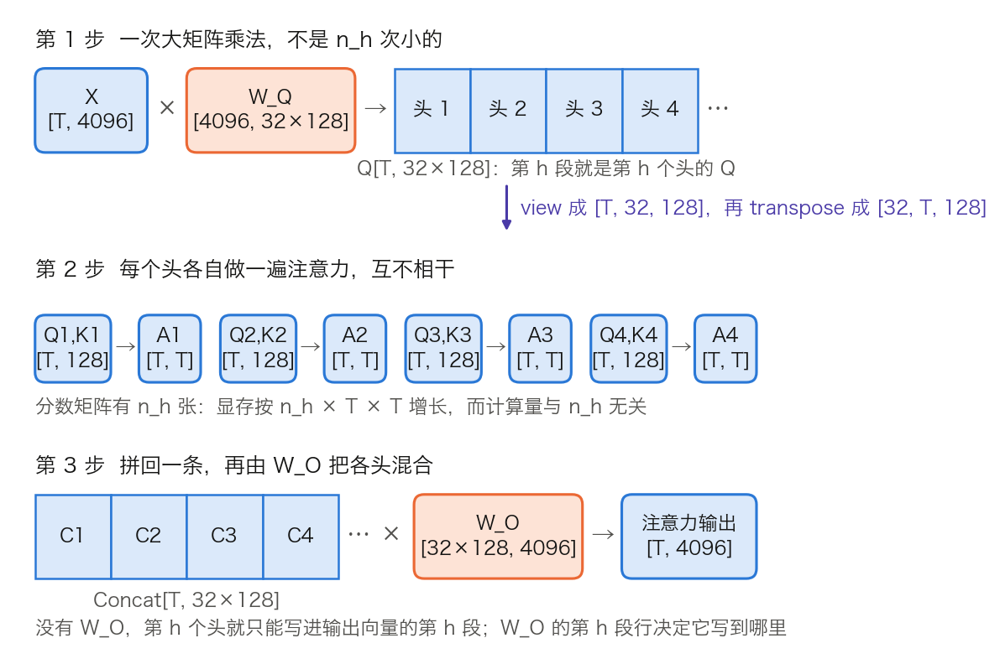

## 2.3 多头注意力：为什么多个子空间更好

单头注意力对每个位置只能交出一个加权平均，几种关系一旦混进同一个向量就再也分不开。多头在同样的参数和运算量下，把一个秩至多 $d_{\text{model}}$ 的打分换成 $n_h$ 个秩至多 $d_h$ 的打分，各读各的，再由 $W^O$ 组合。每头不能太窄，因为单头的打分矩阵秩不超过 $d_h$；实践是把 $d_h$ 定在 64 到 128，模型变宽时加头数。训练后多数头是冗余的，可以剪掉；注意力权重也不是模型的解释。推理时 K 与 V 要进缓存而 Q 不用，所以可以让几个 Q 头共用一套 K/V，即 GQA：公开配置的主流模型多取 8 个 K/V 头，KV 缓存按比例缩小。

### 2.3.1 单头只能给出一个加权平均

考虑句子“小明在北京的大学里学习计算机科学”。对“学习”这个位置，至少要建立三种关系：主语是“小明”，地点是“北京的大学”，宾语是“计算机科学”。

单头注意力对这个位置只输出**一个**加权平均。三处内容被同一组权重读出后相加成一个向量，后续层拿到的是混合结果，分不出哪部分来自主语、哪部分来自宾语。

障碍不在“注意力总量只有 1 不够分”。多头之下每个头的权重同样和为 1，总量并没有变多。差别在于输出的份数：$n_h$ 个头给出 $n_h$ 个独立的加权平均，各自占据输出向量的一段，再由 $W^O$ 决定怎样组合。例如单头把权重平分给三处，交出的是 $(v_{\text{主}} + v_{\text{地}} + v_{\text{宾}})/3$ 这一个向量；三个头则可以各把 0.9 的权重放在其中一处，交出三个各以一处为主的向量。一个平均变成 $n_h$ 个平均，这才是多头换来的东西。

### 2.3.2 实现里的多头：一次投影，两次变形

以自注意力为例，输入为 $X \in \mathbb{R}^{T \times d_{\text{model}}}$，$T$ 是词元数，省略批大小维。**多头注意力**（Multi-Head Attention，MHA）写为：

$$\text{MultiHead}(X) = \text{Concat}(\text{head}_1, \dots, \text{head}_{n_h})W^O$$

第 $i$ 个头使用自己的投影矩阵，独立计算注意力：

$$\text{head}_i = \text{Attention}(XW_i^Q, XW_i^K, XW_i^V)$$

其中 $W_i^Q, W_i^K \in \mathbb{R}^{d_{\text{model}} \times d_k}$，$W_i^V \in \mathbb{R}^{d_{\text{model}} \times d_v}$，下文取常见的 $d_k = d_v = d_h$。一个头的 Q、K、V 与输出都是 `[T, d_h]`；拼接后为 `[T, n_h × d_h]`，再乘 $W^O \in \mathbb{R}^{n_h d_h \times d_{\text{model}}}$ 回到 `[T, d_model]`。投影始终作用在输入 $X$ 上，不对 [2.1 节](2.1_qkv_intuition.md)得到的 Q、K、V 再投影一次；[原论文](https://arxiv.org/abs/1706.03762)的公式用 Q、K、V 指代模块的三路输入，头数记作 $h$，本书记作 $n_h$。

实现不会真的做 $n_h$ 次小投影。各头的权重沿列拼成一个大矩阵，一次投影得到 `[T, n_h × d_h]`，“第 $i$ 个头的 $W_i^Q$”就是这个大矩阵的第 $i$ 段列；再把最后一维按头切开、交换前两维，得到 `[n_h, T, d_h]`，每个头对应一个 `[T, d_h]` 视图（图 2-3）。两次变形只改变下标的解释，不搬数据；交换维度后的视图不保证连续，拼回时要用按需复制的 `reshape` 而不是 `view`。

图 2-3：多头在实现里是“一次大投影，两次变形”（[生成脚本](https://github.com/yeasy/llm_internals/blob/main/tools/figures/ch02_multihead_reshape.py)）。形状按 GPT-3 6.7B 的配置标注，省略 batch 维；图上画 4 个头只为画得下。

$W^O$ 不是可有可无的收尾。拼接只是把数字排在一起，前 $d_h$ 个分量仍只含头 1 的信息。没有 $W^O$，第 $i$ 个头就永远只能写进输出向量的第 $i$ 段；有了它，每个头的结果可以写到输出的任何方向上，也可以互相抵消。$W^O$ 的第 $i$ 段行就是头 $i$ 的“写入地址”。

### 2.3.3 三笔账：参数、计算与显存

“多头不增加计算量”只对其中两笔账成立。取 $d_{\text{model}} = n_h \times d_h = d$，序列长 $n$：

- **参数**：$4d^2$，与 $n_h$ 无关。头多头少，切的都是同样大的四个矩阵。
- **打分与读取的计算量**：$n_h$ 个头合计 $4n^2 d$（因果掩码下 $2n^2d$），同样与 $n_h$ 无关（计数见 [1.4.5 节](../01_introduction/1.4_transformer_idea.md)）。
- **分数矩阵的显存**：朴素实现下每个头一张 `[n, n]`，合计 $n_h \times n^2$ 个数，随 $n_h$ 线性增长。

取 $d = 4096$、$n = 4096$、FP16、批大小 1，朴素实现一层的分数矩阵合计：$n_h = 8$ 时 0.25 GiB，$n_h = 32$ 时 1 GiB，$n_h = 128$ 时 4 GiB，参数与 FLOPs 相同而峰值显存差 16 倍。这第三笔账只属于把分数矩阵写进显存的朴素实现。生产中的融合内核按块计算、不保存这张矩阵（见 [2.2.6 节](2.2_scaled_dot_product.md)与 [10.3 节](../10_inference_optimization/10.3_flash_attention.md)），头数对显存几乎没有影响，头数的真实约束回到 2.3.5 的低秩瓶颈。

### 2.3.4 训练后的头学到了什么

头级分析能把一部分头的行为归类。[对翻译模型编码器各头的分析](https://arxiv.org/abs/1905.09418)在英俄、英德、英法三个方向上识别出三种可解释的功能：位置头指向相邻位置，句法头指向特定句法关系的词，稀有词头指向句中频率最低的词。这些功能是训练中自发形成的，没有人为指定。可解释的头只是少数，其余多数头可以剪掉，见 2.3.6。

### 2.3.5 头数与每头宽度怎么定

原论文在保持总计算量不变的前提下做过消融，改变头数的同时反向调整每头宽度：

| $h$ | $d_k = d_v$ | PPL（dev） | BLEU（dev） |
| ---: | ---: | ---: | ---: |
| 1 | 512 | 5.29 | 24.9 |
| 4 | 128 | 5.00 | 25.5 |
| 8（base） | 64 | 4.92 | 25.8 |
| 16 | 32 | 4.91 | 25.8 |
| 32 | 16 | 5.01 | 25.4 |

表 2-3：头数消融，取自[原论文](https://arxiv.org/abs/1706.03762)表 3 的 (A) 组，英德翻译，评测集 newstest2013。$h$ 即本书的 $n_h$，$d_k = d_v$ 即 $d_h$。

这是一段平缓的最优区间，不是一个最优点：16 头与 8 头的 BLEU 同为 25.8，PPL 还略低；32 头回落 0.4 BLEU；只有 1 头明显落后，低 0.9 BLEU。头数在相当宽的范围内都可接受，只有极端值会明显吃亏。

**为什么每头不能太窄。** 单头的分数矩阵 $QK^\top$ 由 `[n, d_k] × [d_k, n]` 得到，秩不超过 $d_k$（见 [2.1.3 节](2.1_qkv_intuition.md)）。当 $d_k < n$ 时，这个头无法表达任意的 `n × n` 注意力模式。[对低秩瓶颈的分析](https://arxiv.org/abs/2002.07028)据此论证每头宽度低于序列长度会限制单个头的表示能力，建议把头宽度直接设为序列长度、与头数解耦。这为“先定每头宽度、再反推头数”提供了论据。

实践中的做法正是先定宽度：把 $d_h$ 固定在 64 到 128，再由 $n_h = d_{\text{model}} / d_h$ 反推。实践没有照上面的建议把 $d_h$ 提到 $n$：那样每层投影的参数和每个词元要缓存的 K/V 都随 $d_h$ 同比例放大，代价无法承受。实际的取舍是接受单个头的低秩限制，由同层的多个头与多层堆叠组合出复杂的注意力模式，只避免把每头压得过窄。GPT-3 Small 是 `768 / 64 = 12` 个头，GPT-3 175B 是 `12288 / 128 = 96` 个头，Llama 3 8B 是 `4096 / 128 = 32` 个头（见 [3.8.7 节](../03_components/3.8_gpt_inference_flow.md)的表 3-25）：模型变大，头数和层数一起增加，每头宽度几乎不动。每头宽度也可以单独设定（例子见 [2.1.5 节](2.1_qkv_intuition.md)）。

### 2.3.6 头并不都有用

**多数头可以在推理时直接去掉。** [一项逐头消融实验](https://arxiv.org/abs/1905.10650)对训练好的翻译模型与 BERT 逐个屏蔽注意力头，按重要性从低到高依次剪除，分别剪掉 20% 与 40% 的头时性能没有明显下降，多数层甚至可以只保留一个头。继续剪则性能陡降，两个模型都不能在不重训的情况下退化为纯单头。

**用带惩罚的剪枝可以剪得更多。** 2.3.4 那项头级分析对英俄翻译模型剪掉 48 个编码器头中的 38 个，BLEU 只下降 0.15；最后才被剪掉的正是那些有明确功能的专门化头。

**注意力权重不等于解释。** [一项跨任务的检验](https://arxiv.org/abs/1902.10186)发现：学到的注意力权重常与基于梯度的重要性度量不相关，而且可以构造出与原权重差别很大、却给出几乎相同预测的注意力分布。权重说明信息从哪里被读出，不说明结论由哪里决定。

### 2.3.7 Q 头与 K/V 头可以不一样多

推理时 Q、K、V 的地位并不对称：Q 每轮只用一次就丢，K 和 V 却要存进 KV 缓存，被后面每一轮反复读取（定义见 [1.4.3 节](../01_introduction/1.4_transformer_idea.md)，旧位置的 K、V 为何不变见 [2.4.2 节](2.4_self_cross_causal.md)）。于是有了同一条轴上的三种配置：

| 配置 | K/V 头数 $n_{kv}$ | 每词元 KV 缓存 | 代表模型 |
| --- | --- | --- | --- |
| MHA（多头） | $n_{kv} = n_h$ | 最大 | GPT-3 各规模 |
| GQA（分组查询） | $1 < n_{kv} < n_h$，每组 Q 头共用一套 K/V | 按 $n_{kv} / n_h$ 缩小 | Llama 3 各规模，$n_{kv} = 8$ |
| MQA（多查询） | $n_{kv} = 1$ | 最小 | PaLM（见[其论文](https://arxiv.org/abs/2204.02311)第 2 节），另见 [3.7.5 节](../03_components/3.7_full_architecture.md) |

表 2-4：Q 头数与 K/V 头数的三种关系。Q 的头数不变，变的只是 K/V 被共享的程度。

每词元要缓存的 K/V 个数正比于 K/V 头数，其余因子（层数、每头宽度）不随这条轴变化。Llama 3 8B 把 $n_{kv}$ 从 32 降到 8，缓存降到四分之一，BF16 下每词元 128 KiB，同样的显存能装下四倍的上下文（公式与各模型取值见 [10.2.3 节](../10_inference_optimization/10.2_kv_cache.md)）。代价是每组 Q 头共用一套 K/V，匹配依据的多样性下降。[GQA 论文](https://arxiv.org/abs/2305.13245)的对照是：MQA 可能导致质量下降，而由多头检查点续训得到的 GQA 质量接近多头、速度接近 MQA。

GQA 是今天的默认。Llama 3 全系、Mistral 7B、Qwen 2.5 72B、gpt-oss 都取 8 个 K/V 头，同系列的小模型可能更少（Qwen 2.5 7B 是 28 个 Q 头配 4 个 K/V 头）（见 [13.2 节](../13_decoder_models/13.2_llama.md)与 [13.3 节](../13_decoder_models/13.3_deepseek_gemini.md)的配置对照）；DeepSeek 一系改用更激进的 MLA（见 [10.2.7 节](../10_inference_optimization/10.2_kv_cache.md)）。K/V 头数必须在训练时定下，已发布的 MHA 模型只能靠续训转换。

下一节换另一条坐标轴：Q 与 K、V 可以来自不同的序列，哪些位置允许被看见则由掩码决定。
