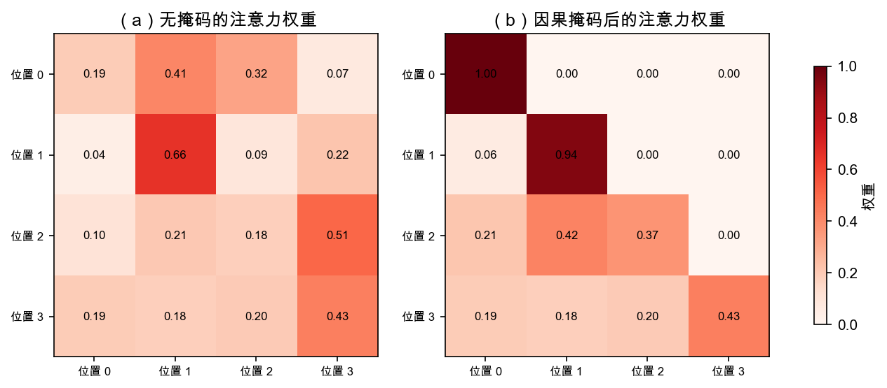
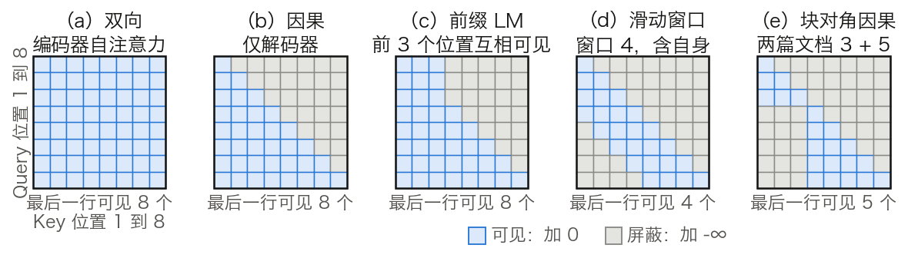

## 2.4 自注意力、交叉注意力与因果掩码

同一个注意力算子上有两个旋钮：K 与 V 取自哪条序列（自注意力或交叉注意力），哪些格子允许被看见（掩码）。因果掩码一举三得：不泄漏答案；一次前向给出 $$n$$ 个位置的监督信号；旧位置在每一层的 K 与 V 都不受后来追加的词元影响，因此可以缓存，相同的前缀还能跨请求复用。代价是每个位置只读得到左文。掩码加在 Softmax 之前。实践中最常出错的四处：批量生成要左填充；填充掩码遮列不遮行；整行被遮会得到 NaN；打包多篇文档要用块对角掩码，只重置位置索引不够。

### 2.4.1 自注意力：序列内部的信息交互

**自注意力**（Self-Attention）指 Q、K、V 全部来自同一个序列，每个位置既提问，也提供用于匹配的键和被读走的内容；它让任意距离的两个位置一跳相连（例子见 [1.4.2 节](../01_introduction/1.4_transformer_idea.md)）。编码器中的自注意力是全双向的，每个位置可以关注任意其他位置。

不加掩码的自注意力对输入顺序是置换等变的，打乱输入的行序，输出只是跟着换行（推导见 [3.3.1 节](../03_components/3.3_position_encoding.md)）。顺序信息靠位置编码带入（见[第四章](../04_position_encoding/README.md)），可见范围靠掩码规定，两者是不同的机制。因果掩码按下标规定谁能读谁，带来一点隐含的顺序信号，但因果模型在实践中仍配合位置编码使用。

### 2.4.2 因果掩码：遮住未来换来了什么

自回归生成中，第 $$t$$ 个词元只能依据前 $$t-1$$ 个词元预测。训练时把目标序列整体右移一位作为输入：输入是 `[BOS, 猫, 坐]`（BOS 是序列起始符）时，三个位置的预测目标依次是 `猫`、`坐`、`下`。位置 $$i$$ 的预测目标就是位置 $$i+1$$ 的输入，所以它可以读自己和左边，不能读右边；不加限制时，位置 1 要预测的 `猫` 就摆在位置 2 的输入上，任务退化为复制。

**因果掩码**（Causal Mask）把分数矩阵的上三角置为 $$-\infty$$：

$$\text{Mask}_{ij} = \begin{cases} 0 & \text{if } j \leq i \\ -\infty & \text{if } j > i \end{cases}$$

加到缩放后的分数上，再做 Softmax：

$$A = \text{softmax}\left(\frac{QK^T}{\sqrt{d_k}} + \text{Mask}\right)$$

由于 $$e^{-\infty} = 0$$，被屏蔽的位置权重为零，既不进入行和，也读不到任何内容。条件 $$j \leq i$$ 包含 $$j = i$$：输入已右移一位，位置 $$i$$ 读到的是已给定的前缀，读自己不算偷看。

遮住未来除了防止读到答案，还换来两项收益。这是因果语言模型相对双向目标的优势，编码器-解码器模型的解码器同样具备；仅解码器为什么胜过编码器-解码器，见 [5.3.7 节](../05_pretraining/5.3_encoder_decoder.md)。

**收益一：一次前向产生 $$n$$ 个训练信号。** 一条长 $$n$$ 的序列送进模型，每个位置都算出“下一个词元”的分布，等价于用 $$n$$ 个前缀各做一次预测，计算只做一遍。没有掩码就只能泄漏答案，或者实际跑 $$n$$ 次。

**收益二：旧位置的 K、V 永不改变。** 位置 $$i$$ 的键和值只由位置 $$1$$ 到 $$i$$ 的内容算出，追加新词元不会改变它们，可以存下来复用，这就是 KV 缓存（见 [3.8.6 节](../03_components/3.8_gpt_inference_flow.md)与 [10.2 节](../10_inference_optimization/10.2_kv_cache.md)）。

这条性质要逐层看。第一层的 K、V 只是 $$x_i$$ 自己的投影，有没有掩码都不受其他位置影响。从第二层起，每层的输入是上一层的输出，其中已混入该位置在上一层读到的内容：因果掩码下混入的只有位置 $$1$$ 到 $$i$$，后来追加的词元进不来，所以每一层的 K、V 都不变。双向注意力没有这个性质：旧位置会读到新词元，第二层起的表示全部改变，缓存无从谈起。

同一条性质也是跨请求前缀复用的依据：两个请求只要前 $$P$$ 个词元逐个相同，这 $$P$$ 个位置在每一层的 K、V 就相同，可以共用一份；条件只对完全相同的前缀成立，中间改一个词元，其后的缓存全部作废（机制见 [11.5 节](../11_serving/11.5_prefix_reuse.md)）。

图 2-4 用一组随机的 4×4 分数（$$d_k = 8$$）验证收益二。第 3 行（图中的位置 2）掩码后剩下 `[-1.070, -0.388, -0.508]`，Softmax 后权重是 `[0.211, 0.418, 0.371, 0]`。这一行只由 $$q_3$$ 与 $$k_1$$ 到 $$k_3$$ 决定，只把前 3 个词元送进模型，算出的最后一行一模一样。Decode 每轮只算一行而结果与整条重算相同，依据就在这里。

图 2-4：因果掩码前后的注意力权重热力图对比（[生成脚本](https://github.com/yeasy/llm_internals/blob/main/tools/figures/causal_mask_heatmap.py)，随机种子 42）。左图每一行的权重分布在全部 4 个位置上；右图右上角全为零，位置 0 的权重全部集中在自身。

**代价：每个位置只读得到左文。** 句首位置的表示不含后文的任何信息，越靠前的位置看到的上下文越少。只需要一份整句表示的分类、检索类任务，也常用去掉因果掩码的双向编码器（见[第十二章](../12_encoder_models/README.md)）。

### 2.4.3 掩码的实现细节与两个陷阱

掩码是**加**在分数上，不是乘在权重上。先做 Softmax 再把未来位置乘 0，行和就不再是 1，等于悄悄改变了各位置的相对权重；加 $$-\infty$$ 则让被屏蔽的项从指数和里彻底消失，剩下各项仍然归一。布尔掩码的约定在不同接口里相反：`masked_fill` 里 `True` 表示屏蔽，PyTorch 融合接口的 `attn_mask` 里 `True` 表示参与，混用时掩码会整个反过来。

**整行被遮住会得到 NaN。** 一行分数若全是 $$-\infty$$，指数全为 0，行和为 0，Softmax 变成 0 除以 0。左填充序列里填充位置自己的那一行正是这种情形：它前面没有任何可见位置（见 2.4.6）。这是批量推理里“输出突然变成 NaN”的常见原因。对策是保证每行至少一个可见位置，或在半精度下用该精度的最小有限值代替 $$-\infty$$，让分数仍可归一，也避免后续算子遇到 `inf`。

朴素实现还会浪费计算：它先算满 `[n, n]` 再遮掉上三角，接近一半的乘法是无效计算。融合内核在声明因果（`is_causal=True`）时直接跳过整块被遮住的分块，[1.4.5 节](../01_introduction/1.4_transformer_idea.md)的计数因此对因果注意力折半。传入显式的下三角掩码在数学上等价，但未必能走到跳块的快路径。

### 2.4.4 交叉注意力：两个序列之间的桥梁

**交叉注意力**（Cross-Attention）中，Q 来自目标序列，K、V 来自另一个序列，通常是编码器最后一层的输出。设目标序列长 $$m$$、源序列长 $$n$$：`Q[m, d_k] × Kᵀ[d_k, n] → 分数[m, n]`，再 `[m, n] × V[n, d_v] → [m, d_v]`。分数矩阵不是方阵，代价为 $$O(mnd)$$，而且通常不加因果掩码：源序列是已知的完整输入，读取它的任何部分都不算偷看。

源序列的 K、V 在整个生成过程中不变，可以只算一次并一直缓存。自注意力的 KV 缓存每轮追加一行，交叉注意力的缓存是一次写入、只读到底。

今天交叉注意力的主要去处是编码器-解码器模型（见 [13.4 节](../13_decoder_models/13.4_t5_bart.md)）。仅解码器模型不需要它：源内容被直接拼进同一条序列，由同一套自注意力读取，代价是源内容也占用上下文长度。主流的多模态模型同样默认把视觉特征投影后拼进序列；交叉注意力用在 Q-Former 一类重采样器里，或像 Flamingo 那样插进 LLM 的部分层（见 [14.4.6 节](../14_future_trends/14.4_multimodal.md)）。

### 2.4.5 三种注意力在 Transformer 中的位置

原始的编码器-解码器 Transformer 用到全部三种（层结构见 [1.4.3 节](../01_introduction/1.4_transformer_idea.md)）：编码器每层一个全双向自注意力，解码器每层先是带因果掩码的自注意力，再是读编码器输出的交叉注意力；前两种只在有填充时另加填充掩码。仅解码器模型（如 GPT 系列）只保留带因果掩码的自注意力，仅编码器模型（如 BERT）只保留全双向自注意力，三种变体的取舍见 [3.7.4 节](../03_components/3.7_full_architecture.md)。

### 2.4.6 填充掩码：遮的是列，不是行

批处理要求同批序列等长，较短的序列用填充词元补齐。**填充掩码**（Padding Mask）把指向填充位置的分数设为 $$-\infty$$，使真实位置读不到填充内容。

它遮的是**列**：不让别人读填充位。填充位自己那一行照常计算，输出靠损失掩码丢弃，不必也不该整行屏蔽，整行屏蔽正是 2.4.3 那个 NaN 的来源。`[B, T]` 的 0/1 掩码广播成 `[B, 1, T, T]` 后与因果掩码取逻辑与：既在因果范围内、又不是填充位的格子才可见。

仅解码器模型批量生成必须**左填充**。右填充会把填充词元排在真实内容之后，新生成的词元与真实内容之间隔着填充位，位置索引也整体错位（见 [9.1 节](../09_decoding/9.1_autoregressive_decode.md)）。

### 2.4.7 序列打包与文档掩码

预训练很少让一条序列只装一篇短文档，那样填充会浪费大量算力。常见做法是把多篇文档首尾相接，拼满固定长度。纯因果掩码此时有漏洞：后一篇文档的位置可以读到前一篇的内容，而两者毫无关系。

对策是块对角因果掩码：在因果条件之外再加一条“同属一篇文档”。[Llama 3](https://arxiv.org/abs/2407.21783) 用的就是这种掩码，并报告它在标准预训练中影响有限，在超长序列的继续预训练中则很重要。

只重置位置索引是不够的。重置位置索引只改变位置编码，不改变可见性，注意力分数仍会在文档之间产生非零权重。阻断依赖的是掩码本身。实现上，变长打包的内核按各段长度的前缀和分段计算，不显式构造 `[n, n]` 掩码，被遮的块既不占显存也不计算（训练细节见 [6.4 节](../06_training_techniques/6.4_batch_sequence.md)，接口见[附录 A.7](../appendix/a7_framework_recipes.md)）。

### 2.4.8 掩码家族一览

因果、双向、前缀 LM、滑动窗口、块对角，都是同一张 `[T, T]` 的 0/$$-\infty$$ 矩阵，区别只在哪些格子被置为 $$-\infty$$。图 2-5 把五种并排画出。

图 2-5：五种掩码都是同一张 `[T, T]` 矩阵（[生成脚本](https://github.com/yeasy/llm_internals/blob/main/tools/figures/ch02_mask_family.py)）。行是 Query 位置，列是 Key 位置，深色格表示被屏蔽。

| 掩码 | 规则 | 最后一行可见数（$$T = 8$$） | 典型使用者 |
| --- | --- | ---: | --- |
| 双向 | 全部可见 | 8 | BERT 等仅编码器模型（见 [12.1 节](../12_encoder_models/12.1_bert.md)） |
| 因果 | $$j \leq i$$ | 8 | GPT 等仅解码器模型 |
| 前缀 LM | 前缀内部互相可见，前缀之后按因果 | 8 | [UniLM](https://arxiv.org/abs/1905.03197) 的序列到序列目标等（见 [5.3.5 节](../05_pretraining/5.3_encoder_decoder.md)） |
| 滑动窗口 | $$i - w < j \leq i$$ | 4（$$w = 4$$） | Longformer（见 [12.3 节](../12_encoder_models/12.3_longformer_bigbird.md)）、Mistral、长上下文混合结构（见 [14.7 节](../14_future_trends/14.7_long_context.md)） |
| 块对角因果 | 因果且同属一段 | 5（第二段长 5） | 打包预训练、多请求拼批 |

表 2-5：掩码家族的规则与使用者。滑动窗口把每行的可见数从 $$O(n)$$ 压到常数 $$w$$，计算量随之从 $$O(n^2)$$ 降到 $$O(nw)$$，代价是超出窗口的依赖要靠层数堆叠或少量全局位置来补。前缀 LM 是单个模型内的一张掩码；T5 这类编码器-解码器是两套参数由交叉注意力相连，不是一张 `[T, T]` 矩阵。

下一节把这些形状换算成时间和显存，看长上下文究竟贵在哪里。
