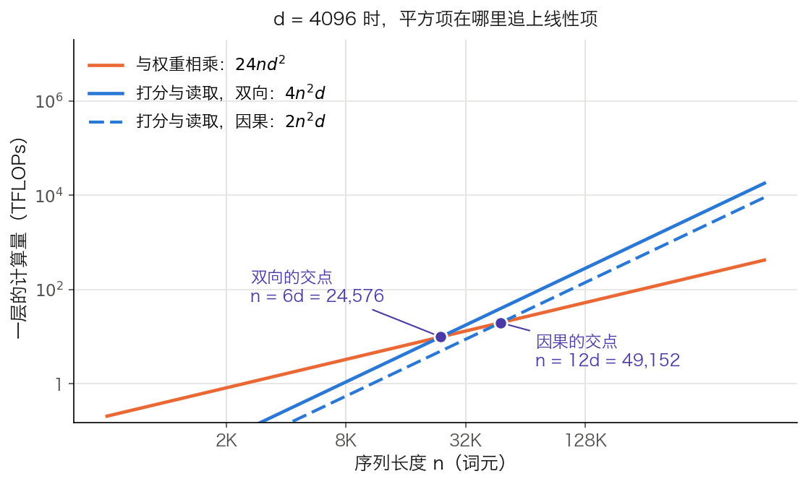

## 2.5 注意力的代价：复杂度与局限

一层的运算量是与权重相乘的 $24nd^2$ 加上打分与读取的 $2n^2d$（[1.4.5 节](../01_introduction/1.4_transformer_idea.md)）；平方项要到 $n \approx 12d$ 才追平线性项，几千词元的上下文里瓶颈在前馈网络与投影，不在注意力。训练时先撞墙的是那张 $n \times n$ 分数矩阵的显存，FlashAttention 解决的是这一项，不降复杂度。有了 KV 缓存，Decode 每步对长度是线性的，约束变成显存带宽与 KV 的容量：Llama 3 8B 的上下文到约 12.3 万词元时，每步读 KV 的字节就追平读权重的字节。复杂度之外，Softmax 注意力还有四条换硬件也去不掉的性质。今天的默认是精确的 IO 感知实现加 GQA 或 MLA；改写注意力本身的方案里，进了新模型的是可训练稀疏，以及线性层与全注意力层的按比例混合。

### 2.5.1 一层要算多少、存多少

打分 $QK^\top$ 与读取 $AV$ 是注意力里仅有的两个操作数都是数据的矩阵乘法，各约 $2n^2 d$ 次运算（各头合计），因果掩码下合计 $2n^2 d$。与权重相乘的投影和前馈合计 $24nd^2$。一层的总账是

$$\underbrace{24nd^2}_{\text{与权重相乘}} + \underbrace{2n^2d}_{\text{打分与读取，因果}}$$

两项在 $n = 12d$ 时相等，双向注意力为 $n = 6d$。逐项来历见 [1.4.5 节](../01_introduction/1.4_transformer_idea.md)。

**显存里存的是分数矩阵，而且训练时必须留着。** 前向算出的 $A = \text{softmax}(S')$ 有 $n^2$ 个数，每层每个头各一张。反向传播绕不开它：记这一步的输出为 $C = AV$，值的梯度是 $\partial L/\partial V = A^\top \, \partial L / \partial C$，直接用到 $A$；对分数、查询、键的梯度经 Softmax 的雅可比（见 [2.2.3 节](2.2_scaled_dot_product.md)）同样依赖 $A$。朴素实现因此在前向时把这张 `[n, n]` 矩阵写进显存，反向时再读回来。

代入 GPT-3 6.7B 的配置（32 层、32 个头），序列长 4,096，FP16，批大小 1：一层所有头的分数矩阵是 `32 × 4096² × 2` 字节，正好 1 GiB，32 层合计 32 GiB，并随批大小线性增长。FlashAttention 针对的就是这一项：它不保存 `[n, n]`，反向时按块重算，用计算换显存和访存（见 [10.3 节](../10_inference_optimization/10.3_flash_attention.md)；“存还是重算”的一般取舍见 [7.5 节](../07_distributed_training/7.5_activation_checkpointing.md)）。

### 2.5.2 与其他架构的复杂度对比

循环层、卷积层与自注意力层的对照见 [1.4.5 节](../01_introduction/1.4_transformer_idea.md)的表 1-4：自注意力用平方的计算量买到了 $O(1)$ 的路径和完全并行，Transformer 比 RNN 快，主因是顺序操作数从 $O(n)$ 降到 $O(1)$，不是单层 FLOPs 更少。

原论文的表 1 还有第四行：**受限自注意力**，每个位置只看邻域 $r$ 内的位置，单层计算量 $O(r \cdot n \cdot d)$，最长路径 $O(n/r)$。它是今天滑动窗口注意力的源头，用变长的路径换来对 $n$ 的线性复杂度。

原论文还说过“当 $n < d$ 时自注意力比循环层更快”，它的语境是机器翻译的句子级表示，即几十个词元配 $d = 512$。这个前提今天不成立：上下文动辄 8K 到 128K 以上，而 $d$ 仍在 4,096 到 16,384 之间，$n$ 远大于 $d$。

### 2.5.3 平方项从多长开始主导

两项之比只取决于 $n / d$。取 $d = 4096$：

| 序列长度 $n$ | 单头分数矩阵元素数 | 单头 FP16 显存 | 平方项占比（双向） | 平方项占比（因果） |
|---------:|---------:|---------:|---------:|---------:|
| 512 | 262,144 | 0.5 MiB | 2.1% | 1.0% |
| 2,048 | 4,194,304 | 8 MiB | 8.3% | 4.2% |
| 8,192 | 67,108,864 | 128 MiB | 33.3% | 16.7% |
| 32,768 | 1,073,741,824 | 2 GiB | 133.3% | 66.7% |
| 131,072 | 17,179,869,184 | 32 GiB | 533.3% | 266.7% |

表 2-6：$d = 4096$ 时，注意力的平方项相对一层线性项的比例（双向为 $n / (6d)$，因果减半），以及单层单头的分数矩阵显存，整层整模型要再乘头数和层数。

从 512 到 131,072，平方项自己涨了 65,536 倍，但决定实际耗时的是它与线性项的相对大小。在 2K 上下文上，打分与读取只占一层的百分之几，瓶颈在前馈网络和投影；因果注意力要到约 4.9 万词元才追平线性项。图 2-6 把两条线画在一起。

图 2-6：$d = 4096$ 时，一层中线性项与平方项的交点（[生成脚本](https://github.com/yeasy/llm_internals/blob/main/tools/figures/ch02_flops_crossover.py)）。橙色是与权重相乘的部分，蓝色是打分与读取；双向注意力在 $n = 6d = 24{,}576$ 处交叉，因果注意力在 $n = 12d = 49{,}152$ 处交叉。

早期模型把长度限制在 512 或 1024，主因是训练成本和学习式绝对位置嵌入的固定表长，不是硬件承受不了：$n = 1024$ 时单头分数矩阵在 FP16 下只有 2 MiB。

### 2.5.4 推理时的另一笔账

上面是训练与 Prefill 的视角（Prefill、Decode 与 KV 缓存的定义见 [1.4.3 节](../01_introduction/1.4_transformer_idea.md)）。有了 KV 缓存，Decode 的每一轮只有新位置这一行 Query，账完全不同：

- 没有 `[n, n]` 矩阵，只有 `[1, s]` 的一行分数，$s$ 是当前总长度。
- 打分与读取每层约 $4sd$ 次运算，对 $s$ 是线性的。
- 与权重相乘的部分退化为每层 $24d^2$，与 $s$ 无关。

代入 $d = 4096$：$s = 1000$ 时，每层打分与读取约 $1.6 \times 10^7$ 次，只有权重部分 $4.0 \times 10^8$ 次的 4%；$s = 131{,}072$ 时前者升到 $2.1 \times 10^9$ 次，是后者的 5 倍。但 Decode 的主要约束不在运算，而在把权重与 KV 缓存从显存读出的带宽，以及缓存占用的容量。

**带宽。** 一层与权重相乘的 $24d^2$ 次运算要读 $12d^2$ 个参数，FP16 下是 $24d^2$ 字节，每读 1 字节只做约 1 次运算，与 $d$ 无关。H100 的算力与带宽要在每字节约 300 次运算时才匹配（[10.1.2 节](../10_inference_optimization/10.1_bottleneck.md)），单请求 Decode 低了两个多数量级，速度受显存带宽限制。

**容量，以及 KV 何时追平权重。** Llama 3 8B 每个词元的 KV 缓存是 128 KiB（8 个 K/V 头即 [2.3.7 节](2.3_multi_head.md)的 GQA，公式见 [10.2.3 节](../10_inference_optimization/10.2_kv_cache.md)），128K 的上下文占 16 GiB，约为一张 80 GB 卡的五分之一，加上 16 GB 的权重已用去四成。它的 16 位权重是 16.06 GB，折合约 12.3 万个词元的 KV。Decode 每步把权重读一遍、由全批分摊，KV 则按请求累加：批内各请求的上下文总长超过约 12.3 万词元，每步读 KV 的字节就多于读权重，此后 Decode 的速度由 KV 决定。单请求要到 12.3 万词元，批大小 32 时每个请求约 3,800 词元就到了（见 [10.1.2 节](../10_inference_optimization/10.1_bottleneck.md)）。

### 2.5.5 复杂度之外的四条局限

平方复杂度是工程问题，下面四条是 Softmax 注意力的结构性质，换硬件解决不了。

**其一，不含顺序。** 不加掩码时自注意力置换等变，顺序必须由位置编码补上（见 [3.3.1 节](../03_components/3.3_position_encoding.md)），这也给了位置编码可替换的空间，第四章整章在这条缝隙上展开。

**其二，行和必须为 1，没有“谁都不看”的选项。** 某个头在当前这一步确实无事可看时，仍必须把这份权重分配到某处。模型学到的解法是分配给位置固定、语义无害的地方，通常是序列开头的几个词元，即**注意力汇**（attention sink）。[StreamingLLM](https://arxiv.org/abs/2309.17453) 据此提出：流式推理时保留最靠前的少量词元的 KV（实验中 4 个即够），再配上最近的窗口，困惑度就能稳住；只留最近窗口则会突然退化（见 [14.7 节](../14_future_trends/14.7_long_context.md)）。

**其三，长度稀释。** 分数差固定时，候选越多权重越小：领先 5 个单位的位置在 $n = 512$ 时权重 0.225，在 $n = 131{,}072$ 时只剩 0.001。要保住同样的权重，分数差得随 $\ln n$ 增长（见 [2.2.4 节](2.2_scaled_dot_product.md)），模型学不出这么大的差距时，长上下文里的注意力就会变平，这是“大海捞针”类任务变难的机制来源之一。

**其四，纯注意力堆叠会秩坍缩。** [一项理论分析](https://arxiv.org/abs/2103.03404)证明：去掉残差连接与 MLP 的纯自注意力网络，输出随深度以双指数速度收敛到秩 1 的矩阵，各行趋同；残差连接与 MLP 恰好阻止了这种退化。残差和 MLP 因此是深层注意力网络保持表达力的必要条件（见 [3.5 节](../03_components/3.5_residual.md)）。

### 2.5.6 应对平方复杂度的四类思路

降低注意力成本有四类做法：只改实现（IO 感知），让每个查询少看几个位置（稀疏），把历史压进固定大小的状态（线性注意力），或换掉整个算子（状态空间模型等）。后两类在推理时把历史压进固定大小的状态逐步更新，拿回的是 [1.2.5 节](../01_introduction/1.2_rnn_cnn_limits.md)表 1-2 末行 RNN 的那项优势，代价是状态容量固定，精确回忆受限。

| 思路 | 代表 | 是否精确 | 计算复杂度 | 显存 | 主要代价 |
| --- | --- | --- | --- | --- | --- |
| 稀疏注意力 | 固定模式：Longformer、BigBird；可训练：NSA、DSA | 否 | $O(n \cdot w)$ | $O(n \cdot w)$ | 固定模式下窗口外的依赖要靠全局词元或层数补 |
| 线性注意力 | Performer、Linear Transformer | 否 | $O(n)$ | $O(n)$ | 精确检索能力弱于 Softmax 注意力，详见 [14.1 节](../14_future_trends/14.1_efficient_attention.md) |
| IO 感知 | FlashAttention | **是** | 仍是 $O(n^2)$ | $O(n)$ | 只省显存与访存，不省运算 |
| 替代架构 | Mamba 等状态空间模型 | 不适用（不同的算子） | $O(n)$ | 推理时状态固定 | 状态容量固定，长程精确回忆受限 |

表 2-7：四类思路的取舍。最需要分清的是第三行：FlashAttention 不改变注意力的数学定义，也不降低计算复杂度，它避免的是把 `[n, n]` 矩阵写回显存再读回来，把它说成“解决了平方复杂度”是常见误读。稀疏一行的 $w$ 是每个查询看的位置数，Longformer 的复杂度常写作 $O(n)$，省略了它。

默认仍是精确的 IO 感知实现加 GQA 或 MLA。固定模式的稀疏与纯线性注意力都没有成为旗舰模型的主干；进入新模型的是两种改写，一是由模型学出看哪里的可训练稀疏，二是线性层与少量全注意力层按比例混合（如 3:1），由全注意力层守住精确检索。这两种改写要到批大小与上下文长度的乘积超过约十万词元才有收益，而且必须从训练阶段就定下（见 [14.1 节](../14_future_trends/14.1_efficient_attention.md)）。实现层的优化见[第十章](../10_inference_optimization/README.md)。
