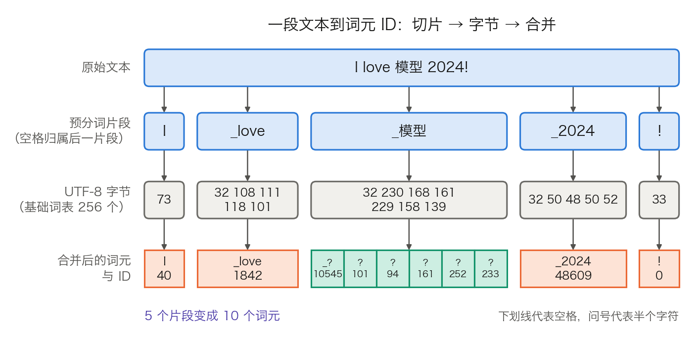

## 3.1 分词：从文本到词元

**分词**（Tokenization）把文本切成模型处理的基本单元，即**词元**（Token）。第二章所有公式的起点都是 $Q = XW^Q$ 里的 $X \in \mathbb{R}^{n \times d_{\text{model}}}$，其中的行数 $n$ 就是分词器切出的词元个数，它同时是算力、上下文占用与计费的单位。分词是一次在训练之前就冻结的粒度选择：子词是字符级（序列太长）与词级（未登录词、词表膨胀）之间的折中，BPE 用贪心压缩实现它，高频组合合并成一个词元，长尾退回字节。今天的默认做法是字节级 BPE，词表多在十万到二十几万之间（`cl100k_base` 100,277、Llama 3 128,256、`o200k_base` 200,019；Gemma 2 沿用 Gemini 的多语言词表，256,128），英文大约 4 个字符一个词元。分词器与权重不可分离，数字算错、尾随空格、故障词元、非英语更贵这几类常见问题都出在两者的接缝上（3.1.8）。

### 3.1.1 为什么是子词

神经网络只能处理数值，因此需要一个从文本到整数的映射。两种朴素方案各有明确的代价。

**字符级分词**把每个字符当作一个词元。词表小，但序列长，单个符号携带的信息少，模型要用更多的层和位置才能拼出一个词的含义。

**词级分词**以空格切分，语义清晰，但词表庞大，且无法处理**未登录词**（Out-of-Vocabulary，OOV）：训练时未见过的词只能用 `[UNK]` 替代，信息丢失。中文、日文没有空格分隔，这一方案还需要额外的分词工具。

**子词分词**（Subword Tokenization）在两者之间取平衡：常见词保持完整，罕见词拆成已知片段（如 `tokenization` 切成 `token` 与 `ization`）。这一思路由 [Sennrich 等人 2015 年的工作](https://arxiv.org/abs/1508.07909)引入机器翻译，现已成为主流 LLM 的默认选择。

衡量分词好坏的第一个量是**压缩率**，即平均每个词元覆盖多少个字符。用 tiktoken 的 `cl100k_base` 实测一句 69 个字符的英文，得到 12 个词元，压缩率 5.75 字符/词元；同一句话的中文译文 24 个字符切出 28 个词元，压缩率只有 0.86（四种语言在三种编码下的对照见 3.1.8 的表 3-3）。压缩率直接决定序列长度，而序列长度决定注意力的开销（见 [2.5 节](../02_attention/2.5_complexity_limits.md)）。

### 3.1.2 BPE 训练：一个可手算的三轮例子

**字节对编码**（Byte Pair Encoding，BPE）是最广泛使用的子词算法。训练过程只有一条规则：反复把语料中出现最频繁的相邻符号对合并成一个新符号。一对相邻符号出现多少次，合并后语料的符号总数就减少多少，所以每轮选的都是当前压缩得最多的一对，常见的组合最先变短。

用一份四个词的迷你语料演示，括号里是词频：`low`（5）、`lower`（2）、`newest`（6）、`widest`（3）。先把每个词拆成字符，并在词尾追加一个词尾标记 `</w>`，用来区分词内片段与词末片段。初始基础符号共 11 个：`</w> d e i l n o r s t w`。

第 1 轮统计全部相邻对。语料里共 14 种相邻对，计数之和 79，表 3-1 列出计数最高的 6 种。

| 相邻对 | 计数 | 来源 |
| --- | ---: | --- |
| `e`+`s` | 9 | newest 6 + widest 3 |
| `s`+`t` | 9 | newest 6 + widest 3 |
| `t`+`</w>` | 9 | newest 6 + widest 3 |
| `w`+`e` | 8 | lower 2 + newest 6 |
| `l`+`o` | 7 | low 5 + lower 2 |
| `o`+`w` | 7 | low 5 + lower 2 |

表 3-1：迷你语料第 1 轮计数最高的 6 种相邻对。每一项等于包含该相邻对的词的词频之和：`e`+`s` 只出现在 `newest` 与 `widest` 中，故为 `6 + 3 = 9`。其余 8 种的计数在 2 到 6 之间，合计 30。

最高计数是 9，有三对并列。真实实现按一个固定次序打破平局，结果因实现而异；这里取 `e`+`s`。合并后语料变成 `l o w </w>`、`l o w e r </w>`、`n e w es t </w>`、`w i d es t </w>`，符号总数从 95 降到 86，正好少了 9 个。

第 2 轮重新计数。`es`+`t` 的计数是 9，与 `t`+`</w>` 并列第一，取前者，得到 `est`。第 3 轮 `est`+`</w>` 计数 9，独占第一，得到 `est</w>`。

三轮结束，**合并表**（merge table）按学到的先后顺序记为：`(e, s)`、`(es, t)`、`(est, </w>)`，依次编号为 rank 0、1、2。词表则是 11 个基础符号加上这 3 个新符号。本例训练到此为止；真实分词器预先设定目标词表大小，每轮合并新增一个符号，合并轮数等于目标大小减去基础符号与特殊词元的个数。训练结束后，这张表不再改动。

合并表是**有序**的。同一份语料、不同的平局规则，会得到不同的表；表不同，同一个字符串的切分就不同，送进模型的 ID 序列也不同，而模型的嵌入矩阵只认训练时那一套 ID。分词器与模型因此不可分离，见 3.1.8。

### 3.1.3 BPE 编码：合并表怎样切开一个新词

推理时给定一个新词，编码**按合并表中的先后次序（rank）反复合并**，不在词表里找最长匹配。

用上表切 `lowest`。初始符号序列是 `l o w e s t </w>`。

1. 扫描全部相邻对，找出出现在合并表里、rank 最小的一对。`(e, s)` 的 rank 为 0，命中，合并为 `l o w es t </w>`。
2. 重新扫描。`(es, t)` 的 rank 为 1，命中，得到 `l o w est </w>`。
3. 再扫描。`(est, </w>)` 的 rank 为 2，命中，得到 `l o w est</w>`。
4. 剩余相邻对 `(l, o)`、`(o, w)`、`(w, est</w>)` 都不在表里，停止。

结果是 4 个词元：`l`、`o`、`w`、`est</w>`。`l o w` 没有被合并成 `low`，尽管语料里 `low` 出现 5 次：那需要更多轮训练，而这里只训了 3 轮。

再切 `newer`。初始序列 `n e w e r </w>` 里没有任何相邻对在合并表中，一次合并都做不了，结果是 6 个词元。同一份语料训出的表，对 `lowest` 压得很紧，对 `newer` 完全无效。

这解释了**词表更大 ≠ 每个词都更短**：合并表只压它见过的高频组合。

### 3.1.4 字节级与预分词：从 UTF-8 字节到词元

真实 GPT 类分词器在上述算法外加了两层工程处理。

**字节级：基础词表固定为 256。** BPE 的基础符号取 UTF-8 字节，不取 Unicode 码点。[GPT-2 论文](https://cdn.openai.com/better-language-models/language_models_are_unsupervised_multitask_learners.pdf)给出的理由是规模：按码点建表，基础词表就超过 13 万，比当时常用的 3.2 万到 6.4 万还大；按字节只需 256。代价是非拉丁文字要先拆成多个字节：`模型` 是 2 个字符、6 个 UTF-8 字节。好处是任何输入都能表示，`[UNK]` 不再需要。

**预分词：先用正则切片，再在片内合并。** 直接在字节上跑 BPE，会把标点和空格合进词里，学出 `dog.`、`dog!`、`dog?` 这类同一个词的多种变体，浪费有限的词表位置。GPT-2 因此禁止跨字符类别合并，原始发布所用的模式是：

```text
's|'t|'re|'ve|'m|'ll|'d| ?[\p{L}]+| ?[\p{N}]+| ?[^\s\p{L}\p{N}]+|\s+(?!\S)|\s+
```

读法是：常见缩写单独成片；字母串、数字串、其他符号串各自成片；前导的一个空格归属**后面**那个片段。这就是 GPT 系列词元前常带一个空格的原因。

`cl100k_base` 起，数字一项改成了 `\p{N}{1,3}`：一个片段最多 3 位数字。这限制了合并能学出的数字词元，也直接影响算术表现，见 3.1.8。

图 3-1 把这条流水线走了一遍，片段与 ID 由 tiktoken 的 `gpt2` 编码实测。



图 3-1：一段文本怎样经预分词、字节化与合并变成词元 ID（[生成脚本](https://github.com/yeasy/llm_internals/blob/main/tools/figures/ch03_bpe_pipeline.py)）。蓝色是数据，橙色表示片段与词元一一对应，青绿色表示一个片段裂成了多个词元。图中 ID 取自 `gpt2` 编码：` 2024` 是一个词元（ID 48609），而 ` 模型` 的 7 个字节要 6 个词元。

**另一条路线：SentencePiece 的字节回退。** SentencePiece 在 Unicode 字符上建表，遇到词表外的字符时退回字节，写成 `<0xE6>` 这样的词元，Llama 1/2 的词表里可以直接看到这 256 个字节词元。两条路线的效果接近，区别在于字节是基础单元还是兜底方案。

### 3.1.5 算法与库：不要混为一谈

“BPE、WordPiece、Unigram”是**算法**，“SentencePiece、tiktoken、HF tokenizers”是**库**。一个库可以实现多种算法，同一个算法也有多种实现。表 3-2 把两层分开。

| 名称 | 属于 | 关键做法 | 使用者 |
| --- | --- | --- | --- |
| BPE | 算法 | 每轮合并计数最高的相邻对 | GPT 系列、Llama 系列 |
| WordPiece | 算法 | 每轮合并使语言模型似然增加最多的一对；非词首片段加 `##` 前缀 | BERT |
| Unigram | 算法 | 从大词表出发，迭代删去对似然影响最小的词元；可给出多种切分及其概率 | T5 |
| SentencePiece | 库 | 直接在原始文本上训练，把空格编码为 `▁`，可无损还原；同时支持 BPE 与 Unigram | Llama 1/2 用其 BPE，T5 用其 Unigram |
| tiktoken | 库 | 字节级 BPE，Rust 实现，只做编码不做训练 | GPT 系列 |
| HF tokenizers | 库 | 把预分词、模型、后处理组织成流水线，产物是一个 `tokenizer.json` | 大量开源模型 |

表 3-2：分词的算法层与库层。SentencePiece 不是一种算法，把它与 WordPiece 并列会造成误解：Llama 1/2 用的是 SentencePiece 库里的 **BPE**，T5 用的是同一个库里的 **Unigram**。

生成模型一侧，GPT 与 Llama 两个系列用的都是 BPE；WordPiece 与 Unigram 的代表是 BERT 与 T5。读一个真实分词器要看哪些字段，实现对照见[附录 A.7](../appendix/a7_framework_recipes.md)。

### 3.1.6 词表大小怎么算账

词表大小是三方面的取舍：词表矩阵的成本、序列长度、每个词元见到的样本数。

**代价随模型变大而消失。** 词表矩阵的形状是 `[V, d_model]`，与层数无关；模型末端还有一个同形状的输出投影（LM head，见 [3.2.5 节](3.2_embedding.md)），两处不共享时有两份。层内参数随 $d_{\text{model}}^2$ 增长，词表参数只随 $d_{\text{model}}$ 增长，所以词表占比随规模下降：同一张 128,256 行的表，在 Llama 3 8B 上占总参数 13.1%，在 405B 上只占 1.0%（逐项见 [3.2.4 节](3.2_embedding.md)的表 3-4）。计算量同理：每生成一个词元，LM head 的运算量占整个前向的比例约为 `dV / N`（$N$ 为总参数量），8B 为 6.5%，405B 为 0.5%。

**收益是序列变短。** [Llama 3 论文](https://arxiv.org/abs/2407.21783)把词表从 3.2 万扩到 12.8 万后，英文样本上的压缩率从每词元 3.17 个字符升到 3.94 个，序列缩短约 20%，注意力的 `O(T²)` 项与 KV 缓存同比缩小，同样的训练算力能读更多文本。

**上限来自样本数。** 按上面两条，大模型的词表应当越大越好，实际却停在十万到二十几万。原因在统计一侧：词表越大，长尾词元各自见到的训练样本越少，对应的嵌入行学不好，3.1.8 的故障词元是这一头的极端情形。

三条合起来：模型越小，大词表越不划算；模型越大，限制词表的不再是参数，而是长尾词元的样本数。这也是“小模型绑定权重、大模型不绑定”的量化依据（见 [3.7.6 节](3.7_full_architecture.md)）。

### 3.1.7 特殊词元与聊天模板

分词器还要定义一组**特殊词元**（Special Tokens）标记序列结构。两套体系不要混用。

掩码语言模型一侧（BERT）：`[CLS]` 置于序列首，其输出用于分类；`[SEP]` 分隔句对；`[MASK]` 标记被掩盖的位置；`[PAD]` 补齐长度。

自回归一侧（GPT、Llama）：序列开始标记写作 `<s>` 或 `<|begin_of_text|>`；序列结束标记写作 `</s>`、`<|endoftext|>` 或 `<|eot_id|>`，模型选中它即停止解码。GPT-2 把开始与结束合用一个 ID 50256。

对话模型还要把角色写进词元序列，这就是**聊天模板**（chat template）：系统提示、用户消息、助手回复各有自己的起止标记。模板由分词器配置携带，不属于模型权重；模板错了，模型看到的是训练时没见过的格式。[3.8.2 节](3.8_gpt_inference_flow.md)给出了一条消息变成词元序列的完整例子。

两个错误最常见。其一，把用户正文里的特殊词元字面串编码成控制词元：用户输入 `<|eot_id|>` 这样的字符串时，应当按普通文本切分，否则用户可以伪造角色边界；tiktoken 的编码接口默认遇到这类字面串直接报错，就是为了防这一点。其二，序列开始标记加了两次：模板已经写入开始标记，分词时又让分词器自动再加一个，[HF 的聊天模板文档](https://huggingface.co/docs/transformers/chat_templating)专门提醒了这一点。

### 3.1.8 分词会在哪里出错

分词器训练与模型训练分开进行，两者的衔接处容易出错。

**故障词元。** 词表里存在、模型训练中几乎没见过的词元，其嵌入没有学好，喂给模型会引出异常输出。[Land 等人 2024 年的工作](https://arxiv.org/abs/2405.05417)把这类词元称作 glitch token，成因是分词器的构建与模型训练所用的语料脱节，并给出了基于词表分析与权重指标的自动检测方法。低频词元的嵌入行为见 [3.2.7 节](3.2_embedding.md)。

**数字切分与位值不对齐。** 用 `cl100k_base` 实测：`1000` 切成 `100`/`0`，`1000000` 切成 `100`/`000`/`0`，`2024` 切成 `202`/`4`；`gpt2` 编码下 `10000` 是一个词元，而 `100000` 是 `100`/`000` 两个。数字按 1 到 3 位一组、从左到右切，位值和进位却是从右到左对齐的，同一个数位在不同长度的数里落进不同的片段。模型做加法之前，得先在这些不对齐的片段上把位值恢复出来，这是大模型算术出错的上游原因之一。

**多语言词元税。** 同一句话在不同语言下的词元数相差数倍，直接换算成上下文占用与 API 计费。表 3-3 是同一句话的四种语言版本在三种编码下的实测结果。

| 语言 | 字符数 | UTF-8 字节 | `gpt2` | `cl100k_base` | `o200k_base` |
| --- | ---: | ---: | ---: | ---: | ---: |
| 英语 | 69 | 69 | 13 | 12 | 12 |
| 法语 | 86 | 88 | 31 | 23 | 21 |
| 日语 | 35 | 105 | 38 | 37 | 27 |
| 中文 | 24 | 72 | 52 | 28 | 18 |

表 3-3：同一句话的四种语言版本在三种 tiktoken 编码下的词元数，数值由 tiktoken 0.14.0 实测。中文从 `gpt2` 的 52 个词元降到 `o200k_base` 的 18 个，正是扩词表换来的收益；但即便如此，24 个汉字仍占 18 个词元，而 69 个英文字符只占 12 个。

**尾随空格。** Prompt 以空格结尾，会迫使模型从一个训练中罕见的切分点续写。实测 `The capital of France is` 的末词元是 ` is`，而 `The capital of France is ` 的末两个词元是 ` is` 与一个单独的空格词元。后者在训练语料里几乎不会紧跟一个实词，模型的续写分布因此偏移。

**分词器与模型不可分离。** 换分词器等于换词表，嵌入矩阵与 LM head 同时作废。给已有模型扩词表（如为中文补充词元）必须新增嵌入行并继续训练，否则新行一直停在初始化值上，与故障词元同理。

分词完成后，每个词元成为一个整数 ID。下一节把这些 ID 换成向量。
