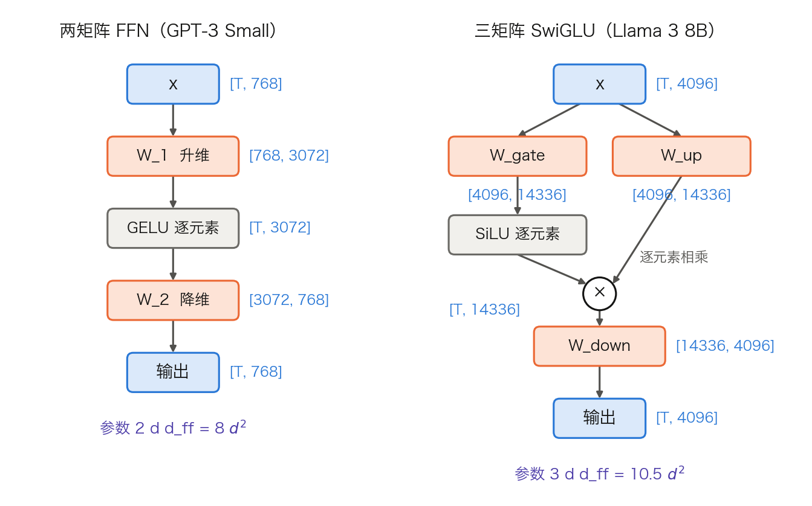
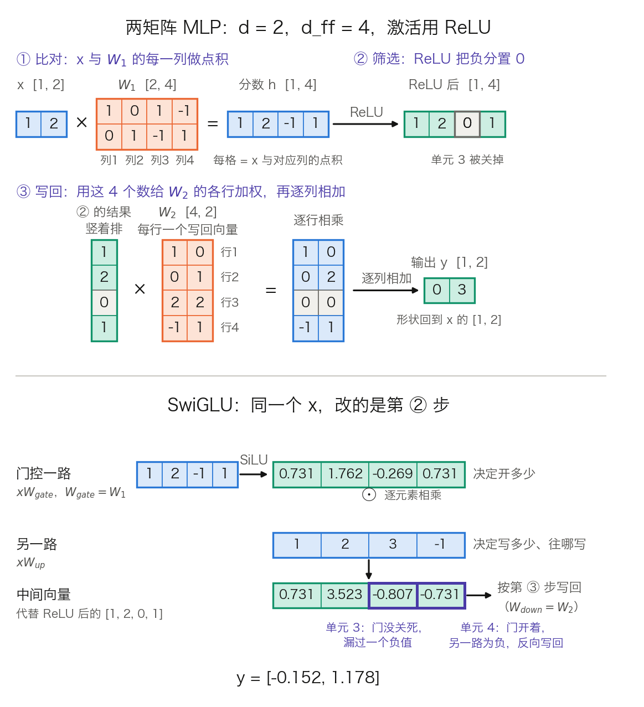

## 3.4 前馈网络：Transformer 的“记忆层”

注意力在位置之间搬运信息，但对搬来的内容只做线性组合；一层里就地算出新特征的是**逐位置前馈网络**（Position-wise Feed-Forward Network，FFN）。它拿 $$d_{ff}$$ 个方向去比对当前位置的向量，被激活的方向各自向残差流（各层共同读写的主通路，见 [3.5.4 节](3.5_residual.md)）写回一个向量。它是参数的主体：两矩阵、4 倍宽时占一层的三分之二，配上 GQA 后到八成，因此也是 Decode 时访存的主体，是知识编辑与 MoE 下手的地方。今天的默认是无偏置的门控 FFN（多为 SwiGLU，$$d_{ff}$$ 按参数预算定，常见为 $$d_{\text{model}}$$ 的 2.6 到 5.3 倍，个别达 8 倍）；依据是等参对照实验里稳定的小幅提升，起作用的是两路投影相乘，换哪一条激活曲线影响很小。标题里的“记忆层”是一个有限度的比喻：键值记忆的视角有实证支持，但知识并不只存放在 FFN 里（3.4.3）。

代码和不少文献把 FFN 叫作 MLP（多层感知机），[3.8 节](3.8_gpt_inference_flow.md)沿用 MLP 这个名字，两者指同一个子层。

### 3.4.1 结构与形状：从两矩阵到三矩阵

原始 FFN 是两层全连接，中间夹一个逐元素激活：

$$\text{FFN}(x) = f(x W_1 + b_1) W_2 + b_2$$

$$f$$ 是逐元素作用的激活函数。把单个位置的表示 $$x$$ 视为行向量，则 $$W_1 \in \mathbb{R}^{d_{\text{model}} \times d_{ff}}$$、$$W_2 \in \mathbb{R}^{d_{ff} \times d_{\text{model}}}$$。原始 Transformer base 取 $$f = \text{ReLU}$$、$$d_{ff} = 2048$$，是 $$d_{\text{model}} = 512$$ 的 4 倍。

按 [3.8 节](3.8_gpt_inference_flow.md)的记法写出形状，`T` 是词元数：

- `X[T, d] × W_1[d, d_ff] → H[T, d_ff]`
- `H[T, d_ff] → f(H)[T, d_ff]`（逐元素，不改形状）
- `f(H)[T, d_ff] × W_2[d_ff, d] → Y[T, d]`

现代开源模型多数改用 **SwiGLU**（各模型的实际选择见 3.4.5 的表 3-9）。它把升维那一步拆成两路并行投影，一路过激活当作门，另一路直通：

$$\text{FFN}_{\text{SwiGLU}}(x) = \left(\text{SiLU}(x W_{\text{gate}}) \odot x W_{\text{up}}\right) W_{\text{down}}$$

其中 $$\odot$$ 是逐元素乘，$$W_{\text{gate}}, W_{\text{up}} \in \mathbb{R}^{d \times d_{ff}}$$，$$W_{\text{down}} \in \mathbb{R}^{d_{ff} \times d}$$。两个激活函数的定义各一行，其中 $$\sigma$$ 专指 sigmoid 函数：

$$\text{SiLU}(z) = z \cdot \sigma(z), \qquad \sigma(z) = \frac{1}{1 + e^{-z}}$$

$$\text{GELU}(z) = z \cdot \Phi(z)$$

$$\Phi$$ 是标准正态的累积分布函数，GPT-2 等模型用的是它的 tanh 近似。

SwiGLU 的形状流多一路，但输入输出仍是 `[T, d]`：

- `X[T, d] × W_gate[d, d_ff] → G[T, d_ff]`，同时 `X[T, d] × W_up[d, d_ff] → U[T, d_ff]`
- `SiLU(G) ⊙ U → H[T, d_ff]`
- `H[T, d_ff] × W_down[d_ff, d] → Y[T, d]`

现代模型通常去掉 $$b_1$$、$$b_2$$，三个投影都不带偏置。图 3-2 把两种结构并排画出，标出各矩阵的真实形状。

图 3-2：两矩阵 FFN 与三矩阵 SwiGLU 的形状对照（[生成脚本](https://github.com/yeasy/llm_internals/blob/main/tools/figures/ch03_ffn_shapes.py)）。橙色是权重，蓝色是数据。左边取 GPT-3 Small 的配置，右边取 Llama 3 8B 的配置；两者的输入与输出都回到 `[T, d_model]`，差别只在中间那一段。

“逐位置”意味着同一组权重独立地作用于每个位置，位置之间不交换信息。这是与注意力互补的一半：注意力跨位置路由，FFN 就地变换。

**手算一次，看它做了什么。** 取 `d = 2`、`d_ff = 4` 的两矩阵 FFN，激活用 ReLU，不设偏置。输入是一个位置的向量 `x = [1, 2]`，权重是

$$
W_1 = \begin{bmatrix} 1 & 0 & 1 & -1 \\ 0 & 1 & -1 & 1 \end{bmatrix},\qquad
W_2 = \begin{bmatrix} 1 & 0 \\ 0 & 1 \\ 2 & 2 \\ -1 & 1 \end{bmatrix}
$$

$$W_1$$ 有 4 列，对应 4 个中间单元；$$W_2$$ 有 4 行，也对应这 4 个单元。计算分三步，图 3-3 上半幅按矩阵画出，表 3-6 逐单元列出：

1. **匹配。** `x` 与 $$W_1$$ 的每一列做点积，得到 4 个分数 `h = xW_1 = [1, 2, −1, 1]`。每一列相当于一个“探测方向”，分数越大，说明 `x` 越像它。
2. **筛选。** ReLU 把负分置 0，得到 `[1, 2, 0, 1]`。单元 3 与 `x` 方向相反，被关掉。
3. **写回。** 用这 4 个数给 $$W_2$$ 的 4 行加权求和：`y = 1·[1, 0] + 2·[0, 1] + 0·[2, 2] + 1·[−1, 1] = [0, 3]`。

| 单元 j | $$W_1$$ 第 j 列 | 分数 $$h_j$$ | ReLU 后 | $$W_2$$ 第 j 行 | 写回的量 |
| :---: | --- | ---: | ---: | --- | --- |
| 1 | `[1, 0]` | 1 | 1 | `[1, 0]` | `[1, 0]` |
| 2 | `[0, 1]` | 2 | 2 | `[0, 1]` | `[0, 2]` |
| 3 | `[1, −1]` | −1 | 0 | `[2, 2]` | `[0, 0]` |
| 4 | `[−1, 1]` | 1 | 1 | `[−1, 1]` | `[−1, 1]` |
| 合计 | | | | | `[0, 3]` |

表 3-6：两矩阵 FFN 对 `x = [1, 2]` 的逐单元计算。每一行彼此独立：先用 $$W_1$$ 的一列打分，再按分数写回 $$W_2$$ 的一行，最后把四行相加，合计即输出 `y`。

图 3-3：两矩阵 MLP 与 SwiGLU 对同一个 `x = [1, 2]` 的逐步计算（[生成脚本](https://github.com/yeasy/llm_internals/blob/main/tools/figures/ch03_ffn_walkthrough.py)）。蓝色是随输入变化的数据，橙色是权重，青绿是激活后的中间结果，灰格是被 ReLU 关掉的单元。上半幅是比对、筛选、写回三步；下半幅是 SwiGLU，它只替换第 ② 步，写回一步不变。

FFN 所做的事可以概括为一句：**拿 `d_ff` 个方向去比对当前向量，被激活的那些各自写回一个向量，加总后交给残差流。** `d_ff` 就是这样的“比对—写回”对的个数，GPT-3 Small 有 3,072 对，Llama 3 8B 有 14,336 对。3.4.3 的键值记忆视角说的正是这个结构。

ReLU 这一步让结果不再是线性的。把输入取反为 `[−1, −2]`，分数变成 `[−1, −2, 1, −1]`，只有单元 3 通过，输出是 `[2, 2]`；若 FFN 是线性的，输入取反，输出只会跟着取反，得到 `[0, −3]`。去掉激活函数，$$W_1 W_2$$ 就合并成一个 `[2, 2]` 矩阵，四个单元的分工随之消失。

**SwiGLU 改的是第 2 步**（图 3-3 下半幅）。 两矩阵版本里，开多少和写多少都由同一个分数决定；SwiGLU 把两者拆开，门控一路 `SiLU(xW_gate)` 决定开多少，另一路 `xW_up` 决定写多少、朝哪个方向写。沿用上例，令 `W_gate = W_1`、`W_down = W_2`，再取

$$
W_{\text{up}} = \begin{bmatrix} 1 & 0 & 1 & -1 \\ 0 & 1 & 1 & 0 \end{bmatrix}
$$

门控一路是 `SiLU([1, 2, −1, 1]) = [0.731, 1.762, −0.269, 0.731]`，另一路是 `xW_up = [1, 2, 3, −1]`，逐元素相乘得中间向量 `[0.731, 3.523, −0.807, −0.731]`，写回后 `y ≈ [−0.152, 1.178]`。与 ReLU 版本的 `[1, 2, 0, 1]` 相比有两处不同：单元 3 的门没有完全关死，漏过一个小负值；单元 4 的门是开的，但另一路是 −1，于是反向写回。

### 3.4.2 为什么注意力之外还要 FFN

一个常见的说法是“没有 FFN，多层注意力会塌缩成一层线性变换”。这句话不成立：注意力权重由 $$QK^\top$$ 经 Softmax 得到，本身既非线性又依赖输入，多层堆叠并不等价于单个线性映射。

FFN 的作用有两项。其一是**通道混合**：注意力的输出是 Value 的加权和，权重对所有通道相同；$$W_V$$ 与 $$W_O$$ 虽然也组合通道，但只是固定的线性组合。$$W_1$$ 与 $$W_2$$（或 gate/up/down 三者）之间夹着逐元素非线性，哪些单元参与组合随输入而变。其二是**逐位置非线性**：把表示升到 $$d_{ff}$$ 维，在高维空间做一次选择性响应，再压回 $$d_{\text{model}}$$ 维。

分工可以这样对照：注意力决定“从哪里取信息”，FFN 决定“取到之后怎么算”。两者都在残差流上读写，互不替代。

### 3.4.3 键值记忆视角：依据与限度

把 FFN 看作一张查询表，有实证依据，也有明确的限度。

**依据。** [Geva 等人 2021 年的工作](https://arxiv.org/abs/2012.14913)提出 FFN 像键值记忆一样工作：在本节的右乘记法下，$$W_1$$ 的每一列是一个“键”，与训练样本里的某类文本模式相关，匹配的输入让对应的中间单元激活；$$W_2$$ 的对应行是“值”，被加权后写回残差流，每个值对应输出词表上的一个分布。该文还观察到低层的键多对应浅层模式，高层的键更偏语义。

**应用。** [ROME](https://arxiv.org/abs/2202.05262)（Meng 等人 2022 年）用因果干预定位到中间层 FFN 在处理主语词元时的一组计算，再用一次秩一更新改写这些权重，把某个主语的属性换成另一个值。它证明的是中间层 FFN 在存储事实关联上起重要作用，没有证明事实只存在这里。

**限度。** [Hase 等人 2023 年的工作](https://arxiv.org/abs/2301.04213)发现，因果追踪定位到的层并不能预测编辑哪一层效果最好，编辑效果主要取决于选了哪一层。“定位到哪一层”与“编辑哪一层有效”是两件事。另一条限度来自可解释性研究：单个中间单元通常同时响应多种无关的模式，更合适的分析单位是方向，即稀疏特征（见 [14.8.1 节](../14_future_trends/14.8_interpretability.md)）。

综合起来：键值记忆是一个好用的解释模型，编辑 FFN 权重确实能改写事实关联，但不能由此推出知识像数据库记录一样只存放在 FFN 里，也不能用定位结果直接指导编辑。

### 3.4.4 中间层多宽：4 倍、8/3 与真实取值

原始 Transformer 取 $$d_{ff} = 4 d_{\text{model}}$$，两矩阵版本的参数量是 $$2 d \cdot d_{ff} = 8d^2$$。

SwiGLU 有三个矩阵，参数量是 $$3 d \cdot d_{ff}$$。若要与 4 倍宽的两矩阵版本等参，需要

$$3 d \cdot d_{ff} = 8 d^2 \implies d_{ff} = \tfrac{8}{3} d \approx 2.667 d$$

[Shazeer 2020 年的 GLU Variants 论文](https://arxiv.org/abs/2002.05202)正是这样做对照的：基线的 $$d_{ff} = 3072$$，GLU 类变体缩到 $$d_{ff} = 2048$$，使参数量与计算量保持不变。

**$$8/3$$ 只是等参的理论值，真实模型并不照抄。** Llama 2 7B 的中间宽度是 11,008，等于 $$2.6875 d$$，来历是 $$\tfrac{8}{3} \times 4096 = 10{,}922.7$$ 向上取整到 256 的倍数。Llama 3 把这一比例放宽：8B 与 70B 取 3.5 倍，405B 取 3.25 倍。其他系列差得更远：DeepSeek-V3 的稠密层约 2.6 倍，Qwen3 从 3 倍（8B）到 5 倍（32B），Qwen2.5-7B 约 5.3 倍，[Gemma 2](https://arxiv.org/abs/2408.00118) 的 2B、9B 取 4 倍，27B 取 8 倍。表 3-7 给出三个模型一层内部的参数分配。其中注意力一列按 `2 d² + 2 d · n_kv · d_h` 计：$$W_Q$$、$$W_O$$ 各 `d²`；$$W_K$$、$$W_V$$ 各 `d × n_kv · d_h`，`n_kv` 是 K/V 头数，`d_h` 是每头宽度（GQA 见 [2.3.7 节](../02_attention/2.3_multi_head.md)）。普通多头注意力的 `n_kv · d_h = d`，四个矩阵合计 `4 d²`。

| 模型 | `d_model` | `d_ff` | `d_ff / d` | 注意力 | FFN | FFN 占一层 |
| --- | ---: | ---: | ---: | ---: | ---: | ---: |
| GPT-3 175B | 12,288 | 49,152 | 4.00 | 4.0 `d²` | 8.0 `d²` | 66.7% |
| Llama 2 7B | 4,096 | 11,008 | 2.6875 | 4.0 `d²` | 8.06 `d²` | 66.8% |
| Llama 3 8B | 4,096 | 14,336 | 3.50 | 2.5 `d²` | 10.5 `d²` | 80.8% |

表 3-7：一层内部的参数分配。GPT-3 与 Llama 2 是普通多头注意力，注意力项为 `4 d²`；Llama 3 8B 用 GQA，`n_kv = 8`、`d_h = 128`，降到 `2.5 d²`。FFN 项按结构分两种算法：两矩阵版本是 `2 d · d_ff`，三矩阵 SwiGLU 是 `3 d · d_ff`。末列的分母还计入每层归一化的参数（两个 RMSNorm 共 `2d`，两个 LayerNorm 共 `4d`）。`d_ff` 取自各模型的 `config.json`（GPT-3 按论文规定的 `4 × d_model` 算出）。

表里的规律是：**GQA 省下的参数被挪给了 FFN。** Llama 3 8B 的注意力比 Llama 2 7B 少了 $$1.5 d^2$$，FFN 多了 $$2.4 d^2$$，一层反而更大。“FFN 占三分之二”对 GPT-3 式配置成立；到了 Llama 3 8B，FFN 已占一层的八成。

**宽度没有独立的最优值。** [Transformer 原论文](https://arxiv.org/abs/1706.03762)的消融里，$$d_{ff}$$ 从 1,024 加到 4,096，开发集 BLEU 从 25.4 升到 26.2，参数从 5,300 万增到 9,000 万：加宽有收益，但它与层数、$$d_{\text{model}}$$ 竞争同一份参数预算。[Kaplan 等人](https://arxiv.org/abs/2001.08361)的实测是，固定参数量后性能对模型形状不敏感（数字见 [3.7.3 节](3.7_full_architecture.md)）。选型时先定总参数量，$$d_{ff} / d$$ 随之按惯例取，公开模型常见 2.6 到 5.3，个别达 8。

### 3.4.5 激活函数为什么从 ReLU 换到 SwiGLU

换成 SwiGLU 的依据是一次等参对照实验里稳定的小幅提升，其中起作用的是**门控**，即两路投影逐元素相乘；换哪一条激活曲线影响很小。

**证据。** GLU Variants 论文在参数量与计算量对齐的条件下比较了八种 FFN，表 3-8 摘录其表 1 的一列。

| FFN 变体 | 524,288 步的 heldout log 困惑度 |
| --- | ---: |
| ReLU（基线） | 1.677 |
| GELU | 1.679 |
| Swish | 1.683 |
| GLU | 1.663 |
| Bilinear | 1.648 |
| ReGLU | 1.645 |
| SwiGLU | 1.636 |
| GEGLU | 1.633 |

表 3-8：GLU Variants 论文表 1 中训练 524,288 步后留出集上的 log 困惑度，任务是 T5 的 span-filling 目标；log 困惑度即留出数据上每词元的平均交叉熵，越低越好（定义见 [6.1 节](../06_training_techniques/6.1_loss_optimizer.md)）。该文对机理未给解释，原话是“We offer no explanation as to why these architectures seem to work”。

读表时分两组：前三行不门控，后五行门控。5 个门控变体全部优于 3 个不门控变体，连两路都不加激活的 Bilinear 也是；不带门控、只把 ReLU 换成 Swish 的那一行（1.683）反而略差于 ReLU 基线（1.677）。组内差异很小，SwiGLU 与 GEGLU 只差 0.003，选哪一个更多是工程惯例。

**门控改变了什么。** GLU 类结构里，一个单元通过多少由输入的**另一条**投影决定，不由同一条投影的符号决定。开多少与写多少成了两个分数（3.4.1 的手算），一路的输出幅度可以被另一路独立调节，这是一种乘性交互，单纯换激活函数做不到。它为什么带来提升，目前只有这条结构上的直觉。

**名字怎么拆。** GLU（Gated Linear Unit，门控线性单元）出自 [Dauphin 等人 2016 年的工作](https://arxiv.org/abs/1612.08083)：对同一个输入做两次线性投影，一路过 sigmoid 当门，与另一路逐元素相乘。把 sigmoid 换成别的函数 $$f$$，得到一族结构：

$$\text{GLU}_f(x) = f(xW_{\text{gate}}) \odot xW_{\text{up}}, \qquad \text{FFN}(x) = \text{GLU}_f(x)\,W_{\text{down}}$$

$$f$$ 取 sigmoid、恒等、ReLU、GELU、Swish，分别是 GLU、Bilinear、ReGLU、GEGLU、SwiGLU。[Swish](https://arxiv.org/abs/1710.05941) 定义为 $$\text{Swish}_\beta(z) = z\,\sigma(\beta z)$$，取 $$\beta = 1$$ 就是 3.4.1 的 SiLU，所以论文写 Swish，代码写 `silu`，结构整体叫 SwiGLU，是同一个东西。$$f$$ 不取 sigmoid 时门值没有上界，GELU 与 Swish 还会取负值（图 3-3 的单元 3），“门”只是比喻，实质是两路投影相乘。

**激活曲线本身。** ReLU 在整个负半轴严格为零，梯度也为零，单元长期落在负半轴就不再更新，即死神经元。GELU 与 SiLU 在负半轴保留一小段非零响应（最小值约 −0.170 与 −0.278），梯度处处非零；三者在正半轴都接近恒等。表 3-8 的前三行说明，这一差别在这组实验里没有换来收益。

**现在的主流是哪一种。** 看公开权重最直接。表 3-9 汇总了几个代表模型。

| 模型 | 年份 | FFN 结构 | 激活字段 | 备注 |
| --- | ---: | --- | --- | --- |
| GPT-2 | 2019 | 两矩阵 | `gelu_new` | GPT-3 沿用 |
| Mistral 7B | 2023 | SwiGLU | `silu` | |
| Llama 3.1 8B | 2024 | SwiGLU | `silu` | |
| OLMo 2 7B | 2024 | SwiGLU | `silu` | |
| Phi-4 | 2024 | SwiGLU | `silu` | gate、up 合存 |
| Qwen3 8B | 2025 | SwiGLU | `silu` | |
| DeepSeek-V3 | 2024 | MoE，专家为 SwiGLU | `silu` | 前 3 层稠密 |
| Kimi K2 | 2025 | MoE，专家为 SwiGLU | `silu` | 前 1 层稠密 |
| Gemma 2、3 | 2024、2025 | GeGLU | `gelu_pytorch_tanh` | |
| gpt-oss | 2025 | MoE，SwiGLU 变体 | `silu` | 门控与另一路都带截断 |
| Nemotron-4 | 2024 | 两矩阵 | `relu2` | 平方 ReLU |

表 3-9：代表模型的 FFN 结构，取自各模型的 `config.json` 与 HF transformers 中对应的 MLP 实现。“两矩阵”指不门控的原始结构；Nemotron-4 一行取同一架构的 Nemotron-Mini-4B 配置。各字段的含义与几处实现细节，实现对照见[附录 A.7](../appendix/a7_framework_recipes.md)。

结论分三层。第一，2023 年以来的公开权重解码器里，门控 FFN 已是默认，其中 SwiGLU 占多数。第二，它不是唯一选择：Gemma 用 GeGLU，这与表 3-8 里两者几乎不分高下相吻合；Nemotron-4 则回到不门控的两矩阵结构，只把激活换成平方 ReLU。第三，MoE 改变的是“每层有几个 FFN、每个词元用哪几个”，没有改变单个 FFN 的结构：DeepSeek-V3、Kimi K2 的每个专家仍是一份 SwiGLU，对单个词元而言，等效的中间宽度是专家宽度乘以被激活的专家数（见 [14.2 节](../14_future_trends/14.2_moe.md)）。闭源模型的 FFN 细节未公开，不在此列。

**门控在全书的其他位置。** 判断一个结构算不算门控，看两点：门值是否由当前输入算出，是否逐元素乘到另一股信号上。按这个判据，LSTM 的门（[1.2 节](../01_introduction/1.2_rnn_cnn_limits.md)）、线性注意力与状态空间模型的衰减（[14.1 节](../14_future_trends/14.1_efficient_attention.md)、[14.3 节](../14_future_trends/14.3_ssm_hybrid.md)）、[Gated Attention](https://arxiv.org/abs/2505.06708) 在每个头输出上乘的 sigmoid 门（Qwen3.5 的全注意力层采用）、MoE 的路由分数（[14.2 节](../14_future_trends/14.2_moe.md)）都是门控；注意力权重与 RMSNorm 的 $$\gamma$$ 不是，前者是位置之间的加权平均，后者训练后固定、不随输入变化。

### 3.4.6 FFN 的开销与失效情形

**计算量。** 每个词元的 FFN 前向约 $$2 \times 3 \times d \times d_{ff}$$ 次浮点运算，两矩阵版本是 $$2 \times 2 \times d \times d_{ff}$$（每个权重一次乘加记 2 次，约定见 [1.4.5 节](../01_introduction/1.4_transformer_idea.md)）。Llama 3 8B 每层是 $$6 \times 4096 \times 14336 \approx 3.52 \times 10^8$$，32 层共约 $$1.13 \times 10^{10}$$，约为全模型前向 $$2N = 1.61 \times 10^{10}$$ 的七成（$$N$$ 为总参数量，见 [3.7.7 节](3.7_full_architecture.md)）。其余由注意力的四个投影（$$2.68 \times 10^{9}$$）和 LM head（$$1.05 \times 10^{9}$$）承担；嵌入查表只按行取值，不做乘加，$$2N$$ 在这一项上是高估。

**Decode 阶段 FFN 是访存的主体。** FFN 不跨位置，Decode 每轮只有一行输入，计算量与序列长度无关。Llama 3 8B 的一层 FFN 仍要做约 3.5 亿次运算，为此要把 1.76 亿个权重（BF16 下约 352 MB）完整读一遍，每读 1 字节只配约 1 次运算。注意力的四个投影同样如此；FFN 成为主体，只因为它占了八成参数。这是 [3.8.8 节](3.8_gpt_inference_flow.md)里 Decode 受显存带宽限制的主要来源，也是 MoE 选择稀疏化 FFN 而不动注意力的原因（见 [14.2 节](../14_future_trends/14.2_moe.md)）。

另有三条性质在后文用到。其一，ReLU 模型的中间层有大量精确为零的单元，可以据此跳过计算；SiLU 与 GELU 的输出几乎处处非零，依赖这种稀疏性的加速手段随之失效。其二，少数通道会出现远大于其余通道的激活值，写回残差流后一路传下去，是低比特量化最主要的困难来源（见 [10.4 节](../10_inference_optimization/10.4_quantization.md)）。其三，“逐位置”带来两个工程便利：Prefill 时可以把词元任意切块分批过 FFN，分块 Prefill 依赖这一点；张量并行时按列切 `W_gate` 与 `W_up`、按行切 `W_down`，整层只需一次 all-reduce（见 [7.3 节](../07_distributed_training/7.3_model_tensor_parallel.md)）。

### 3.4.7 对到实现

读一个新模型的 FFN，`config.json` 里四个字段就够：`hidden_size`、`intermediate_size`、`hidden_act`、`mlp_bias`，三个矩阵的参数量随即是 `3 × hidden_size × intermediate_size`。模块名、推理引擎合并 gate 与 up 两个投影的做法，实现对照见[附录 A.7](../appendix/a7_framework_recipes.md)。
