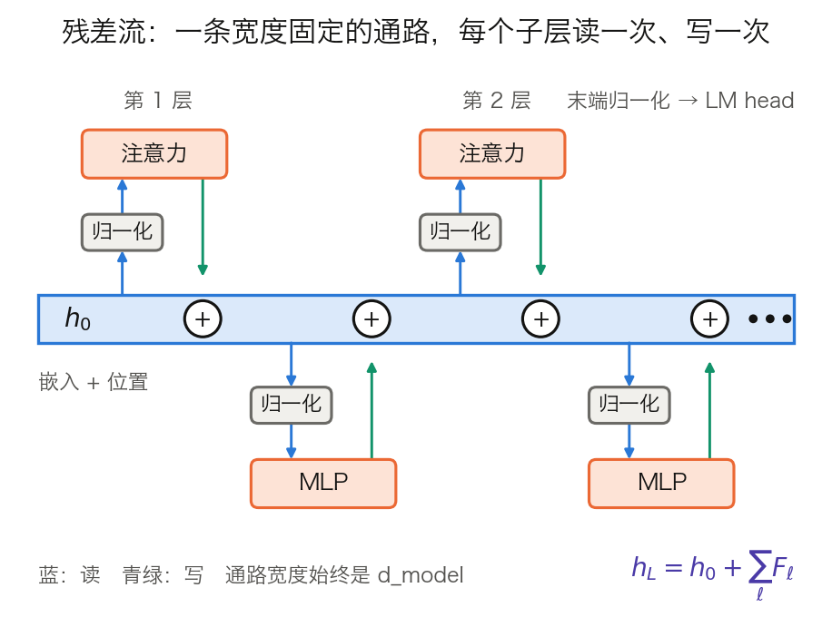

## 3.5 残差连接：梯度为什么能流过百层网络

**残差连接**（Residual Connection）把“每层算出一个新表示”改成“每层向一条共享通路加一个修正”：末层表示等于初始嵌入加全部子层输出之和。反向看，网络的行为更像许多条较浅路径的集成，优化从“恒等”这个好起点出发；恒等通路改善梯度的传播，但并不保证梯度不消失，标题所说的梯度通路只是这一改写的结果之一。前向看，这条宽度固定的**残差流**是各子层之间唯一的通信通道，写入线性可加，因而可以逐项归因。代价是写入逐层累加，尺度随深度增长，所以要配两样东西：归一化管读出的尺度，初始化（残差分支末端乘 $1/\sqrt{2L}$）管写入的初始尺度。以单位权重相加只是一种设计选择，多路可学习的残差是它的推广，但必须保住恒等通路不放大也不缩小信号的性质（3.5.5）。

### 3.5.1 退化问题：原论文怎么说

更深的网络理应不比浅网络差：只要多出来的层学成恒等映射，深网络就能复现浅网络。He 等人 2015 年的 [ResNet](https://arxiv.org/abs/1512.03385) 报告的实验却相反：网络加深后准确率先饱和、再迅速下降，而且变高的是训练误差本身。这一现象称为**退化**。它不是过拟合，也不是梯度消失，是优化困难。

后一点常被讹传。原文明确否定了梯度消失这一归因：“We argue that this optimization difficulty is unlikely to be caused by vanishing gradients.” 那些不带残差的网络用了 BatchNorm，前向信号与反向梯度的范数都正常。原文给出的解释是求解器难以用多个非线性层逼近恒等映射：解存在，但找不到。

两种说法要分开：“难以逼近恒等映射”出自原论文，“残差提供梯度通路”是后来对 Transformer 训练的普遍观察。Transformer 去掉残差的后果还有前向一侧的证据：[2.5 节](../02_attention/2.5_complexity_limits.md)已经提到，去掉残差连接与 MLP 的纯注意力网络，输出各行随深度迅速趋同。3.5.3 给出梯度一侧的算术。

### 3.5.2 学残差而不是学映射

残差连接的想法是：不让网络直接学目标映射 $H(x)$，而是学**残差** $F(x) = H(x) - x$，输出写成

$$H(x) = x + F(x)$$

若目标接近恒等映射，即 $H(x) \approx x$，那么 $F(x) \approx 0$。让一组权重趋近于零，比让它们精确拼出一个恒等矩阵容易得多。这一重构的作用是换一个更好的起点；真实任务里恒等映射未必是最优解，原论文也是这样限定的。

Transformer 中每个子层都包在这样一条加法里：

$$\text{output} = x + \text{Sublayer}(x)$$

$\text{Sublayer}$ 可以是注意力，也可以是 FFN。

**维度一致性是这条加法的直接后果。** $x$ 与 $\text{Sublayer}(x)$ 必须同形状才能相加，所以 Transformer 里每一层的输入输出宽度都固定为 $d_{\text{model}}$。[3.4 节](3.4_feedforward.md) FFN 的沙漏形状正源于此：中间可以临时扩到 $d_{ff}$，两端必须回到 $d_{\text{model}}$。注意力也一样，各头结果拼接后由 $W_O$ 投回 $d_{\text{model}}$。

### 3.5.3 反向：$2^L$ 条路径与一个数值对照

雅可比（Jacobian）是指一层的输出对输入的导数矩阵，第 $(i, j)$ 个元素是第 $i$ 个输出分量对第 $j$ 个输入分量的偏导；输入输出都是标量时，它就是普通导数。无残差时，梯度要按层序连乘每一层的雅可比（下式把梯度写成行向量）：

$$\frac{\partial \mathcal{L}}{\partial h_0} = \frac{\partial \mathcal{L}}{\partial h_L} A_L \cdots A_1, \qquad A_l = \frac{\partial h_l}{\partial h_{l-1}}$$

连乘对尺度极其敏感。看最简单的情形：每层都是标量乘法 $h_l = \rho h_{l-1}$，96 层后的梯度缩放恰好是 $\rho^{96}$。$\rho = 0.9$ 时 $0.9^{96} \approx 4.05 \times 10^{-5}$，梯度显著衰减；$\rho = 1.1$ 时 $1.1^{96} \approx 9.41 \times 10^{3}$，梯度显著放大。深度会放大持续的尺度偏差。对一般矩阵，各层的谱范数（矩阵能把向量长度放大的最大倍数）之积只给出连乘的**上界**，实际缩放还取决于各矩阵的方向；单层谱范数接近 1 不足以保证整体梯度稳定。

有残差时 $h_l = h_{l-1} + F_l(h_{l-1})$，单层雅可比变成

$$\frac{\partial h_l}{\partial h_{l-1}} = I + J_l, \qquad J_l = \frac{\partial F_l}{\partial h_{l-1}}$$

假设相加后没有额外变换，把连乘按层序展开：

$$(I + J_L) \cdots (I + J_1) = I + \sum_l J_l + \sum_{l < m} J_m J_l + \cdots + J_L \cdots J_1$$

展开式共 $2^L$ 项，每一项对应一条“在每层上选择进入子层或跳过”的路径；经过 $k$ 个子层的路径有 $\binom{L}{k}$ 条。恒等项 $I$ 是其中最短的一条，每层都选跳过，梯度不经任何子层直接传到底。

恒等项提供一条直接通路，但其他项可能与它抵消，不能据此给整体梯度一个非零下界。例如每层取 $F_l(x) = -0.9x$，残差输出便是 $x - 0.9x = 0.1x$，96 层后的梯度缩放仍只有 $0.1^{96} = 10^{-96}$。[He 等人的后续分析](https://arxiv.org/html/1603.05027v3)强调恒等通路有助于优化；残差连接改善梯度传播条件，并不保证梯度永不消失或爆炸。

[Veit 等人 2016 年的工作](https://arxiv.org/abs/1605.06431)把这一展开当作解释残差网络的主线。路径长度服从二项分布，对 54 个残差模块的网络，95% 以上的路径只经过 19 到 35 个模块；训练中的梯度则主要来自更短的路径，长度在 10 到 34 层之间。由此得到一个比“梯度高速公路”更可检验的说法：深层残差网络在训练中的行为，更接近许多条较浅路径的集成，而不是一条很深的链。同一项工作的删层实验与此一致：在图像残差网络上，测试时删掉单个模块，精度只小幅下降，不带残差的网络删掉一层则完全失效。

### 3.5.4 前向：残差流、方差增长与初始化缩放

再看前向。以子层前归一化的 [Pre-Norm 结构](3.6_layer_norm.md)为例。3.5.3 的 $h_l$ 按层编号，这里改按子层编号：$s = 1, \dots, 2L$，$F_s$ 是第 $s$ 个子层，$h_s$ 是它写入之后的残差流，$\text{Norm}$ 是子层读入之前的那次归一化（[3.6.5 节](3.6_layer_norm.md)详述）。每个子层做的是 $h_s = h_{s-1} + F_s(\text{Norm}(h_{s-1}))$，把这条递推式正向展开（不含模型末端的最终归一化）：

$$h_{\text{out}} = h_0 + \sum_{s=1}^{2L} F_s\left(\text{Norm}(h_{s-1})\right)$$

求和上限是 $2L$ 而不是 $L$：每层有注意力与 FFN 两个子层，各写入一次。最终表示等于**初始嵌入加上所有子层输出之和**。这条贯穿全模型、宽度恒为 $d_{\text{model}}$ 的向量通路称为**残差流**（residual stream）。

残差流给出了一个统一的读写视角：每个子层从流上读一份（先经归一化），算出自己的贡献，再把结果加回流上；子层之间不直接相连，全部通过这条流通信。图 3-4 把两层四个子层的读写画出来。

图 3-4：残差流。各子层从同一条通路读、向同一条通路写（[生成脚本](https://github.com/yeasy/llm_internals/blob/main/tools/figures/ch03_residual_stream.py)）。蓝色箭头是读，读操作不改变通路；青绿色箭头是写，写操作是一次逐元素相加。通路宽度始终是 `d_model`，这正是 3.5.2 的维度约束。

这个视角有三条直接推论。

其一，各子层的贡献是**线性叠加**的，因此可以逐项拆开分析：某个注意力头写了什么、某个 FFN 写了什么，可以分别投影到词表上看。这是 Logit Lens 一类方法可行的前提（见 [14.8 节](../14_future_trends/14.8_interpretability.md)）。能拆开的只是最后这次加法：每一项本身仍是它之前所有写入的非线性函数，逐项分析回答的是谁写了什么，不能回答去掉某一项后其余各项会怎样变。

其二，靠前的子层写进去的东西，靠后的所有子层都读得到，无须逐层转发。跨层组合（如第 $l$ 层的头读第 $l'$ 层写入的特征）因此成为可能。

其三，残差流的宽度固定，$d_{\text{model}}$ 是这条通路的全部带宽。子层要写入互不干扰的信息，只能占用不同的方向；特征数远多于维数时，只能靠近似正交的方向叠加（见 [14.8.1 节](../14_future_trends/14.8_interpretability.md)）。加宽 $d_{\text{model}}$ 放宽的是所有子层共用的带宽，加宽 $d_{ff}$ 只增加单个 FFN 的比对方向数，两者不能互相替代。

**残差的尺度风险：方差可能随深度增长。** 相加可以增强信号，也可以抵消信号；对任一坐标，$\operatorname{Var}(x+F) = \operatorname{Var}(x) + \operatorname{Var}(F) + 2\operatorname{Cov}(x,F)$。设 $h_0$ 与各子层输出近似零均值、各子层输出每个坐标的方差同量级 $s^2$，并且两两协方差的总贡献可忽略，则逐坐标有

$$\text{Var}(h_{\text{out}}) \approx \text{Var}(h_0) + 2L \cdot s^2$$

方差随深度**线性增长**，均方根范数 $\sqrt{\mathbb{E}\|h\|_2^2}$ 约按 $\sqrt{2L}$ 增长。取 $\text{Var}(h_0) = s^2 = 1$：$L = 12$ 时方差约为 $1 + 24 = 25$，均方根范数为初值的 5.0 倍；$L = 96$ 时方差约为 193，均方根范数为 $\sqrt{193} = 13.9$ 倍。后果有两条：深层的子层输出相对于已积累的和越来越小，贡献被稀释；残差流的数值范围抬高，对低精度训练不利。

GPT-2 的对策是在初始化时压小每个残差分支的末端投影：把这些权重的初始标准差乘以 $1/\sqrt{N}$，$N$ 是残差层的个数（[GPT-2 论文](https://cdn.openai.com/better-language-models/language_models_are_unsupervised_multitask_learners.pdf) 2.3 节）。实现里 $N$ 取 $2L$，即每层两次残差相加各算一次，只作用于注意力与 FFN 的输出投影。基准标准差为 0.02 时，$L = 12$ 得 $0.02 / \sqrt{24} = 0.0041$，$L = 96$ 得 $0.02 / \sqrt{192} = 0.0014$。这样每个分支的初始输出方差正比于 $1/(2L)$，上式的 $2L \cdot s^2$ 不再随深度增长。

这是一条**只作用于初始化**的措施：训练开始后权重自行调整，范数仍可能长大；把归一化放在子层之前（Pre-Norm，见 [3.6.5 节](3.6_layer_norm.md)）也不直接约束残差流本身的范数。同一条缩放放在训练配方里看，以及它与损失尖峰、logits 尺度失控的关系，见 [6.3.5 节](../06_training_techniques/6.3_regularization.md)的表 6-4。

两件事合起来看：分支逐层累加会改变通路的尺度，所以既要靠归一化管住读出的尺度，也要靠初始化控制写入的初始尺度。

### 3.5.5 固定权重求和的代价与替代方案

上面的公式还隐含一件事：所有子层的输出以**固定的单位权重**相加。第 1 层的粗浅特征和第 50 层的推理结果在最终表示中权重相同，模型只能靠调整各分支自身的幅度来分配话语权。固定权重求和是一个设计选择，可以改；所有改法面对的是同一条约束：不能破坏恒等通路的尺度性质。表 3-10 列出五类改法及其代价。

| 方案 | 公式 | 改动的对象 | 代价 |
| --- | --- | --- | --- |
| Highway | $h = g \odot F(x) + (1 - g) \odot x$ | 用可学习的门控分配残差与分支 | 恒等路径被门衰减，深度一大又回到连乘问题 |
| ReZero / SkipInit | $h = x + \alpha F(x)$，$\alpha$ 初始为 0 | 给每个分支一个可学习标量 | 训练初期分支形同不存在，收敛路径改变 |
| 初始化缩放 | $h = x + F(x)$，$F$ 末端初始化乘 $1/\sqrt{2L}$ | 只改初值，结构不变 | 只在初始时刻成立，训练中不再保持 |
| 深度维注意力 | $h_l = \sum_{j<l} \alpha_{j\to l} v_j$ | 用注意力权重替代固定求和 | 需要保存前序层输出，额外内存与计算 |
| 超连接 / mHC | $X_s = H^{\text{res}} X_{s-1} + (H^{\text{post}})^{\top} F(H^{\text{pre}} X_{s-1})$ | 把残差流加宽成 $n$ 路，读、写、混合的系数都可学习 | 残差流的访存与激活显存随 $n$ 增长；混合矩阵须加约束才能稳定训练 |

表 3-10：五类替代固定权重求和的做法。前两类改的是分支的缩放系数，第三类只改初值，第四类改的是聚合方式本身，第五类把残差流加宽成多路。初始化缩放即 3.5.4 的做法，GPT-2 及沿用其训练配方的实现采用，其余模型的训练初始化多未公开；第五类的约束版本 mHC 用于 DeepSeek-V4（见 [13.3.3 节](../13_decoder_models/13.3_deepseek_gemini.md)）。

第四类的代表是 Moonshot AI 团队的[注意力残差](https://arxiv.org/abs/2603.15031)（AttnRes）：每层用一个可学习的向量对所有前序层的输出打分、按 Softmax 权重聚合，为控制开销只在若干层组成的块之间这样做。第五类已进入公开模型，下面展开。

**超连接把残差流加宽成多路。** **超连接**（Hyper-Connections，HC）由字节跳动团队的 [Hyper-Connections 论文](https://arxiv.org/abs/2409.19606)提出：把一条残差流扩成 $n$ 路，记 $X_s \in \mathbb{R}^{n \times d_{\text{model}}}$ 为第 $s$ 个子层写入之后的残差流，每行是一路。输入端把嵌入复制 $n$ 份作为 $X_0$，输出端把 $n$ 行相加。一个子层的更新是

$$X_s = H_s^{\text{res}} X_{s-1} + \left(H_s^{\text{post}}\right)^{\top} F_s\left(H_s^{\text{pre}} X_{s-1}\right)$$

$H_s^{\text{pre}} \in \mathbb{R}^{1 \times n}$ 把 $n$ 路合成一个向量交给子层，$H_s^{\text{post}} \in \mathbb{R}^{1 \times n}$ 把子层输出分别加到各路，$H_s^{\text{res}} \in \mathbb{R}^{n \times n}$ 让各路相互混合。子层 $F_s$ 的输入输出仍是 $d_{\text{model}}$ 维，内部计算量不变；$n = 1$ 且三个系数都取 1 时，上式退回普通残差。

问题出在 $H^{\text{res}}$。逐层展开后，直通项由 $h_0$ 变成 $H_S^{\text{res}} \cdots H_1^{\text{res}} X_0$，恒等项被 $S$ 个矩阵的连乘取代，3.5.3 的尺度敏感性回到了主通路上。取 $n = 2$，每个 $H^{\text{res}}$ 的对角元为 1、非对角元为 0.1：每列之和是 1.1，两路之和每过一个子层放大到 1.1 倍，96 个子层后是 $1.1^{96} \approx 9.41 \times 10^{3}$ 倍。[mHC 论文](https://arxiv.org/abs/2512.24880)在 27B 模型上观察到了这种情形：不加约束的超连接在约 1.2 万步处损失突增，连乘矩阵行和、列和的最大绝对值达到 3,000。

**mHC 把混合矩阵限制为双随机矩阵。** **流形约束超连接**（Manifold-Constrained Hyper-Connections，mHC）要求 $H_s^{\text{res}}$ 是**双随机矩阵**（doubly stochastic matrix），即元素非负、每行之和与每列之和都等于 1 的方阵。两组求和约束各管一件事。行和为 1：每一路的新值是各路旧值的加权平均，不会超出旧值的范围。列和为 1：各路之和不变，均值守恒；反向传播时每一路的梯度是下游各路梯度的加权平均，同样不被放大。取 $n = 2$，某个坐标上两路的值为 4 和 0：

$$
\begin{bmatrix} 0.7 & 0.3 \\ 0.3 & 0.7 \end{bmatrix}
\begin{bmatrix} 4 \\ 0 \end{bmatrix} =
\begin{bmatrix} 2.8 \\ 1.2 \end{bmatrix}
$$

均值仍是 2。再乘一次得 $(2.32, 1.68)$，均值仍是 2，两路之差每次缩小到 0.4 倍。双随机矩阵的乘积仍是双随机矩阵，所以无论叠多少层，直通项的均值都不变，幅度也不被放大。单位矩阵是双随机矩阵，对应各路互不混合；$n = 1$ 时双随机矩阵只有标量 1，即普通残差的恒等项。约束保住了恒等通路的尺度性质，同时留下各路混合的自由度；论文的消融里，只放开 $H^{\text{res}}$ 一项就拿到了大部分收益。

约束用 Sinkhorn-Knopp 迭代（交替做行、列归一化）近似实现，27B 模型上连乘之后的反向增益最大约 1.6，不加约束时接近 3,000。新增参数很少，代价在访存与显存：$n = 4$ 时未融合的实现每个子层维护残差流的访存约为普通残差的 10 倍，激活显存与流水线级间通信也随 $n$ 增长。论文用内核融合、反向重算与通信重叠把额外训练时间压到 6.7%，27B 模型的最终训练损失比普通残差低 0.021。DeepSeek-V4 采用 mHC，取 $n = 4$（见 [13.3.3 节](../13_decoder_models/13.3_deepseek_gemini.md)）。

### 3.5.6 对到实现

读一个新模型的层实现，先找两处“保存输入、算完子层再加回去”的语句，归一化夹在哪一侧，就确定了它的接线方式（实现对照见[附录 A.7](../appendix/a7_framework_recipes.md)）。两处工程细节与本节直接相关。其一，推理引擎常把“残差相加”与“下一次归一化”融进同一个内核：两步都是逐元素操作，合并后残差流只需读写一遍显存。其二，低精度训练中残差流常保留较高精度累加，原因正是 3.5.4 的方差增长：一路累加的数值范围最宽，最先溢出。

残差把子层的输出加回主通路，却没说这条通路的数值该有多大。下一节的归一化负责这件事。
