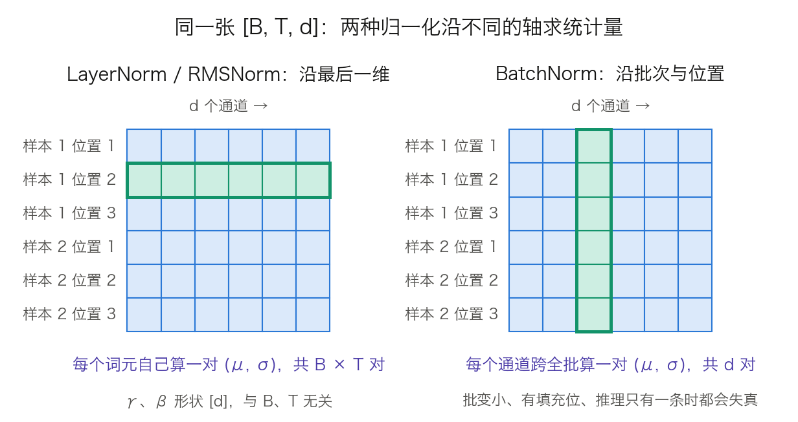
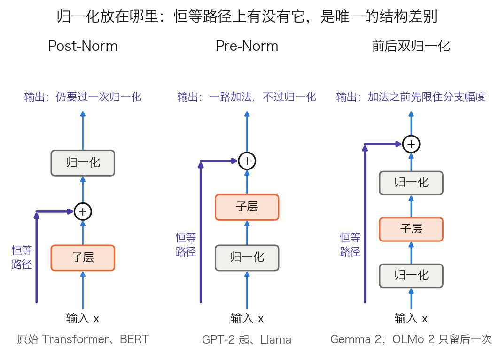

## 3.6 层归一化：为什么选择 LayerNorm 而非 BatchNorm

**归一化**（Normalization）让每个子层读到的输入落在固定的尺度上。残差流的尺度随深度和训练漂移，归一化之后，子层读到的内容与输入的整体缩放无关，权重不必逐层重新标定。Transformer 选层归一化，是因为它的统计量只取自单个词元自身，与批大小、序列长度、填充、训练还是推理都无关；RMSNorm 进一步说明起作用的是重缩放，减均值可以省掉。放在哪里比用哪一种更要紧：Post-Norm 把归一化放在主通路上，层数多了难训、离不开预热；Pre-Norm 保留一条纯加法的恒等通路，代价是残差流的尺度不受约束，末端必须补一次归一化。今天的默认是 Pre-Norm 加 RMSNorm，归一化用 FP32 计算；新变体只是在分支出口或 Q、K 上再加一道。

### 3.6.1 归一化解决什么问题

归一化提供**尺度不变性**：把输入向量整体放大或缩小若干倍，归一化后的结果不变。在 Transformer 里，它管住的是子层从残差流读到的尺度。[3.5.4 节](3.5_residual.md)已经说明残差流的方差随深度线性增长；没有归一化，越靠后的子层读到的向量越大，每层的权重都要适应各自的输入尺度，训练中尺度一漂移又要重新适应。归一化把子层读到的那一份拉回固定范围。它管的是读出的尺度，残差流本身的范数不受它约束，3.6.5 再回到这一点。

尺度不变性还带来一条优化上的性质。若一组权重之后紧跟归一化，把这组权重整体放大 $\alpha$ 倍，输出不变，梯度则缩小为 $1/\alpha$：权重范数越大，同样的学习率改变方向的幅度越小，等效学习率随权重范数自动调节。这是带归一化的网络对学习率不那么敏感的一个原因。

BatchNorm 论文最初给出的动机是**内部协变量偏移**（Internal Covariate Shift），即前面的层一更新，后面各层的输入分布就跟着变。[后续研究](https://arxiv.org/abs/1805.11604)表明，收益更可能来自损失地形变平滑、梯度更稳定可预测。

### 3.6.2 沿哪个轴：BN 与 LN 在 `[B, T, d]` 上的区别

一次前向的激活张量形状是 `[B, T, d]`：B 个样本、每个样本 T 个位置、每个位置 d 个通道。两种归一化的唯一差别是沿哪个轴求统计量。

**层归一化**（Layer Normalization）沿最后一维：

$$
\text{LN}(x) = \gamma \odot \frac{x - \mu_L}{\sqrt{\sigma_L^2 + \epsilon}} + \beta, \qquad
\mu_L = \frac{1}{d}\sum_{i=1}^{d} x_i, \quad \sigma_L^2 = \frac{1}{d}\sum_{i=1}^{d}(x_i - \mu_L)^2
$$

每个**词元**自己算一对 $(\mu, \sigma)$，共 `B × T` 对。$\gamma$ 与 $\beta$ 的形状都是 `[d]`，与 B、T 无关。它们是逐通道的可学习缩放与偏移，初始为 1 和 0：分式把每个词元的尺度统一之后，模型仍可以通过 $\gamma$、$\beta$ 给各通道设定不同的幅度与基线。归一化要的是各词元尺度一致，并不要求每个通道都保持零均值、单位方差。

**批归一化**（Batch Normalization）沿批次与位置两维：

$$\text{BN}(x) = \gamma \odot \frac{x - \mu_B}{\sqrt{\sigma_B^2 + \epsilon}} + \beta$$

其中 $\mu_B$、$\sigma_B^2$ 是某个通道在全批全位置上的均值与方差，共 `d` 对。图 3-5 把两者画在同一张表上。

图 3-5：同一张 `[B, T, d]` 上，两种归一化沿不同的轴求统计量（[生成脚本](https://github.com/yeasy/llm_internals/blob/main/tools/figures/ch03_norm_axes.py)）。每一行是一个词元（样本与位置的组合），每一列是一个通道。LayerNorm 圈一行，BatchNorm 圈一列。

### 3.6.3 一个 4 维算例：LayerNorm 与 RMSNorm 各做了什么

取 $x = [1, 2, 3, 4]$，$d = 4$，暂设 $\gamma = 1$、$\beta = 0$、$\epsilon = 0$。

**LayerNorm。** 均值 $\mu = (1 + 2 + 3 + 4)/4 = 2.5$。方差 $\sigma^2 = \frac{1}{4}\left[(-1.5)^2 + (-0.5)^2 + 0.5^2 + 1.5^2\right] = \frac{5}{4} = 1.25$，标准差 $\sigma = 1.1180$。逐项相减再相除：

$$\frac{1 - 2.5}{1.1180} = -1.3416, \quad \frac{2 - 2.5}{1.1180} = -0.4472, \quad \frac{3 - 2.5}{1.1180} = 0.4472, \quad \frac{4 - 2.5}{1.1180} = 1.3416$$

结果是 $[-1.3416,\ -0.4472,\ 0.4472,\ 1.3416]$。

**RMSNorm。** 不减均值，直接除以均方根：$\text{RMS} = \sqrt{(1 + 4 + 9 + 16)/4} = \sqrt{7.5} = 2.7386$。逐项相除：

$$[0.3651,\ 0.7303,\ 1.0954,\ 1.4606]$$

由此可得两点结论。

其一，**RMSNorm 只改变长度，不改变方向**：输出各分量之比仍是 1 : 2 : 3 : 4，符号不变。输出的 L2 范数恒为 $\sqrt{d} = 2$，即所有输出都落在半径 $\sqrt{d}$ 的球面上。

其二，**LayerNorm 多做了一次投影**：减均值等价于减去输入沿全 1 方向的分量。本例中 $x - \mu \mathbf{1} = [-1.5, -0.5, 0.5, 1.5]$，各分量之和为 0。这一个等式约束去掉一个自由度，输出被限制在一个 $d - 1$ 维子空间里，范数同样是 $\sqrt{d} = 2$。

**RMS 不是标准差。** 两者的差别在平方之前减不减均值：

$$\text{RMS}^2 = \frac{1}{d}\sum_{i=1}^{d} x_i^2 = \sigma^2 + \mu^2$$

本例 $7.5 = 1.25 + 2.5^2$。只有均值为 0 时两者相等，这时 RMSNorm 与 $\gamma = 1$、$\beta = 0$ 的 LayerNorm 给出同一结果。RMSNorm 的做法是不处理均值，只把向量的均方根统一到 1，并没有拿 RMS 去近似标准差。

### 3.6.4 为什么不用 BatchNorm

BatchNorm 在序列任务上的困难，来自它的统计量依赖整个批次。

**批内统计量不稳定。** 序列任务的批大小受显存限制，常远小于视觉任务；批越小，$\mu_B$、$\sigma_B^2$ 的估计方差越大。

**填充位置污染统计量。** 同一批内序列长度不齐，短序列要补 `[PAD]`。这些位置的激活是无意义的，却照样进入某个通道的均值与方差。要排除它们，需要带掩码的归约，实现复杂且随批内长度分布抖动。

**训练与推理行为不一致。** BatchNorm 训练时用批统计量、推理时用滑动平均；自回归生成每轮只处理一个新位置，批构成还随调度不断变化（见 [11.2 节](../11_serving/11.2_continuous_batching.md)），滑动统计量与实际分布容易对不上。

LayerNorm 不受这三点影响：统计量只依赖当前词元自己的 d 个数，与批大小、序列长度、填充位置、训练还是推理全都无关。这是它被选中的原因。BatchNorm 在 Transformer 上的具体失效与一种补救见 [PowerNorm](https://arxiv.org/abs/2003.07845)。

### 3.6.5 Pre-Norm 与 Post-Norm：梯度、预热与代价

原始 Transformer 用 **Post-Norm**：先算子层，再加残差，最后归一化。

$$\text{output} = \text{LN}\left(x + \text{Sublayer}(x)\right)$$

GPT-2 起改用 **Pre-Norm**：先归一化，再算子层，最后加残差。

$$\text{output} = x + \text{Sublayer}\left(\text{LN}(x)\right)$$

差别只有一处：**恒等路径上有没有归一化**。Post-Norm 下每层的恒等路径都要穿过一次 LN，[3.5.3 节](3.5_residual.md)展开式里单独的 $I$ 项不复存在；梯度每过一层被归一化重新缩放一次，各层的梯度尺度因此失衡。Pre-Norm 下恒等路径是一条纯加法通道，$I$ 项完整保留。图 3-6 把三种放置并排画出，第三种见 3.6.7。

图 3-6：Post-Norm、Pre-Norm 与前后双归一化三种放置方式（[生成脚本](https://github.com/yeasy/llm_internals/blob/main/tools/figures/ch03_norm_placement.py)）。紫色是恒等路径。三者的子层与归一化算子完全相同，差别只在接线。

[Xiong 等人 2020 年的工作](https://arxiv.org/abs/2002.04745)用平均场理论（在随机初始化下把各分量当作独立随机变量，据此估计信号与梯度量级的分析方法）算了两者在初始化时的梯度量级：Post-LN 最后一层 FFN 的梯度范数是 $\mathcal{O}(d\sqrt{\ln d})$，与层数 $L$ 无关；Pre-LN 则是 $\mathcal{O}(d\sqrt{\ln d / L})$。Post-LN 靠近输出端的梯度偏大，且不因网络加深而变小，一开始就用大学习率会让更新步子过大，所以要先预热，即在训练初期把学习率从接近 0 逐步升到目标值。Pre-LN 的同一梯度按 $1/\sqrt{L}$ 随深度缩小，初始化时就已良态，该文的结论是预热可以去掉。

这条结论要加两处限定。其一，它说的是可以去掉预热，不是任意学习率都稳定；主流 LLM 预训练仍普遍使用预热（见 [6.2 节](../06_training_techniques/6.2_lr_schedule.md)）。其二，Pre-Norm 有自己的代价：同一篇文章证明，Pre-LN 下残差流平方范数的期望随层数线性增长，范数本身按层数的平方根增长，与 [3.5.4 节](3.5_residual.md)的 $\sqrt{2L}$ 是同一件事。深层子层的相对贡献因此被稀释。这与 3.6.1 并不矛盾：Pre-Norm 的归一化只管住每个子层读到的尺度，残差流本身没有经过任何归一化。

Pre-Norm 还留下一处必须补上的缺口：最后一层之后残差流没有被任何归一化处理过，所以模型末端、LM head 之前要再加一次归一化。

### 3.6.6 RMSNorm：省掉了什么，为什么影响不大

**RMSNorm**（Root Mean Square Normalization）去掉减均值这一步，也去掉偏移参数 $\beta$：

$$\text{RMSNorm}(x) = \frac{x}{\sqrt{\frac{1}{d}\sum_{i=1}^{d}x_i^2 + \epsilon}} \odot \gamma$$

[RMSNorm 原论文](https://arxiv.org/abs/1910.07467)的论点是：LayerNorm 起效靠的是重缩放不变性，减均值既不降低隐状态的方差，也不降低梯度的方差，可以省掉。实验与此相符：在 Transformer 上 BLEU 与 LayerNorm 相当，端到端运行时间缩短 7% 到 9%。

省下的是一次逐元素减均值与 $d$ 个偏移参数，数量很小。归一化的参数与 FLOPs 本来就可以忽略：GPT-3 175B 每层两个 LayerNorm 各 `2d` 个参数，加末端一个，合计 `2 × 2 × 12,288 × 96 + 2 × 12,288 = 4,743,168`，只占 1.75 × 10¹¹ 的 0.0027%。它被普遍采用的理由是质量相当而更简单。归一化真正的开销在访存：它是逐元素操作，要把整条 `[B, T, d]` 读一遍、写一遍，实际耗时占比远高于 FLOPs 占比，这是推理引擎把归一化与上一步残差相加融成一个内核的原因（见 [3.5.6 节](3.5_residual.md)）。

Llama、Gemma、Mistral 等开源模型均采用 RMSNorm。

### 3.6.7 放置方式的新变体

Pre-Norm 不是终点。表 3-11 列出三种在用的接线，对应图 3-6 的三块。

| 放置方式 | 一层里的归一化 | 恒等路径上有归一化吗 | 实现线索 |
| --- | --- | --- | --- |
| Post-Norm | 每个子层后 1 次，共 2 次 | 有 | 原始 Transformer、BERT |
| Pre-Norm | 每个子层前 1 次，共 2 次，末端再 1 次 | 无 | HF Llama 的 `input_layernorm`、`post_attention_layernorm`、`model.norm` |
| 前后双归一化 | 每个子层前后各 1 次，共 4 次 | 无 | HF Gemma 2 的 `input_layernorm`、`post_attention_layernorm`、`pre_feedforward_layernorm`、`post_feedforward_layernorm` |

表 3-11：三种归一化放置方式。判断一种接线属于哪一类，看第三列：恒等路径上有没有归一化。

读实现时名字容易误导：HF Llama 的 `post_attention_layernorm` 位于注意力之后，但它是 **FFN 的 Pre-Norm**，不是 Post-Norm。Gemma 2 在子层输出加回残差之前再归一化一次，等于给每个分支的写入幅度加了一道闸。OLMo 2 只归一化子层输出、不归一化子层输入，并对 Q 与 K 分别做归一化（QK-Norm）来压住注意力 logits 的量级；这一类做法与 z-loss、logit soft-cap 一并在 [6.3.6 节](../06_training_techniques/6.3_regularization.md)讨论。

### 3.6.8 对到实现：模块名、$\epsilon$ 与精度

**归一化要用 FP32 计算。** 平方和在 FP16 下极易溢出：一个 4,096 维向量，各分量哪怕只有 100 量级，平方和就到 $4.1 \times 10^{7}$，约为 FP16 上限 65,504 的 625 倍。实现因此先把输入转成 FP32，算完平方均值与倒数平方根后再转回原精度。这一步是必须的，不是保守。

**归一化的增益与偏移通常不做权重衰减。** 权重衰减把参数拉向 0，这条先验对增益不成立，训练脚本一般把它与偏置一起排除在外（见 [6.1.4 节](../06_training_techniques/6.1_loss_optimizer.md)）。移植权重时还要留意参数化：有的实现存的是增益减 1，前向时再加回去，忽略这一点整个模型的尺度会错。

$\epsilon$ 的取值、各框架的模块名与这类参数化差异，实现对照见[附录 A.7](../appendix/a7_framework_recipes.md)；[附录 A.2](../appendix/a2_pytorch_examples.md) 给出了一段可运行的 RMSNorm 实现。

至此本章的零件全部到齐，但每个零件都是单独介绍的。下一节把它们接起来。
