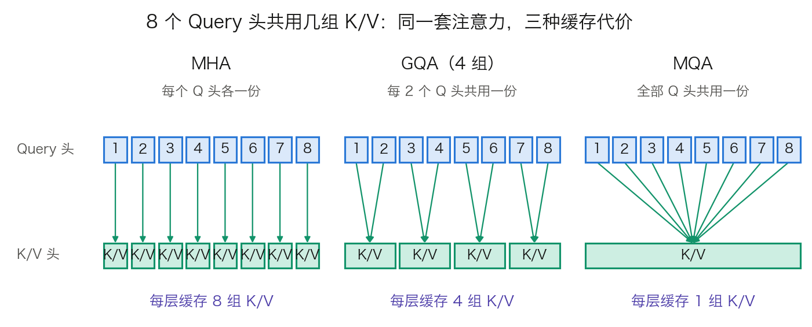

## 3.7 编码器-解码器：完整架构如何协同工作

完整的 Transformer 就是把前六节的零件接起来：嵌入，挂在残差流上的注意力与 FFN 重复 $$L$$ 次，末端归一化，词表打分。编码器与解码器的区别只在掩码（双向或因果）和有没有交叉注意力。深度是可组合计算的步数，宽度是每步的容量，固定参数量下两者在很大范围内可以互换。读一个现代仅解码器模型只需要 `config.json` 的七个字段：参数约 $$12Ld^2$$（多头注意力加 4 倍宽两矩阵 FFN 时），训练约 $$6ND$$ 次浮点运算，推理每词元约 $$2N$$ 次，注意力的平方项在 $$T = 12d$$ 时与权重项持平。

本节分两部分：3.7.1 到 3.7.4 走通编码器与解码器的信息流，3.7.5 到 3.7.7 算现代仅解码器层的三笔账（KV 缓存、词表矩阵、参数与算力），表 3-12 是两部分之间的转折。

### 3.7.1 编码器的信息流

编码器由 $$N$$ 个同构层堆叠（原始论文 $$N = 6$$）。输入先分词、查嵌入、加位置编码；每层做一次双向、无掩码的自注意力和一次逐位置的 FFN，两个子层各带残差与归一化；$$N$$ 层之后，每个位置的表示都融合了整条序列。输出是 `[T, d_model]`，每个输入位置各一行。编码器不产生新词元，只产生表示。

“底层学局部语法、高层学全局语义”是一条统计上的倾向，有探针研究与注意力可视化的支持，但不是层的硬分工。可检验的结论在 3.7.3。

### 3.7.2 解码器的信息流

解码器每层比编码器多一个交叉注意力子层，一层里因此有三处残差与三处归一化。以翻译“I love machine learning”为“我热爱机器学习”为例，设已生成“我 热爱”：

1. 嵌入与位置：已生成词元查表得向量，加上位置信息。
2. 掩码自注意力 + 残差 + 归一化：“热爱”能看到“我”和自己，看不到未来位置。
3. 交叉注意力 + 残差 + 归一化：Query 来自解码器当前表示，Key 与 Value 来自编码器最后一层的输出。
4. FFN + 残差 + 归一化：逐位置变换。
5. 重复 $$N$$ 层，最后一层的最后一行经 LM head 与 Softmax，得到下一个词元的分布。

两处细节决定了工程行为。

**交叉注意力的 K、V 只算一次。** 编码器最后一层的输出在整个生成过程中不变，每个解码器层用自己的 $$W_K$$、$$W_V$$ 把它投影一次并缓存；此后每生成一个词元，只需算新的 Query。这与解码器自注意力的 KV 缓存是两件事：前者长度固定为源序列长度，后者随生成变长。

**训练时不逐词元进行。** 训练用**教师强制**（teacher forcing）：把目标序列整体右移一位作为解码器输入，一次前向就算出所有位置的预测，损失在全部目标位置上同时计算。因果掩码保证位置 $$i$$ 看不到位置 $$i$$ 之后的目标词元。逐词元只发生在推理时（见 [2.4 节](../02_attention/2.4_self_cross_causal.md)与 [3.8 节](3.8_gpt_inference_flow.md)）。

### 3.7.3 为什么要重复堆叠 $$N$$ 层

深度提供组合步数，宽度提供每步的容量；在很宽的范围内两者可以互换，但深度不能压到算法所需的步数以下。这个判断由两条可检验的事实支撑。

**其一：某些算法必须至少两层才能实现。** 最清楚的例子是归纳头（induction head）：它由两个头组成，前一层的“前序词元头”把“上一个词元是谁”搬到当前位置，后一层的匹配头据此回头查找，实现“序列中出现过 [A][B]，再遇到 [A] 就预测 [B]”。以序列 `… Harry Potter … Harry` 为例：第一步，前一层的头在 `Potter` 的位置写入“我前面是 Harry”；第二步，后一层的头在末尾的 `Harry` 处查找“前面是 Harry”的位置，找到 `Potter`，把它复制过来作为预测。一层注意力做不到这件事，因为“把信息搬过来”和“据此再查一次”必须分两步（见 [14.8 节](../14_future_trends/14.8_interpretability.md)）。层数因此是可组合算法的步数预算，而不只是容量。

**其二：固定参数量下，深度与宽度可以大幅互换。** [Kaplan 等人](https://arxiv.org/abs/2001.08361)的实测结论是性能强烈依赖规模、弱依赖形状：宽深比变化 40 倍，损失只受轻微影响；6 层、宽 4,288 的模型与 48 层、宽 1,600 的 GPT-2 相比，损失相差在 3% 以内。

真实模型的取法是层数与宽度同步增长：从 GPT-3 Small 到 Llama 3 405B，层数从 12 增到 126，宽度从 768 增到 16,384，每头宽度则始终在 64 到 128 之间（见 [3.8.7 节](3.8_gpt_inference_flow.md)的表 3-25）。

### 3.7.4 三种架构变体，以及仅解码器为何胜出

按编码器与解码器的组合方式，Transformer 有三种主流变体。

**仅编码器**用全双向自注意力，输出表示而非词元（BERT、RoBERTa，见[第十二章](../12_encoder_models/README.md)）。**仅解码器**用因果掩码，每个位置预测下一个词元（GPT、Llama，见[第十三章](../13_decoder_models/README.md)）。**编码器-解码器**用编码器读输入、解码器写输出（T5、BART）。

仅解码器成为通用生成模型的主流，首要原因是训练目标与使用方式一致：任何任务都能写成续写，一个目标、一个模型，不需要任务头；其次是单一堆栈、只追加的 KV 缓存让服务系统简单；每个位置都产生监督信号是辅证。完整的论证与反面证据在 [5.3.7 节](../05_pretraining/5.3_encoder_decoder.md)。

选型的判据是任务形态。输入固定且完整、输出是对输入的转写时，编码器-解码器仍占优，机器翻译与语音识别属于这一类：编码器双向读完输入，交叉注意力的 K、V 只算一次（3.7.2）。要的是整段文本的一个表示而不是逐词生成时，用双向编码器：吞吐优先的嵌入、检索与重排序模型至今以它为主，精度优先时由解码器改造的大嵌入模型也有竞争力（见 [5.2 节](../05_pretraining/5.2_masked_lm.md)与 [12.3.7 节](../12_encoder_models/12.3_longformer_bigbird.md)）。开放式的对话与工具调用用仅解码器。

**从原始层到现代层。** 今天的仅解码器层与 2017 年的原始层，零件几乎逐项换过一遍。表 3-12 把差异列齐，每一行都指向本章前面的某一节；后面三个小节算的都是右边一列的账。

| 部位 | 原始 Transformer | 现代仅解码器（Llama 式） | 本书对应处 |
| --- | --- | --- | --- |
| 归一化算子 | LayerNorm | RMSNorm | [3.6.6](3.6_layer_norm.md) |
| 归一化位置 | Post-Norm | Pre-Norm，末端再加一次 | [3.6.5](3.6_layer_norm.md) |
| FFN 激活 | ReLU，两个矩阵 | SwiGLU，三个矩阵 | [3.4.5](3.4_feedforward.md) |
| FFN 宽度 | `4 d` | 按参数预算定，Llama 系 `2.7 d` 到 `3.5 d` | [3.4.4](3.4_feedforward.md) |
| 位置编码 | 正弦，输入端相加 | RoPE，每层注意力内部旋转 | [3.3.5](3.3_position_encoding.md) |
| 注意力 | 多头，`n_kv = n_h` | GQA，`n_kv` 远小于 `n_h` | 3.7.5 |
| 偏置项 | 只有 FFN 的 `b₁`、`b₂`；注意力投影本来就无偏置 | 线性层普遍无偏置 | [3.4.1](3.4_feedforward.md) |
| 权重绑定 | 输入输出共享 | 视词表占比而定 | 3.7.6 |

表 3-12：原始 Transformer 层与现代仅解码器层的逐项对照。右边一列的每一项都能在 `config.json` 里找到对应字段，实现对照见[附录 A.7](../appendix/a7_framework_recipes.md)。另有一类改动本表未列：PaLM、GPT-J 采用的并行块把注意力与 FFN 并联在同一次归一化之后，而不是串联。

### 3.7.5 多查询与分组查询注意力

标准多头注意力里每个头有自己的 K、V 投影，KV 缓存随头数线性增长。**多查询注意力**（Multi-Query Attention，MQA）让所有 Query 头共用同一组 K、V；**分组查询注意力**（Grouped-Query Attention，GQA）是中间档，Query 头分成 $$n_{kv}$$ 组，每组共用一组（定义见 [2.3.7 节](../02_attention/2.3_multi_head.md)）。GQA 是今天的默认：Llama 2 的 70B、Llama 3 全系与 Mistral 都用它，[Llama 3 论文](https://arxiv.org/abs/2407.21783)取 8 个 K/V 头，理由是提高推理速度、缩小解码时的 KV 缓存。图 3-7 画出三者的对应关系。

图 3-7：8 个 Query 头共用几组 K/V（[生成脚本](https://github.com/yeasy/llm_internals/blob/main/tools/figures/ch03_gqa_heads.py)）。蓝色是 Query 头，青绿色是它们共用的 K/V 头。注意力的计算步骤三者完全相同，差别只在每层要缓存几组 K/V。

**形状怎么变。** $$W_Q$$ 与 $$W_O$$ 仍是 `[d, d]`；$$W_K$$、$$W_V$$ 变成 `[d, n_kv × d_h]`。Llama 3 8B 有 32 个 Query 头、8 个 K/V 头，`d_h = 128`，所以 $$W_K$$、$$W_V$$ 各是 `[4096, 1024]`。算注意力分数时，每组 K/V 被 $$n_h / n_{kv} = 4$$ 个 Query 头共用。

**缓存账。** 每个词元全模型要存 `2 × L × n_kv × d_h` 个数。Llama 3 8B 是 `2 × 32 × 8 × 128 = 65,536` 个，BF16 下每词元 128 KiB；若改回多头（`n_kv = 32`）是 512 KiB，正好 4 倍，8K 上下文下一条请求的 KV 缓存从 4 GiB 降到 1 GiB。公式的推导与各模型的取值在 [10.2 节](../10_inference_optimization/10.2_kv_cache.md)。

**质量代价。** [GQA 论文](https://arxiv.org/abs/2305.13245)的结论是 MQA 会带来质量下降，而 GQA 的质量接近多头注意力、速度接近 MQA。它是这条取舍曲线上的折中点，并非没有代价。另一条路线是 DeepSeek-V2 起采用的 MLA：把所有头的 K、V 压成一个低维隐向量再缓存（见 [10.2.7 节](../10_inference_optimization/10.2_kv_cache.md)）。

### 3.7.6 参数共享与权重绑定

输入嵌入与输出 LM head 形状互为转置，可以共用同一张矩阵，即**权重绑定**（Weight Tying），原始 Transformer、GPT-2、BERT 都这样做。判据是词表矩阵占总参数的比例（[3.2.4 节](3.2_embedding.md)）：GPT-2 small 占 31.0%，不绑定意味着模型凭空大三成；Llama 3 405B 只占 1.0%，绑定省下的参数可以忽略，不如让输入表示与输出预测各自优化。小模型或大词表模型倾向绑定，大模型倾向不绑定。

### 3.7.7 参数量与计算量的速算

三条估算式在实践中反复用到，都是**数量级工具**。

**单层参数量 $$\approx 12 d^2$$。** 多头注意力有 $$W_Q, W_K, W_V, W_O$$ 四个 $$d \times d$$ 矩阵，合计 $$4d^2$$；4 倍宽的两矩阵 FFN 合计 $$8d^2$$。两者相加：

$$N \approx 12 L d^2$$

**这条式子有两个未声明的前提**：注意力是多头（$$n_{kv} = n_h$$），FFN 是 4 倍宽的两矩阵版本。Llama 3 两条都不满足。此外它只数层内的权重矩阵，不含词表矩阵与归一化参数。

先看一个逐项相加的精确账。表 3-13 用 Llama 3 8B 的 `config.json` 算出全部参数。

| 部位 | 形状 | 参数量 | 折合 |
| --- | --- | ---: | --- |
| `q_proj` | `[4096, 4096]` | 16,777,216 | `1.0 d²` |
| `k_proj` | `[4096, 1024]` | 4,194,304 | `0.25 d²` |
| `v_proj` | `[4096, 1024]` | 4,194,304 | `0.25 d²` |
| `o_proj` | `[4096, 4096]` | 16,777,216 | `1.0 d²` |
| `gate_proj`、`up_proj`、`down_proj` | 各 `4096 × 14336` | 176,160,768 | `10.5 d²` |
| 每层两个 RMSNorm | 各 `[4096]` | 8,192 | — |
| **每层合计** | | **218,112,000** | `13.0 d²` |
| 32 层 | | 6,979,584,000 | |
| `embed_tokens` | `[128256, 4096]` | 525,336,576 | |
| `lm_head` | `[128256, 4096]` | 525,336,576 | |
| `model.norm` | `[4096]` | 4,096 | |
| **总计** | | **8,030,261,248** | |

表 3-13：Llama 3 8B 的逐项参数账，全部由 `config.json` 的七个字段算出：`num_hidden_layers = 32`、`hidden_size = 4096`、`num_attention_heads = 32`、`num_key_value_heads = 8`、`intermediate_size = 14336`、`vocab_size = 128256`、`tie_word_embeddings = false`。`d_h = hidden_size / num_attention_heads = 128`，故 `k_proj`、`v_proj` 的列数是 `8 × 128 = 1024`。总计 80.3 亿，与标称的 8B 吻合。后文算矩阵乘法或权重访存时只数每层的七个矩阵，即 218,103,808，不含两个 RMSNorm 的 8,192。

同一张表可以套到任何 Llama 式模型上，只要把七个字段换掉。表 3-14 把 $$12Ld^2$$ 与四个模型的逐项账放在一起对比。

| 模型 | 注意力/层 | FFN/层 | 逐项总计 | `12Ld²` | 偏差 |
| --- | --- | --- | ---: | ---: | ---: |
| Llama 2 7B | `4.00 d²` | `8.06 d²` | 6,738,415,616 | 6,442,450,944 | −4.4% |
| Llama 3 8B | `2.50 d²` | `10.50 d²` | 8,030,261,248 | 6,442,450,944 | −19.8% |
| Llama 3 70B | `2.25 d²` | `10.50 d²` | 70,553,706,496 | 64,424,509,440 | −8.7% |
| Llama 3 405B | `2.13 d²` | `9.75 d²` | 405,853,388,800 | 405,874,409,472 | +0.0% |

表 3-14：`12Ld²` 与逐项账的偏差。405B 上几乎完全吻合，但这是抵消的结果而非公式仍然精确：GQA 把注意力项从 `4 d²` 压到 `2.13 d²`，FFN 从 `8 d²` 放宽到 `9.75 d²`，再加上占 1.0% 的词表矩阵，三者正好凑回 `12 d²`。同一公式用在 8B 上低估近两成，因为那里词表占 13.1%，抵消关系不成立。

结论：`12Ld²` 适合估计同代模型的量级，不适合替代逐项相加。手边有 `config.json` 时，用表 3-13 的方法。

**训练每词元约 $$6N$$ 次浮点运算。** 矩阵乘法里每个参数对应一次乘加，记 2 次浮点运算（约定见 [1.4.5 节](../01_introduction/1.4_transformer_idea.md)），故前向约 $$2N$$；反向要同时算输入梯度与权重梯度，代价约为前向的两倍，即 $$4N$$。合计

$$C \approx 6ND$$

$$D$$ 是训练词元总数。代入 Llama 3 405B：$$N = 4.05 \times 10^{11}$$，论文自报的 $$D = 15.6 \times 10^{12}$$ 词元，得 $$6ND \approx 3.79 \times 10^{25}$$ FLOPs，与论文自报的 $$3.8 \times 10^{25}$$ 一致。这条式子是 Scaling Law 讨论的基础，[5.4 节](../05_pretraining/5.4_data_scaling.md)里 Chinchilla 的结论就是在这个约束下解出来的。对 MoE 模型，式中的 $$N$$ 要取**激活参数量**而非总参数量，这正是 MoE 能在固定算力预算下容纳更大总参数量的原因（见 [14.2 节](../14_future_trends/14.2_moe.md)）。

**推理每词元约 $$2N$$ 次浮点运算**，即只有前向那一份。训练与推理相差 3 倍。

**共同失效边界。** 三条式子只数了权重，没数注意力自身的 $$O(T^2)$$ 项。一层的计算量约为 $$24Td^2 + 2T^2d$$（推导见 [1.4.5 节](../01_introduction/1.4_transformer_idea.md)）：前一项是 $$T$$ 个词元各经过一层 $$12d^2$$ 个参数的权重项，后一项是因果掩码下打分与读取两步的注意力项。两项之比是

$$\frac{2T^2d}{24Td^2} = \frac{T}{12d}$$

[Kaplan 等人](https://arxiv.org/abs/2001.08361)用的是同一个判据：$$d_{\text{model}}$$ 大于上下文长度的 1/12 时，与上下文相关的那部分计算只占总量的一小部分。$$T = 12d$$ 是两项相等的点，不是“开始不能忽略”的点。对 $$d = 4096$$ 的模型，$$12d = 49{,}152$$，各档上下文下的占比见表 3-15。

| 上下文长度 | `T / (12d)` | 注意力项占一层计算量 |
| --- | ---: | ---: |
| 2,048 | 0.042 | 4.0% |
| 8,192 | 0.167 | 14.3% |
| 49,152 | 1.000 | 50.0% |
| 131,072 | 2.667 | 72.7% |

表 3-15：`d = 4096` 时注意力项随上下文长度的占比。第三列由第二列换算：记 `r = T / (12d)` 为两项之比，注意力项占一层计算量就是 `r / (1 + r)`，例如 `0.167 / 1.167 = 14.3%`。8K 上下文下已占一成四，到 128K 则反超权重项。长上下文因此是一个独立的工程问题（见 [14.7 节](../14_future_trends/14.7_long_context.md)），不能把同一套估算直接外推。

**装不装得下。** 把 3.7.5 与本小节的两笔账合起来，就是部署时的第一条判据：显存约等于“参数量 × 每参数字节”加“每词元 KV 字节 × 上下文长度 × 并发数”。Llama 3 8B 的 BF16 权重约 16 GB；上下文 4,096 时每个请求的 KV 缓存是 `4,096 × 128 KiB = 0.5 GiB`，一张 80 GB 的 H100 去掉权重后最多并发约 119 个这样的请求（见 [10.1.2 节](../10_inference_optimization/10.1_bottleneck.md)）。

零件与接线都已齐备。下一节按真实的生成流程把它们完整运行一遍。
