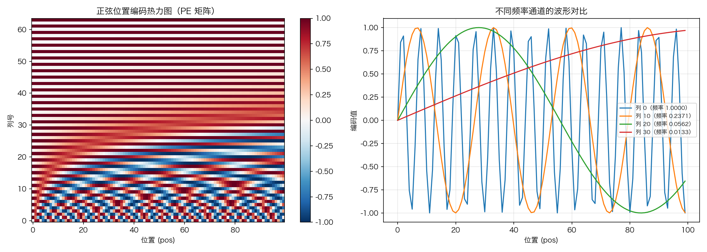

## 4.1 正弦位置编码：频率与外推的直觉

**正弦位置编码**（Sinusoidal Positional Encoding）把每个位置写成一组转速按等比数列排开的指针，一对 $$(\sin, \cos)$$ 就是单位圆上的一点。位置平移 $$k$$ 相当于每个指针转过一个固定角度，所以平移是一个只依赖 $$k$$ 的正交线性变换，两个位置编码的点积只依赖距离。这只是可供模型利用的结构：编码加进残差流之后，注意力分数里的位置项隔着学出来的 $$W_Q^T W_K$$，平移不变并不成立，实测的外推余量只有几十个词元。今天的大语言模型已不用加性的绝对编码，留下来的是这组频率：RoPE（[4.3 节](4.3_rope.md)）原样继承了它，注入方式从加到嵌入改为旋转查询和键。[3.3.4 节](../03_components/3.3_position_encoding.md)只给了公式与前三个位置的数值，本节补上推导与边界。

### 4.1.1 编码公式

原始 Transformer 的定义为：

$$\text{PE}(pos, 2i) = \sin\left(\frac{pos}{10000^{2i/d_{\text{model}}}}\right)$$

$$\text{PE}(pos, 2i+1) = \cos\left(\frac{pos}{10000^{2i/d_{\text{model}}}}\right)$$

其中 $$pos$$ 是位置索引（0, 1, 2, …），$$i$$ 是频率对的编号（0, 1, …, $$d_{\text{model}}/2 - 1$$）。每个位置得到一个 $$d_{\text{model}}$$ 维向量，第 $$2i$$ 列放正弦，第 $$2i+1$$ 列放余弦。记第 $$i$$ 对的角频率为 $$\omega_i = 10000^{-2i/d_{\text{model}}}$$，则位置 $$pos$$ 在第 $$i$$ 对上的两个数是 $$(\sin(\omega_i \cdot pos),\ \cos(\omega_i \cdot pos))$$。

取 $$d_{\text{model}} = 4$$，只有两对频率：$$\omega_0 = 1$$，$$\omega_1 = 10000^{-1/2} = 0.01$$。表 4-1 给出前四个位置的完整向量，列号从 0 起算。

| 位置 | 第 0 列 $$\sin(\omega_0 pos)$$ | 第 1 列 $$\cos(\omega_0 pos)$$ | 第 2 列 $$\sin(\omega_1 pos)$$ | 第 3 列 $$\cos(\omega_1 pos)$$ |
| ---: | ---: | ---: | ---: | ---: |
| 0 | 0.0000 | 1.0000 | 0.0000 | 1.0000 |
| 1 | 0.8415 | 0.5403 | 0.0100 | 1.0000 |
| 2 | 0.9093 | −0.4161 | 0.0200 | 0.9998 |
| 3 | 0.1411 | −0.9900 | 0.0300 | 0.9996 |

表 4-1：$$d_{\text{model}} = 4$$ 时前四个位置的编码向量。高频对（第 0、1 列）三步转过 172 度，低频对（第 2、3 列）三步只转过 1.7 度；位置 0 的向量因余弦列为 1 而不是全零。

### 4.1.2 为什么是正弦函数

筛掉其他函数的要求只有一条：位置 $$pos + k$$ 的编码能写成位置 $$pos$$ 的编码各分量的线性组合，组合系数只依赖 $$k$$，并且取值有界。满足这条要求、又能区分位置（不是常数，对实数位置连续）的最低维实值表示，就是一对 $$(\sin, \cos)$$。有界性排除了维度更低的实指数 $$e^{a \cdot pos}$$，它同样满足 $$f(pos + k) = e^{ak} f(pos)$$，但幅值随位置发散或衰减到零。方波、锯齿波的平移要展开成整条傅里叶级数才能表示，对应的变换不再是一个 2×2 矩阵。其余常被并列的要求，如各位置编码互不相同、相邻位置接近、任意实数位置有定义，由多个频率叠加后顺带满足。

sin 与 cos 必须成对：$$\sin\theta$$ 相同的角有两个，配上 $$\cos\theta$$ 才能把圆上的点定死。用欧拉公式 $$e^{i\theta} = \cos\theta + i\sin\theta$$ 改写，每一对就是复数 $$e^{i\omega \cdot pos}$$ 的虚部和实部，整个编码等价于在 $$d_{\text{model}}/2$$ 个复平面上以不同频率旋转，位置加 $$k$$ 就是每个平面各转 $$\omega_i k$$。RoPE 沿用的正是这个写法。

**频率按等比数列排布。** 波长 $$\lambda_i = 2\pi / \omega_i = 2\pi \cdot 10000^{2i/d_{\text{model}}}$$ 同样等比。最高频（$$i = 0$$）的波长恒为 $$2\pi \approx 6.28$$，与底数无关；最低频的波长是 $$2\pi \cdot 10000^{1 - 2/d_{\text{model}}}$$，$$d_{\text{model}} = 512$$ 时为 60,611。由此得到选底数的判据：最长波长约为 $$2\pi$$ 乘以底数，应当明显大于要支持的最大长度。这条判据在 [4.3.5 节](4.3_rope.md)调大底数时还要用到。

多尺度排布与二进制计数同理：最低位每加一就翻转，最高位变化最慢，区别是这里用连续波形。高频对区分相邻位置，低频对区分远距离位置。

### 4.1.3 频率分解的可视化

图 4-1 把 $$d_{\text{model}} = 64$$、100 个位置的编码矩阵画成热力图，并取四列画出波形。

图 4-1：正弦位置编码的频率分解可视化（[生成脚本](https://github.com/yeasy/llm_internals/blob/main/tools/figures/sinusoidal_pe.py)）。第 $$2i$$ 与 $$2i+1$$ 两列共用第 $$i$$ 对的频率。

热力图（左）里，底部的低编号列变化密集，顶部的高编号列平滑过渡。波形图（右）里，第 0 列的波长是 $$2\pi \approx 6.3$$，100 个位置里振荡了近 16 个周期；第 30 列的波长是 $$2\pi \cdot 10000^{30/64} \approx 471$$，100 个位置只走过 0.21 个周期。

### 4.1.4 相对位置的线性表示

存在一个只依赖偏移量 $$k$$ 的矩阵 $$M_k$$，使得

$$\text{PE}(pos + k) = M_k \cdot \text{PE}(pos)$$

这来自三角函数的**和角公式**（angle addition formula）。对单个频率 $$\omega$$ 展开：

$$\sin(\omega(pos + k)) = \sin(\omega \cdot pos)\cos(\omega k) + \cos(\omega \cdot pos)\sin(\omega k)$$

$$\cos(\omega(pos + k)) = \cos(\omega \cdot pos)\cos(\omega k) - \sin(\omega \cdot pos)\sin(\omega k)$$

写成矩阵形式是一个二维旋转：

$$\begin{pmatrix} \sin(\omega(pos+k)) \\ \cos(\omega(pos+k)) \end{pmatrix} = \begin{pmatrix} \cos(\omega k) & \sin(\omega k) \\ -\sin(\omega k) & \cos(\omega k) \end{pmatrix} \begin{pmatrix} \sin(\omega \cdot pos) \\ \cos(\omega \cdot pos) \end{pmatrix}$$

矩阵里只出现 $$\omega k$$，与 $$pos$$ 无关。整个 $$M_k$$ 是 $$d_{\text{model}}/2$$ 个这样的 2×2 块拼成的分块对角矩阵，是正交矩阵。分量按 $$(\sin, \cos)$$ 排列，所以右上角是 $$+\sin$$；按 $$(\cos, \sin)$$ 排列时就是 [4.3.1 节](4.3_rope.md)的标准旋转矩阵。用表 4-1 验算：取 $$k = 1$$，把 $$\text{PE}(1)$$ 的前两格代进去，得 $$0.5403 \times 0.8415 + 0.8415 \times 0.5403 = 0.9093$$ 与 $$-0.8415^2 + 0.5403^2 = -0.416$$，正是 $$\text{PE}(2)$$ 的前两格。

**推论：点积只依赖距离。** 两个位置编码的内积里，每一对频率贡献一项：

$$\text{PE}(pos) \cdot \text{PE}(pos+k) = \sum_{i} \bigl[\sin(\omega_i pos)\sin(\omega_i (pos+k)) + \cos(\omega_i pos)\cos(\omega_i (pos+k))\bigr] = \sum_{i} \cos(\omega_i k)$$

右边不含 $$pos$$。表 4-2 给出 $$d_{\text{model}} = 512$$ 时的取值。

| 距离 $$k$$ | 0 | 1 | 2 | 10 | 100 | 1000 | 2000 |
| --- | ---: | ---: | ---: | ---: | ---: | ---: | ---: |
| $$\sum_i \cos(\omega_i k)$$ | 256.00 | 249.10 | 231.73 | 173.79 | 111.95 | 44.97 | 22.52 |

表 4-2：$$d_{\text{model}} = 512$$ 时两个位置编码的点积，由 256 项余弦求和得到。数值随距离下降但不单调，例如 $$k$$ 从 80 到 81 时由 117.54 升到 117.67。$$\cos$$ 是偶函数，$$k$$ 与 $$-k$$ 给出同一个值，这条曲线分不清前面 10 个词和后面 10 个词。

### 4.1.5 这条性质在注意力里还剩多少

正弦编码让相对距离可以被线性提取，但不保证注意力分数只依赖距离。4.1.4 证明的是两个位置向量之间的关系，真实注意力算的是另一个量。位置向量与词嵌入相加之后，位置 $$m$$ 对位置 $$n$$ 的打分是

$$(x_m + p_m)^T W_Q^T W_K (x_n + p_n)$$

展开成四项：

- 内容-内容：$$x_m^T W_Q^T W_K x_n$$
- 内容-位置：$$x_m^T W_Q^T W_K p_n$$
- 位置-内容：$$p_m^T W_Q^T W_K x_n$$
- 位置-位置：$$p_m^T W_Q^T W_K p_n$$

只有最后一项与 4.1.4 的点积有关，中间还隔着 $$W_Q^T W_K$$。

把两个位置整体平移 $$k$$，$$p_m$$、$$p_n$$ 分别变成 $$M_k p_m$$、$$M_k p_n$$，位置-位置项变为 $$p_m^T M_k^T (W_Q^T W_K) M_k p_n$$。它等于原值的条件是 $$M_k^T W_Q^T W_K M_k = W_Q^T W_K$$；$$M_k$$ 是正交矩阵，这相当于要求 $$W_Q^T W_K$$ 与 $$M_k$$ 可交换。训练得到的 $$W_Q^T W_K$$ 一般不满足，这一项在整段平移之后通常会变。含位置的另外两项各只带一个位置向量，平移后同样改变。四项里只有内容-内容项与位置无关。

这条结构带来多少收益，原论文只有一条间接证据：换成不具备这一结构的可学习位置编码，翻译结果几乎相同（4.1.7）。后来的相对位置方案都从这个展开式下手：Transformer-XL 改写含位置的三项（[4.4.2 节](4.4_alibi_others.md)），RoPE 把旋转移到投影之后，让 $$W_Q^T W_K$$ 不再夹在两个位置之间（[4.3.3 节](4.3_rope.md)）。

**加性注入还有一个尺度问题。** 位置向量与词嵌入共用同一条残差通道，量级必须可比。正弦编码各分量的幅值不超过 1，词嵌入按常规初始化后幅值小得多。原论文在嵌入层把词嵌入乘上 $$\sqrt{d_{\text{model}}}$$，通行的解释是量级匹配，算例见 [3.2.6 节](../03_components/3.2_embedding.md)。

### 4.1.6 外推的实际边界

正弦函数对任意位置都有定义，训练长度之外的位置也能算出编码，但能算出不等于模型用得对：实测可用的外推余量是几十个词元。本章用 $$L_{\text{train}}$$ 记训练长度。ALiBi 论文的测量是：$$L_{\text{train}} = 512$$ 的正弦编码模型，推理长度加到 $$L_{\text{train}} + k$$ 后，困惑度在 $$k = 20$$ 之前还在改善，20 到 50 之间持平，此后变差；$$L_{\text{train}} = 1024$$ 的模型同样在多出 50 个词元之后下滑。起初的改善来自更长的上文；转为变差，说明未见过的位置造成的损失已经超过上文变长的收益。

原因可以从波长看出来。$$d_{\text{model}} = 512$$ 时，256 对频率里只有 123 对的波长不超过 512，其余 133 对在整个训练长度内没有转满一圈；最低频那一对在位置 512 处才转过 3.04 度。这些维度在训练中只取到圆周上很短的一段弧，超出训练长度后给出的取值组合模型从未见过。训练覆盖决定外推边界，这条规律在 RoPE 上原样重演（[4.3.4 节](4.3_rope.md)）。

### 4.1.7 固定与可学习：论文的口径与实现细节

原论文对两种编码的比较只有一句：翻译任务上结果几乎相同。选择正弦的理由也只写了一条，即它可能让模型外推到更长的序列；4.1.6 的实测表明这一预期过于乐观。不增加参数、数学结构清晰，是后人补充的好处。

这套公式今天用在三类地方：长度固定的模型（Whisper 的编码器把位置嵌入初始化为正弦值并关掉梯度）、相对距离的编码（Transformer-XL）、扩散模型的时间步嵌入。通用大语言模型的位置方案已换成 RoPE。

实现上记住两点。正弦表不是参数，不进优化器，遇到更长输入时按公式重算即可。列的排布有两种：论文公式是奇偶列交错，Tensor2Tensor 的原始实现把 sin 放前半、cos 放后半，两者只差一个固定的列置换，但权重与布局绑定，移植时不能混用；RoPE 有同样的分歧（[4.3.6 节](4.3_rope.md)）。

固定编码把位置怎样影响表示完全交给一组人为选定的频率，模型无从调整。下一节的可学习编码把这件事交给训练，代价在别处。
