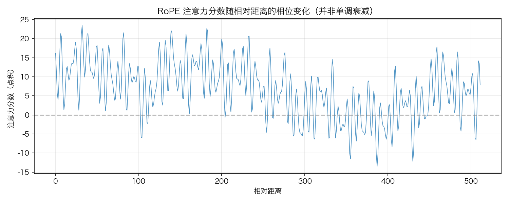
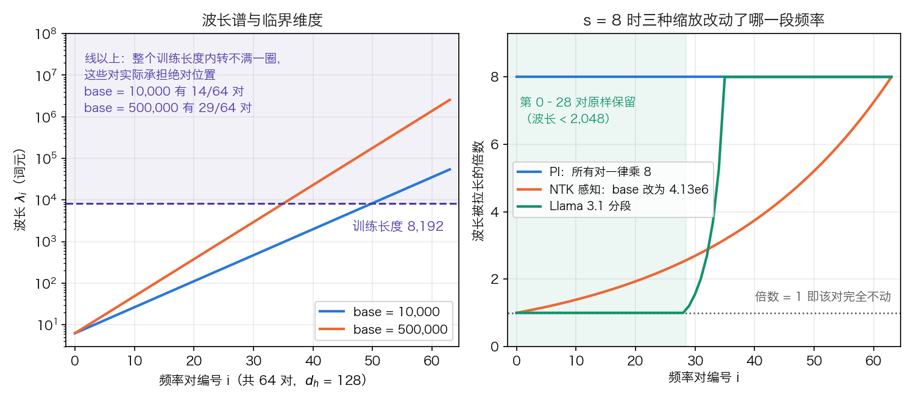

## 4.3 旋转位置编码：为什么旋转能编码相对位置

**旋转位置编码**（Rotary Position Embedding，RoPE）不给位置发向量，它在每一层把查询和键的每个二维子空间按“位置乘频率”转一个角。内积里两次旋转相消，只剩与位置差成正比的角，分数因此是相对距离的函数，不占残差通道，也没有参数。对单个向量做的变换只依赖它的绝对位置，相对性到内积里才出现。相对不等于能外推：模型只在小于训练长度的距离上受过训练，波长超过训练长度的低频对从未转满一圈，超长时进入没见过的相位区。各种长度扩展手段的差别只在把哪些频率压回已见范围，而且都要在目标长度上再训练一段。RoPE 由 [Su 等人](https://arxiv.org/abs/2104.09864)在 2021 年提出，现在是 Llama、Gemma、Qwen、DeepSeek 等模型的默认方案。

### 4.3.1 核心直觉

把查询和键各看成一串二维向量。把一个二维列向量逆时针转 $\alpha$ 弧度，就是左乘旋转矩阵

$$R(\alpha) = \begin{pmatrix} \cos\alpha & -\sin\alpha \\ \sin\alpha & \cos\alpha \end{pmatrix}$$

位置 $m$ 的查询转 $m\theta$ 弧度，位置 $n$ 的键转 $n\theta$ 弧度，两者的点积只与转角之差有关：

$$\bigl(R(m\theta) q\bigr)^T \bigl(R(n\theta) k\bigr) = q^T R((n-m)\theta) k$$

推导只用旋转矩阵的两条性质：转置等于反向旋转，$R(\alpha)^T = R(-\alpha)$；连续旋转的转角相加，$R(\alpha)R(\beta) = R(\alpha + \beta)$。于是左边等于 $q^T R(-m\theta) R(n\theta)\,k = q^T R((n-m)\theta)\,k$。有的文献写成 $R((m-n)\theta)$，差别来自旋转方向或左右乘的约定，公式与代码用同一套约定即可。

**代进数字。** 取 $\theta = \pi/6$（30 度）、$q = (1, 0)$、$k = (1, 1)$，位置对 $(m, n) = (3, 1)$。查询转 $90°$ 得 $(0,\ 1)$；键转 $30°$ 得 $(0.8660 - 0.5,\ 0.5 + 0.8660) = (0.3660,\ 1.3660)$；点积为 1.3660。换成 $(23, 21)$，两个向量各多转 $600°$，转角之差仍是 $60°$，点积不变。表 4-4 给出更多组。

| 位置对 $(m, n)$ | 相对距离 $m - n$ | 旋转后的点积 |
| --- | ---: | ---: |
| (0, 0) | 0 | 1.0000 |
| (1, 0) | 1 | 1.3660 |
| (3, 1) | 2 | 1.3660 |
| (23, 21) | 2 | 1.3660 |
| (4, 1) | 3 | 1.0000 |
| (5, 0) | 5 | −0.3660 |

表 4-4：$\theta = \pi/6$、$q = (1, 0)$、$k = (1, 1)$ 时旋转后的点积，闭式为 $\sqrt{2}\cos(j\theta - \pi/4)$，$j = m - n$。距离相同的位置对给出同一个值；距离变大时数值先升后降，到 $j = 5$ 已经为负，单个频率上不存在随距离的衰减。[附录 A.2](../appendix/a2_pytorch_examples.md) 有同一性质的验证代码。

### 4.3.2 数学形式

对 $d$ 维向量（$d$ 为偶数），把它切成 $d/2$ 个二维子空间，第 $i$ 个子空间在位置 $m$ 处转 $m\theta_i$：

$$\theta_i = b^{-2i/d}, \quad i \in \{0, 1, \dots, d/2 - 1\}$$

底数 $b$ 在原论文中取 10000，与正弦编码是同一组频率。

**这里的 $d$ 是每个注意力头的宽度** $d_h$，不是 $d_{\text{model}}$。Llama 系的 $d_h$ 为 128，每个头有 64 对二维子空间。旋转发生在每一层、每一个头、Q/K 投影之后、打分之前，形状不变；按 [3.8.3 节](../03_components/3.8_gpt_inference_flow.md)的手算步骤，它插在第 2 步与第 3 步之间。

实现中不显式乘矩阵。把 64 个 2×2 块展开，等价于两次逐元素乘加：

$$\text{RoPE}(x) = x \odot \cos + \text{rotate}(x) \odot \sin$$

其中 $\cos$、$\sin$ 是按位置和频率预先算好的表，$\text{rotate}$ 把每个二维子空间里的两个分量交换并给其中一个取负。

**只旋转查询和键，不旋转值。** 相对性来自内积里两次旋转相消。值不进内积，它被注意力权重加权求和后写入残差流；若把值也转一个角，绝对位置的相位会原样留在输出里，平移不变随之破坏。

### 4.3.3 RoPE 的性质

**天然的相对位置。** 分数中的位置依赖只通过 $n - m$ 进入，模型不必先从绝对位置学出相对位置。与 [4.1.5 节](4.1_sinusoidal.md)的四项展开相比，旋转作用在已经投影完的 q、k 上，位置信息不再被 $W_Q^T W_K$ 隔开。

**分数随距离振荡，衰减只在内容匹配时出现。** 固定 q、k，记 $j = m - n$（与表 4-4 相同），分数是各子空间贡献之和：

$$\text{score}(j) = \sum_{i} \lVert q_i \rVert\,\lVert k_i \rVert \cos(\varphi_i - j\theta_i)$$

$q_i$、$k_i$ 是第 $i$ 个子空间里的二维分量，$\varphi_i$ 是从 $q_i$ 转到 $k_i$ 的夹角。各子空间相位对齐（$\varphi_i = 0$，查询与键内容匹配）时，它退化为表 4-2 那样的余弦和，随距离下降。相位杂乱时各项相互抵消，对随机相位取期望为零，谈不上衰减。原论文所说的长程衰减是对分数幅度上界的陈述，不能读成任意一对向量的分数都随距离单调下降。

图 4-2：RoPE 注意力分数随相对距离的相位变化示例（[生成脚本](https://github.com/yeasy/llm_internals/blob/main/tools/figures/rope_phase.py)）。取一对随机向量，曲线随距离振荡，没有单调趋势。

**没有参数，计算量可以忽略。** 以 Llama 3 8B 为例，每个词元每层的旋转约 1.5 万次浮点运算，同层的投影与 MLP 约 4.4 亿次。它是逐元素算子，开销主要在访存。

### 4.3.4 波长与临界维度：为什么相对编码仍然外推失败

相对位置恒等式只说明分数是 $n - m$ 的函数，不保证模型能处理训练中没见过的距离。实测如此：[位置内插论文](https://arxiv.org/abs/2306.15595)报告，直接让 LLaMA 处理更长的序列，困惑度升至 $10^3$ 以上，注意力分数急剧放大。ALiBi 论文的测量温和一些，结论相同：$L_{\text{train}} = 512$ 的 RoPE 模型只能在多出 200 个词元以内继续改善，$L_{\text{train}} = 1024$ 的只能多出 100 个。

哪些频率会转到没见过的角度，由波长决定。第 $i$ 对的波长是

$$\lambda_i = \frac{2\pi}{\theta_i} = 2\pi \cdot b^{2i/d_h}$$

即这一对转满一圈所需的词元数。$\lambda_i \le L_{\text{train}}$ 的高频对在训练窗口内至少转满一圈，更大的距离仍落在已覆盖的角度范围内。$\lambda_i > L_{\text{train}}$ 的低频对只覆盖了圆周上的一段；距离一旦超过 $L_{\text{train}}$，它们的转角进入训练中从未出现的区间，对应的分数分量不受训练约束。

两类频率的分界称为**临界维度**：按频率从高到低数，波长不超过训练长度的维度数（[Liu 等人](https://arxiv.org/abs/2310.05209)）。由 $\lambda_i \le L_{\text{train}}$ 解出

$$i \le \frac{d_h}{2}\cdot\frac{\ln\bigl(L_{\text{train}}/2\pi\bigr)}{\ln b}$$

代入 Llama 2 的 $d_h = 128$、$b = 10{,}000$、$L_{\text{train}} = 4{,}096$，右边是 45.03：第 0 到 45 对转满过一圈，共 46 对，临界维度 92；其余 18 对没有。这个式子同时给出两个调节方向：训练长度加长，转满的对数按对数增长；底数加大，转满的对数减少。表 4-5 列出两个底数下的数目。

| 底数 $b$ | $\lambda_0$ | $\lambda_{63}$ | 4,096 内未转满 | 8,192 内未转满 | 131,072 内未转满 |
| ---: | ---: | ---: | ---: | ---: | ---: |
| 10,000 | 6.28 | 54,410 | 18 / 64 | 14 / 64 | 0 / 64 |
| 500,000 | 6.28 | 2,559,196 | 32 / 64 | 29 / 64 | 15 / 64 |

表 4-5：$d_h = 128$ 时的波长跨度与未转满一圈的对数。Llama 3 用 $b = 500{,}000$、以 8,192 预训练，有 29 对频率在预训练阶段没有转满一圈。$\lambda_0 = 2\pi$ 与底数无关。

Liu 等人的对照实验支持这一归因：去掉 Llama 2 7B 的 q、k 向量最后 36 维再微调，效果明显好于直接微调，可外推到 2 万词元以上。

两条限定。恒等式本身对每个频率都成立，与这一对在训练中是否转满无关；“未转满”描述的是训练覆盖范围，外推是否失败、失败到什么程度，要由上面这类实测回答。[YaRN 论文](https://arxiv.org/html/2309.00071v2#S3.SS2)还据此提出一个假说：模型可能利用这些未绕回的相位保留绝对位置线索。这是对模型如何使用位置信息的解释，尚无定论。

图 4-3：左图是 64 对频率的波长谱，紫色虚线是训练长度 8,192，线以上的对在训练中没有转满一圈；右图是 $s = 8$ 时三种缩放各把哪一段频率的波长拉长了多少倍（[生成脚本](https://github.com/yeasy/llm_internals/blob/main/tools/figures/ch04_rope_wavelength.py)）。右图取 $b = 500{,}000$，图例里的 4.13e6 是这一底数下 NTK 感知缩放的换底结果。

### 4.3.5 把长度补回来：内插与外推

**现行做法是把长度扩展放进训练。** 公开模型走两条路，共同点是都在目标长度上训练过：

- **训练期就取大底数，再做长序列续训。** [Llama 3](https://arxiv.org/abs/2407.21783) 从 8K 预训练起就把底数取为 500,000，技术报告引 Xiong 等人的结果说明这个取值对 32,768 以内的长度有效；预训练末段再分六个阶段把上下文扩到 128K（[6.4.2 节](../06_training_techniques/6.4_batch_sequence.md)），Llama 3.1 的发布配置在大底数之上还叠了一层分段缩放（见本小节末）。更早的 [Code Llama](https://arxiv.org/abs/2308.12950) 在 16,384 长度的续训里把底数从 10,000 提到 1,000,000，续训 10,000 步，理由是减小注意力分数随距离的衰减，让远处的词元也能参与预测。
- **短上下文预训练，再用分频缩放加少量续训。** DeepSeek-V3 全程以 4K 预训练，之后用 YaRN 做两个各 1,000 步的阶段，扩到 32K 再到 128K（6.4.2 节）。

选型按手里有什么来定。能从头训练或做大规模续训，直接取大底数。底数的下限判据是最长波长 $2\pi b^{1-2/d_h}$ 明显大于目标长度（底数 500,000 时约 256 万）；满足它只说明低频还没有绕回，是否够用仍要在目标长度上实测。只有训练好的短上下文权重和少量续训预算，用分频缩放。位置内插今天主要作为对照基线。不做任何训练、只在推理端改缩放参数，属于补救：下面每种方法的公开结果都带续训。

各方法的差别在于对每一对频率做内插还是外推。对某一对频率**内插**，指把它的频率除以缩放倍数 $s$，使转角回到训练范围；**外推**指保持原频率，转角随位置继续增大。$s = L_{\text{new}} / L_{\text{train}}$，$L_{\text{new}}$ 是目标长度。表 4-6 按这一口径并列五种做法。

| 方法 | 第 $i$ 对的频率怎样变 | 续训 | 代价与定位 |
| --- | --- | --- | --- |
| 直接外推 | 不变 | 无 | 低频对进入未见过的角度区间，困惑度可升至 $10^3$ 以上 |
| 位置内插（PI） | 全体除以 $s$ | 约千步 | 高频分辨率同样被压缩，约 $s = 8$ 后退化；现作基线 |
| NTK 感知缩放（调大底数） | 除以 $s^{2i/(d-2)}$：最高频不动，最低频除以 $s$ | 配合长序列续训 | 中间的对仍有部分越界；训练期直接取大底数是它的现行形态 |
| NTK-by-parts | 按训练长度内的圈数分三段：低频除以 $s$，高频不动，中间斜坡过渡 | 需要 | 多两个超参 $\alpha$、$\beta$ |
| YaRN | NTK-by-parts 加注意力温度 | 数百到上千步 | 短上下文权重事后扩展的常用方案 |

表 4-6：五种长度扩展做法的对照。PI 对所有频率统一内插；其余三种对低频内插、对高频保留外推。Llama 3.1 配置里的分段方案与 NTK-by-parts 同类，不含温度项，不应等同于 YaRN。

**位置内插**（Position Interpolation，PI）把位置号压回原范围，$m \to m / s$，等价于所有 $\theta_i$ 同除以 $s$。内插后全部转角落回训练见过的范围，模型只需适应更密的位置间隔，所以千步以内的微调就够：PI 论文把 LLaMA 7B 到 65B 扩到了 32,768，并证明内插时注意力分数的上界比外推时至少小约 600 倍（LLaMA 7B 的设定）。代价是最高频的几对也被压缩，相邻位置更难分辨；YaRN 论文指出，用 PI 微调出的模型大约到 $s = 8$ 就开始退化。

**NTK 感知缩放与调大底数是同一件事。** 名称来自神经正切核（Neural Tangent Kernel）理论的一个结论：输入缺少高频分量时网络难以学到高频信息，所以要保住高频。做法是换底数，YaRN 论文给出的换底公式是

$$b' = b \cdot s^{\frac{d}{d-2}}, \qquad \theta_i' = b'^{-2i/d} = \theta_i \cdot s^{-2i/(d-2)}$$

$i = 0$ 时倍数为 1，$i = d/2 - 1$ 时倍数恰为 $s$：最低频那一对被内插 $s$ 倍，最高频那一对不变。$d = 128$、$b = 10{,}000$、$s = 8$ 时 $b' \approx 82{,}685$。图 4-3 右图的橙色曲线就是这条从 1 平滑升到 8 的倍数线。YaRN 论文指出，这样缩放后部分维度仍会越出训练范围，名义倍数未必等于实际可用的扩展倍数，要按经验调整，微调后的效果不如 PI。调大底数的另一项代价可以从表 4-5 读出：同样以 8,192 训练，底数从 10,000 改到 500,000，未转满的对数从 14 涨到 29，更多频率在训练窗口内只覆盖一段弧，所以大底数要配长序列训练。

**NTK-by-parts** 把这一取舍写成显式的分段。记 $r_i = L_{\text{train}} / \lambda_i$，即第 $i$ 对在训练长度内转了多少圈。$r < \alpha$ 的低频对按 PI 内插，$r > \beta$ 的高频对不动，中间按斜坡过渡：

$$\gamma(r) = \mathrm{clip}\left(\frac{r - \alpha}{\beta - \alpha},\ 0,\ 1\right), \qquad \theta_i' = \bigl(1 - \gamma(r_i)\bigr)\frac{\theta_i}{s} + \gamma(r_i)\,\theta_i$$

YaRN 论文对 Llama 系模型取 $\alpha = 1$、$\beta = 32$。

**[YaRN](https://arxiv.org/abs/2309.00071)** 在 NTK-by-parts 之上加一项注意力温度：把 Softmax 之前的分数除以 $t$，$t < 1$ 时分布变尖。论文的观察是这一项在扩展后的整个窗口内一致地改善困惑度；一种解释是序列变长后每个查询要在更多的键上分配注意力，分布被摊平，温度把它重新拉尖。实现上把 $q$ 和 $k$ 各乘 $\sqrt{1/t}$ 即可，相当于缩放预先算好的 cos/sin 表，训练和推理都没有额外开销。论文对 LLaMA 系列拟合的经验式是

$$\sqrt{1/t} = 0.1\ln(s) + 1$$

$s = 8$ 时为 1.208。YaRN 同样要续训：论文的 64K 模型在 $s = 16$ 下微调 400 步，128K 模型从该检查点起在 $s = 32$ 下再训 200 步。

**Llama 3.1 的分段方案**按波长划界。配置里的四个数是缩放倍数 8、低频因子 1、高频因子 4、原始长度 8,192：波长小于 $8192/4 = 2048$ 的对不动，大于 $8192/1 = 8192$ 的对频率除以 8，两者之间线性过渡。代入 $b = 500{,}000$、$d_h = 128$，第 0 至 28 对不动，第 29 至 34 对在斜坡上，第 35 至 63 对除以 8。验算第 35 对：$\theta = 7.645 \times 10^{-4}$，位置 8,192 处的角度是 6.263 弧度；缩放后 $\theta' = 9.556 \times 10^{-5}$，位置 65,536 处的角度同样是 6.263 弧度。只有整体除以 8 的低频对，在 8 倍位置上的角度与原位置完全一致。斜坡带的逐对验算与配置键见[附录 A.7](../appendix/a7_framework_recipes.md)。

### 4.3.6 对到实现

公式与实现之间有四处需要知道的设计决定，配置键与各框架的写法见[附录 A.7](../appendix/a7_framework_recipes.md)。

**两种配对布局。** 论文把相邻两维配成一对；Hugging Face 的实现把前半与后半配对（第 0 与第 64 维、第 1 与第 65 维……）。两者只差一个固定的维度置换，数学等价，但权重与布局绑定：在两种格式之间转换权重时，必须对查询、键的投影矩阵做相应的行置换，否则输出全错。[附录 A.2](../appendix/a2_pytorch_examples.md) 的实现用相邻配对。

**cos/sin 表按 fp32 算。** 位置号可以很大而低频 $\theta_i$ 很小，bf16 只有 8 位尾数，直接相乘会丢相位精度。实现上强制用 fp32 算这张表，算完再转回激活的数据类型。

**KV 缓存里存的是旋转后的 K。** Decode 每轮只旋转新词元的 q、k，历史部分直接复用（[3.8.6 节](../03_components/3.8_gpt_inference_flow.md)）。分数只依赖位置差，所以从头部淘汰旧词元之后，剩余词元沿用原位置号即可，不需要任何处理。确实要重新编号时，旋转的转角可加，对缓存里的 K 再转一个差角就行。把一段前缀搬到别的上下文里复用做不到，原因是深层的 K、V 依赖它前面的全部内容，这与位置方案无关。

**旋转挡住了低秩吸收。** MLA（多头隐向量注意力）只缓存低维隐向量，并把还原键所需的上投影预先并入查询投影。位置相关的旋转夹在两个投影之间，矩阵乘法不可交换，合并无法进行；MLA 因此把位置信息拉到一条不压缩的旁路上，见 [10.2.7 节](../10_inference_optimization/10.2_kv_cache.md)的解耦 RoPE。

RoPE 把位置写进每一层的 q、k，训练时的长度范围定下之后，超出部分只能靠缩放加续训弥补。下一节讨论不这样写入位置的方案。
