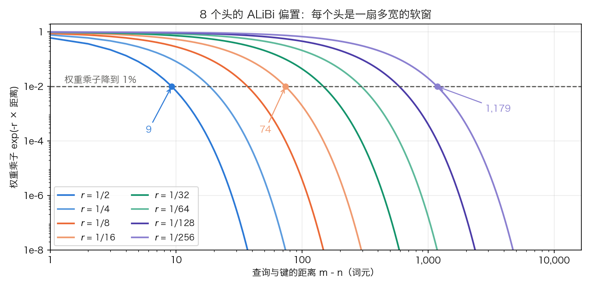

## 4.4 ALiBi 与其他相对位置方案

RoPE 把位置写进每一层的 q、k。另一条路不动向量，直接在注意力分数上加一个只依赖距离的偏置。ALiBi 取固定的线性惩罚，相当于给每个头套一扇指数衰减的软窗，8 个头时窗宽从 9 到约 1,200 个词元按倍数分档。窗宽与序列长度无关，所以困惑度不随长度崩溃；但这是偏向近处的先验，远处的键被压到万分之一以下，长程检索做不了，长上下文成为主要需求之后，主流方案停在了 RoPE 加缩放。T5 偏置把线性惩罚换成按对数分桶的可学习标量；NoPE 完全不写位置，说明因果掩码本身就带位置信息。近年的做法是分层混合：局部层带位置，全局层少带或不带。

### 4.4.1 ALiBi：用偏置替代编码

**ALiBi**（Attention with Linear Biases，Press 等人，2021 年）不添加位置向量，只在注意力分数上加一个与距离成正比的负偏置：

$$\text{score}(q_m, k_n) = \frac{q_m^T k_n}{\sqrt{d_h}} - r \cdot (m - n), \quad n \leq m$$

$d_h$ 是每头宽度，$m - n$ 是因果注意力中查询到历史键的距离，$r$ 是预设的斜率，每个头一个，不参与训练。头数为 2 的幂时，论文取几何级数 $r_h = 2^{-8h/n_h}$，$h = 1, \dots, n_h$；8 个头时是 $1/2, 1/4, \dots, 1/256$。头数不是 2 的幂时由实现插值生成；用到双向注意力时要另行定义方向。

**把偏置换算成乘子。** Softmax 之前加上 $-r \cdot (m-n)$，等价于把该键的权重乘上 $e^{-r(m-n)}$。8 个头的情形：斜率 $1/2$ 的头在距离 16 处的乘子是 $e^{-8} \approx 3.4 \times 10^{-4}$；最平缓的 $1/256$ 头要到距离 2,048 才降到同一个值。以乘子降到 1% 作为一个头的有效窗口，窗宽是 $\ln 100 / r$，八个头依次为 9、18、37、74、147、295、589、1,179 个词元。相邻两个头斜率差一倍，窗宽也差一倍。

图 4-4：8 个头的 ALiBi 偏置换算成 Softmax 权重乘子后的衰减曲线，横纵轴均为对数坐标（[生成脚本](https://github.com/yeasy/llm_internals/blob/main/tools/figures/ch04_alibi_decay.py)）。虚线是乘子降到 1% 的位置，标注的是三个头对应的距离。

所以 ALiBi 的八个头是八扇宽度不同的软窗，最宽的一扇也只有一千多个词元。它的外推应当读作“窗口宽度与序列长度无关”：序列变长后，每个头看到的有效注意力范围与训练时相同，等价于滑窗评估，困惑度因此不崩溃。ALiBi 论文的实测也是这样：性能在约两倍训练长度处见顶，此后缓降，到 10,000 仍然不差，作者把收益归于偏向近处的归纳偏置。

**困惑度不崩溃，不等于能检索远处的信息。** 困惑度主要由局部可预测性决定，对远端注意力被压平并不敏感；“从 100K 词元里找出那一句话”却依赖远端的键不被压到 $10^{-4}$ 以下。评估长上下文能力因此不能只报困惑度，要看检索类指标，见 [14.7.4 节](../14_future_trends/14.7_long_context.md)的大海捞针与 RULER。长上下文成为主要需求之后，主流方案停在 RoPE 加缩放（[4.3.5 节](4.3_rope.md)），原因就在这里：RoPE 不施加随距离线性增长的硬惩罚，代价是必须显式处理外推。

**实现形态决定了偏置方案的工程成本。** Softmax 对一行加同一个常数不变，$-r(m-n)$ 与 $+r \cdot n$ 等价，所以偏置只需要键的位置，每个头只存一个斜率，可以在注意力内核里按位置现算。一般的 $T \times T$ 偏置做不到这一点：要么物化一张与分数矩阵同样大的表，与 FlashAttention 不物化分数矩阵的做法相抵（[10.3 节](../10_inference_optimization/10.3_flash_attention.md)），要么由内核为它专门实现。RoPE 作用在进入内核之前的 q、k 上，内核不必改动，偏置类方案在工程上多一层负担。ALiBi 的 K 缓存里不含位置信息，这一点的实际意义有限：RoPE 下淘汰旧词元同样不需要处理（4.3.6 节）。实现细节见[附录 A.7](../appendix/a7_framework_recipes.md)。

### 4.4.2 写进分数的其他方案

这几种方案今天都不是大语言模型的默认选择，各用一段交代做法与来由。

**Shaw 等人（2018 年）的相对位置表示**是这条路线的源头：给每个相对距离学一个向量加到键上，并把距离裁剪在 $\pm k$ 之内（基础模型取 $k = 16$）。裁剪的理由有两条：超过一定距离后精确的相对位置不再有用；裁剪让模型能处理训练中没见过的长度。

**Transformer-XL 的相对位置编码**（Dai 等人，2019 年）从 [4.1.5 节](4.1_sinusoidal.md)的四项展开改起：键一侧的绝对位置向量换成相对距离 $i - j$ 的正弦编码，并配一个独立的投影；查询一侧的位置向量换成两个与位置无关的可训练向量。四项因此变成内容寻址、内容相关的位置偏置、全局内容偏置、全局位置偏置，查询侧不再含位置。改动的直接原因是它的段级循环：上一段的隐状态被缓存下来供下一段读取，绝对位置号在跨段复用时会冲突。按内容与位置拆项的写法后来被 DeBERTa 沿用。

**T5 的相对位置偏置**更简单。每个相对距离先映射到一个桶，每个桶、每个头学一个标量，直接加到分数上，各层共享。论文取 32 个桶：近距离一距离一桶，远距离按对数合并，128 以上同桶。单独一层因此分不清 128 以外的距离，多层叠加后仍可组合出更大尺度的敏感性。分桶表见[附录 A.7](../appendix/a7_framework_recipes.md)。

**DeBERTa 的解耦注意力**把内容与位置拆成两组向量，分数由内容-内容、内容-位置、位置-内容三项相加，位置一侧用相对距离。论文的理由是：Shaw 等人的写法只有前两项，而位置-内容项同样重要；位置-位置项在相对位置下提供的信息不多，被略去。模型侧的设计见 [12.2.4 节](../12_encoder_models/12.2_roberta_albert.md)。

### 4.4.3 不写位置与少写位置

**NoPE**（No Positional Encoding）不注入任何位置信息，只靠因果掩码。因果掩码本身携带位置：位置 $i$ 能看到 $i$ 个词元。一个平均分配注意力的头给每个可见位置的权重是 $1/i$；序列若以固定的起始词元开头，读出结果里该词元的分量恰为 $1/i$，这就是一个位置计数器。[3.8.6 节](../03_components/3.8_gpt_inference_flow.md)第 2 轮 Decode 的头 2 是现成的例子：Query 全零，注意力平均分给 8 个可见位置。[Haviv 等人](https://arxiv.org/abs/2203.16634)的探测实验表明，不带显式位置的因果语言模型能学到隐式的绝对位置，困惑度在多个数据集和规模上接近显式方案。[Kazemnejad 等人](https://arxiv.org/abs/2305.19466)在从零训练的小规模解码器上比较了五种方案：在一组推理与数学任务的长度泛化上，NoPE 优于绝对位置编码、T5 偏置、ALiBi 与 RoPE；理论上它能表示绝对与相对两类编码，训练出的注意力模式更接近 T5 的相对偏置。两项工作都不覆盖大规模长上下文模型，纯 NoPE 没有成为大模型的默认方案。

**分层混合已经进入公开发布的模型。** 同一个模型的各层不必用同一种位置方案，有三种写法：

- **隔层去掉位置。** Llama 4 的公开实现每四层去掉一次 RoPE，带 RoPE 的层做 8,192 词元的分块局部注意力，合起来是局部层带位置、全局层不带位置的交错结构。SmolLM3 的 36 层同样每四层去掉一次。Cohere 的 Command 系列在滑窗层施加 RoPE，全局层不施加。动机是负责长程的层不带显式位置，就不必为它们处理外推。
- **局部层与全局层用不同底数。** Gemma 3 的全局层取 1,000,000，滑窗层取 10,000。理由可以从 [4.3.4 节](4.3_rope.md)的波长表读出：滑窗层只看几千个词元，小底数保住高频分辨率；全局层要覆盖十万量级，需要大底数把低频波长拉长。
- **部分旋转。** 只对每个头的前若干维施加 RoPE，其余维度不带位置；GPT-NeoX 20B 只旋转四分之一的维度。

各模型的配置键见[附录 A.7](../appendix/a7_framework_recipes.md)。

### 4.4.4 各方案的对比

表 4-7 按三条口径并列各方案：位置信息注入在哪里、超出训练长度时表现如何、扩展是否需要微调。

| 方案 | 类型 | 注入点 | 超出训练长度时的表现 | 扩展是否需要微调 | 额外参数 | 代表模型 |
| --- | --- | --- | --- | --- | --- | --- |
| 正弦编码 | 绝对 | 嵌入层 | 困惑度约在 $L_{\text{train}} + 50$ 之后开始变差 | 不适用 | 无 | 原始 Transformer |
| 可学习编码 | 绝对 | 嵌入层 | 查表越界，直接报错 | 需插值后微调 | $L_{\max} \times d$ | GPT-2、BERT |
| RoPE | 相对为主 | 每层 Q/K 旋转 | 直接外推即崩，困惑度可上千 | 内插方案普遍需要 | 无 | Llama、Gemma |
| ALiBi | 相对 | 注意力偏置 | 困惑度约在两倍处见顶，其后缓降 | 否 | 无 | BLOOM |
| T5 偏置 | 相对 | 注意力偏置 | 超出最大距离的键全部同桶，不再可分 | 否 | 桶数 × 头数个标量，跨层共享 | T5、Flan-T5 |
| NoPE | 隐式 | 不注入 | 缺乏大规模长上下文证据 | 不适用 | 无 | 小规模研究模型；混合用法见 4.4.3 |

表 4-7：主要位置编码方案对比。正弦编码与 ALiBi 的表现取自 ALiBi 论文的实测（[4.1.6 节](4.1_sinusoidal.md)与 4.4.1），RoPE 取自位置内插论文（[4.3.4 节](4.3_rope.md)）。RoPE 标为“相对为主”，依据是 4.3.4 节的 YaRN 假说。

选型的结论很短：新训练的大语言模型用 RoPE，长度靠大底数与续训解决；长度固定的模型用可学习表或正弦表即可；ALiBi 与 T5 偏置的长处是不必微调就能读更长的输入，前提是任务不依赖远程检索。

### 4.4.5 设计趋势

四条趋势可以从上表读出。

1. **从绝对到相对**：注入的信息从“第几个”转向“相隔多远”，语言中的依存关系与相对距离更相关。
2. **从嵌入层到注意力层**：注入点从输入端移到每层的打分过程，位置不再占用残差通道，也不必穿过 $W_Q^T W_K$。
3. **从固定长度到可扩展**：把长度上限写进权重形状的方案退出，取而代之的是可以缩放的连续参数化。
4. **从全局统一到分层混合**：同一模型的不同层采用不同的位置方案或不同的底数，把局部分辨率和长程覆盖分开处理（4.4.3）。

贯穿四条趋势的是同一条规律：位置方案的外推边界由训练覆盖决定。正弦编码的低频维、位置表靠后的行、RoPE 未转满的低频对，失效的都是训练中没有覆盖到的部分；ALiBi 不崩溃，是因为它的窗口不随长度变化。RoPE 是目前的默认选择，但问题尚无定论：4.3.5 的每一种扩展都需要额外的训练预算，4.4.3 的混合设计正在把“哪些层需要位置”重新变成待定的问题。
