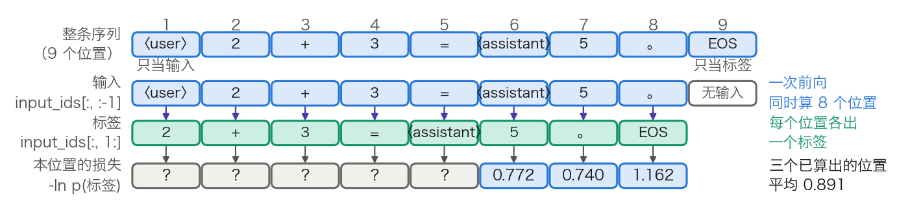

## 5.1 自回归语言模型：从左到右的世界观

**自回归语言模型**（Autoregressive Language Model）的训练目标是预测下一个词元。链式分解是恒等式，所以这个目标不含近似，它就是对整段文本联合概率的最大似然。每词元平均的负对数似然是交叉熵，等于数据的熵加上模型与数据分布之间的 KL 散度，也等于用模型做无损压缩时的码长：要压得短，模型必须掌握语料里一切可预测的规律。这是它能学到知识的原因，也划定了它学不到什么。因果掩码让一条长 $T$ 的序列一次前向给出 $T-1$ 个预测，训练并行、推理串行，走的是同一条计算路径。两个实用的锚点：随机初始化时损失约为词表大小的自然对数，训练充分的大模型在通用语料上约为每词元 2 nat。代价是单向性与暴露偏差。[3.8 节](../03_components/3.8_gpt_inference_flow.md)走完了一次前向，权重是手工摆的；本节给出权重由之训练出来的那个目标。

### 5.1.1 训练目标：链式分解与负对数似然

一段文本的联合概率按链式法则拆成逐位置的条件概率：

$$
P_\theta(x_1,\dots,x_T) = \prod_{t=1}^{T} P_\theta(x_t \mid x_{<t})
$$

其中 $x_{<t}$ 表示位置 $t$ 左边的全部词元。这个分解是恒等式，不含任何假设；模型要做的只是给每个条件概率一个参数化形式。训练目标取它的负对数，并按位置数归一：

$$
\mathcal{L}(\theta) = -\frac{1}{T}\sum_{t=1}^{T} \log P_\theta(x_t \mid x_{<t})
$$

三处约定决定它能否与别处的数字对上。$t=1$ 时条件为空：多数实现在序列开头补一个 BOS（begin of sequence）词元，不补的实现从 $t=2$ 起求和。除以 $T$ 使不同长度的序列可比，[6.1.1 节](../06_training_techniques/6.1_loss_optimizer.md)的困惑度就是对这个每词元平均值取指数。$\log$ 取自然对数时单位是 nat，以 2 为底时是 bit，两者差一个因子 $\ln 2$。

训练时这个标量的作用是提供梯度：算出每个权重增大一点时损失怎样变化，再沿反方向小步更新。本章只讨论目标本身，更新规则见 [6.1 节](../06_training_techniques/6.1_loss_optimizer.md)。

### 5.1.2 从一条序列到一个损失标量

一条长 $T$ 的序列一次前向产生 $T-1$ 个**监督信号**，这是自回归目标最重要的工程性质。因果掩码（[2.4 节](../02_attention/2.4_self_cross_causal.md)）保证位置 $t$ 的输出只依赖位置 $1$ 到 $t$，所以把整条序列送进去，每个位置各自给出一份下一个词元的分布，互不污染。

按形状走一遍，`B` 是批大小、`T` 是序列长度、`n_vocab` 是词表大小：

- **前向到 logits**：`input_ids[B, T] → X⁽ᴸ⁾[B, T, d_model] → logits[B, T, n_vocab]`，每个位置都过 LM head。
- **错位对齐**：预测端取前 T−1 个位置的 logits，标签端取后 T−1 个位置的 `input_ids`。
- **取负对数并平均**：逐位置取正确词元的负对数概率，对有效位置求平均，得到一个标量。

与推理的差别只在第一步。推理时只把最后一行送进 LM head，前面位置的下一个词元早已写在提示里（3.8.5）；训练要的正是这些位置，它们的标签就是右边那个真实词元。错位时丢掉的是最后一个位置的 logits，它预测的词元还不存在。

图 5-1：一条序列怎样错一位变成 T−1 个训练样本（[生成脚本](https://github.com/yeasy/llm_internals/blob/main/tools/figures/ch05_shift_labels.py)）。序列沿用 3.8 节的教学例子，共 9 个位置：第 1 个位置只当输入，第 9 个位置只当标签，中间每个位置既是上一个位置的标签，又是下一个位置的输入。

每个词元既当过输入也当过标签（序列开头补了 BOS 时监督信号是 $T$ 个）。训练的计算量按 [3.7.7 节](../03_components/3.7_full_architecture.md)的 $C \approx 6ND$ 计，$D$ 就是这些词元位置数。下一节的掩码语言模型每次前向只产生约 $0.15T$ 个监督信号。

### 5.1.3 手算一步训练损失

损失就是模型分给正确答案的概率取负对数，概率越接近 1，这一格越接近 0。3.8 节的教学模型可以直接代入。训练序列为 `〈user〉 2 + 3 = 〈assistant〉 5 。 EOS`，共 9 个位置。位置 6 的标签是 `5`，3.8.5 的表 3-20 给出它的概率 0.462：

$$
\ell_6 = -\log P(\text{`5'} \mid x_{<7}) = -\ln 0.462 = 0.772
$$

位置 7、8 的标签 `。` 与 EOS 的概率是 0.477 与 0.313（3.8.6），损失为 0.740 与 1.162。三格平均 0.891。完整的训练损失还要把位置 1 到 5 一并平均进来，那几格 3.8 节没有算。

**起点的锚点是 $\ln n_{\text{vocab}}$。** 随机初始化的模型对每个候选词元给出近似相等的概率 $1/n_{\text{vocab}}$，损失约为 $\ln n_{\text{vocab}}$。表 5-1 给出几个常见词表的取值。

| 词表 | `n_vocab` | 初始损失 `ln n_vocab`（nat） | 以 2 为底（bit） |
| --- | ---: | ---: | ---: |
| 本节教学模型（5 个候选） | 5 | 1.61 | 2.32 |
| T5 的 SentencePiece 词表 | 32,000 | 10.37 | 14.97 |
| GPT-2 与 GPT-3 | 50,257 | 10.82 | 15.62 |
| Llama 3 发布权重 | 128,256 | 11.76 | 16.97 |

表 5-1：均匀猜测时的损失锚点，由 `ln n_vocab` 算出。Llama 3 的 128,256 是发布权重嵌入表的行数，含特殊词元。

首步损失在任何参数更新之前算出，与学习率无关，检查的是前向与损失的写法。偏离的方向各有所指：

- **明显偏高**：初始化或输出层把 logits 的尺度放大了。logits 的方差为 $\sigma^2$ 时，期望损失比 $\ln n_{\text{vocab}}$ 高约 $\sigma^2/2$。
- **明显偏低**：损失的归约或忽略标记写错，例如分母多算了不计损失的位置；或者在输入、输出嵌入共享权重的模型里标签没有错位，每个位置在预测自己的输入词元。
- **锚点对不上词表**：输出头的宽度与分词器不一致。

标签错位在不共享嵌入的随机模型上测不出来，随机模型对任何标签都给出约 $\ln n_{\text{vocab}}$，要靠训练几步后损失是否正常下降来查。

**终点的量级是每词元 2 nat 左右。** 训练充分的大模型在通用网页语料上的损失落在 2 附近，比起点低近 10 nat。到了这个区间，百分之几 nat 就是可见的差距：[5.4.3 节](5.4_data_scaling.md)里 Gopher 与 Chinchilla 的预测损失只差 0.056 nat，后者在大量下游任务上胜出。

### 5.1.4 为什么这个目标能学到知识

预测下一个词元看上去只是拟合共现频率。把损失写成信息论的形式，就能看清它要求的远不止于此。

设真实文本分布为 $p$、模型分布为 $q$。训练损失在全部文本上的期望是 $\mathbb{E}_{x\sim p}[-\log q(x)]$，称为 $p$ 与 $q$ 的交叉熵。熵 $H(p) = \mathbb{E}_{x\sim p}[-\log p(x)]$ 是分布 $p$ 自身的不确定性；KL 散度 $D_{\mathrm{KL}}(p \,\|\, q) = \mathbb{E}_{x\sim p}[\log p(x) - \log q(x)]$ 衡量两个分布的差距。把 $-\log q$ 拆成 $-\log p + (\log p - \log q)$ 再取期望：

$$
\mathbb{E}_{x\sim p}\!\left[-\log q(x)\right] = H(p) + D_{\mathrm{KL}}(p \,\|\, q)
$$

$H(p)$ 只由数据决定，$D_{\mathrm{KL}}$ 非负且仅当 $q = p$ 时为零。最小化损失等价于最小化模型分布与真实分布的 KL 散度，损失的下界是数据的熵。由此得到四条推论。

**损失降不到零不是缺陷。** 自然语言本身有不确定性，$H(p)$ 大于零；[5.4.2 节](5.4_data_scaling.md)拟合式里的常数项就是对它的估计。

**语言建模等价于无损压缩。** 按香农的信源编码定理，以 2 为底的交叉熵就是用模型 $q$ 做算术编码时的平均码长，损失越低，同一段文本压得越短。每词元 2.0 nat 折合 $2.0/\ln 2 = 2.885$ bit；按 Llama 3 分词器在英文上每词元 3.94 个字符算，约 0.73 bit/字节（ASCII 文本一个字符一个字节）。跨模型比较应当用 bit/字节，每词元损失依赖分词方式（6.1.1 节）。

**它是一个隐式的多任务目标。** 每一种上文都定义了一道预测题：补全“法国的首都是＿＿”要世界知识，补全“如果 x > 5 且 x < 10，那么 x 的范围是＿＿”要逻辑，补全一段代码要语法与控制流。要把所有上文上的损失一起压低，逐条记忆共现远远不够，模型只能去建模产生这些文本的过程。语法、事实、推理都没有被单独教授，它们是压缩这批语料的副产品。

**被压缩的对象划定了边界。** 语料里没有的东西，这个目标学不到。目标奖励的是像语料，不是为真：语料里常见的错误说法同样会被学会，事实可靠性与任务执行能力都不在它的保证之内。

### 5.1.5 训练并行、推理串行

训练时整条序列一次算完，推理时每次只出一个词元，两者由同一个因果掩码同时保证。

训练能并行，是因为位置 $t$ 的条件 $x_{<t}$ 已经写在语料里，不必等模型自己生成。这种用真实前缀当条件的做法称为**教师强制**（Teacher Forcing）。推理时真实前缀不存在，只能把上一步选出的词元追加进去再算下一步。

两者一致的是条件分布的形式：同一套权重、同一个因果掩码、同一条计算路径，位置 $t$ 的 logits 都是 $P_\theta(\cdot \mid x_{<t})$。不一致的是条件的来源：训练条件于人写的前缀，推理条件于模型自己生成的前缀。模型一旦生成了训练语料里不会出现的前缀，后续就在没见过的条件上工作，误差可能逐步累积，这一现象称为**暴露偏差**（Exposure Bias），是[第九章](../09_decoding/README.md)各种解码策略面对的前提之一。

### 5.1.6 单向性的代价，以及仅解码器为什么胜出

自回归目标的直接代价是**单向性**：每个位置的表示只汇总了它左边的信息。理解型任务里右边同样重要，“这部电影的特效很好，但剧情＿＿”不看后文就无法判断整体情感。下一节的 BERT 针对的就是这一点。

更尖锐的例子是**逆转诅咒**（Reversal Curse）：模型在“A 是 B”形式的句子上训练后，不会自动学会回答“B 是 A”。[提出该现象的工作](https://arxiv.org/abs/2309.12288)的实测是，GPT-4 回答“某位名人的母亲是谁”的正确率约 79%，反过来问“某人的儿子是谁”只有约 33%。原因在目标本身：它只要求给定左侧上下文时预测右侧词元，从未要求反向的条件概率成立。

仅解码器仍然成为主流，首要原因是预训练目标与使用方式一致：预训练完直接给提示就能用。完整的论证在 [5.3.7 节](5.3_encoder_decoder.md)。模型变大之后可以用更多上下文和更强的表示部分补偿单向性，单向性仍是代价。

### 5.1.7 对到实现

目标函数落到训练脚本里有三个约定，接口细节见[附录 A.7](../appendix/a7_framework_recipes.md)。

**标签由框架内部移位。** 主流框架的因果语言模型接口只接收一份与 `input_ids` 等长的标签，错位在损失函数里完成。调用方把 `input_ids` 原样当作标签传入即可；自己先错一位再传，等于错了两位。

**不计损失的位置用忽略标记。** 标签被置为 −100 的位置既不进分子也不进分母，填充位置靠它排除。监督微调只对回答部分计损失，做法同样是把指令部分的标签置为忽略标记（[8.1 节](../08_alignment/8.1_sft.md)），这是它与预训练全位置计损失的唯一区别。

**文档边界有两种处理。** 预训练把短文档拼接成定长序列以免填充浪费，文档之间插入 EOS，模型由此学会何时停止。早期的通行做法到此为止，PaLM 一类只用分隔词元拼接，后一个文档可以读到前一个文档。Llama 3 加了文档掩码：可见性方阵沿对角线分块，块内是因果三角，块与块之间全部屏蔽；只重置位置号挡不住跨文档的注意力。序列越长，一条序列里塞进的文档越多，文档掩码越有必要，代价是各段计算量不均（[6.4.2 节](../06_training_techniques/6.4_batch_sequence.md)）。
