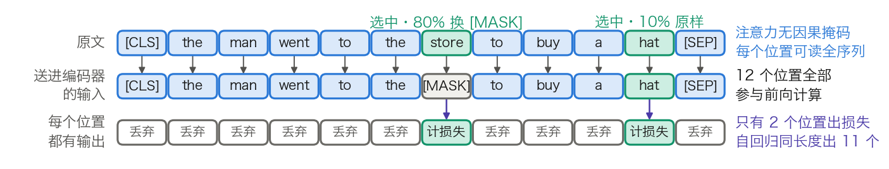

## 5.2 掩码语言模型：完形填空的智慧

**掩码语言模型**（Masked Language Model，MLM）要的是双向上下文。去掉因果掩码之后不能再预测“下一个”词元，多层双向注意力会让目标词经由邻居绕回自己；MLM 的办法是破坏输入，只在被破坏的约 15% 位置上预测原词。它换来深度双向的表示，付出三样代价：每次前向只有约 15% 的位置产生监督；`[MASK]` 只出现在预训练里，造成两阶段的输入失配；模型没有学过从空白开始生成所需的条件分布。BERT 的 80/10/10 改写只是缓解失配的补丁，微调口径下几乎不影响成绩。今天的默认配方是动态掩码、不带句间任务、整词或片段掩码、遮盖率提到 30% 上下（ModernBERT），或改用替换词元检测（ELECTRA、DeBERTaV3）；MLM 的主要用途是给编码器打底，再接对比学习做嵌入与重排。上一节的自回归目标只看左边，本节回答看两边要付出什么。

### 5.2.1 为什么不能直接做双向语言模型

去掉因果掩码、照旧预测下一个词元，答案会泄漏，泄漏有两种。字面的一种：位置 $$t$$ 在第 1 层就能直接读到位置 $$t+1$$ 的输入，那正是它要预测的词。BERT 论文所指的是另一种，每个词可以**间接看到自己**：即使让位置 $$t$$ 只用左右上下文预测本位置的 $$x_t$$、不读自己的输入，第 1 层里位置 $$t+1$$ 的表示已经读了 $$x_t$$，第 2 层里位置 $$t$$ 再读它，就绕一圈拿到了答案。层数越多，迂回路径越多，预测退化为复制。

绕开它有两条路。一条是浅层拼接：分别训练从左到右和从右到左的模型再拼接表示，ELMo 走的就是这条路（见 [1.1 节](../01_introduction/1.1_seq_challenge.md)），两个方向从不在同一层交互。另一条是改任务：改为预测被遮住的词元，泄漏路径随之被掐断。

### 5.2.2 掩码流程与损失

设原始序列为 $$x_1,\dots,x_T$$。随机挑出一个位置集合 $$M$$ 作为预测目标，按下面的规则改写输入，得到 $$\tilde{x}$$，然后在 $$\tilde{x}$$ 上做一次双向前向，只在 $$M$$ 的位置上计损失：

$$
\mathcal{L}_{\mathrm{MLM}}(\theta) = -\frac{1}{|M|}\sum_{i \in M} \log P_\theta(x_i \mid \tilde{x})
$$

与 5.1.1 相比，条件是整条改写后的序列 $$\tilde{x}$$，求和范围缩到 $$M$$。按形状走一遍，与 5.1.2 对照：

- **采样并改写**：`input_ids[B, T] → 目标掩码[B, T]`，每个位置以 15% 的概率被选中；被选中的位置按 80/10/10 改写成 `[MASK]`、随机词元或保持原样。
- **双向前向**：`改写后的输入[B, T] → X⁽ᴸ⁾[B, T, d_model] → logits[B, T, n_vocab]`，注意力矩阵是满的，全部位置都过 MLM head。
- **只取目标位置的损失**：未选中位置的标签置为忽略标记，其余位置取负对数概率求平均。

容易弄错的有三处。未选中的位置照常参与前向、照常产生 logits，只是不计损失。“保持不变”的位置输入未动，仍属于 $$M$$，仍要计损失。改写只发生在输入侧，标签始终是原始词元。

图 5-2：一条句子经 80/10/10 改写后，哪些位置计损失（[生成脚本](https://github.com/yeasy/llm_internals/blob/main/tools/figures/ch05_mlm_masking.py)）。12 个位置全部参与前向，只有 2 个选中位置产生损失；其中一个被改成 `[MASK]`，另一个保持原样。同样长度的序列，自回归会在 11 个位置上产生损失。

### 5.2.3 名额怎么分：一组可复核的数字

取序列长度 512，按 BERT 的配置，每条序列选中 $$512 \times 15\% = 76.8$$ 个位置，实现里取整为 77。再按 80/10/10 分：

$$
512 \times 0.15 \times 0.8 = 61.44,\quad
512 \times 0.15 \times 0.1 = 7.68
$$

即约 61 个换成 `[MASK]`、约 8 个换成随机词元、约 8 个保持原样。随机替换只占全部词元的 $$0.15 \times 0.10 = 1.5\%$$，小到不会损害模型对正常输入的理解。官方脚本与常用框架的默认参数见[附录 A.7](../appendix/a7_framework_recipes.md)。

### 5.2.4 三个比例从何而来

原论文给出的动机是：`[MASK]` 只在预训练里出现，微调时从不出现，不总是替换成它是为了缩小两阶段的输入失配。留 10% 原词，被考的位置里就有真词；再加 10% 随机词，编码器事先不知道哪些位置被考、哪些已被换掉，只能为每一个输入词元都保留一份带上下文的表示。

这组比例并不关键。[BERT 论文](https://arxiv.org/abs/1810.04805)附录的消融里，六种比例组合的 MNLI 微调成绩落在 83.6 到 84.4 之间，差距不到 1 分。拉开差距的是特征式用法，即冻结 BERT、只把它的表示当特征：只用 `[MASK]` 的组合在 NER 上掉到 94.0，比 80/10/10 的 94.9 低 0.9 分，因为冻结的表示没有机会在微调阶段适应“没有 `[MASK]`”的输入。失配的代价只出现在无法补偿失配的场景里。

15% 这个遮盖率是先例，不是最优值。BERT 论文没有扫描它；T5 论文扫过 10%、15%、25%、50% 四档，只有 50% 明显变差，最终沿用 15%。[专门研究遮盖率的工作](https://arxiv.org/abs/2202.08005)发现 15% 并非普遍最优，BERT-large 规模上遮 40% 在 GLUE 与 SQuAD 上好于 15%；ModernBERT 取 30%（见 [12.2.5 节](../12_encoder_models/12.2_roberta_albert.md)与 [12.3.5 节](../12_encoder_models/12.3_longformer_bigbird.md)）。取舍的方向是：比例太低则每次前向的监督太少，太高则上下文被破坏到无从推断，中间的平坦区比 15% 宽。

### 5.2.5 信号密度：77 对 511

“MLM 训练效率低”要量化成一个可比的量才有意义，这个量是每次前向产生多少个监督位置：

$$
\frac{T - 1}{T \times 15\%} = \frac{511}{76.8} = 6.65
$$

同一条 512 长度的序列，自回归给出 511 个监督位置，MLM 只给出约 77 个，相差约 6.6 倍。

这个倍数不能直接读作学习效率差 6.6 倍。其一，MLM 的每个预测用到了双向上下文，单个监督信号携带的约束更强；BERT 论文的实测是 MLM 收敛只略慢于从左到右的模型，绝对成绩很快反超。其二，每一步的前向与反向（由损失算出各权重更新方向的计算，见 [6.1 节](../06_training_techniques/6.1_loss_optimizer.md)）对全部位置都要做，两者花的算力一样多，差的只是换回多少个监督位置。

监督密度确实是真代价，但不是全部。ELECTRA 改用判别式目标，让损失铺满全部 $$T$$ 个位置，同等计算预算下训练效率提升约 4 倍（见 [12.2.3 节](../12_encoder_models/12.2_roberta_albert.md)）。这个 4 倍是端到端的算力效率，判别任务的每个位置只是一个二分类，还要另付生成器的算力，所以它与 6.6 倍不能相减比较。

BERT 的总训练量要按实际排布算。批 256 条、训练 100 万步，按每条 512 计是 $$1.31 \times 10^{11}$$ 个词元位置，即论文所说在 33 亿词的语料上过约 40 遍；但前 90% 的步数只用 128 的序列长度：

$$
0.9 \times 10^6 \times 256 \times 128 + 0.1 \times 10^6 \times 256 \times 512 = 4.26 \times 10^{10}
$$

约为前者的三分之一，折合约 13 遍。重复几遍才划算见 [5.4.8 节](5.4_data_scaling.md)。

### 5.2.6 NSP 的去留

BERT 还引入了**下一句预测**（Next Sentence Prediction，NSP）作为辅助任务：给定两段文本，判断第二段是否紧接第一段，训练损失是 MLM 与 NSP 两项之和。今天的编码器预训练不再带这个任务，RoBERTa 的配方与 ModernBERT 都没有句间目标。

NSP 失效是因为它太容易：负例随机抽取，多半来自不同主题，靠词面就能分辨（见 [12.1.4 节](../12_encoder_models/12.1_bert.md)）。RoBERTa 去掉它之后成绩持平或略升，但同时还改了掩码、批大小、词表与训练量，提升不能全部记在 NSP 头上。反面结果来自 ALBERT 的句序预测（SOP）：正负例是同一篇文档的相邻两段，只差顺序，模型只能去学连贯性，它在多句输入的下游任务上有帮助（见 [12.2.2 节](../12_encoder_models/12.2_roberta_albert.md)）。设计得当的句间任务有小幅收益，但没有进入后来的默认配方。

### 5.2.7 对到实现

**动态掩码。** BERT 在预处理阶段一次性生成掩码，把数据复制 10 份、各用一种掩码；RoBERTa 改为每次送进模型时现场采样。数据越大、步数越多，静态副本的重复越不可接受，主流框架的数据整理器默认就是动态掩码（参数名见[附录 A.7](../appendix/a7_framework_recipes.md)）。

**片段级的掩码。** 名额分散到孤立的词元上，模型常能靠同一个词的其他子词猜出答案。全词掩码让同一个词的子词一起被遮；[SpanBERT](https://arxiv.org/abs/1907.10529) 遮连续随机片段，并用片段两端的边界表示还原整段。下一节 T5 的片段破坏是同一思路。

**MLM 不能增量生成。** 原因有两层。没有因果掩码，改动一个位置会改变所有位置的表示，KV 缓存不成立，要重算全序列。更根本的是，模型只学过约 15% 的位置被遮时怎样填空，没有学过从全空开始逐个生成所需的条件分布。把遮盖率从固定的 15% 改成在 0 到 100% 之间随机取，MLM 就变成了掩码扩散语言模型的训练目标，后者正是靠这一点获得生成能力（见 [9.6.1 节](../09_decoding/9.6_diffusion_lm.md)）。

**MLM 今天用在哪里。** 要的是整段文本的一个向量或一个分数时，双向编码器适用：嵌入、检索召回与重排序。吞吐优先的场景仍以一两亿参数的编码器为主；精度前沿上，解码器大模型加对比学习改造的嵌入模型也有竞争力（见 [12.3.7 节](../12_encoder_models/12.3_longformer_bigbird.md)）。三种范式的机制对照见 [5.3.6 节](5.3_encoder_decoder.md)的表 5-3。
