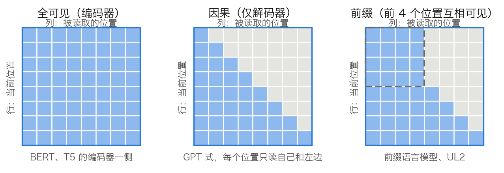

## 5.3 编码器-解码器预训练：两种范式的统一

编码器-解码器把“双向读”和“自回归写”各放进一个堆栈，用去噪做预训练：破坏输入，让解码器生成。T5 只生成被丢掉的片段，目标长度约为输入的五分之一；BART 重建整句。三种架构其实是同一张可见性方阵的三种形状，差别在是否共享权重、有没有交叉注意力。同算力、逐任务微调的口径下，编码器-解码器配去噪目标成绩最好；但大模型的用法是预训练后直接提示，这时因果仅解码器的零样本能力最强，加上单栈缓存可以逐轮追加，仅解码器成为主流。编码器-解码器留在输入固定、输出是对输入的转写的场景：语音识别、翻译，以及给扩散模型提供文本条件的编码器。前两节各占一边，自回归能生成但只看左边，掩码语言模型看两边却不能生成，本节的问题是能否两者兼得。

### 5.3.1 T5：文本到文本的接口

[T5](https://arxiv.org/abs/1910.10683)（Text-to-Text Transfer Transformer）把所有 NLP 任务统一为文本到文本的生成，做法是在输入前加一段任务前缀：

- 翻译：`translate English to German: That is good.` → `Das ist gut.`
- 语法可接受性判断：`cola sentence: John made Bill master of himself.` → `acceptable`

同一个模型、同一套训练与推理流程、同一个损失函数处理所有任务，不必为每类任务另设分类头。代价在边界处：回归任务 STS-B 只能把 1 到 5 的分数按 0.2 取整写成字符串，变成 21 类分类；模型输出不在标签集合里时直接判错。输出不再受标签集合约束是这种接口固有的代价，需要在解码端另加限制（见 [9.4 节](../09_decoding/9.4_constrained.md)）。

### 5.3.2 片段破坏怎样造出一对训练样本

T5 的预训练目标叫**片段破坏**（Span Corruption）。它随机丢弃输入中 15% 的词元，把每一段连续被丢的词元换成一个**哨兵词元**（sentinel token）。目标序列由被丢掉的片段组成，各段前面放回对应的哨兵，末尾再补一个哨兵表示结束。以论文的例句说明，`for`、`inviting`、`last` 被选中，前两个相邻因而合成一段：

```text
输入：Thank you <X> me to your party <Y> week .
目标：<X> for inviting <Y> last <Z>
```

四件事由此确定。每段连续被破坏的词元只占一个哨兵，所以输入变短。同一条样本里各哨兵的 ID 互不相同，模型据此知道该填哪一段。目标只含被丢掉的内容，不含整句。损失是解码器对目标串的标准自回归交叉熵，与 5.1.1 的式子相同，只是条件里多了编码器输出，经交叉注意力进入解码器（见 [2.4 节](../02_attention/2.4_self_cross_causal.md)）。哨兵是加进词表的特殊词元，T5 在 32,000 词的词表之外追加了 100 个，实现细节见[附录 A.7](../appendix/a7_framework_recipes.md)。

### 5.3.3 长度账：为什么片段破坏省算力

片段破坏相对逐词遮盖的收益是工程性的，可以直接算出来。设输入长 512、破坏率 15%、平均片段长 3，则被破坏 $512 \times 0.15 = 76.8$ 个词元，合成 $76.8 \div 3 = 25.6$ 个片段。编码器输入去掉被破坏的词元、换回哨兵，解码器目标由被丢词元、哨兵和 1 个结束哨兵组成：

$$
512 - 76.8 + 25.6 = 460.8,\qquad 76.8 + 25.6 + 1 = 103.4
$$

BERT 式的逐词遮盖不合并片段，编码器输入仍是 512。BART 式的重建整句让目标也是 512，约为 103.4 的 5 倍；解码器的自回归计算量与目标长度成正比，差距直接落在训练速度上。T5 论文的取舍正是这一条：几种去噪目标的下游成绩差别有限，选哪一个主要看计算成本。它扫过的平均片段长 2、3、5、10 差别也不大，最终取破坏率 15%、片段长 3。

### 5.3.4 BART：去噪自编码器

[BART](https://arxiv.org/abs/1910.13461) 把预训练视为序列去噪：对输入施加噪声，训练模型重建原文。论文比较了词元遮盖、词元删除、文本填充、句子排列、文档旋转五种噪声，最终配方是文本填充加句子排列：按泊松分布（$\lambda = 3$）采样片段长度，每段换成一个掩码词元，共遮盖 30% 的词元，并打乱全部句子。

与 T5 的差别在两处。BART 重建整句，目标长度等于原文长度；T5 只生成被破坏的片段。BART 的一个掩码词元可能对应任意长度的片段（包括长度 0），模型还要推断“这里缺了几个词元”。

### 5.3.5 三种注意力掩码形状

编码器、解码器、前缀语言模型三者的区别只是同一张 $T \times T$ 可见性方阵的形状不同。图 5-3 把三种形状并排画出。



图 5-3：全可见、因果、前缀三种注意力掩码形状（[生成脚本](https://github.com/yeasy/llm_internals/blob/main/tools/figures/ch05_mask_shapes.py)）。行是正在计算的位置，列是被读取的位置，深色表示可读，浅色表示分数被置为 −∞。虚线框标出前缀部分，其内部互相可见。

**前缀语言模型**（Prefix LM）介于两者之间：前缀部分全可见，其后的生成部分因果。它交出的信息流与编码器-解码器几乎相同，区别在于没有独立的编码器堆栈，前缀与生成部分共享同一套权重，也没有交叉注意力。把几种去噪方案合进同一次预训练的 UL2 见 [13.4.5 节](../13_decoder_models/13.4_t5_bart.md)。

形状也决定了缓存能否成立。3.8.3 所说的“因果掩码保证每个位置从不读右边”是 KV 缓存的前提：掩码里一旦出现“右边可见”的格子，追加新词元就会改变旧位置的表示，缓存随之失效。前缀语言模型的前缀一次性算完、其后严格因果，所以在单次生成内仍可缓存；前缀本身一旦追加内容，就要整段重算。

### 5.3.6 三种范式的成绩与代价

T5 论文用同一套语料、同一套评测比较了架构与目标的组合，结果列在表 5-2。$P$ 是一个 12 层 BERT-base 规模堆栈的参数量，$M$ 是编码器-解码器处理一对输入-目标所需的 FLOPs。

| 架构 | 预训练目标 | 参数量 | 计算量 | GLUE | SQuAD | SuperGLUE |
| --- | --- | ---: | ---: | ---: | ---: | ---: |
| 编码器-解码器 | 去噪 | $2P$ | $M$ | 83.28 | 80.88 | 71.36 |
| 编码器-解码器（共享参数） | 去噪 | $P$ | $M$ | 82.81 | 80.63 | 70.73 |
| 编码器-解码器（各半层） | 去噪 | $P$ | $M/2$ | 80.88 | 77.59 | 68.42 |
| 前缀语言模型 | 去噪 | $P$ | $M$ | 81.82 | 78.94 | 68.11 |
| 仅解码器语言模型 | 去噪 | $P$ | $M$ | 74.70 | 61.14 | 55.02 |
| 编码器-解码器 | 自回归 | $2P$ | $M$ | 79.56 | 76.02 | 64.29 |

表 5-2：架构与预训练目标的组合成绩，取自 [T5 论文](https://arxiv.org/abs/1910.10683)的表 2，保留 GLUE、SQuAD、SuperGLUE 三列。这是同规模模型“预训练后逐任务微调”口径下的比较。“仅解码器配去噪”是把破坏后的输入与目标拼成一条序列，从左到右处理。

在这个口径下，编码器-解码器配去噪最好，去噪目标几乎在每一组对照里都优于自回归目标。表里最有信息量的是前缀语言模型与仅解码器这一对：同参数、同算力、同目标，唯一的差别是输入一侧能否双向，GLUE 81.82 对 74.70，SQuAD 78.94 对 61.14。这个差距量出的正是 5.3.5 那张方阵里前缀块全可见的价值，前提是逐任务微调。

参数量要按计算量对齐来读。记单个堆栈的层数为 $L$（T5 基线取 12），编码器、解码器各 $L$ 层的编码器-解码器有约 $2P$ 个参数，是 $L$ 层仅解码器的两倍，但每个词元只经过编码器或解码器之一，处理一对输入-目标的计算量同为 $M$，T5 论文实测两者的单步耗时几乎相同。参数翻倍换来的是同等计算量下更多的容量，代价落在推理侧的显存与缓存形态上，见 5.3.7。

表 5-3 把三种范式按本章算过的量并排。

| 范式 | 架构 | 注意力可见性 | 每次前向的损失位置 | 同计算量下的参数量 | 增量生成时的缓存 | 代表模型 |
| --- | --- | --- | --- | --- | --- | --- |
| 自回归 | 仅解码器 | 因果 | $T-1$，全部位置 | $P$ | 单栈 KV 缓存，逐轮追加 | GPT 系列、Llama |
| 掩码 LM | 仅编码器 | 全可见 | 约 $0.15T$ | $P$ | 不成立，改一个位置要重算全序列 | BERT 系列 |
| 片段破坏 | 编码器-解码器 | 编码器全可见，解码器因果 | 约 $0.15T$（在解码器侧） | $2P$ | 单次生成内可缓存；输入追加内容时编码器与交叉注意力 K/V 全部重算 | T5 |

表 5-3：三种预训练范式的机制对照。损失位置数的算法见 [5.2.5 节](5.2_masked_lm.md)与 5.3.3 节。

### 5.3.7 为什么仅解码器成为主流

理由有三条，按分量排序：预训练目标与用法一致；缓存与系统简单；监督信号密度是辅证。

**目标与用法一致。** 大模型的用法是预训练完直接给提示，任何任务都写成续写，不需要任务头。[一项覆盖三种架构与两种目标的系统评估](https://arxiv.org/abs/2204.05832)给出了这一用法下的对照：纯无监督预训练之后，因果仅解码器配自回归目标的零样本泛化最强；若接一轮多任务提示微调（用大量写成指令形式的任务继续做监督微调，见[第八章](../08_alignment/README.md)），输入段非因果可见、用掩码目标预训练的模型反而最好。表 5-2 比的是微调之后的成绩，与后一种口径同类，去噪目标在那里领先与这里的结论并不冲突。“预训练完直接提示”落在前一种。

**缓存与系统简单。** 多轮对话里仅解码器只有一份逐轮追加的 KV 缓存，历史前缀还能跨请求共享（见 [11.5 节](../11_serving/11.5_prefix_reuse.md)）。编码器-解码器做不到：编码器是双向的，输入每追加一轮，全部编码器表示都会改变，由编码器输出算出的交叉注意力 K、V 随之失效，只能每轮重新编码全部历史；交叉注意力缓存只在单次生成内有效。10 轮对话的累计处理量相差 5.5 倍，算例见 [13.4.3 节](../13_decoder_models/13.4_t5_bart.md)。系统一侧，单一堆栈让张量并行的切分、流水线的分段、推理引擎的调度都只需处理一种层（见 [11.8 节](../11_serving/11.8_multi_gpu_inference.md)）。

**监督信号密度是辅证。** 仅解码器的每个词元都产生损失，片段破坏只有约 15% 的词元产生损失。但 5.2.5 已说明损失位置之比不等于学习效率之比，表 5-2 里同算力下的去噪目标反而普遍领先，这一条不能单独解释胜负。

编码器-解码器仍占优的场景有共同特征：输入固定且完整、输出是对输入的转写而非开放续写。机器翻译、语音识别、固定模板的条件生成都属此类，编码器一次读完输入、解码器专注生成的分工在这里是优势。文生图与文生视频模型也常只取它的编码器一半，为扩散模型提供文本条件（见 [13.4.5 节](../13_decoder_models/13.4_t5_bart.md)）。编码器-解码器没有被淘汰，让出的是通用对话与工具调用这个最大的场景。
