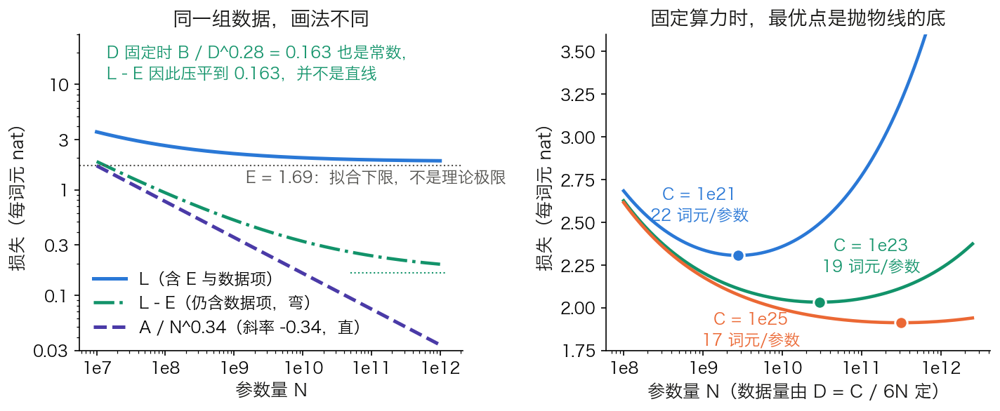

## 5.4 预训练数据：规模定律与数据质量的博弈

**规模定律**（Scaling Law）说的是：损失随参数量 $$N$$、数据量 $$D$$、算力 $$C$$ 按幂律平滑下降，而且指数很小，参数量乘 10，损失只乘 0.84。可预测，所以敢先用小模型试、再外推到大模型；昂贵，所以要算账。给定训练算力，损失分成不可约项、容量不足项、数据不足项三部分，最优分配落在后两项边际收益相等处；两项的指数相近，参数与数据应同比例增长，约 20 词元每参数，而且最优点很平，配比取 20 还是 93，预测损失只差约 0.007 nat。这只是训练算力最省的答案：把推理算进来，服务量越大，最优点越偏向小而久训的模型，Llama 3 8B 训到了每参数约 1,900 个词元。最后，$$D$$ 指不重复的有效词元：整份语料重复 4 遍以内几乎无损，16 遍之后基本白训。前三节定下了训练目标，本节回答给定算力时模型该多大、该喂多少数据。

### 5.4.1 三条幂律与它们的指数

Kaplan 等人 2020 年的[规模定律工作](https://arxiv.org/abs/2001.08361)发现，损失与 $$N$$、$$D$$、$$C$$ 之间各有一条平滑的幂律，在另外两项不构成限制时成立：

$$
L(N) = (N_c/N)^{\alpha_N},\quad \alpha_N \approx 0.076
$$

$$
L(D) = (D_c/D)^{\alpha_D},\quad \alpha_D \approx 0.095
$$

$$
L(C_{\min}) = (C_c^{\min}/C_{\min})^{\alpha_C^{\min}},\quad \alpha_C^{\min} \approx 0.050
$$

其中 $$N$$ 取非嵌入参数量，$$C_{\min}$$ 是按最优批大小折算的算力（固定批大小时指数为 0.057）。三个常数是 $$N_c \approx 8.8 \times 10^{13}$$、$$D_c \approx 5.4 \times 10^{13}$$ 词元、$$C_c^{\min} \approx 3.1 \times 10^{8}$$ PF-days（1 PF-day 即 $$8.64 \times 10^{19}$$ 次浮点运算），它们依赖词表与分词方式，单独没有含义。

指数小得出奇：$$10^{-0.076} = 0.840$$，参数量翻 10 倍，损失只乘 0.84；翻 100 倍，也只乘 0.705。改善平滑、可预测，但每一分都极其昂贵。可预测意味着可以先用小模型试再外推，大模型的投资逻辑建立在这一点上。

算力该怎么分，两代结论不同。Kaplan 的答案是 $$N \propto C^{0.73}$$、$$D \propto C^{0.27}$$，额外算力优先投给参数。2022 年 DeepMind 的 [Chinchilla 工作](https://arxiv.org/abs/2203.15556)重新拟合，得到两者各约 $$\propto C^{0.5}$$，此前的许多大模型因此是“过大欠训练”的。分歧有两个来源。Kaplan 对所有模型用同一条按 1,300 亿词元设定的学习率调度，中途读出的损失偏高，低估了少数据训练的效果（见 [6.2.3 节](../06_training_techniques/6.2_lr_schedule.md)）。[另一项分析](https://arxiv.org/abs/2406.12907)认为分歧的主要原因是 Kaplan 计的是非嵌入参数、实验规模又小，嵌入在小模型里占比大；在同样条件下模拟 Chinchilla 的研究，得到的系数就接近 Kaplan 的。规模研究应当按总参数量和总算力计。

### 5.4.2 计算最优是怎么解出来的

参数与数据同比例增长是拟合得到的经验事实，下面的推导说明它对应两个指数相近。Chinchilla 把损失参数化为带常数项的双幂律：

$$
L(N, D) = E + \frac{A}{N^{\alpha}} + \frac{B}{D^{\beta}}
$$

$$E$$ 是理想模型在该数据分布上的损失，对应 5.1.4 的 $$H(p)$$，再大的模型、再多的数据也降不到它以下；$$A/N^{\alpha}$$ 是容量不足带来的超额损失，$$B/D^{\beta}$$ 是数据不足带来的超额损失。论文正文公布的拟合值是 $$E = 1.69$$、$$A = 406.4$$、$$B = 410.7$$、$$\alpha = 0.34$$、$$\beta = 0.28$$。

在约束 $$C = 6ND$$ 下求最小值。把 $$D = C/(6N)$$ 代入，损失只剩 $$N$$ 一个变量：$$L = E + A N^{-\alpha} + B\,(6N/C)^{\beta}$$。$$N$$ 增大时第二项下降、第三项上升，对 $$N$$ 求导并令其为零，整理得

$$
N^{\alpha+\beta} = \frac{\alpha A}{\beta B}\left(\frac{C}{6}\right)^{\beta}
$$

再由 $$D = C/(6N)$$ 得

$$
N_{\mathrm{opt}} \propto C^{\frac{\beta}{\alpha+\beta}},\qquad
D_{\mathrm{opt}} \propto C^{\frac{\alpha}{\alpha+\beta}}
$$

代入两个指数：$$\beta/(\alpha+\beta) = 0.28/0.62 = 0.452$$，$$\alpha/(\alpha+\beta) = 0.548$$，论文报告的区间是 0.454 至 0.455、0.542 至 0.543。两个数都接近 0.5，因为 $$\alpha \approx \beta$$：两项的边际收益衰减得一样快，算力就该在两边平分。

论文并列用了三种估计方法：沿各模型的训练曲线取最优点；IsoFLOP 剖面，即固定算力、扫 $$N$$ 找损失最低点；把上面的参数化式拟合到全部最终损失上。前两种不假设函数形式，第三种需要，三者给出的配比并不一致（5.4.4）。

图 5-4：左为同一条幂律的两种画法，右为 IsoFLOP 剖面（[生成脚本](https://github.com/yeasy/llm_internals/blob/main/tools/figures/ch05_scaling_curves.py)）。左图固定 $$D = 1.4$$T、用正文系数画 $$L$$、$$L - E$$、$$A/N^{\alpha}$$ 三条曲线，只有最后一条在对数坐标下是直线，斜率为 $$-0.34$$；$$L - E$$ 也会弯，因为固定 $$D$$ 时数据项 $$B/D^{\beta} = 0.163$$ 同样是常数。右图对三个算力预算各画一条 $$L(N, C/6N)$$ 剖面，最低点就是该预算下的计算最优配比，系数取[复现工作](https://arxiv.org/abs/2404.10102)重拟合的一组（5.4.4）。

直接画 $$L$$ 看到的曲线随规模逐渐压平，那是在趋近与 $$N$$ 无关的常数项，不是规模定律失效；$$E$$ 也只是当前语料与分词下的拟合项，不是理论下界。

### 5.4.3 三笔算力账

有了 $$C \approx 6ND$$ 和参数化式，可以把几个公开模型放进同一张表比较。

| 模型配置 | 参数量 $$N$$ | 训练词元 $$D$$ | 词元/参数 | $$C = 6ND$$ | 预测损失 $$L(N,D)$$ |
| --- | ---: | ---: | ---: | ---: | ---: |
| Gopher 280B | 2.8×10¹¹ | 3.0×10¹¹ | 1.1 | 5.04×10²³ | 1.993 |
| Chinchilla 70B | 7.0×10¹⁰ | 1.4×10¹² | 20.0 | 5.88×10²³ | 1.937 |
| 8B 配 Chinchilla 比例 | 8.0×10⁹ | 1.6×10¹¹ | 20.0 | 7.68×10²¹ | 2.164 |
| Llama 3 8B | 8.0×10⁹ | 1.5×10¹³ | 1,875 | 7.20×10²³ | 1.949 |
| Llama 3 405B | 4.05×10¹¹ | 1.56×10¹³ | 38.5 | 3.79×10²⁵ | 1.819 |

表 5-4：五组配置的算力与预测损失。Gopher 与 Chinchilla 的 $$N$$、$$D$$ 取自 Chinchilla 论文，405B 的 15.6T 取自 [Llama 3 论文](https://arxiv.org/abs/2407.21783)，8B 的 15T 取自 [Llama 3 的官方模型卡](https://github.com/meta-llama/llama3/blob/main/MODEL_CARD.md)。$$6ND$$ 只数与权重相乘的部分，是便于心算的下界。损失由正文系数算出，只能作同一口径下的相对比较。

表中有三处对照。

第一，前两行复现了 Chinchilla 的主结论：算力相近（5.04×10²³ 对 5.88×10²³），70B 配 1.4T 的预测损失比 280B 配 300B 低 0.056 nat。参数少了四分之三，数据量是它的 4.7 倍，成绩更好。

第二，第三、四行是同一个 8B 模型的两种训法。只喂 160B 词元，预测损失 2.164；喂 15T 词元，降到 1.949。训练算力多花 94 倍，换来 0.215 nat。

第三，训练 Llama 3 8B 的算力（7.20×10²³）比 Chinchilla 70B（5.88×10²³）还多 22%，预测损失仍略高。用小模型多喂数据并不节省训练的钱，它把钱从推理挪到了训练；这笔挪动何时划算，见 5.4.5。

### 5.4.4 “20 词元/参数”的来历，以及它不是常数

**最优点很平。** 同一算力下，配比偏离最优几倍，损失只差千分之几 nat。按重拟合系数（复现工作修正后的一组，来历见下文）在 Chinchilla 的算力 $$5.88 \times 10^{23}$$ 上算，最优约为 18 词元每参数，取 20 几乎就在最优点上；配比取 5、93、200，预测损失比最优点只高 0.004、0.007、0.014 nat；偏离 10 倍约高 0.013，偏离 100 倍约高 0.055。换用正文系数，结论对称：那组系数的最优点在 93，取 20 也只高 0.007。对照 5.1.3 的量感，大模型之间差百分之几 nat 才是可见的差距，所以配比在几倍范围内的争论对结果影响很小。偏离两个数量级才开始要紧：Llama 3 8B 的训练算力若按计算最优分配（约 80B 参数配 1.5T 词元），按重拟合系数预测损失还能低约 0.05 nat，这是它为推理成本有意付出的代价。

**20 出自哪种方法。** 它来自 Chinchilla 的前两种估计方法，也是该文训练 70B 时实际用的配比。用正文系数（第三种方法）在同一算力下反解，最优点是 $$N = 3.25 \times 10^{10}$$、$$D = 3.02 \times 10^{12}$$，约 93 词元每参数。[复现工作](https://arxiv.org/abs/2404.10102)查明了原因：拟合系数用的数值优化程序因损失尺度设置不当而提前停止，正文系数又经过四舍五入。按它重新拟合的系数（$$E = 1.8172$$、$$A = 482.01$$、$$B = 2085.43$$、$$\alpha = 0.3478$$、$$\beta = 0.3658$$），同一算力下的最优点回到约 18 词元每参数，与前两种方法吻合。引用“最优配比”时，要说清出自哪种方法、哪组系数。

**配比随算力缓慢变化。** 由 5.4.2 的两个指数得 $$D_{\mathrm{opt}}/N_{\mathrm{opt}} \propto C^{(\alpha-\beta)/(\alpha+\beta)}$$，只有 $$\alpha = \beta$$ 时与算力无关。重拟合系数下 $$\alpha < \beta$$，$$C = 10^{21}$$、$$10^{23}$$、$$10^{25}$$ 时最优配比约为 22、19、17，随算力缓慢下降，图 5-4 右图画的就是这三点；正文系数下 $$\alpha > \beta$$，同样三档是 50、78、122，方向相反。

**系数只在拟合它的设定里有数值意义。** 语料、分词器、训练配方一变，$$E$$、$$A$$、$$B$$ 都会变。跨设定可以比较幂律的形状与配比的量级，不能直接比较预测损失的数值；Llama 3 在自己的数据上拟合出约 41 词元每参数（5.4.6），就是一例。

### 5.4.5 把推理成本算进来

计算最优只优化训练期的算力。模型部署之后，每处理一个词元还要付约 $$2N$$ 的前向算力（见 [3.7.7 节](../03_components/3.7_full_architecture.md)）。两段成本写进同一个式子：

$$
C_{\mathrm{total}} = 6 N D_{\mathrm{train}} + 2 N D_{\mathrm{infer}}
$$

这是[把推理计入规模定律的工作](https://arxiv.org/abs/2401.00448)采用的目标：给定质量要求，把全生命周期的算力压到最低。

设小模型 $$(N_s, D_s)$$ 与大模型 $$(N_l, D_l)$$ 训练后质量相同，令两者总算力相等，解出打平时的推理词元数：

$$
D^{*}_{\mathrm{infer}} = \frac{3\,(N_s D_s - N_l D_l)}{N_l - N_s}
$$

服务量超过 $$D^{*}$$ 时，过度训练的小模型总算力更省；低于它，按计算最优训练的大模型更省。

**“质量相同”是这个式子的前提，也是最容易被跳过的一步。** 表 5-4 的 Llama 3 8B 配 15T 与 Chinchilla 70B 配 1.4T，按正文系数预测损失只差 0.012 nat，近似满足；代入得 $$D^{*}$$ 约 1 万亿个推理词元，服务到 10 万亿词元时 70B 方案的总算力是 8B 的 2.3 倍。按重拟合系数，两者差 0.048 nat，约为同一组系数下 Gopher 对 Chinchilla 差距（0.026）的两倍；而且 8B 的容量项 $$A/N^{\alpha}$$ 单独就有 0.173，超过 70B 配 1.4T 的全部超额损失 0.157，8B 喂再多数据也追不上。所以具体的打平点取决于用哪组系数，不能当作定数引用。

结论的方向不依赖系数：给定质量目标，预期的服务量越大，总算力最省的配置越偏向更小的 $$N$$ 和更多的训练词元。面向大规模部署的开源模型普遍远离计算最优，原因在此；只训练一次、用于研究的模型不必如此。表 5-5 把三个阶段的口径并排。

| 口径 | 优化目标 | 算力如何分配 | 对应的词元/参数 |
| --- | --- | --- | ---: |
| Kaplan（2020） | 固定训练算力下的损失 | $$N \propto C^{0.73}$$、$$D \propto C^{0.27}$$，优先给参数 | 随 $$C$$ 增大而下降 |
| Chinchilla（2022） | 固定训练算力下的损失 | $$N \propto C^{0.5}$$、$$D \propto C^{0.5}$$，同比例增长 | 约 20 |
| 推理感知（2024） | 训练加推理的总算力 | 按预期推理量把最优点推向更小的 $$N$$ | 视推理量而定，可达数千 |

表 5-5：三种口径的差别在优化目标，不在幂律本身。

Chinchilla 在它自己的目标下依然成立，它从未声称 20 是任何目标下的最优；说 Llama 3 8B “证明 Chinchilla 错了”是误读，它换了优化目标。MoE 模型的配比要用激活参数量计算（见 3.7.7 节），按总参数算出的值可以差一个数量级。

### 5.4.6 Llama 3 自己拟合的规模定律

Llama 3 论文把规模定律用在两件事上。

第一件是选模型尺寸。该文在 $$6\times10^{18}$$ 到 $$10^{22}$$ FLOPs 之间训练 40M 到 16B 的模型，用 IsoFLOP 曲线的最低点拟合幂律。外推到 $$3.8\times10^{25}$$ FLOPs，最优配置是 402B 参数配 16.55T 词元，约 41 词元每参数，比 20 大一倍，最终发布的 405B 与它很接近。论文还观察到，算力越大，IsoFLOP 曲线在最低点附近越平坦，旗舰模型对参数与数据的折中并不敏感，这与 5.4.4 的平坦性一致。

第二件是预测下游成绩。规模定律只预测下一词元损失，该文用两步把它接到基准分数上：先把计算最优模型在某个基准上正确答案的归一化负对数似然与训练 FLOPs 做线性关联，再把这个负对数似然与准确率用 Sigmoid 关联，后一步借用算力更高的 Llama 2 系列作锚点。

按这套口径，系列里只有 8B 和 70B 是刻意的过度训练，405B 接近它自己拟合出的计算最优点，不宜把整个系列笼统称作“远超计算最优”。

### 5.4.7 词元化与词表大小

$$D$$ 的单位是词元，一个词元覆盖多少文本由分词器决定，同一批文本换一个分词器，折算出的 $$D$$ 就不同。Llama 3 把词表从 32K 扩到 128K，英文压缩率从每词元 3.17 个字符提升到 3.94，同样的训练算力可以多读约 24% 的文本。

代价在参数与显存：两份词表矩阵在 Llama 3 8B 上占总参数的 13.1%，32K 词表的 Llama 2 7B 只占约 3.9%（逐项见 [3.2.4 节](../03_components/3.2_embedding.md)）。算力上的代价小得多：嵌入是查表，不做矩阵乘法；输出头每生成一个词元的运算量约占前向的 $$dV/N$$，8B 为 6.5%（见 [3.1.6 节](../03_components/3.1_tokenization.md)）。Kaplan 的 $$N$$ 不含嵌入参数，所以比较不同词表的模型时，要说清参数量是否计入词表矩阵。模型越小，词表占比越高，这是小模型往往不跟进超大词表的原因。

中文的词元数同样取决于词表覆盖：字节级 BPE 遇到词表未收录的汉字，按 UTF-8 拆成最多 3 个词元，收录了就是 1 个（见 [3.1 节](../03_components/3.1_tokenization.md)）。

### 5.4.8 $$D$$ 不是随便什么词元

规模定律把 $$D$$ 当成一个标量，隐含的前提是这些词元互不重复、质量均匀。真实语料两条都不满足，$$D$$ 需要打折。

**重复的词元只值一部分。** [一项在最多 9000 亿词元、90 亿参数规模上的系统扫描](https://arxiv.org/abs/2305.16264)给出了折算方式。设唯一词元数为 $$U$$、重复次数为 $$R_D$$（即 epoch 数减一），有效词元数近似为：

$$
D' = U + U \cdot R_D^{*} \cdot \left(1 - e^{-R_D / R_D^{*}}\right)
$$

$$R_D^{*}$$ 是重复价值的衰减常数（该文称为“半衰期”，对应的衰减比例是 $$1/e$$），拟合值约为 15，对应 16 个 epoch。$$R_D \to \infty$$ 时 $$D'$$ 趋于 $$U(1 + R_D^{*}) = 16U$$，再怎么重复也超不过唯一数据的 16 倍。表 5-6 代入几个 epoch 数。

| epoch 数 | 处理的词元 | 有效词元 $$D'$$ | 这一段每多处理 1 份唯一数据值多少 |
| ---: | ---: | ---: | ---: |
| 1 | 1.0 $$U$$ | 1.00 $$U$$ | — |
| 2 | 2.0 $$U$$ | 1.97 $$U$$ | 0.97 |
| 4 | 4.0 $$U$$ | 3.72 $$U$$ | 0.88 |
| 8 | 8.0 $$U$$ | 6.59 $$U$$ | 0.72 |
| 16 | 16.0 $$U$$ | 10.48 $$U$$ | 0.49 |
| 32 | 32.0 $$U$$ | 14.10 $$U$$ | 0.23 |

表 5-6：重复训练的有效词元数，由上式代入 $$R_D^{*} = 15$$ 算出，最后一列是本行与上一行之间的边际值。该文的两条结论对应表中两处：重复至多 4 个 epoch，损失与全用新数据相比变化可以忽略（其 8.7B 模型训 4 个 epoch 的验证损失只比单 epoch 高 0.5%）；到 16 个 epoch 附近收益急剧衰减。

用法很直接：手里只有 2T 词元的语料，想花掉 8T 词元的训练预算，训 4 个 epoch 的有效词元约 7.44T，相当于全新数据的 93%，这个折扣通常可以接受。

**重复的对象要分清。** 上式描述的是整个语料重复若干遍。只把某个小子集上采样很多遍是另一回事：该文引用的先前工作发现，把 0.1% 的训练数据重复 100 次会显著损害性能。

**重复还决定逐字记忆。** [一项去重研究](https://arxiv.org/abs/2107.06499)报告，在原始 C4 上训练的模型无提示生成的文本里，1.571% 的词元属于某段 50 词元的逐字复制，去重后降到 0.264%，约为六分之一。该文还发现 C4 验证集有 4.6% 的样本在训练集里有近似重复，直接抬高评测成绩；评测污染的防御见 5.5.8 节。

$$D$$ 的大小与它的构成同样重要。下一节讲一条真实管线怎样把原始网页变成可用的 $$D$$。
