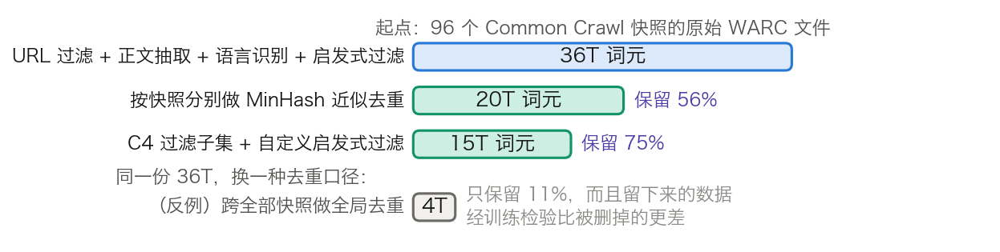
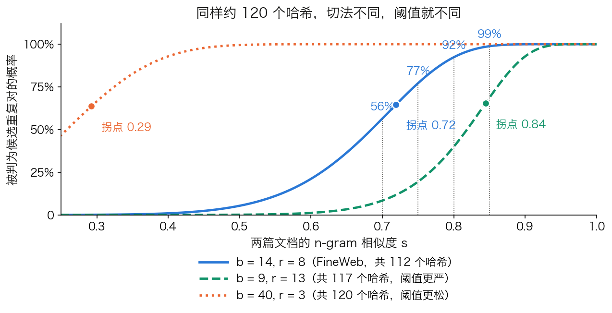

## 5.5 预训练数据管线：从原始网页到一份配比

规模定律里的 $$D$$ 是造出来的：原始网页经正文抽取、语言识别、启发式过滤、去重、模型打分、配比，留下的往往不到一半。排序原则是便宜的先做、贵的后做；每条规则的阈值要用小模型消融在下游评测上定，不能照搬别家。几条公开结果给出了量级：FineWeb 的 96 个 Common Crawl 快照经过滤与按快照去重得到 15T 词元；用分类器挑出教育性内容，或只保留打分靠前的一小部分，是提升最大的一步；去重不是越狠越好，被大量转载本身就是质量信号。过滤越严，质量越高而数据越少，严到数据成为约束、不得不重复时为止，这条边界由 [5.4.8 节](5.4_data_scaling.md)的有效词元折算与训练预算共同决定。配比可以用小模型加规模定律做代理实验来优化；训练末期学习率退到零的那一段集中投放高质量数据，对小模型收益大，对大模型近乎为零。

### 5.5.1 一条公开管线的顺序与逐步保留量

[FineWeb](https://arxiv.org/abs/2406.17557) 处理了 96 个 Common Crawl 快照，每一步的产出词元数都写在论文里，可以直接读出各步的淘汰率。

图 5-5：FineWeb 管线的逐步保留量（[生成脚本](https://github.com/yeasy/llm_internals/blob/main/tools/figures/ch05_data_pipeline.py)）。条形长度与词元数成正比，数值取自该论文，词元数按 GPT-2 分词器计。最下面一行是它的反例，见 5.5.5 节。

表 5-7 列出每一步做的事和它解决的问题。顺序不是随意的：便宜的过滤放前面，贵的放后面；去重放在主要的过滤之后，因为对垃圾内容做去重是浪费算力。

| 顺序 | 步骤 | 解决的问题 | 产出 |
| ---: | --- | --- | ---: |
| 1 | URL 黑名单过滤 | 成人内容、已知低质量站点 | — |
| 2 | 正文抽取 | 把 HTML 里的导航栏、页脚、广告剥掉 | — |
| 3 | 语言识别 | 只保留目标语言 | — |
| 4 | 启发式质量与重复规则 | 乱码、模板、极端重复 | 36T 词元 |
| 5 | 按快照分别做 MinHash 近似去重 | 转载、镜像、近似副本 | 20T 词元（保留 56%） |
| 6 | C4 过滤子集与自定义启发式过滤 | 更细的低质量模式 | 15T 词元（保留 75%） |

表 5-7：FineWeb 管线的六个步骤与产出，词元数取自该论文，步骤 1 到 4 只有合计值。质量分类器（5.5.4）不在这条主管线里，FineWeb 只把它用在派生的 FineWeb-Edu 上。

### 5.5.2 正文抽取与语言识别

Common Crawl 同时提供 WARC（原始 HTTP 响应）和 WET（它自带的纯文本转换）。WET 方便，但正文抽取质量不高：FineWeb 在同样 280 亿词元、只做英文过滤的条件下比较，用专门的抽取工具从 WARC 重新抽取，下游成绩优于直接用 WET。这一步排在最前，因为后面所有过滤规则都以正文干净为前提。

Llama 3 自建了 HTML 解析器，保留数学与代码页面的结构和图片的 alt 文本（公式常写在那里）；它的实测是保留 Markdown 标记反而有害，所以全部去掉。

语言识别用轻量分类器。FineWeb 用 fastText 只保留得分不低于 0.65 的英文文档；Llama 3 用 fastText 分出 176 种语言，再按语言分别去重和过滤。阈值是一个取舍：调高会丢掉代码多、自然语言少的技术页面，调低会放进混杂语种的垃圾。

### 5.5.3 启发式过滤

启发式规则便宜且可解释，是淘汰量最大的一层。FineWeb 给出了每条规则的淘汰率：

- 行尾带终止标点的行所占比例低于 0.12 的文档被删，淘汰 10.14% 的词元。C4 原版的同类规则阈值更严，一次淘汰约 30%。
- 重复行中的字符占比不低于 0.1 的文档被删，淘汰 12.47%。MassiveText 原版的阈值是 0.2。
- 短于 30 个字符的行占比不低于 0.67 的文档被删，淘汰 3.73%。

三条合起来淘汰约 22% 的词元（删掉的文档相互重叠），在 280 亿词元的消融上把综合成绩抬高约 1%。

阈值要逐条测，不能照搬。C4 原版的终止标点过滤器单独看收益最大，代价是一次删掉约 30% 的词元；FineWeb 的消融显示，去掉它、只留其余 C4 过滤器，组合成绩反而更好，总共只删约 7%。于是 FineWeb 改用上面 0.12 的自定义阈值。

Llama 3 公开的三条规则是另一种思路：用重复 $$n$$-gram 覆盖率删掉由重复内容构成的长行（行级去重抓不到）；用脏词计数过滤域名黑名单漏掉的成人站点；用词元分布相对训练语料的 KL 散度过滤离群词元过多的文档。

### 5.5.4 质量分类器

启发式规则抓的是形式上的毛病，抓不到“这段文字有没有信息量”，模型打分补的是这一层。做法是训练一个轻量分类器，正例取自已知的高质量来源。Llama 3 用了两类：一类是 fastText，判断一段文本是否可能被 Wikipedia 引用；另一类先用 Llama 2 的对话模型按质量要求给文档打标，再把这套判断蒸馏进一个 DistilRoBERTa 打分器（用大模型的标签训练小模型，让它模仿大模型的判断），以便在万亿词元规模上跑得动。代码与数理推理另有专门的分类器，因为它们的词元分布与自然语言差别很大。

两条公开结果说明模型打分是管线里最主要的杠杆。FineWeb-Edu 用自训的分类器从 15T 词元中挑出教育性强的 1.3T，在 MMLU、ARC、OpenBookQA 这类知识与推理密集的基准上显著优于同规模的网页数据；跑这一遍分类器花了 6,000 个 H100 小时，所以它排在便宜的启发式过滤之后。[DCLM](https://arxiv.org/abs/2406.11794) 在 4 亿到 70 亿参数的规模上系统比较了去重、过滤与配比，结论是基于模型的过滤是组装高质量训练集的关键：由此得到的数据训练 7B 模型 2.6T 词元，MMLU 与 Llama 3 8B 相当，训练算力约为后者的六分之一。

### 5.5.5 去重：三层方法与一组可调参数

去重分三层，成本与能抓到的重复类型同步递增，实际管线通常三层都用。

**精确去重**按文档或段落的哈希消重，最便宜，只抓逐字相同的副本。

**近似去重**抓大部分内容相同、但不逐字相同的文档对，主流做法是 MinHash 配合 LSH（局部敏感哈希）的分带技巧。把文档切成 $$n$$-gram（连续 $$n$$ 个词构成的片段）的集合，两篇文档的相似度 $$s$$ 是交集大小除以并集大小，即 Jaccard 相似度。一个哈希函数相当于把并集里的全部 $$n$$-gram 随机排序，排在最前的那个落在交集里的概率正是 $$s$$，此时两篇文档的最小哈希值相同。用 $$b \times r$$ 个哈希函数各取一次最小值得到签名，切成 $$b$$ 个带、每带 $$r$$ 行，只要任意一个带完全相同，就视为候选重复对。相似度为 $$s$$ 的文档对成为候选的概率是

$$
P(s) = 1 - (1 - s^{r})^{b}
$$

这条 S 形曲线的拐点约在 $$(1/b)^{1/r}$$。FineWeb 的配置是 5-gram、112 个哈希函数、14 个带每带 8 行，拐点为 $$(1/14)^{1/8} = 0.719$$；相似度 0.70、0.75、0.80、0.85 的文档对成为候选的概率依次是 56%、77%、92%、98.8%，即以高概率抓住相似度 75% 以上的文档、几乎必然抓住 85% 以上的。

调 $$b$$ 与 $$r$$ 就是调“多像才算重复”。哈希总数几乎不变时，改成 9 个带每带 13 行，拐点升到 0.84，相似度 0.80 的文档对只有 40% 的概率被抓到；改成 40 个带每带 3 行，拐点降到 0.29，大量只是题材相近的文档会被误判为重复。

图 5-6：三组 $$(b, r)$$ 下的候选概率曲线（[生成脚本](https://github.com/yeasy/llm_internals/blob/main/tools/figures/ch05_minhash_scurve.py)）。实线是 FineWeb 的 14 × 8 配置，虚线与点线是哈希总数相近但切法不同的两组，开销几乎一样，判定阈值却相差很大。

**语义去重**是最内层。[SemDeDup](https://arxiv.org/abs/2303.09540) 用预训练模型的嵌入找出语义相似但不逐字相同的数据对，在 LAION 的子集上移除 50% 数据而性能损失极小、训练时间近乎减半。

**去重的范围比算法更要紧。** FineWeb 对 96 个快照做全局去重，越老的快照被删得越多，最老的那些被删掉高达 90%（它们要与后来所有快照比对）；全部做完只剩 4T 词元，训练效果却远不如预期。单独检查 2013-48 这个老快照，在全局去重中保留下来的那 10% 数据，质量反而不如被删掉的那 90%。全局去重对每一簇重复只留一份：被反复转载的内容失去了它在语料里原有的权重，留在老快照里的则多是各快照独有、往往更边缘的内容。改为按快照分别去重，产出 20T 词元，成绩更好。一般的规律是：**去重强度**不是越大越好，重复次数本身含有“被反复引用因而重要”的信号。去重的另一项收益是抑制逐字记忆，量化结果见 5.4.8 节。

### 5.5.6 配比：把同一批数据按什么比例抽

配比不改变总量，只改变同样的 $$D$$ 里模型学到的是什么。Llama 3 公开了最终的大类比例，落到 15T 词元上如表 5-8。

| 大类 | 比例 | 折合词元 |
| --- | ---: | ---: |
| 通用知识 | 50% | 7.50T |
| 数理推理 | 25% | 3.75T |
| 代码 | 17% | 2.55T |
| 多语言 | 8% | 1.20T |

表 5-8：Llama 3 的预训练数据配比，比例取自 [Llama 3 论文](https://arxiv.org/abs/2407.21783)，词元数由比例乘 15T 算出。多语言只占 8%，与该文“8B 和 70B 的目标用法是英语”的说明一致。

配比怎么定出来比比例本身更有价值。先训一个分类器给网页数据打上内容类别，才谈得上按类别配比；再用规模定律做代理实验：在候选配比上训几个小模型，按 5.4.6 节的两步法预测大模型在关键基准上的成绩，据此挑出下一个候选，反复多轮。这把配比从口味问题变成了可测量的优化问题。[DoReMi](https://arxiv.org/abs/2305.10429) 是同一方向上的自动化尝试，用一个小的代理模型学出各领域的权重。

提高一个小子集的权重，等于让它重复很多遍，而 5.4.8 节的折算式描述的是整个语料重复若干遍；小子集被上采样上百倍属于另一种情形，会显著损害性能。提高权重之前，先算它会被抽到几遍。数据不够时还可以用别的数据类型补：5.4.8 节那项数据受限研究发现，在自然语言里混入代码约可带来 2 倍的有效词元增益，即便评测只看自然语言任务；混到一半仍无劣化，再往上自然语言任务开始下滑。

### 5.5.7 退火：训练末期的配比切换

学习率是每次参数更新的步长，训练末期通常把它逐步降到零（原理见 [6.2 节](../06_training_techniques/6.2_lr_schedule.md)）。学习率衰减到零的那一段称为**退火**（annealing），这一段常切换配比，集中投放高质量语料：它是模型最后见到的一批数据，之后不再被别的数据覆盖。

Llama 3 给出了效果与边界。在 GSM8K 与 MATH 的训练集上做退火，8B 预训练模型在这两个验证集上分别提升 24.0% 和 6.4%，同样的做法对 405B 的提升可以忽略，论文的解释是旗舰模型的上下文学习与推理能力已经够强。退火的收益随模型变大而缩小。

退火还可以当评估工具用：取一个训练到一半的 8B 模型，在 400 亿词元上把学习率线性退火到零，新数据集占 30% 权重、默认配比占 70%，看基准成绩的变化，这比为每个小数据集单独做一轮规模定律实验便宜得多。退火数据里不能含常用基准的训练集，否则少样本评估被污染。

### 5.5.8 污染防御与数据治理

**检测与防御是两件事。** 检测手段有 $$n$$-gram 重叠比对、在语料中预埋 canary 串（专门埋入的唯一标识串，用于事后检查语料是否进了训练集），以及基于模型行为的方法，例如 [Min-K% Prob](https://arxiv.org/abs/2310.16789)：没见过的文本里往往含有几个概率极低的离群词。基于模型行为的方法可靠性有限：[一项大规模评估](https://arxiv.org/abs/2402.07841)发现，对预训练数据做成员推断在多数设定下只比随机猜测略好，此前看似成功的结果，部分来自成员与非成员取自不同时间段造成的分布漂移。

检测是事后补救，根本的防线是让评测集从一开始就不可能进训练集：使用私有的评测集，或者按时间切分。[5.4.8 节](5.4_data_scaling.md)的“C4 验证集有 4.6% 的样本在训练集里有近似重复”是不这样做的代价。微调阶段的污染另有形态，见 [8.5 节](../08_alignment/8.5_practice.md)。

**合成数据是一条正在变化的边界。** 它能低成本补足稀缺领域，但完全用模型生成的内容训练下一代模型会触发[模型崩溃](https://arxiv.org/abs/2305.17493)：原始分布的尾部消失，且不可逆。Llama 3 的实践是：8B 与 70B 在更强模型生成的数据上训练收益明显，405B 在自己生成的数据上训练无益甚至有害；可用的做法是给合成数据接上执行反馈这类外部真值，由模型提出、由外部检验。

**数据治理是管线的账本。** 来源、许可、过滤规则、去重版本和敏感信息处理策略都要记录，否则无法复现实验、排查污染，也无法在事后回答“某段内容为什么在或不在语料里”。Llama 3 在管线最前端移除含大量个人身份信息的域名，这类决定同样要记入账本。
