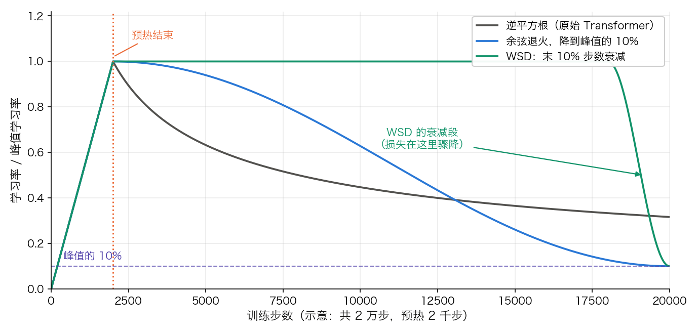

## 6.2 学习率调度：为什么需要先预热再衰减

Adam 自适应的是各参数之间的相对步长，全局尺度 $$\eta$$ 不在它的调节范围内。[6.1.3 节](6.1_loss_optimizer.md)已经说明单步位移以 $$\eta$$ 为基准并且有上界，学习率调度因此就是安排每步走多远随时间怎样变。预热用小步把网络带到能承受峰值学习率的区域，长度取总步数的千分之几到百分之一。衰减撤掉恒定学习率留下的噪声底，必须恰好在训练结束时做完，留给它一成左右的词元就够。峰值学习率随模型变宽而下降。当代配方是线性预热加余弦，或恒定段加末段衰减，终值取峰值的 1% 到 10%；比较两种调度时各自调到最优超参，并且只比衰减完的终点。

### 6.2.1 原始调度公式

原始 Transformer 把预热与衰减写进一条公式：

$$\text{lr} = d_{\text{model}}^{-0.5} \cdot \min(\text{step}^{-0.5}, \text{step} \cdot \text{warmup\_steps}^{-1.5})$$

步数小于 warmup_steps 时取后一项，学习率线性上升；之后取前一项，按 $$\text{step}^{-0.5}$$ 衰减；两项在 step = warmup_steps 处相等。原始论文取 warmup_steps = 4000，$$d_{\text{model}} = 512$$ 时峰值是 $$512^{-0.5} \cdot 4000^{-0.5} \approx 6.99 \times 10^{-4}$$。这条曲线的尾巴太平：步数从峰值起涨 25 倍，学习率才降到峰值的五分之一，当代配方因此改用 6.2.4 的余弦与 WSD。公式留下的是 $$d_{\text{model}}^{-0.5}$$ 这个因子所含的经验：模型越宽，学习率越小。6.2.4 的 μP 给出了它按层类型区分的版本。

### 6.2.2 为什么需要预热

预热的理由有三层，前提各不相同。

**其一，Post-LN 结构在初始化时靠近输出层的梯度偏大。** 原始 Transformer 把层归一化放在残差相加之后（Post-LN）。[一项用平均场理论做的分析](https://arxiv.org/abs/2002.04745)证明：这种结构在初始化时输出层附近参数的期望梯度很大，直接用大学习率会让优化不稳定，预热绕开了这一段。把归一化搬进残差分支内部（Pre-LN，见 [3.6 节](../03_components/3.6_layer_norm.md)）后初始化时的梯度表现良好，**预热可以安全去掉**，该文在 IWSLT14、WMT14 与 BERT 预训练上验证了这一点。当代 LLM 几乎全是 Pre-LN，却仍然保留预热，理由在后两条。

**其二，Adam 的二阶矩在开头几步估不准。** 首步的 $$\hat m_1/\sqrt{\hat v_1}$$ 恒等于 1（6.1.3），此时 $$v$$ 只见过一个样本，比值里不含统计信息。$$\beta_2 = 0.95$$ 要约 20 步、$$\beta_2 = 0.999$$ 要约 1,000 步才积累起像样的估计，此前自适应步长的方差很大，乘上全局 $$\eta$$ 后个别参数可能一步被推到很远。

**其三，预热让网络先走到能承受峰值学习率的区域。** 前两条解释不了实际的长度：DeepSeek-V3 的 $$\beta_2 = 0.95$$ 只对应 20 步的窗口，预热却有 2,000 步，Llama 3 405B 是 8,000 步。对损失曲率的测量给出了原因：训练早期处在曲率高的区域，小学习率下的头一段轨迹把网络带到更平坦、条件更好的区域，之后才承受得住更高的峰值学习率（[Gilmer 等](https://arxiv.org/abs/2110.04369)、[Kalra 与 Barkeshli](https://arxiv.org/abs/2406.09405)）。预热要多长，主要取决于峰值定得多高，$$\beta_2$$ 的窗口只覆盖开头的一小段。实践中按总步数的千分之几到百分之一取，见表 6-2。

**预热常与批量预热同时进行。** GPT-3 在最初的 40 亿到 120 亿词元内把批量从 3.2 万词元线性增到全量，与 3.75 亿词元的学习率预热重叠。批量从小往大排的理由在 [6.4.1 节](6.4_batch_sequence.md)：训练早期损失高、临界批量小，大批量只是多花词元。

### 6.2.3 为什么需要衰减

**衰减撤掉的是噪声底。** 大模型单轮预训练结束时离任何极小点都很远，损失仍在下降，衰减的作用不是让参数在最优点附近停稳。恒定学习率下，小批量梯度的噪声使参数在下降方向之外不停抖动，损失停在一个噪声底上，学习率越高，这个底越高。梯度噪声的尺度大致正比于 $$\eta/B$$（$$B$$ 为批量），降低学习率与增大批量因此是同一件事的两种做法。[在视觉任务上的实验](https://arxiv.org/abs/1711.00489)用训练中增大批量代替学习率衰减，得到了相同的学习曲线，SGD 与 Adam 下都成立。

6.2.4 的 WSD 调度给出了最直接的观察：恒定段的损失一直偏高，进入衰减段后陡降。[河谷假说](https://arxiv.org/abs/2410.05192)把预训练的损失地形比作谷底有河的深谷：高学习率下参数沿河道快速前进，同时在两侧山坡之间大幅振荡；衰减把振荡压下去，沿河道已经取得的进展才显现出来。按这种解释，高学习率段与衰减段各负责一个方向上的进展，缺一不可。原文把它作为猜想提出，并在一个简单的二元语法数据集上演示了这种地形可以出现。

**衰减要恰好做完。** [MiniCPM 的一组扫描实验](https://arxiv.org/abs/2404.06395)在 0.036B 模型上把余弦调度的周期 $$T_{\cos}$$（学习率从峰值降到终值所用的步数）与实际总步数 $$S$$ 拆开。在 $$S = 20N, 40N, 60N, 80N$$ 四种设定下（$$N$$ 为该模型的非嵌入参数量），最低损失**总是出现在 $$T_{\cos} = S$$**。$$T_{\cos} > S$$ 时训练结束而衰减没有做完，噪声底还在；$$T_{\cos} < S$$ 时高学习率的阶段被砍短。MiniCPM 还引述了 Chinchilla 的同一观察。调度长度就这样进入了最终损失。

**降学习率也在放松权重衰减。** AdamW 的实际衰减量是 $$\eta\lambda\theta$$（6.1.4），学习率下降时权重衰减同步变弱。Llama 3 在 scaling-law 实验里把权重衰减定义成当步学习率的 0.1 倍，就是把这层耦合写进了配置。

### 6.2.4 现代调度策略

当代配方用的是下面三条曲线，形状见 6.2.5 的图 6-1。记 $$t$$ 为当前步，$$W$$ 为预热结束步，$$S$$ 为总步数，$$\eta_{\max}$$、$$\eta_{\min}$$ 为峰值与终值。预热段三者相同，都从 0 线性升到 $$\eta_{\max}$$。

**余弦退火**（Cosine Annealing）在 $$W \le t \le S$$ 上取：

$$\eta(t) = \eta_{\min} + \tfrac{1}{2}(\eta_{\max}-\eta_{\min})\left(1 + \cos\frac{\pi(t-W)}{S-W}\right)$$

它在中期保持较高学习率，末期下降很快。$$\eta_{\min}$$ 通常**不是 0**：GPT-3 降到峰值的 10% 后继续以这个值训练，Llama 3 的 scaling-law 实验同样降到峰值的 0.1 倍。留一点更新能力，训练可以从终点继续；降到 0 的曲线只对一个事先定死的总步数有效。

**线性衰减**（Linear Decay）是同一想法的直线版本：$$\eta(t) = \eta_{\max} - (\eta_{\max}-\eta_{\min})\frac{t-W}{S-W}$$。表 6-2 的三个公开预训练配方都没有用它。

**预热-稳定-衰减**（Warmup-Stable-Decay，WSD）由 MiniCPM 命名并系统研究，写成三段：

$$
\eta(t) =
\begin{cases}
\dfrac{t}{W}\,\eta_{\max}, & t < W \\[4pt]
\eta_{\max}, & W \le t < S_{\text{stable}} \\[4pt]
f(t-S_{\text{stable}})\,\eta_{\max}, & S_{\text{stable}} \le t < S
\end{cases}
$$

其中 $$f$$ 是一个从 1 递减的函数，$$S_{\text{stable}}$$ 是稳定段结束步。MiniCPM 的实验结论是**衰减段占总词元的 10% 就够**：2.5% 不足，10% 已能取得最好结果。

**WSD 换来的是不必预知总步数。** 余弦调度必须事先定死总步数，而训练要跑多久往往在开跑时并不确定。WSD 稳定段上的**任何一个检查点**都可以接一段短衰减，得到一个可用的模型；不满意就回到稳定段继续训，再衰减一次。scaling-law 实验省得最多：余弦调度下每多看一个数据量，就要按那个总步数从头训一次；WSD 只训一次，再从稳定段的各个检查点分别接短衰减。

**比较两种调度有两条前提。** 其一，只比衰减完的终点。衰减段开始之前，WSD 的损失一直高于同点的余弦，进入衰减段后才追平甚至更低；中途截取两条曲线，比的是谁已经衰减完，与调度的好坏无关。其二，每种调度各用自己的最优超参。[Kimi K3 的技术报告](https://arxiv.org/abs/2607.24653)发现，在相同模型规模与词元预算下，两种调度的最优峰值学习率与最优批大小显著不同，用同一组超参比较，只会偏向那组超参更贴合的一方。该团队为每种调度各做一次独立的 scaling-law 搜索，再比最终损失，在这个前提下余弦退火稳定更优；这是他们在自己的模型族与数据上的观察。**只要两个方案各有一组要调的超参，固定超参、只换方案的对比就是有偏的**，优化器、归一化位置、注意力变体的比较同样受此约束。

**真实配置。** 表 6-2 把三个公开模型的调度放在一起。

| 模型 | 峰值 | 预热 | 衰减形状 | 终值 | 总长 |
| --- | ---: | --- | --- | ---: | --- |
| GPT-3 175B | $$0.6\times10^{-4}$$ | 前 3.75 亿词元线性升 | 余弦，跨 2,600 亿词元 | 峰值的 10% | 3,000 亿词元 |
| Llama 3 405B | $$8\times10^{-5}$$ | 8,000 步线性升 | 余弦 | $$8\times10^{-7}$$ | 120 万步 |
| DeepSeek-V3 | $$2.2\times10^{-4}$$ | 2,000 步线性升 | 恒定到 10T 词元，再余弦跨 4.3T | $$2.2\times10^{-5}$$，末段两级常数 | 14.8T 词元 |

表 6-2：三个公开模型的学习率调度。DeepSeek-V3 的末段是带两级常数尾巴的多段式：最后 5,000 亿词元里先用 $$2.2\times10^{-5}$$ 训 3,330 亿，再用 $$7.3\times10^{-6}$$ 训 1,670 亿。

三家有三个共同点。预热只占训练的千分之一到百分之一，GPT-3 约 0.13%，Llama 3 405B 约 0.7%。主体是余弦，或恒定段加余弦。终值落在峰值的 1% 到 10%。DeepSeek-V3 的恒定段占 68% 的词元，形状上已接近 WSD。选择的判据是总步数是否事先确定：确定就用余弦；要边训边定，或想从一条主干上取出多个数据量的模型，就用 WSD。

**峰值学习率随规模下降。** 表 6-3 取 GPT-3 八个规模中的三个。

| 配置 | GPT-3 Small（125M） | GPT-3 6.7B | GPT-3 175B |
| --- | ---: | ---: | ---: |
| 峰值学习率 | $$6.0\times10^{-4}$$ | $$1.2\times10^{-4}$$ | $$0.6\times10^{-4}$$ |
| 批量（词元） | 0.5M | 2M | 3.2M |

表 6-3：GPT-3 三个规模的峰值学习率与批量。参数量涨 1,400 倍，峰值学习率降到十分之一，批量涨 6.4 倍。

原因是结构性的。Adam 每步把每个权重挪动约 $$\eta$$，而一个神经元的输出是 fan_in 个权重与输入分量的乘积之和（fan_in 是指权重矩阵的输入维度，$$W_Q$$ 的 fan_in 就是 $$d_{\text{model}}$$）。各权重的挪动方向彼此相关，叠加后输出的变化约为 $$\eta \times \text{fan\_in}$$，随宽度线性增长。词嵌入的输入是独热向量，每次只用到一行，没有这种叠加。在标准参数化下，一步更新之后 logits 与 attention logits 的量级随宽度一起涨，只能调小全局学习率去压，这又让词嵌入几乎学不动。

**μP**（Maximal Update Parametrization，最大更新参数化）按层的类型分别缩放，消除这种宽度依赖。用 Adam 时，[它的处方](https://arxiv.org/abs/2203.03466)分三类：

- 输入层权重与所有偏置：初始化方差 $$1/\text{fan\_in}$$，学习率不随宽度变；
- 输出层权重：初始化方差 $$1/\text{fan\_in}^2$$，学习率按 $$1/\text{fan\_in}$$ 缩小；
- 隐藏层权重：初始化方差 $$1/\text{fan\_in}$$，学习率按 $$1/\text{fan\_in}$$ 缩小。

Transformer 还要把 attention logits 除以每头宽度 $$d_h$$ 而不是 $$\sqrt{d_h}$$。做完这些之后，最优学习率在不同宽度上基本重合，可以在小模型上调好超参、零样本迁移到大模型，论文称之为 **μTransfer**：从 4,000 万参数的代理模型迁移出的超参，在 6.7B 的 GPT-3 规模上超过了原论文公布的结果，调参代价只占总预训练算力的 7%。它有两条边界。迁移的对象是同一族模型在**不同宽度**上的超参，换数据或换任务不在保证范围内。三类参数的初始化与学习率要同时改对，不能只改学习率一项。

**续训是否重新预热，取决于优化器状态是否恢复。** 从检查点继续训（继续预训练、长上下文扩展、退火阶段）时，$$m$$ 与 $$v$$ 若一并恢复，就不需要重新预热；只恢复权重而丢掉优化器状态，6.2.2 的第二条理由重新生效，要补一段短预热。DeepSeek-V3 的长上下文扩展两阶段直接沿用预训练末尾的 $$7.3\times10^{-6}$$，没有重新升回峰值，属于前一种情形。各框架里这几条曲线的函数名与参数名见[附录 A.7](../appendix/a7_framework_recipes.md)。

### 6.2.5 学习率调度可视化

图 6-1 把原始的逆平方根、余弦退火与 WSD 三条曲线画在同一张图上。

图 6-1：三种学习率调度策略的曲线对比（[生成脚本](https://github.com/yeasy/llm_internals/blob/main/tools/figures/lr_schedule_comparison.py)）。纵轴统一归一化为“占峰值学习率的比例”，以便三条曲线并排；横轴的 2 万步与 2 千步预热是示意值，真实配置见表 6-2。余弦与 WSD 都降到峰值的 10%，WSD 的衰减段取总步数的 10%，与 MiniCPM 的结论一致。

逆平方根衰减最平缓，两万步后仍停在峰值的三成；余弦退火在中期保持较高学习率，末期快速下沉；WSD 在九成的训练时间里维持峰值，只在最后 10% 降下来。图上没有画损失曲线：WSD 的损失在衰减段之前一直偏高，要等这段陡坡走完才追上余弦，6.2.4 的第一条比较前提由此而来。
