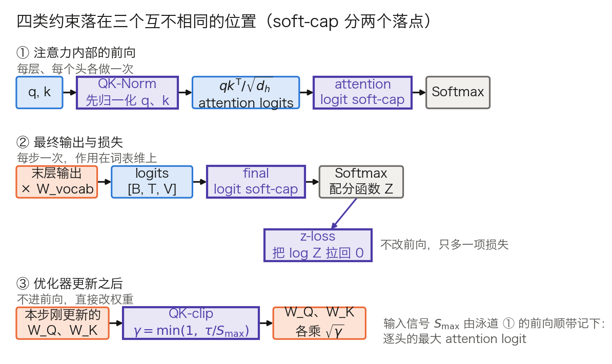

## 6.3 正则化策略：防止过拟合的多重手段

单轮预训练里，“正则化防止过拟合”这层意思已经很淡：十几万亿词元只过一遍，模型远谈不上记住训练集，Dropout 与权重衰减在这里很少是为泛化而设。本节真正的主题是数值尺度失控，它才会让一次长达数月的训练前功尽弃。失控有三处源头，各有一道闸。初始化时残差流的方差随层数线性累加，用 $1/\sqrt{2L}$ 缩放抵消。偶发的异常批次污染 Adam 的 $m$、$v$，用全局范数裁剪限制它进入状态的幅度。训练中 logits 随权重范数漂移，$\sqrt{d_h}$ 只管初始化，要靠 QK-Norm、soft-cap、z-loss、QK-clip 管住整个过程。权重衰减的作用同样是给范数设平衡点。公开配方取裁剪 1.0、衰减 0.1、不用 Dropout，并长期记录裁剪触发率、末层输出范数与逐头最大 attention logit，这几个量都先于损失报警。

### 6.3.1 Dropout

**Dropout** 在训练时随机将一定比例的神经元输出置零，推理时恒等通过；为使两个阶段的期望一致，训练时把保留下来的值乘以 $1/(1-p)$。神经元随时可能被关闭，模型被迫学习分布式的特征表示，不依赖少数神经元之间的共适应。原始 Transformer 取 $P_{\text{drop}} = 0.1$，施加在每个子层的输出上（与子层输入相加并归一化之前），以及词嵌入与位置编码之和上。

当代超大规模预训练通常**不使用 Dropout**：数据只过一遍，模型远未过拟合，Dropout 只会减慢收敛。PaLM 写明预训练未用 Dropout，仅微调时取 0.1。它偶尔以稳定性工具的身份回来：Chameleon 报告 7B 模型需要 Dropout 与 z-loss 并用才稳定，34B 则只需 z-loss。

### 6.3.2 梯度裁剪与梯度爆炸防止

**梯度裁剪**（Gradient Clipping）把梯度的全局范数限制在阈值以内：

$$\|g\| = \sqrt{\sum_{p}\|g_p\|_2^2},\qquad \text{若 } \|g\| > \text{max\_norm}，\text{则所有 } g_p \leftarrow g_p\cdot\frac{\text{max\_norm}}{\|g\|}$$

平方和跨**全部参数**求，不是逐张量各裁各的，缩放对所有参数统一，梯度的整体方向保留。常用阈值为 1.0，GPT-3、PaLM、DeepSeek-V3 都取这个值（[6.1.4 节](6.1_loss_optimizer.md)的表 6-1）。某步全局范数为 7.3 时，所有梯度统一乘 `1.0 / 7.3 = 0.137`；范数为 0.4 时什么也不做。

**它防的是偶发的异常批次。** 裁剪最初用来对付循环网络里沿时间步连乘造成的梯度爆炸（[1.2 节](../01_introduction/1.2_rnn_cnn_limits.md)）。Transformer 的反传路径长度由层数 $L$ 决定，与序列长度无关（[2.5 节](../02_attention/2.5_complexity_limits.md)）；残差结构又给梯度留了一条不经连乘的直通路径（[3.5 节](../03_components/3.5_residual.md)）。各层雅可比矩阵（输出对输入的导数矩阵）谱范数之积只是梯度放大倍数的一个上界，上界随深度增长不代表实际梯度必然增长。当代预训练保留裁剪，针对的是个别批次给出的异常大的梯度。

**在 Adam 下，异常梯度的危害是污染状态。** [6.1.3 节](6.1_loss_optimizer.md)已经算出：梯度长期为 0.02 的参数遇到一次 0.4 的尖峰，当步位移只有 $0.63\eta$，单步位移另有 $1.17\eta$ 的上界，一个批次不可能把参数一步推远。问题留在 $m$ 与 $v$ 里：

- 二阶矩一步抬高约 21 倍，从 $4\times10^{-4}$ 到 $8.38\times10^{-3}$。此后梯度恢复到 0.02，$v$ 超出稳态的部分按 $\beta_2^{\,k}$ 衰回：20 步后 $v$ 仍是稳态的 8.2 倍，更新的分母是稳态的 2.9 倍；45 步后是 3.0 倍与 1.7 倍；60 步后是 1.9 倍与 1.4 倍。
- 一阶矩里这个批次的分量按 $\beta_1^{\,k}$ 衰减，窗口约 10 步；10 步后它仍占 $m$ 的四成，这段时间的更新方向主要由它决定。

两者合起来，尖峰之后的十来步朝着一个批次指的方向走，此后几十步的 $m/\sqrt v$ 只有 0.43 到 0.72。净更新要把分子与分母合起来算，不能只凭 $v$ 偏大就下结论。

**裁剪限制这次污染的幅度，同时也改变当步更新。** 6.1.3 的尺度不变性要求全部历史梯度同比缩放，裁剪只缩当前一步，不满足这个条件。同一个例子里把 0.4 裁到 0.04：

| 当前梯度 | $m$ | $v$ | $m/\sqrt v$ |
| --- | ---: | ---: | ---: |
| 0.4（不裁剪） | 0.058 | 0.00838 | 0.63 |
| 0.04（裁剪后） | 0.022 | 0.00046 | 1.03 |

裁剪后当步位移从 $0.63\eta$ 变成 $1.03\eta$，反而更大：分母里的 $v$ 随梯度的平方变化，降得比分子快。位移因此不会按裁剪系数同比缩小。裁剪换来的是状态几乎不受扰动，$v$ 只抬高到稳态的 1.15 倍，后面几十步的步长照常。

**阈值与监控。** PyTorch 的 `torch.nn.utils.clip_grad_norm_()` 返回裁剪**之前**的总范数，可以直接记作监控量。比损失曲线更早的健康度信号是**裁剪触发比例**：稳定的训练里它低且平稳，它先上升、损失随后出问题，是最常见的顺序。阈值若低到几乎每步都触发，优化器收到的就是范数恒定的归一化梯度，裁剪不再是保险，而是改了优化器的语义。参数被张量并行、流水线并行或 FSDP 切开后（见[第七章](../07_distributed_training/README.md)），各分片的平方和要先跨卡归约再开方，否则每张卡算出的范数都偏小，缩放系数也各不相同；框架侧的做法见[附录 A.7](../appendix/a7_framework_recipes.md)。

裁剪管的是送入优化器的梯度范数，6.3.6 的几种手段管的是前向计算中 logits 的量级。

### 6.3.3 权重衰减

**权重衰减**（Weight Decay）在每次参数更新时对参数施加微小的收缩，AdamW 下的形式见 [6.1.4 节](6.1_loss_optimizer.md)：

$$\theta \leftarrow \theta - \eta\lambda\theta - \eta\cdot(\text{优化器给出的更新})$$

在单轮预训练里，它起作用的地方是**优化动力学**：给参数范数设一个平衡点，抵消更新带来的范数增长。对后面接着归一化的权重，整体缩放不改变输出，梯度与权重近似正交，每步更新只会使范数增大，衰减把它拉回，两者相抵处就是平衡点。[对这一平衡的分析](https://arxiv.org/abs/2305.17212)给出两条规律：平衡范数与 $\sqrt{\eta/\lambda}$ 成正比，平衡时权重向量每步转过的角度与 $\sqrt{\eta\lambda}$ 成正比。这类权重的范数本身不影响输出，真正起作用的有效学习率是每步转过的角度（[早期分析](https://arxiv.org/abs/1706.05350)），它由乘积 $\eta\lambda$ 决定，$\lambda$ 与 $\eta$ 因此要放在一起调。6.1.4 的时间尺度 $1/(\eta\lambda)$ 就是趋近平衡所需步数的量级。Moonlight 给出了不加衰减的后果：Muon 不加权重衰减时，权重与层输出的 RMS 一路涨到超出 bf16 的高精度区间，加上之后才稳住并取得更低的验证损失。

常见取值是 $\lambda = 0.1$（GPT-3、DeepSeek-V3），也有随学习率变化的写法（PaLM 取 $\text{lr}^2$，Llama 3 的 scaling-law 实验取 $0.1\times\text{lr}$）。哪些参数不做衰减见 6.1.4 的 no-decay 组。

### 6.3.4 梯度累积

**梯度累积**（Gradient Accumulation）累积多个小批次的梯度后统一更新一次，用来在显存有限时凑出大的有效批次。有效批次该定到多大由 [6.4.1 节](6.4_batch_sequence.md)的临界批量决定，这里只讲怎样凑。下面的代码按多卡数据并行来写，`model.no_sync()` 跳过各卡之间的梯度同步（[7.1.5 节](../07_distributed_training/7.1_data_parallel.md)），单卡训练时去掉它即可。

```python
import contextlib

accumulation_steps = 4
optimizer.zero_grad()
for i in range(accumulation_steps):
    batch = get_batch(size=64)
    sync = (i == accumulation_steps - 1)          # 只在最后一次同步梯度
    with contextlib.nullcontext() if sync else model.no_sync():
        loss = model(batch)
        (loss / accumulation_steps).backward()    # 梯度累积到各参数的 param.grad
torch.nn.utils.clip_grad_norm_(model.parameters(), 1.0)   # 裁剪在累积之后
optimizer.step()
```

三处细节决定它是否正确。

**其一，归一化的分母。** 代码假设 `loss` 已是小批次内的平均值，各小批的样本数又相同，除以 `accumulation_steps` 才与一次性使用大批次一致。语言模型按词元计损失，各小批的有效词元数通常不同，这样做就是错的。两个小批，一个有 100 个有效词元、损失和为 250，另一个有 300 个、损失和为 600：先各自取均值再平均得 `(2.5 + 2.0) / 2 = 2.25`，按词元加权得 `850 / 400 = 2.125`，相差 5.9%，短的那一批里每个词元的权重是长的那一批的 3 倍，按词元加权时两者应相等。稳妥的做法是对累积窗口内所有非填充词元的交叉熵求和，再除以窗口内非填充词元的总数。多卡时分母还要跨卡统一，见 [7.1.2 节](../07_distributed_training/7.1_data_parallel.md)。

**其二，通信。** 多卡时前 N−1 个小批的反向不必同步梯度，`no_sync()` 把通信量降到 1/N。

**其三，裁剪的位置。** 全局范数在**累积完成之后**、更新之前算一次。逐个小批裁剪改变了各小批在合成梯度里的权重，与大批次不再对应。

归一化正确时，累积 N 个小批得到的梯度**等于**在 N 倍大的批次上算出的梯度，依据是求导的线性，与用哪种优化器无关。这是精确算术下的等价，舍入、Dropout 与依赖批统计量的层带来的偏差见 7.1.2。有效批次变了之后学习率怎样跟着调，见 6.4.1。

### 6.3.5 训练稳定性的实践建议

**损失尖峰：诱因、拖尾与处置。** 训练中偶尔出现损失突然飙升。直接诱因通常是一批异常大的梯度，6.3.2 的状态污染解释了它为什么恢复得慢；损失为什么会升上去，目前没有公认的完整解释。PaLM 报告其最大的模型在训练中出现约 20 次尖峰，时机高度不规律，小模型上没有；处置是**从尖峰前约 100 步的检查点重启，并跳过约 200 到 500 个数据批次**。同一篇论文把尖峰附近的那些批次拿到另一个更早的检查点上重放，**不会**再触发尖峰：尖峰来自特定数据批次与特定参数状态的组合，不是数据本身有毒。[一种理论](https://arxiv.org/abs/2304.09871)把它归到 Adam 自身：更新向量可能进入范数偏大、又与下降方向基本不相关的状态，模型越深、批量越大越容易出现，依据是 70 亿到 5,460 亿参数的几次训练。训练框架因此必须能定位并跳过指定批次，并保留多个历史检查点（[7.7 节](../07_distributed_training/7.7_checkpoint.md)）。

尖峰并非不可避免。Llama 3 405B 报告很少观察到损失尖峰，也不需要人工干预来纠正发散；Kimi K2 报告用 MuonClip 训完 15.5 万亿词元没有出现损失尖峰。前者靠的是保守的批量与学习率配方，后者靠的是 6.3.6 的 QK-clip。

**初始化与残差分支缩放。** 多数实现采用较小的初始化标准差（如 $\mathcal{N}(0,\,0.02^2)$），并使用 **GPT-2／Megatron 的残差缩放**：把每个子层中直接写入残差流的输出投影（注意力的 $W_O$、FFN 的 $W_2$）在初始化时额外乘以 $1/\sqrt{2L}$，$2L$ 是残差子层总数，[GPT-2 原文](https://cdn.openai.com/better-language-models/language_models_are_unsupervised_multitask_learners.pdf)记作 $N$。设残差流入口方差为 1，每个子层输出的方差为 $\sigma^2$ 且近似互不相关，$2L$ 次累加后残差流的方差是 $1 + 2L\sigma^2$。缩放使每个子层的贡献变成 $\sigma^2/(2L)$，合计恰为 $\sigma^2$，与层数无关。取 $\sigma^2 = 1$：

| 层数 $L$ | 12 | 32 | 48 | 96 |
| --- | ---: | ---: | ---: | ---: |
| 不缩放时的残差流方差 | 25 | 65 | 97 | 193 |
| 乘 $1/\sqrt{2L}$ 之后 | 2 | 2 | 2 | 2 |
| 对应的初始化标准差 $0.02/\sqrt{2L}$ | 0.00408 | 0.00250 | 0.00204 | 0.00144 |

表 6-4：残差分支缩放把残差流方差的深度依赖抵消掉。前两行取每个子层输出方差 $\sigma^2 = 1$；第三行是同一缩放用到 $\mathcal{N}(0,\,0.02^2)$ 初始化上时输出投影实际采用的标准差。

Pre-LN 结构里子层输入先归一化，不缩放的后果不是把信号推入饱和区，而是**残差流的方差随深度线性增长**：后面的子层相对残差流越来越小，最终 logits 的尺度随深度失控，直接喂给 6.3.6 要治的问题。[3.5 节](../03_components/3.5_residual.md)关心梯度能不能传回去，这里关心激活会不会在前向上越滚越大，两者互为对偶。

**监控哪些量，看到什么算有问题。** 6.3.2 的裁剪触发率与下面几项构成一份可操作的清单：

| 监控量 | 正常时的样子 | 异常信号 |
| --- | --- | --- |
| 首步损失 | 约 $\ln n_{\text{vocab}}$（6.1.1） | 明显偏高多为 logits 尺度被放大，明显偏低多为损失归约或忽略标记写错（[5.1.3 节](../05_pretraining/5.1_autoregressive.md)） |
| 全局梯度范数 | 平稳，缓慢下降 | 突刺，或整体台阶式抬升 |
| 裁剪触发比例 | 低且平稳 | 持续上升，通常早于损失异常 |
| 最后一层输出的范数 | 缓慢增长 | 失控增长，与未来的损失发散强相关 |
| 逐头最大 attention logit | 有界 | 持续攀升（6.3.6） |

表 6-5：训练过程中值得长期记录的几个量。第四行出自 Chameleon 的观察：发散可能迟至训练进度的 20% 到 30% 才在损失上显现，而末层输出范数的失控增长能提前预示它。除第一行是一次性自检外，其余四项都在损失曲线之前先动。

### 6.3.6 注意力 logits 的动态约束：QK-Norm、z-loss 与 logit soft-cap

[2.2 节](../02_attention/2.2_scaled_dot_product.md)解释了点积为什么要除以 $\sqrt{d_h}$（$d_h$ 是每头宽度，第 2 章记作 $d_k$）：$q$ 与 $k$ 的分量独立同分布于 $\mathcal{N}(0,1)$ 时，点积方差等于 $d_h$，除以 $\sqrt{d_h}$ 把它拉回 1。这个分布假设**只在初始化时刻成立**。训练开始后 $W_Q$ 与 $W_K$ 的范数持续增长，$\sqrt{d_h}$ 是常数，不会跟着长：**$\sqrt{d_h}$ 是静态修正，无法约束动态漂移**。

后果有实例。Google 把 ViT 扩到 220 亿参数时，约 80 亿参数规模上的训练损失在几千步后发散，[原因是 attention logits 出现极大值](https://arxiv.org/abs/2302.05442)：不加归一化时迅速涨到 **50000 以上**，注意力权重几乎变成 one-hot，熵接近零，梯度不再流向其他位置。

**范数为什么会一直涨。** [Chameleon 报告](https://arxiv.org/abs/2405.09818)把发散的根源归到 Softmax 的平移不变性。Softmax 的输入有两个没有回压的方向，要分开看：

- **平移。** $\text{softmax}(z) = \text{softmax}(z+c)$，整行 logits 同加一个常数不改变输出，损失对这个方向没有任何约束，整行的绝对水平可以漂到很大。z-loss 管的是这个方向。
- **缩放。** 整行 logits 同乘一个大于 1 的系数，相对差距同比拉大，分布变尖。只要变尖能降低损失（例如正确项已排在最前），把产生 logits 的权重范数整体抬高就一直有利，损失里没有任何一项把它往回拉。QK-Norm 管的是这个方向。

多模态共享权重时，各模态靠略微抬高自身范数互相竞争，起初无害，超出 bf16 的有效表示范围就发散。单模态下的同一现象称为 **logit drift**。

约束手段共四类，落在不同的位置，见图 6-2。



图 6-2：四类约束落在三个互不相同的位置，soft-cap 按落点拆成两个框，共五个框（[生成脚本](https://github.com/yeasy/llm_internals/blob/main/tools/figures/ch06_logit_guards.py)）。泳道 ① 是注意力内部的前向，每层每头各做一次；泳道 ② 是最终输出与损失，每步一次；泳道 ③ 在优化器更新之后，不进前向。z-loss 从最终 Softmax 的配分函数分叉出去，只多加一项损失。

**QK-Norm**：在点积**之前**先归一化 $Q$ 与 $K$：

$$\text{softmax}\left(\frac{1}{\sqrt{d_h}}\,\text{LN}(XW^Q)\big(\text{LN}(XW^K)\big)^{\top}\right)$$

这是 ViT-22B 的 LayerNorm 版本。LLM 里更常见的是逐头在 $d_h$ 维上做的 RMSNorm 版本，插在把 Q/K 拆成头之后、施加 RoPE 之前，Gemma 3 即如此。归一化把 $q$、$k$ 的范数钉在固定尺度上，logits 的量级不再随权重范数漂移。取单位增益时 $\|q\| = \|k\| = \sqrt{d_h}$，由柯西—施瓦茨不等式，除以 $\sqrt{d_h}$ 后 attention logit 的绝对上界是 $\sqrt{d_h}$：$d_h = 64$ 时为 8，$d_h = 128$ 时为 11.3，是四类手段里最硬的约束。真实实现的 RMSNorm 带可学习的逐维增益，上界是 $\sqrt{d_h}$ 乘以增益的量级：尺度改由一组显式的、受权重衰减和梯度共同约束的参数决定，不再由 $W_Q$、$W_K$ 的范数自由漂移决定。QK-Norm 只管注意力内部的 Softmax，**不解决最终 Softmax 上的 logit 漂移**。

**z-loss**：约束**最终 Softmax 的归一化项**。PaLM 在语言建模损失之外加了一项[辅助损失 $z_{\text{loss}} = 10^{-4}\cdot\log^2 Z$](https://arxiv.org/abs/2204.02311)（$Z=\sum_i e^{x_i}$ 是 Softmax 的配分函数），把 $\log Z$ 往 0 拉，拴住平移这个自由度；否则整行 logits 可以漂到很大的绝对值，$e^{z}$ 在低精度下失去精度。系数这么小仍然有效：$\log Z = 1$ 时这一项是 $10^{-4}$，$\log Z = 10$ 时是 0.01，$\log Z = 50$ 时是 0.25，而主损失在 2 上下。它是一个只在远处才收紧的软约束。它对相对差距不完全中立：$\partial(\log^2 Z)/\partial z_i = 2\log Z\cdot\hat p_i$，概率高的 logit 被压得多一点，只是量级很小。Chameleon 把系数取为 $10^{-5}$。MoE 的路由器有同样的问题，[ST-MoE 的 router z-loss](https://arxiv.org/abs/2202.08906) 是它的改编。

**logit soft-cap**：用 $\tanh$ 做软截断，把 logits 压进有界区间：

$$\text{logits} \leftarrow c\cdot\tanh(\text{logits}/c)$$

[Gemma 2 在每个注意力层和最后一层都做了这个截断](https://arxiv.org/abs/2408.00118)，注意力层取 $c=50.0$，最后一层取 $c=30.0$。$c = 50$ 时输入 10 输出 9.87，输入 100 输出 48.2：小值近似恒等，大值平滑饱和，处处可导，不会把梯度直接截成 0。代价在工程侧：截断插在 Softmax 之前，融合注意力核（FlashAttention 一类，见 [10.3 节](../10_inference_optimization/10.3_flash_attention.md)）要为它单独适配。[Gemma 3 把 soft-capping 换成了 QK-norm](https://arxiv.org/abs/2503.19786)；该报告只陈述了这一替换，没有比较两者的稳定性收益。

**QK-clip**：在**优化器更新之后**按实测的逐头最大 logit 反过来缩放权重，不改前向结构，也不加损失项。Kimi K2 的 MuonClip 中的 Clip 指的就是它。[K2 报告给出了选它的理由](https://arxiv.org/abs/2507.20534)：attention logits 爆炸在用 Muon 时比用 AdamW 更频繁；soft-cap 截的是点积之后的结果，Q 与 K 的点积在此之前已经可以涨得过大；QK-Norm 不适用于 MLA，因为 MLA 的 Key 矩阵在推理时并不完整物化（MLA 即多头隐向量注意力，把所有头的 K、V 压成一个低维隐向量来缓存，见 [10.2 节](../10_inference_optimization/10.2_kv_cache.md)）。前向时顺带记下每个头在本批次上的最大 logit

$$S_{\max}^{h} = \frac{1}{\sqrt{d_h}}\max_{X\in B}\max_{i,j} Q_i^{h}K_j^{h\top}$$

更新完参数后，对超出阈值 $\tau$ 的头取 $\gamma_h = \min(1, \tau/S_{\max}^{h})$，把该头的 $W_Q$ 与 $W_K$ 各乘 $\sqrt{\gamma_h}$，logit 恰好缩小 $\gamma_h$ 倍：$\tau = 100$、$S_{\max} = 200$ 时两个矩阵各乘 0.707。只有少数头会爆，逐头做使其余头完全不受干预；MLA 下只缩放逐头独有的分量。K2 取 $\tau = 100$ 训完整个 1 万亿参数的模型：最大 logit 先被压在 100 这条线上，约 30% 的训练步之后自行回落到正常区间，全程不需要调整 $\tau$。它更像一副**训练早期的护具**，不是永久生效的约束。

表 6-6 把四类手段放在一起对照。

| 手段 | 作用位置 | 改前向 | 加损失项 | 对融合注意力核 | 与 MLA 兼容 | 代表模型 |
| --- | --- | --- | --- | --- | --- | --- |
| QK-Norm | 点积之前，注意力内部 | 是 | 否 | 友好 | 不适用（K 不完整物化） | ViT-22B、Chameleon、Gemma 3 |
| attention logit soft-cap | Softmax 之前，注意力内部 | 是 | 否 | 须专门适配 `softcap` | 可 | Gemma 2 |
| final logit soft-cap | 末层 Softmax 之前 | 是 | 否 | 无关 | 可 | Gemma 2 |
| z-loss | 最终 Softmax 的 $\log Z$ | 否 | 是 | 无关 | 可 | PaLM、Chameleon、ST-MoE（路由器） |
| QK-clip | 优化器更新之后 | 否 | 否 | 无关 | 可（只缩逐头分量） | Kimi K2（MuonClip） |

表 6-6：四类约束的对照，soft-cap 按落点拆成两行。改前向的三种在推理时也必须原样执行，z-loss 与 QK-clip 只影响训练。

**怎么选。** 表中公开模型的走向给出了判据：注意力内部一侧，Gemma 3 从 soft-cap 换到了约束更硬、对融合注意力核友好的 QK-Norm；注意力变体不完整物化 K 时（MLA）改用 QK-clip；最终 Softmax 一侧由 z-loss 或 final soft-cap 管。**梯度裁剪管的是送入优化器的梯度范数，这几种手段管的是前向计算中 logits 的量级**，两者拦的是不同环节的失控，通常同时开启。只开裁剪而不管 logits，是很多“裁剪已经开了、尖峰照来”的排查会卡住的地方。
