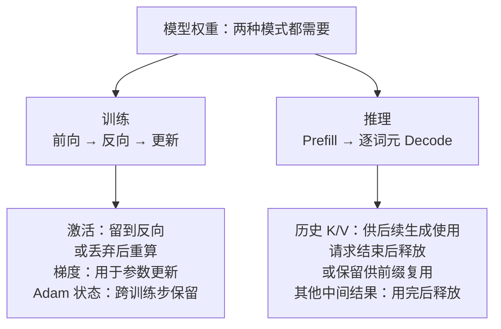

## 6.4 批次与序列长度：效率与质量的平衡

批次大小（Batch Size）和序列长度（Sequence Length）是影响训练效率、模型质量和显存占用的两个关键变量。6.3.4 节讲梯度累积时，把有效批次大小当成一个已经定好的目标：显存放不下就多累积几步；这个目标该定到多大，那一节没有回答。本节先给这个数字划出上界，再转向与它共同决定显存占用的另一个变量：序列长度，最后把两者合并成一笔可以复核的显存账。

### 6.4.1 批次大小的影响

**大批次的优势**：

- 更稳定的梯度估计：批量扩大 $k$ 倍，梯度估计的方差降到 $1/k$
- 更高的 GPU 利用率：参与矩阵乘法的矩阵行数更多，每读一字节权重完成的运算更多（算术强度更高），更容易把运算单元喂饱
- 更少的串行步数：同样的词元预算下参数更新次数更少，通信与优化器开销被摊薄

**大批次的风险**：

- **样本效率下降**：越过临界批量后，再扩大批量几乎不再减少步数，词元却照样多花。这是 LLM 单轮预训练里最实际的代价，下文会把它算成一张表
- **内存瓶颈**：直接增大物理批次会线性增加激活显存，很快达到硬件限制
- **学习率的敏感性增加**：大批次通常需要重调学习率，增加超参调优的复杂度

教科书上还有一条“大批次陷入尖锐极小、泛化差”的说法，它来自多轮训练的视觉任务，在只过一遍数据的 LLM 预训练里并不是主要矛盾，学界对“尖锐即泛化差”本身也有争议。批量的实际上限由下面这条决定。

**实践中的折中**：现代训练通常使用**梯度累积**（见 [6.3.4](6.3_regularization.md)）来在显存约束下达成大的有效批次大小。物理批次大小主要受单卡显存、序列长度和并行策略约束；梯度噪声与学习率调度则由全局有效批次决定。

原始 Transformer 每个训练批次包含源、目标各约 25,000 个词元。现代大语言模型的批次规模要大得多：GPT-3 使用 320 万词元/批次，Llama 3 从初始阶段的 400 万词元/批次逐步增大到 1600 万，DeepSeek-V3 从 3,072 条序列升到 15,360 条（序列长 4K，即 1,258 万到 6,291 万词元）。这些是全局训练批次，通常由数据并行、张量并行、流水线并行、上下文并行、micro-batch 调度和必要的梯度累积共同实现，而不是靠单节点显存直接承载。

**全局批量如何构成。** 一条恒等式把 6.3.4 与这里接上：

$$\text{全局批量（词元）} = \text{micro-batch} \times \text{序列长度} \times \text{累积步数} \times \text{数据并行度}$$

其中 micro-batch 是每张卡一次前向处理的序列条数，数据并行度是各算一份梯度的卡（或卡组）的数目。

代入 Llama 3 405B 后期的 1,600 万词元、序列长度 8,192：`16e6 / 8192 = 1,953` 条序列/步。若数据并行度为 128、每卡 micro-batch 为 1，则需要 `1953 / 128 = 15.3` 步累积。反过来，初期的 400 万词元配 4,096 的序列长度是 977 条序列/步，同样的并行配置只需累积 8 步。这条式子里任何一项翻倍，其余三项就要相应地减半才能维持同一个全局批量。这是第七章各种并行度取值的硬约束（[7.4 节](../07_distributed_training/7.4_pipeline_hybrid.md)）。

#### 临界批量：为什么不能靠加卡无限扩数据并行

上面那些数字看起来像是「显存和工程能力允许多大就多大」，但存在一个与硬件无关的上界。[McCandlish 等人提出的**梯度噪声尺度**](https://arxiv.org/abs/1812.06162)可以预测「最大有用批量」。它最简形式的定义是

$$\mathcal{B}_{\text{simple}} = \frac{\operatorname{tr}(\Sigma)}{|G|^2}$$

其中 $G$ 是全部数据上的真实梯度，$\Sigma$ 是单个样本梯度的协方差矩阵。分子是梯度各分量方差之和，分母是真实梯度模长的平方，这一比值就是梯度在样本之间的信噪比的倒数。

这个量可以实测。用大小为 $B$ 的批量估计梯度时，估计值与真实梯度之差的模长平方，期望为 $\operatorname{tr}(\Sigma)/B$；它相对于 $|G|^2$ 的比值恰为 $\mathcal{B}_{\text{simple}}/B$。估计梯度自身的模长平方，期望则是 $|G|^2 + \operatorname{tr}(\Sigma)/B$。取两个不同的批量各测一次这个量，就得到两个方程，可以同时解出 $|G|^2$ 与 $\operatorname{tr}(\Sigma)$ 两个未知数。

代一组数。批量为 1,000 个样本时测得模长平方的均值为 5.0，批量为 10,000 时为 1.4。两式相减，$\operatorname{tr}(\Sigma)\,(1/1000 - 1/10000) = 3.6$，得 $\operatorname{tr}(\Sigma) = 4000$；代回得 $|G|^2 = 5.0 - 4 = 1.0$。于是 $\mathcal{B}_{\text{simple}} = 4000$ 个样本：批量取到这个数时，梯度估计的噪声与信号一样大。它给出了全局批量该取的量级。

**取舍是一条双曲线。** 该文的核心结果是：达到同一目标损失所需的优化步数 $S$ 与样本数 $E$ 满足

$$\left(\frac{S}{S_{\min}}-1\right)\left(\frac{E}{E_{\min}}-1\right) = 1$$

其中 $S_{\min}$ 是批量趋于无穷时的步数下界，$E_{\min}$ 是批量趋近 0 时的样本数下界，而**临界批量**（critical batch size）正是二者之比 $\mathcal{B}_{\text{crit}} = E_{\min}/S_{\min}$。这条式子可以解成批量的函数。样本数等于批量乘步数，$E = B \cdot S$。记 $r = B/\mathcal{B}_{\text{crit}}$、$x = S/S_{\min}$，则 $E/E_{\min} = BS/(\mathcal{B}_{\text{crit}} S_{\min}) = rx$。代入取舍式得 $(x-1)(rx-1) = 1$，展开后是 $rx^2 = (1+r)x$，即 $x = 1 + 1/r$。于是得到一组干净的关系：$S/S_{\min} = 1 + 1/r$，$E/E_{\min} = rx = 1 + r$。

| $B / \mathcal{B}_{\text{crit}}$ | 1/4 | 1 | 4 | 16 |
| --- | ---: | ---: | ---: | ---: |
| 步数 $S/S_{\min}$ | 5 | 2 | 1.25 | 1.06 |
| 词元 $E/E_{\min}$ | 1.25 | 2 | 5 | 17 |

表 6-11：批量偏离临界批量的代价，由取舍式直接解出。在 $\mathcal{B}_{\text{crit}}$ 上，步数和词元都恰好是各自下界的两倍，这是两项开销的折中点。往右每翻一倍批量，步数的改善迅速趋零而词元开销线性上涨：从 4 倍到 16 倍，步数只从 1.25 降到 1.06，词元却从 5 涨到 17。图 6-3 把这条双曲线和表里的三个点画在一起。

图 6-3：批量在「步数」与「词元数」之间的取舍（[生成脚本](https://github.com/yeasy/llm_internals/blob/main/tools/figures/ch06_batch_tradeoff.py)）。横轴是达到同一损失所需的优化步数（串行时间），纵轴是所需的词元数（算力），两条虚线是各自的下界。曲线的两端都很陡：靠近任一渐近线时，为了再换一点点都要付出成倍的另一项。

**临界批量有多大。** Kaplan 等人在 Transformer 语言模型上把它拟合成损失的幂律。这里用 $\mathcal{L}$ 表示当前的训练损失，以区别于本节后面表示层数的 $L$；指数 $\alpha_B$ 是该文为批量单独拟合的，与 5.4 节的 $\alpha$ 无关：

$$\mathcal{B}_{\text{crit}}(\mathcal{L}) \approx \frac{B_*}{\mathcal{L}^{1/\alpha_B}},\qquad B_*\approx 2\times10^{8}\ \text{词元},\ \alpha_B \approx 0.21$$

代入几个损失值：损失 3.0 时临界批量约 107 万词元，2.5 时 255 万，2.0 时 737 万，1.8 时 1,217 万。论文自己的概括是“损失每降 13%，临界批量约翻一倍”（代入验算：$(1/0.87)^{1/0.21} = 1.94$）。这些数与 GPT-3 的 320 万、Llama 3 的 400 万到 1,600 万落在同一量级。

使用它有两条前提。损失以该文自己分词器下的 nats 计，换分词器不能直接套用。该文的 $\mathcal{B}_{\text{crit}}$ 是从训练曲线直接测出的，噪声尺度只是它的一个预测器。

这条公式有两个反直觉之处，恰恰是它有用的地方。**其一，临界批量随训练推进而增大**：若 $\operatorname{tr}(\Sigma)$ 大致不变而 $|G|$ 随接近极小点而下降，则固定批量下信噪比下降、噪声尺度升高，需要更大批量才能维持梯度估计的精度。这为「批量预热」（batch size warmup）提供了一种解释。**其二，在 Kaplan 等人的实验范围内，临界批量主要取决于当前损失而不直接依赖模型规模**，即 $\mathcal{B}_{\text{crit}}(\mathcal{L})$ 通过已达到的损失值与模型规模发生联系。因此不能仅凭模型更大就设定更大的批量，也不能把这条经验拟合当成适用于所有训练阶段的定律。

> [!NOTE]
> **进阶：批量预热的两种论证。** 归因需要分清。PaLM 在解释自己的批量日程时直接引用了噪声尺度这项工作，写明“早期小批量的样本效率更高，后期大批量因梯度估计更准而更有利”。Llama 3 给出的理由则是“前期小批量利于训练稳定，后期增大以提高效率”，并未援引噪声尺度。两者的做法一致，论证不同。

对分布式训练，这个上界有一个直接后果：**数据并行的可扩展性是有天花板的**。当卡数继续增加、全局批量已经越过临界批量时，再加卡换不来收敛速度，只会摊薄每卡的计算量。此时唯一的出路是把新增的卡投到别的并行维度上：张量并行、流水线并行、上下文并行（[7.3](../07_distributed_training/7.3_model_tensor_parallel.md)、[7.4 节](../07_distributed_training/7.4_pipeline_hybrid.md)）。**大规模训练之所以需要三维并行，一半原因在显存，另一半就在这里。**

### 6.4.2 序列长度的管理

从这里到本节末，序列长度改记为 $s$，即前文的 $T$；这是 [7.5 节](../07_distributed_training/7.5_activation_checkpointing.md)所引 Megatron 论文的记号。本小节的隐藏维仍记作 $d$，即 $d_{\text{model}}$。

序列长度影响两件事：注意力的计算量按 $O(s^2)$ 增长，以及注意力中间结果的显存。后者的 $O(s^2)$ 只对朴素实现成立：FlashAttention 分块计算、不物化 $s\times s$ 的分数矩阵（[10.3 节](../10_inference_optimization/10.3_flash_attention.md)），显存那一侧的平方项因此消失，计算量那一侧不变。6.4.3 会把这两笔账分开算。

**序列长度何时成为瓶颈。** 按 [3.8.8 节](../03_components/3.8_gpt_inference_flow.md)的口径，一层的计算量约为 `24sd² + 2s²d`（$d$ 为 $d_{\text{model}}$，$s$ 为词元数，3.8.8 节记作 $T$；因果掩码的折半已计入），两项在 `s = 12d` 时相等。第一项来自与权重相乘的各步，第二项来自注意力的打分与读取。这是前向口径，但前后向把两项同乘约 3，比值不变，所以它可以直接当训练口径用。于是注意力项与权重项之比就是 $s/(12d)$：

| $d_{\text{model}} = 4096$（GPT-3 6.7B） | $s$ = 2K | 4K | 32K | 128K |
| --- | ---: | ---: | ---: | ---: |
| 注意力项占训练算力的比例 | 4.0% | 7.7% | 40.0% | 72.7% |

表 6-12：注意力的平方项在训练算力中的占比，由 $\frac{s/(12d)}{1+s/(12d)}$ 算出。4K 以内它几乎可以忽略，32K 时已与权重项相当，128K 时反客为主。同一张表换成 GPT-3 175B（$d = 12288$）则是 1.4%、2.7%、18.2%、47.1%，**模型越宽，同样的序列长度越不算长**。

> [!NOTE]
> **进阶：换成 SwiGLU 与 GQA 的层。** `12d` 这个门槛只对 GPT-3 式的层（普通多头注意力加 4h 的 GeLU MLP，每层矩阵参数 $12d^2$）成立。SwiGLU 与 GQA 把每层权重项抬到约 $26sd^2$，门槛相应移到 `13d = 53,248`，同样宽度的 Llama 3 8B 四个数是 3.7%、7.1%、38.1%、71.1%。

**填充与打包**：同一批次中的序列需要统一长度。传统做法是将短序列填充到最大长度，浪费的比例可能极高。取一个批次的 8 条序列，长度分别是 7800、5100、3200、2600、1900、1200、800、400，按模型的最大长度 8,192 填充。有效词元 23,000，实际占用 `8 × 8192 = 65,536`，**填充率 64.9%**，近三分之二的算力花在无意义的位置上。

**序列打包**（Sequence Packing）把多条短序列拼接起来填满一个完整的训练样本。同样这 23,000 个词元打包成 3 条 8,192 的序列，填充率降到 6.4%。打包必须配合 block-diagonal/block-triangular attention mask、FlashAttention varlen 的 `cu_seqlens`，或等价的序列边界元数据，确保不同序列之间不交互。`position_ids` 只能重置位置编号，不能阻断样本间 attention。

打包有两种口径，取舍不同。早期预训练常常**不加文档掩码**：PaLM 的做法是把样本拼接后直接切成恰好 2,048 词元的序列、完全不留填充，样本之间只用一个 `[eod]` 词元隔开，论文未提到任何文档掩码。Llama 3 则明确**使用一个阻断同一序列内不同文档之间自注意力的掩码**，并指出这在长上下文阶段尤其重要：序列越长，一条序列里塞进的文档越多，跨文档污染的机会也越多。代价在工程侧：文档掩码会让各段的计算量不均衡，Llama 3 因此在流水线并行里改用异步点对点通信来消化这种不均衡。

打包还改变了损失的统计口径：批次里不再是“每条序列等权”，而是“每个词元等权”，与 6.3.4 归一化那一节说的是同一件事。

**渐进式长度扩展**：先用短序列快速迭代，后期切到长序列学长距离依赖。实际日程更为细致：Llama 3 405B 在预训练末段把上下文从 8K **分六个阶段**扩到 128K，共用掉约 8,000 亿词元。每一阶段都要先确认短上下文评测完全恢复、且能完美解出该长度的“大海捞针”任务才进入下一阶段。DeepSeek-V3 预训练全程用 4K，之后用 YaRN 做两个各 1,000 步的扩展阶段，4K → 32K → 128K，批量相应从 1,920 降到 480。位置编码一侧要同步调整（[4 章](../04_position_encoding/README.md)的 RoPE 基数）。

**按长度分组**：把相近长度的序列放进同一批次也能减少填充，代价是批次内容不再随机，需要额外打乱来避免引入顺序偏置。

### 6.4.3 显存占用分析

训练显存的两笔主体开销是**模型状态**（参数、梯度和优化器状态）与**激活**（反向需要的前向中间结果），此外还要预留临时工作区和运行时开销。两笔主体开销的量级随配置变化，不能用固定比例概括。以下 GB、MB 使用十进制，GiB、MiB、KiB 使用二进制：1 GB $=10^9$ 字节，1 GiB $=2^{30}$ 字节，1 MiB $=2^{20}$ 字节，1 KiB $=2^{10}$ 字节。

**模型状态：本例为 16 字节/参数。** 沿用 6.1.3 表 6-2 的存储口径：16 位参数与梯度、FP32 主参数、两个 FP32 Adam 矩状态。其中优化器侧（主参数及两个矩状态）占 `12 / 16 = 75%`，这正是 ZeRO 分片优先处理它的原因（[7.2 节](../07_distributed_training/7.2_zero.md)）。16 字节不是所有混合精度实现的固定值，存储精度的其他组合见 [7.6 节](../07_distributed_training/7.6_mixed_precision.md)。

显存账的其余记号同样沿用 Megatron 论文：$h$ 是隐藏维，即 $d_{\text{model}}$，也就是 6.4.2 的 $d$；$a$ 是注意力头数，即 $n_h$；$b$ 是 micro-batch；$L$ 是层数。

代入 GPT-3 6.7B（配置见 [3.8.7 节](../03_components/3.8_gpt_inference_flow.md)的表 3-25：$L = 32$、$h = 4096$、$a = 32$）：模型状态 `16 × 6.7e9 ≈ 107 GB`，一张 80 GB 的卡已经装不下。

**激活：有公式可算。** 激活是指前向的中间结果，反向求导时要用到，所以前向算完不能丢。[7.5 节](../07_distributed_training/7.5_activation_checkpointing.md)会逐项清点一层要为反向保存哪些张量，16 位精度下合计

$$\text{每层激活} = sbh\left(34 + 5\frac{as}{h}\right)\ \text{字节}$$

$s$ 为序列长度、$b$ 为 micro-batch、$h$ 为隐藏维、$a$ 为注意力头数。34 对应与 $s$ 线性相关的那批张量，$5as/h$ 对应形状为 $[a, s, s]$ 的注意力中间结果。这组系数假定的是 GPT 式的层（4h 的 GeLU MLP、普通多头注意力、带 Dropout），换成别的层要按 7.5 节的清单重新数。

两个系数可以粗略数出来。一个 $[s, b, h]$ 的 16 位张量占 $2sbh$ 字节，Dropout 掩码每个元素 1 字节。线性项分三部分：

- 注意力 $11sbh$：Q/K/V 投影的共同输入、Q、K、V、输出投影的输入各 $2sbh$，加一份 $sbh$ 的掩码；
- MLP $19sbh$：两份宽 $4h$ 的中间结果各 $8sbh$，加输入 $2sbh$ 与一份掩码 $sbh$；
- 两个归一化的输入 $4sbh$。

三部分相加得 34。平方项是三份 $[a, s, s]$ 的注意力张量：Softmax 输出 $2as^2b$、它的 Dropout 掩码 $as^2b$、Dropout 之后的输出 $2as^2b$，合计 $5as^2b$，写成 $sbh$ 的倍数就是 $5as/h$。

取 GPT-3 6.7B、$b = 1$，代三个序列长度：

- $s = 2048$：线性项 `34 × 2048 × 4096 ≈ 0.285 GB`，平方项 `5 × 32 × 2048² ≈ 0.671 GB`，每层 0.956 GB，32 层共 **30.6 GB**；
- $s = 8192$：线性项 1.141 GB，平方项 10.737 GB，每层 11.878 GB，32 层共 **380 GB**；
- $s = 32768$：每层 176 GB，32 层共 5,644 GB。

序列长度翻两番，激活涨了 12 倍：线性项按 $s$ 涨，平方项按 $s^2$ 涨，后者很快占绝对多数（$5as/h$ 在 $s = 2048$ 时是 80，$s = 8192$ 时是 320，都远大于 34）。

**两种手段各去掉哪一项。** FlashAttention 不物化 $[s, s]$ 的分数矩阵，等于去掉 $5as/h$ 这一项；**全量激活重计算**每层只保留输入的 $2sbh$ 字节，反向时重算其余部分。图 6-4 把这三档与模型状态画在同一条对数轴上。

图 6-4：GPT-3 6.7B（micro-batch 1）在两种序列长度下的激活显存，纵轴为对数（[生成脚本](https://github.com/yeasy/llm_internals/blob/main/tools/figures/ch06_memory_stack.py)）。紫色虚线是与序列长度无关的模型状态 107 GB。$s = 2048$ 时激活 30.6 GB，只有模型状态的三成；$s = 8192$ 时朴素实现的 380 GB 已是模型状态的 3.5 倍，用 FlashAttention 压到 36.5 GB，再叠全量重计算只剩 2.1 GB。“优化器状态是最大消耗者”这句话只在短序列、小 micro-batch 下成立。

**重计算的代价。** 全量重计算相当于多做一次前向：训练每词元的浮点运算从 $6N$ 变成约 $8N$，多 33%。只重算上面那个平方项的选择性重计算便宜得多，它的取舍、分段数的选法与各框架的参数名见 [7.5 节](../07_distributed_training/7.5_activation_checkpointing.md)，本节只给账。

这几笔账和这张图合起来回答了本节开头的问题：批量的上界由临界批量给出，序列长度的上界由激活显存和注意力的平方项一起给出，而两者都不是由单卡显存直接决定的。显存只决定要用多少张卡、按哪一维切。

#### 同一个 7B 模型：五步算清训练与推理显存

**进阶：训练与推理显存速查。** 本小节把上面“先定形状、再乘字节”的算法用到另一个模型上，并把推理与微调的几种运行模式并排列出。其中 KV 缓存在[第十章](../10_inference_optimization/README.md)展开，LoRA 与量化在[第八章](../08_alignment/README.md)展开，第一遍阅读可以跳过。它与上文 GPT-3 6.7B 的 107 GB 是同一种算法，只是名义参数量取 7B，模型状态因此是 112 GB。

**第一步：固定模型与负载。** 采用 Llama 2-7B 的层配置：32 层、隐藏维 4096、32 个查询头和 32 个 KV 头、每头 128 维、MLP 中间维 11008；其 MLP 使用 SwiGLU，归一化使用 RMSNorm（[官方实现](https://github.com/meta-llama/llama/blob/main/llama/model.py)、[配置说明](https://huggingface.co/docs/transformers/model_doc/llama2)）。取微批量 $b=1$、序列长度 $s=2048$，不是说模型只能处理这一批量或长度。下面权重账按名义参数量 $N\approx7\times10^9$ 估算；实际部署应代入检查点的真实参数量。

**第二步：从形状算一个张量。** 通用方法是“各维相乘，得到元素个数；再乘每个元素的字节数”。例如一份 FP16/BF16 隐藏状态为：

$$
[b,s,h]=[1,2048,4096]
\quad\Rightarrow\quad
1\times2048\times4096\times2=16{,}777{,}216\ \text{字节}=16\ \text{MiB}
$$

<!-- numeric-claim: 7b-tensors -->
| 张量 | 形状 | 每元素字节 | 大小 MiB |
| --- | --- | ---: | ---: |
| 隐藏状态 | `[1, 2048, 4096]` | 2 | 16 |
| 单个 Q、K 或 V | `[1, 32, 2048, 128]` | 2 | 16 |
| 一份 MLP 扩展状态 | `[1, 2048, 11008]` | 2 | 43 |
| 完整注意力矩阵 | `[1, 32, 2048, 2048]` | 2 | 256 |
| 单层 K 与 V 缓存合计 | `[2, 1, 32, 2048, 128]` | 2 | 32 |

表 6-13：同一配置下不同张量的数据大小。Q/K/V 的四维依次是批量、头数、位置数、每头维度；最后一行的首维 2 分别表示 K、V。注意力矩阵一行仅指显式存放的一个 16 位张量，FlashAttention 不保存完整矩阵；Softmax 若用 FP32 中间结果，还要另算其临时开销。

这张表**不能直接相加作为峰值**，也不能说“一层固定保存八份隐藏状态”。每个算子保存什么、能否共用存储、什么时候释放，都要结合反向实现判断，见 [7.5.1 节](../07_distributed_training/7.5_activation_checkpointing.md#activation-ledger)。

**第三步：算与序列长度无关的模型状态。** 全参数训练时，按本节声明的 AdamW 存储布局逐项相加：

<!-- numeric-claim: 7b-model-states -->
| 项目 | 精度 | 每参数字节 | 7B 开销 GB |
| --- | --- | ---: | ---: |
| 前后向参数 | FP16/BF16 | 2 | 14 |
| 参数梯度 | FP16/BF16 | 2 | 14 |
| 主参数 | FP32 | 4 | 28 |
| Adam 一阶矩 | FP32 | 4 | 28 |
| Adam 二阶矩 | FP32 | 4 | 28 |

表 6-14：名义 7B 模型的全参数训练状态，未分片、未卸载；一阶矩与二阶矩分别记录梯度及梯度平方的指数移动平均。

$$
M_{\text{状态}}\approx7\times10^9\times(2+2+4+4+4)=112\ \text{GB}
$$

如果同一布局把梯度改存 FP32，则是 18 字节/参数、126 GB；原生 AMP 等实现是否另留低精度参数副本，也应按实际布局确认。显存账先看“存了哪些副本”，不能只看“计算用 BF16”（[DeepSpeed ZeRO](https://www.deepspeed.ai/tutorials/zero/)、[Hugging Face 显存说明](https://huggingface.co/docs/transformers/model_memory_anatomy)）。112 GB 尚不含激活，因此这套全参数训练配置不能全部驻留在一张 24 GB 卡上，减小微批量也不能解决模型状态本身装不下的问题。

**第四步：按用途和保存时间区分激活与 KV。** 常规整序列训练不维护逐步生成的 KV Cache，而是保存反向所需的激活；推理不求参数梯度，但逐词元生成需要留住历史 K/V。

图 6-5：训练为反向保存激活，推理为后续生成保存 KV；两者都需要临时工作区，图中未列出。

本例每层 K、V 合计 32 MiB，32 层缓存 2048 个位置共 `32 × 32 MiB = 1 GiB`；每追加一个缓存位置，增加 512 KiB。这里计算的是实际位置的数据量，预分配容量与分页管理另算，完整推导见 [10.2.3 节](../10_inference_optimization/10.2_kv_cache.md#kv-cache-cost)。

| 模式 | 可先算清的驻留数据 | 还需要计算的主要开销 |
| --- | --- | --- |
| 16 位推理 | 约 14 GB 权重；本例 KV 为 1 GiB | Prefill/Decode 的中间结果与临时工作区 |
| 全参数 AdamW 训练 | 本例约 112 GB 状态 | 反向所需激活、临时工作区 |
| LoRA 微调 | 冻结基座约 14 GB；另算适配器参数、梯度与优化器状态 | 反向仍需大量激活，不能按可训练参数比例缩减 |
| QLoRA 微调 | 4 位权重数据按名义 7B 算约 3.5 GB，另加量化元数据、未量化模块及适配器状态 | 激活、反量化工作区等仍需另算 |

表 6-15：同一名义 7B 模型的不同运行模式，均不是总显存。LoRA 按实际可训练参数计状态；QLoRA 的 3.5 GB 是假设全部基座权重均为 4 位时的原始数据量，不能当成完整模型占用。[8.4 节](../08_alignment/8.4_peft.md)给出了适配器的形状、参数量与量化附加开销。

**第五步：检查峰值，而不是把所有张量一律累加。** 容量规划应找出同一时刻仍在使用的模型状态、激活或 KV，以及临时工作区，再为 CUDA 上下文、分配器保留空间和 CUDA Graph 内存等运行时开销留预算。训练阶段的激活与推理阶段的 KV 用途不同，不能据此断言“训练固定是推理的四倍”；也不能只凭“权重加 KV 小于 24 GB”保证不会 OOM。

记忆顺序是：**先定配置，再算张量；区分用途，追踪寿命，最后看峰值。** 优化也按同一顺序定位：ZeRO/FSDP 分片模型状态，LoRA 减少可训练参数，量化降低存储位宽，FlashAttention 避免完整注意力矩阵，激活重计算减少反向前的保存量，GQA/MQA 缩小每位置的 KV，PagedAttention 改善缓存分配利用率。
