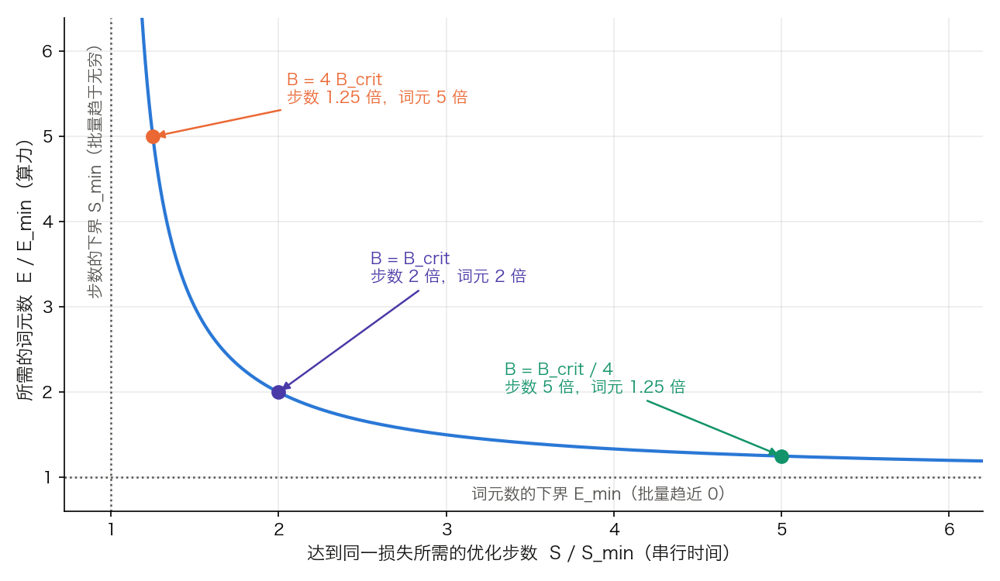
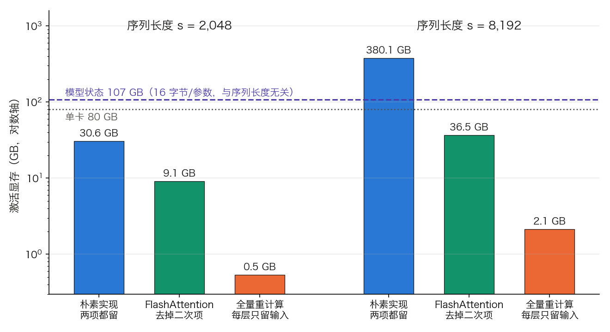
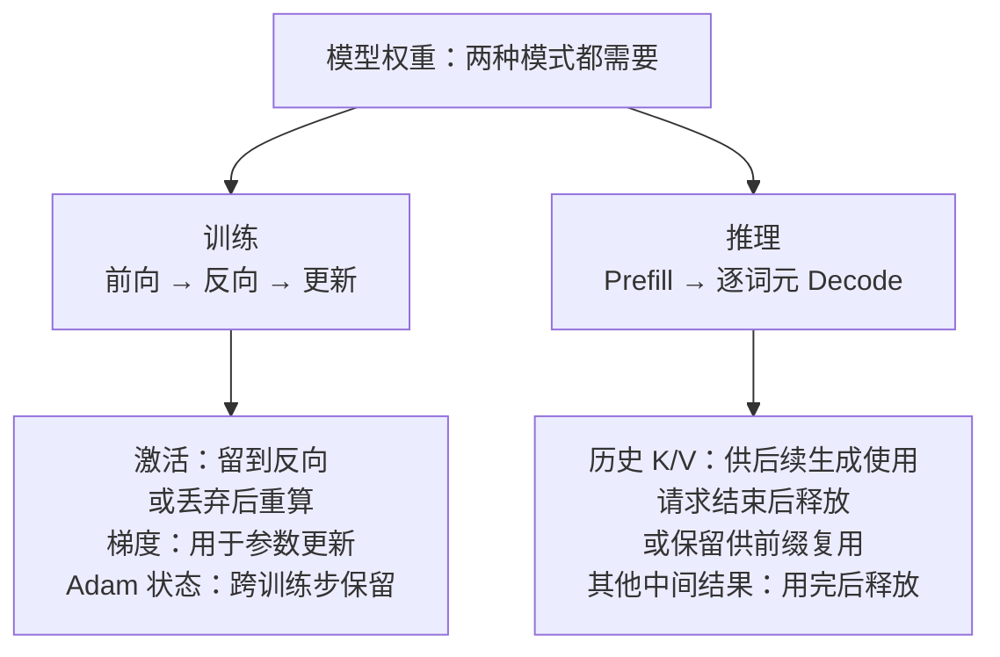

## 6.4 批次与序列长度：效率与质量的平衡

批量大小是用词元换步数。记 $r = B/\mathcal{B}_{\text{crit}}$，达到同一损失所需的步数是下界的 $1+1/r$ 倍，所需词元是下界的 $1+r$ 倍：在临界批量上两者各为两倍，再往上加批量几乎只是多花词元。临界批量由当前损失决定，损失每降约 13% 翻一倍，量级在百万到千万词元，在 Kaplan 等人的实验范围内与模型规模没有直接关系；所以批量应当随训练增大，数据并行的可扩展性有天花板。序列长度进两笔账：算力上注意力项与权重项之比约为 $s/(12h)$，模型越宽，同样的序列越不算长；显存上，训练显存是与序列无关的模型状态（每参数 16 字节）加上随 $s\cdot b\cdot h\cdot L$ 增长的激活，长序列、大微批量下后者占大头。公开配方的做法是批量日程从小到大，用打包代替填充并加文档掩码，长上下文留到预训练末段分阶段扩展。

本节与第七章共用一套记号：$s$ 为序列长度，$b$ 为每卡一次前向处理的序列条数（micro-batch），$h$ 为隐藏维（即 $d_{\text{model}}$），$a$ 为注意力头数，$L$ 为层数；[1.4.5 节](../01_introduction/1.4_transformer_idea.md)把序列长度与隐藏维记作 $n$、$d$。

### 6.4.1 批次大小的影响

大批量的好处是梯度估计的方差按 $1/B$ 下降，矩阵乘法更容易把运算单元喂饱，同样的词元预算下串行步数更少；代价是激活显存随物理批次线性增长，越过临界批量后词元效率迅速下降。教科书上“大批次陷入尖锐极小、泛化差”的说法来自多轮训练的视觉任务，在只过一遍数据的 LLM 预训练里不是主要矛盾。批量的实际上限由临界批量决定。

公开模型的全局批量：GPT-3 为 320 万词元/步；Llama 3 405B 从 400 万词元逐步增大到 1,600 万；DeepSeek-V3 从 3,072 条序列升到 15,360 条（序列长 4K，即 1,258 万到 6,291 万词元）。原始 Transformer 每批只有源、目标各约 2.5 万词元。这样的批量由多卡并行与梯度累积共同凑出，一条恒等式把 [6.3.4 节](6.3_regularization.md)的梯度累积与第七章的并行度接起来：

$$\text{全局批量（词元）} = b \times s \times \text{累积步数} \times \text{数据并行度}$$

Llama 3 405B 后期的 1,600 万词元配 8,192 的序列长度，是每步 1,953 条序列。全局批量定下之后，四项中任何一项翻倍，其余三项的乘积就要减半，这是第七章选并行度的硬约束（[7.4.4 节](../07_distributed_training/7.4_pipeline_hybrid.md)）。

#### 临界批量：为什么不能靠加卡无限扩数据并行

[McCandlish 等人的梯度噪声尺度](https://arxiv.org/abs/1812.06162)给出了这个与硬件无关的上界。它的最简形式是

$$\mathcal{B}_{\text{simple}} = \frac{\operatorname{tr}(\Sigma)}{|G|^2}$$

$G$ 是全部数据上的真实梯度，$\Sigma$ 是单个样本梯度的协方差矩阵。分子是梯度各分量的方差之和，分母是真实梯度模长的平方，比值是梯度在样本之间信噪比的倒数：批量取到 $\mathcal{B}_{\text{simple}}$ 时，梯度估计的噪声与信号一样大。它可以实测：批量为 $B$ 时估计梯度的模长平方期望为 $|G|^2 + \operatorname{tr}(\Sigma)/B$，用两个批量各测一次，就能解出 $|G|^2$ 与 $\operatorname{tr}(\Sigma)$。

**取舍是一条双曲线。** 该文的核心结果是：达到同一目标损失所需的优化步数 $S$ 与样本数 $E$ 满足

$$\left(\frac{S}{S_{\min}}-1\right)\left(\frac{E}{E_{\min}}-1\right) = 1$$

$S_{\min}$ 是批量趋于无穷时的步数下界，$E_{\min}$ 是批量趋近 0 时的样本数下界，**临界批量**（critical batch size）定义为二者之比 $\mathcal{B}_{\text{crit}} = E_{\min}/S_{\min}$。代入 $E = B\cdot S$、记 $x = S/S_{\min}$，取舍式化为 $(x-1)(rx-1) = 1$，解得 $S/S_{\min} = 1 + 1/r$，$E/E_{\min} = 1 + r$。

| $B / \mathcal{B}_{\text{crit}}$ | 1/4 | 1 | 4 | 16 |
| --- | ---: | ---: | ---: | ---: |
| 步数 $S/S_{\min}$ | 5 | 2 | 1.25 | 1.06 |
| 词元 $E/E_{\min}$ | 1.25 | 2 | 5 | 17 |

表 6-7：批量偏离临界批量的代价，由取舍式直接解出。在 $\mathcal{B}_{\text{crit}}$ 上，步数和词元都恰好是各自下界的两倍；从 4 倍到 16 倍，步数只从 1.25 降到 1.06，词元却从 5 涨到 17。图 6-3 把这条双曲线和表里的三个点画在一起。

图 6-3：批量在「步数」与「词元数」之间的取舍（[生成脚本](https://github.com/yeasy/llm_internals/blob/main/tools/figures/ch06_batch_tradeoff.py)）。横轴是达到同一损失所需的优化步数（串行时间），纵轴是所需的词元数（算力），两条虚线是各自的下界。曲线的两端都很陡：靠近任一渐近线时，为了再换一点点都要付出成倍的另一项。

**临界批量有多大。** Kaplan 等人在 Transformer 语言模型上把它拟合成当前训练损失 $\mathcal{L}$ 的幂律（$\alpha_B$ 是为批量单独拟合的指数，与 5.4 节的 $\alpha$ 无关）：

$$\mathcal{B}_{\text{crit}}(\mathcal{L}) \approx \frac{B_*}{\mathcal{L}^{1/\alpha_B}},\qquad B_*\approx 2\times10^{8}\ \text{词元},\ \alpha_B \approx 0.21$$

损失 3.0 时临界批量约 107 万词元，2.5 时 255 万，2.0 时 737 万，1.8 时 1,217 万；损失每降 13%，临界批量约翻一倍（$(1/0.87)^{1/0.21} = 1.94$）。这些数与 GPT-3 的 320 万、Llama 3 的 400 万到 1,600 万落在同一量级。损失以该文自己分词器下的 nats 计，换分词器不能直接套用。

这条公式有两个反直觉之处。**其一，临界批量随训练推进而增大**：若 $\operatorname{tr}(\Sigma)$ 大致不变而 $|G|$ 随训练下降，固定批量下信噪比下降、噪声尺度升高，需要更大的批量才能维持梯度估计的精度。这给批量预热提供了一种解释；PaLM 解释自己的批量日程时引的正是这项工作，Llama 3 给出的理由则是前期小批量利于稳定。**其二，在 Kaplan 等人的实验范围内，临界批量主要取决于当前损失而不直接依赖模型规模**：模型更大并不单凭这一点就该用更大的批量，大模型的批量更大，是因为它能把损失降得更低。[后来在 8,500 万到 12 亿参数模型上的测量](https://arxiv.org/abs/2410.21676)也得到同一方向的结论：临界批量主要随训练数据量增长，随模型规模变化不大。

**学习率随批量怎样调。** 降低学习率与增大批量都在压梯度噪声，噪声尺度大致正比于 $\eta/B$（[6.2.3 节](6.2_lr_schedule.md)），所以批量变了，学习率也要跟着变。SGD 常用**线性缩放法则**（批量扩大 $k$ 倍，学习率乘 $k$，出自[大批次训练的经典实践](https://arxiv.org/abs/1706.02677)），Adam 一类自适应优化器常用更保守的**平方根法则**（乘 $\sqrt k$）。两条都是经验规则，都只在批量仍低于临界批量时成立；越过临界批量之后，加大批量本来就换不来更快的收敛。

对分布式训练，这个上界有一个直接后果：**数据并行的可扩展性是有天花板的**。全局批量越过临界批量之后，再加卡换不来收敛速度，只会摊薄每卡的计算量；新增的卡只能投到张量并行、流水线并行、上下文并行等其他维度上（[7.3](../07_distributed_training/7.3_model_tensor_parallel.md)、[7.4 节](../07_distributed_training/7.4_pipeline_hybrid.md)）。**大规模训练之所以需要三维并行，一半原因在显存，另一半就在这里。**

### 6.4.2 序列长度的管理

序列长度影响两件事：注意力的计算量按 $O(s^2)$ 增长；注意力中间结果的显存在朴素实现里也按 $O(s^2)$ 增长。FlashAttention 分块计算、不物化 $s\times s$ 的分数矩阵（[10.3 节](../10_inference_optimization/10.3_flash_attention.md)），显存那一侧的平方项因此消失，计算量那一侧不变。

**序列长度何时成为算力瓶颈。** 按 [1.4.5 节](../01_introduction/1.4_transformer_idea.md)的计数，一层的计算量约为 $24sh^2 + 2s^2h$（因果掩码的折半已计入），前一项来自与权重相乘的各步，后一项来自注意力的打分与读取。前后向把两项同乘约 3，比值不变，注意力项与权重项之比就是 $s/(12h)$：

| $h = 4096$（GPT-3 6.7B） | $s$ = 2K | 4K | 32K | 128K |
| --- | ---: | ---: | ---: | ---: |
| 注意力项占训练算力的比例 | 4.0% | 7.7% | 40.0% | 72.7% |

表 6-8：注意力的平方项在训练算力中的占比，由 $\frac{s/(12h)}{1+s/(12h)}$ 算出。4K 以内它几乎可以忽略，32K 时已与权重项相当，128K 时反客为主。同一张表换成 GPT-3 175B（$h = 12288$）则是 1.4%、2.7%、18.2%、47.1%，**模型越宽，同样的序列长度越不算长**。

`12h` 这个门槛只对 GPT-3 式的层（普通多头注意力加 $4h$ 的 GeLU MLP，每层矩阵参数 $12h^2$）成立。Llama 3 8B 的 SwiGLU 与 GQA 把每层权重项抬到约 $26sh^2$，门槛移到 $13h = 53{,}248$，表中四个数变成 3.7%、7.1%、38.1%、71.1%。

**用打包代替填充。** 同一批次中的序列需要统一长度。把 8 条长度为 7,800、5,100、3,200、2,600、1,900、1,200、800、400 的序列填充到 8,192，有效词元 23,000，实际占用 65,536，**填充率 64.9%**。**序列打包**（Sequence Packing）把多条短序列拼接起来填满训练样本，同样这 23,000 个词元打包成 3 条 8,192 的序列，填充率降到 6.4%。打包要配合块对角的注意力掩码或等价的序列边界信息，才能阻断不同文档之间的注意力；只重置位置编号做不到这一点。

打包有两种口径。PaLM 把样本拼接后直接切成 2,048 词元的序列，样本之间只用一个 `[eod]` 词元隔开，不加文档掩码。Llama 3 使用阻断同一序列内不同文档之间自注意力的掩码，并指出这在长上下文阶段尤其重要：序列越长，一条序列里塞进的文档越多，跨文档污染的机会越多。代价在工程侧：文档掩码让各段的计算量不均衡，Llama 3 为此在流水线并行里改用异步点对点通信。打包还把损失的统计口径从“每条序列等权”变成“每个词元等权”，与 6.3.4 的分母问题是同一件事。

**长上下文分阶段扩展。** 先用短序列训练主体，末段再逐级拉长。Llama 3 405B 在预训练末段把上下文从 8K 分六个阶段扩到 128K，共用约 8,000 亿词元，每一阶段先确认短上下文评测完全恢复、且能解出该长度的“大海捞针”任务，才进入下一阶段。DeepSeek-V3 预训练全程用 4K，之后用 YaRN 做两个各 1,000 步的扩展阶段，4K → 32K → 128K，批量相应从 1,920 条降到 480 条。位置编码一侧要同步调整（[第 4 章](../04_position_encoding/README.md)的 RoPE 基数）。

### 6.4.3 显存占用分析

训练显存的两笔主体开销是**模型状态**（参数、梯度和优化器状态）与**激活**（反向需要的前向中间结果），此外还要预留临时工作区和运行时开销。两者谁大，取决于序列长度与微批量。本节的 GB、MB 为十进制，GiB、MiB、KiB 为二进制。

**模型状态：每参数 16 字节，与序列无关。** 混合精度的 AdamW 训练常驻 16 位参数与梯度、FP32 主权重和两个 FP32 矩，共 16 字节，其中优化器侧占 75%；逐项构成与其他布局见 [7.2.1 节](../07_distributed_training/7.2_zero.md)。GPT-3 6.7B（配置见 [3.8.7 节](../03_components/3.8_gpt_inference_flow.md)的表 3-25：$L = 32$、$h = 4096$、$a = 32$）的模型状态是 `16 × 6.7e9 ≈ 107 GB`，一张 80 GB 的卡已经装不下。

**激活：随 $s\cdot b\cdot h\cdot L$ 增长。** [7.5.1 节](../07_distributed_training/7.5_activation_checkpointing.md)逐项清点了一层要为反向保存哪些张量。GPT 式的层（$4h$ 的 GeLU MLP、普通多头注意力、带 Dropout）在 16 位精度下每层

$$\text{每层激活} = sbh\left(34 + 5\frac{as}{h}\right)\ \text{字节}$$

34 对应与 $s$ 线性相关的那批张量，$5as/h$ 对应形状为 $[a, s, s]$ 的注意力矩阵及其 Dropout。取 GPT-3 6.7B、$b = 1$：

- $s = 2048$：线性项 0.285 GB，平方项 0.671 GB，每层 0.956 GB，32 层共 **30.6 GB**；
- $s = 8192$：线性项 1.141 GB，平方项 10.737 GB，每层 11.878 GB，32 层共 **380 GB**；
- $s = 32768$：每层 176 GB，32 层共 5,644 GB。

序列长度翻两番，激活涨了 12 倍：平方项按 $s^2$ 涨，很快占绝对多数（$5as/h$ 在 $s = 2048$ 时是 80，$s = 8192$ 时是 320）。

**两种手段各去掉哪一项。** FlashAttention 不物化 $[s, s]$ 的分数矩阵，等于去掉 $5as/h$ 这一项；**全量激活重计算**每层只保留输入的 $2sbh$ 字节，反向时重算其余部分，代价是每词元的训练运算从 $6N$ 变成约 $8N$，多 33%。今天的层不带 Dropout、用 SwiGLU 与 GQA，线性项的系数随之改变，Llama 式的层按同一规则清点见 7.5.1。图 6-4 把这三档与模型状态画在同一条对数轴上。

图 6-4：GPT-3 6.7B（micro-batch 1）在两种序列长度下的激活显存，纵轴为对数（[生成脚本](https://github.com/yeasy/llm_internals/blob/main/tools/figures/ch06_memory_stack.py)）。紫色虚线是与序列长度无关的模型状态 107 GB。$s = 2048$ 时激活 30.6 GB，只有模型状态的三成；$s = 8192$ 时朴素实现的 380 GB 已是模型状态的 3.5 倍，用 FlashAttention 压到 36.5 GB，再叠全量重计算只剩 2.1 GB。“优化器状态是最大消耗者”这句话只在短序列、小 micro-batch 下成立。

这几笔账合起来回答了本节开头的问题：批量的上界由临界批量给出，序列长度的上界由激活显存和注意力的平方项一起给出，两者都不由单卡显存直接决定。显存只决定要用多少张卡、按哪一维切。

#### 同一个 7B 模型：五步算清训练与推理显存

**进阶：训练与推理显存速查。** 同一个“先定形状、再乘字节”的算法也能用来比较推理与微调。以下取 Llama 2-7B 的层配置（32 层、隐藏维 4096、32 个查询头与 32 个 KV 头、每头 128 维、SwiGLU 中间维 11008），$b = 1$、$s = 2048$，权重按名义参数量 $7\times10^9$ 估算。KV 缓存在 [10.2 节](../10_inference_optimization/10.2_kv_cache.md)展开，LoRA 与量化在 [8.4 节](../08_alignment/8.4_peft.md)展开。

**第一步，定配置；第二步，由形状算张量。** 各维相乘得元素个数，再乘每元素字节数，例如隐藏状态 `[1, 2048, 4096]` 在 16 位下是 16 MiB。

<!-- numeric-claim: 7b-tensors -->
| 张量 | 形状 | 每元素字节 | 大小 MiB |
| --- | --- | ---: | ---: |
| 隐藏状态 | `[1, 2048, 4096]` | 2 | 16 |
| 单个 Q、K 或 V | `[1, 32, 2048, 128]` | 2 | 16 |
| 一份 MLP 扩展状态 | `[1, 2048, 11008]` | 2 | 43 |
| 完整注意力矩阵 | `[1, 32, 2048, 2048]` | 2 | 256 |
| 单层 K 与 V 缓存合计 | `[2, 1, 32, 2048, 128]` | 2 | 32 |

表 6-9：同一配置下不同张量的数据大小。Q/K/V 的四维依次是批量、头数、位置数、每头维度；最后一行的首维 2 分别表示 K、V。这张表不能直接相加作为峰值：每个算子保存什么、能否共用存储、何时释放，按 [7.5.1 节](../07_distributed_training/7.5_activation_checkpointing.md#activation-ledger)的规则清点。

**第三步，算模型状态。** 全参数 AdamW 训练按 7.2.1 的布局逐项相加：

<!-- numeric-claim: 7b-model-states -->
| 项目 | 精度 | 每参数字节 | 7B 开销 GB |
| --- | --- | ---: | ---: |
| 前后向参数 | FP16/BF16 | 2 | 14 |
| 参数梯度 | FP16/BF16 | 2 | 14 |
| 主参数 | FP32 | 4 | 28 |
| Adam 一阶矩 | FP32 | 4 | 28 |
| Adam 二阶矩 | FP32 | 4 | 28 |

表 6-10：名义 7B 模型的全参数训练状态，未分片、未卸载，合计 112 GB。梯度改存 FP32 时为每参数 18 字节、126 GB。减小微批量解决不了模型状态本身装不下的问题。

**第四步，按用途区分激活与 KV。** 训练为反向保存激活，推理为后续生成保存历史 K/V；两者都需要临时工作区。

图 6-5：训练为反向保存激活，推理为后续生成保存 KV；两者都需要临时工作区，图中未列出。

本例 32 层缓存 2048 个位置的 KV 共 1 GiB，每追加一个位置增加 512 KiB（推导见 [10.2.3 节](../10_inference_optimization/10.2_kv_cache.md#kv-cache-cost)）。

| 模式 | 可先算清的驻留数据 | 还需要计算的主要开销 |
| --- | --- | --- |
| 16 位推理 | 约 14 GB 权重；本例 KV 为 1 GiB | Prefill/Decode 的中间结果与临时工作区 |
| 全参数 AdamW 训练 | 本例约 112 GB 状态 | 反向所需激活、临时工作区 |
| LoRA 微调 | 冻结基座约 14 GB；另算适配器参数、梯度与优化器状态 | 反向仍需大量激活，不能按可训练参数比例缩减 |
| QLoRA 微调 | 4 位权重数据按名义 7B 算约 3.5 GB，另加量化元数据、未量化模块及适配器状态 | 激活、反量化工作区等仍需另算 |

表 6-11：同一名义 7B 模型的不同运行模式，均不是总显存。

**第五步，查同一时刻的峰值。** 容量规划要找出同一时刻仍在使用的模型状态、激活或 KV 与临时工作区，再为 CUDA 上下文、分配器保留空间等运行时开销留余量。顺序是：**先定配置，再算张量；区分用途，追踪寿命，最后看峰值。** 每一类开销各有对应的手段：ZeRO/FSDP 分片模型状态，LoRA 减少可训练参数，量化降低存储位宽，FlashAttention 不存完整注意力矩阵，重计算减少为反向保存的激活，GQA/MQA 缩小每位置的 KV，PagedAttention 提高缓存的分配利用率。
