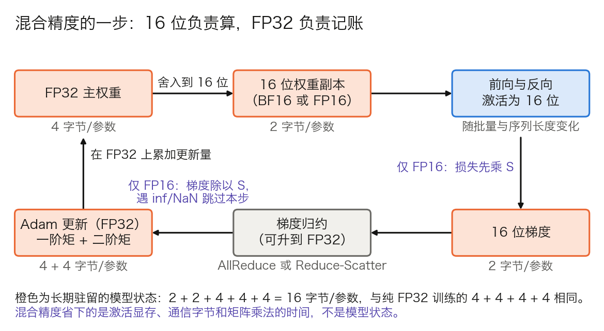

## 7.6 混合精度训练：精度与速度的权衡

**混合精度训练**（Mixed Precision Training）用 16 位浮点数完成大部分计算，只在少数地方保留 32 位。7.5 处理的是哪些数留下，本节处理每个数占几位。16 位省下的是激活、通信和矩阵乘法的时间，但有两个失效：梯度太小下溢为 0，这是范围问题；更新量比权重小太多被舍入吞掉，这是精度问题。前者靠损失缩放，或直接换成指数位与 FP32 相同的 BF16；后者与指数位无关，只能把参数更新和优化器状态留在 FP32。所以今天的默认配方是：矩阵乘法用 BF16，参数更新与优化器状态用 FP32，Softmax、归一化与损失等对范围敏感的算子也留在 FP32，模型状态仍是每参数 16 字节；超大规模训练还常把梯度归约放到 FP32（Llama 3 即如此），代价是梯度通信的字节数翻倍。再往下到 8 位和 4 位，问题变成数值窗口太窄、少数离群值把窗口撑大，关键全在缩放因子的粒度（从按张量到按块）和累加的精度。

### 7.6.1 浮点格式对照：范围与间隔

浮点数由符号、指数、尾数三段组成。指数位决定能表示多大和多小的数，即动态范围；尾数位决定相邻两个可表示的数隔多远，即精度。表 7-18 列出训练中用到的几种格式。

| 格式 | 符号/指数/尾数 | 最大值 | 最小正规数 | 最小非正规数 | 1 附近的间隔 |
| --- | --- | ---: | ---: | ---: | ---: |
| FP32 | 1/8/23 | 3.4 × 10³⁸ | 1.2 × 10⁻³⁸ | 1.4 × 10⁻⁴⁵ | 1.2 × 10⁻⁷ |
| FP16 | 1/5/10 | 65,504 | 6.1 × 10⁻⁵ | 6.0 × 10⁻⁸ | 9.8 × 10⁻⁴ |
| BF16 | 1/8/7 | 3.4 × 10³⁸ | 1.2 × 10⁻³⁸ | 9.2 × 10⁻⁴¹ | 7.8 × 10⁻³ |
| FP8 E4M3 | 1/4/3 | 448 | 1.6 × 10⁻² | 2.0 × 10⁻³ | 0.125 |
| FP8 E5M2 | 1/5/2 | 57,344 | 6.1 × 10⁻⁵ | 1.5 × 10⁻⁵ | 0.25 |
| FP4 E2M1 | 1/2/1 | 6 | 1 | 0.5 | 0.5 |

表 7-18：训练中常见的浮点格式。1 附近的间隔等于 $2^{-\text{尾数位数}}$；各值由位宽按 IEEE 754 的规则算出。E4M3 按 [FP8 Formats for Deep Learning](https://arxiv.org/abs/2209.05433) 的定义不表示无穷大，多出的编码使最大值到 448；E2M1 能表示的绝对值只有 0、0.5、1、1.5、2、3、4、6 这 8 个。

后文用到三个数。FP16 的最大值只有 65,504，超过就变成 inf。最小的正规数是 $2^{-14}$，即 `6.1 × 10⁻⁵`；再往下是有效位逐位减少的非正规数，最小到 $2^{-24}$，即 `6.0 × 10⁻⁸`，小于它的一半（约 `3 × 10⁻⁸`）就舍入为 0。BF16 的指数位与 FP32 相同，范围相同，但 1 附近的间隔是 0.0078，比 FP16 粗 8 倍。

### 7.6.2 为什么用半精度：省下的是什么

半精度带来三项直接收益：

- **激活占用减半。** 同一张量从 FP32 改为 16 位存放，字节数减半。
- **通信字节数减半。** 张量并行与流水线传的激活随之减半；梯度归约有自己的精度策略，不一定跟着减半。
- **矩阵乘法更快。** 同样的显存带宽能送进两倍的数，A100、H100 上的 Tensor Core（GPU 上专做矩阵乘加的单元）对 16 位矩阵乘法有专门的硬件支持，实际加速比取决于模型与内核。

以上节省只落在确实改成 16 位的张量上，保留 FP32 的激活、缓冲区与消息不在其内。

模型状态通常并不减半。训练仍需高精度的参数更新与优化器状态，原因见 7.6.3 的失效二；7.6.4 区分经典混合精度与原生 AMP 的字节账。

### 7.6.3 两个失效：梯度下溢与更新被吞

直接把所有张量换成 FP16，会在两处出错。[Mixed Precision Training 论文](https://arxiv.org/abs/1710.03740)针对它们提出了损失缩放和 FP32 主权重。

**失效一：小梯度变成 0。** 设某个梯度的真实值是 `10⁻⁸`。它小于 FP16 最小非正规数的一半，转成 FP16 后是 0，这个参数在这一步得不到任何更新。论文的说法是绝对值小于 $2^{-24}$ 的数在 FP16 中变为零。

**损失缩放**（loss scaling）利用链式法则的线性：反向之前把损失乘以常数 $S$，所有梯度都放大 $S$ 倍；更新之前再除以 $S$。`S = 1024` 时，上面的梯度变成 `1.02 × 10⁻⁵`，落在非正规数区间，可以表示但有效位不足；`S = 65,536` 时变成 `6.55 × 10⁻⁴`，是正规数，除回去得 `1.00 × 10⁻⁸`。

$S$ 太小救不回小梯度，太大则大梯度乘上去超过 65,504，变成 inf。**动态损失缩放**用溢出本身当信号：

1. 每步在更新之前检查梯度里有没有 inf 或 NaN。
2. 有，则跳过这一步的参数更新，并把 $S$ 乘以回退系数。
3. 连续若干步没有溢出，则把 $S$ 乘以增长系数。

PyTorch 的 `GradScaler` 实现的就是这一算法，默认参数见[附录 A.7](../appendix/a7_framework_recipes.md)。它根据过去的溢出情况调整 $S$，不能预先保证下一步不溢出，代价是偶尔跳过一步更新。

**与累积、裁剪配合的顺序。** 同一累积窗口内保持 $S$ 不变，全部微批量反向完成后只反缩放一次（`unscale_`），再做梯度范数监控与裁剪，最后更新参数与 $S$（[官方示例](https://docs.pytorch.org/docs/stable/notes/amp_examples.html#gradient-accumulation)）。先裁剪再反缩放，实际阈值就缩小为原来的 $1/S$；每个微批量都反缩放，会把不同尺度的梯度加到一起。出现 inf/NaN 时应让缩放器跳过更新，不能用裁剪把非有限梯度“修好”。

**失效二：更新量被权重吞掉。** 即使梯度本身可以表示，加到权重上时也可能消失。浮点加法要先对齐指数，小的一方的尾数右移，移出尾数位的部分丢失。设权重 `w = 1.0`，更新量 `ηg = 10⁻⁴`：

- FP16 在 1 附近的间隔是 `9.8 × 10⁻⁴`，`10⁻⁴` 不到半个间隔，`1.0 + 10⁻⁴` 舍入回 1.0。连加 1,000 次，结果仍是 1.0，正确值是 1.1。
- BF16 的间隔是 `7.8 × 10⁻³`，同样舍入回 1.0。
- FP32 的间隔是 `1.2 × 10⁻⁷`，得到 1.0001，连加 1,000 次得 1.1000。

论文给出的判据是：权重与更新量之比超过 2,048 时，FP16 下更新可能归零。2,048 来自尾数位数：FP16 的尾数有 10 位，量级为 1 的权重附近间隔是 $2^{-10}$，更新量不足半个间隔 $2^{-11}$ 就被舍去，$2^{11} = 2{,}048$。学习率 `10⁻⁴` 量级、权重 `10⁻²` 到 1 的量级时，这个条件很容易满足。

对策是保留一份 **FP32 主权重**（master weights）：更新量在 FP32 上累加，每步再把主权重就近舍入成 16 位副本供前向和反向使用。主权重不一定是另存的一份常驻副本：参数本身若以 FP32 存放，它就承担了主权重的作用，7.6.4 对比这两种布局。省掉主权重也有办法：[对纯 BF16 训练的研究](https://arxiv.org/abs/2010.06192)表明，更新时改用随机舍入或 Kahan 补偿求和，小更新就不再被吞，在七个任务上的验证准确率比 32 位训练低 0.1% 到高 0.2%；主流配方仍保留 FP32 主权重。

### 7.6.4 一步里的精度数据流与每参数字节账

图 7-6 把一步训练中各个张量的精度连成一圈。

图 7-6：经典混合精度实现的一步（[生成脚本](https://github.com/yeasy/llm_internals/blob/main/tools/figures/ch07_precision_flow.py)），按常驻低精度参数、低精度梯度和独立 FP32 主权重计账。橙色是长期驻留的模型状态，方框下方标出每参数字节数；紫色标注只在 FP16 下需要。原生 AMP 的存储布局不同，见下文。

**同是 16 字节，有两种布局。** 经典混合精度（图 7-6）常驻 16 位参数与梯度、FP32 主权重和两个矩，构成见 [7.2.1 节](7.2_zero.md)，前几节的梯度通信量也按每参数 2 字节估算。**PyTorch 原生 AMP** 则保留 FP32 参数及其梯度，各 4 字节，加两个 FP32 矩，常驻部分同样是 16 字节；它没有常驻的 16 位参数副本，FP32 参数兼作主权重，由算子按需生成低精度的计算张量，所以不要再手动把模型转成 16 位（[autocast 文档](https://docs.pytorch.org/docs/stable/amp.html#torch.autocast)）。这种布局下 DDP 同步的是 FP32 梯度，通信量应按每参数 4 字节估。FSDP 把存储、计算与归约精度分开管理，按实际策略计账。

**哪些算子留在 FP32。** 矩阵乘法与线性层用低精度；指数、对数、Softmax、归一化、交叉熵与大范围求和留在 FP32，理由是它们容易溢出或损失精度。具体列表随框架与设备后端而异，见[附录 A.7](../appendix/a7_framework_recipes.md)。

**梯度用 FP32 归约。** 16 位梯度在几千张卡上求和，既可能溢出，也会丢掉小的分量。Llama 3 为保证收敛，跨微批量的梯度累积与跨数据并行组的 Reduce-Scatter 都用 FP32；FSDP 可以把计算与 All-Gather 的精度和梯度归约的精度分别设置。代价是梯度通信的字节数翻倍。

### 7.6.5 BF16：省掉损失缩放，省不掉主权重

**BF16**（Brain Floating Point 16）把 16 位中的 8 位给指数，范围与 FP32 相同，代价是尾数只剩 7 位。范围够大，BF16 通常不需要损失缩放，省掉了一整套动态调节；极小梯度仍可能舍入为零，NaN/Inf 的监控也仍然必要。支持 BF16 的硬件（A100 及之后的 NVIDIA 数据中心 GPU）上，大模型训练普遍使用 BF16。

失效二仍然存在，而且更严重：BF16 在 1 附近的间隔比 FP16 粗 8 倍。所以 BF16 配方仍用 FP32 累积参数更新和优化器状态。“没有额外的主权重副本”（原生 AMP 里 FP32 参数自己就是主权重）与“完全用 BF16 更新参数”是两回事，后者靠指数位多避免不了小更新被吞。

### 7.6.6 FP8：缩放因子怎么定

**8 位只有 256 个编码，一个缩放因子管不住整个张量。** 张量的数值要先缩放到这个窄窗口里再量化，少数离群值会把窗口撑大，其余的值挤在少数几个编码上；FP8 与下一小节的 FP4 都围绕这一点展开。Hopper 与 Ada 架构的 GPU 支持两种 FP8 编码：E4M3 精度较高、最大值 448；E5M2 范围更大、最大值 57,344。

**缩放粒度从张量走到块。** 早期的做法是每个张量（权重、激活、梯度）各带一个缩放因子，使最大绝对值（amax）映射到 FP8 的最大值附近；前向用 E4M3，梯度动态范围更大，用 E5M2；缩放因子由最近若干步的 amax 历史推断，代价是数值突变的那一步缩放因子过时，溢出值被截断。[DeepSeek-V3](https://arxiv.org/abs/2412.19437) 把分组做细：激活每个词元每 128 个通道一个缩放因子，权重每 128 × 128 的块一个，并在线计算每组的 amax。每组的缩放因子相当于组内元素共用的一段指数，组越小，组内数值的量级越接近，于是所有张量都能统一用 E4M3。代价是内核要支持带分组缩放的矩阵乘法。

**累加精度独立于缩放。** DeepSeek-V3 的报告实测发现，H800 上 FP8 矩阵乘法的累加只保留约 14 位，内积维度 4,096 时最大相对误差接近 2%，足以损害训练。对策是每累加 128 个元素就把中间结果转到 FP32 寄存器上累加一次。排查低精度训练时由此多一个检查项：在怀疑缩放策略之前，先确认累加在哪里、以什么精度做。FP8 训练已有前沿规模的公开先例（DeepSeek-V3），BF16 仍是更普遍的配置。

### 7.6.7 4 比特预训练：NVFP4

4 比特预训练是前向、反向、梯度都在 4 位上算，与把训练好的权重压到 4 位再部署的推理量化（[10.4 节](../10_inference_optimization/10.4_quantization.md)）是两回事，难得多。E2M1 只有 8 个绝对值，4 比特格式因此都是“元素 + 分块缩放”的组合，窗口窄的问题只能靠更小的块与更精细的缩放因子弥补：

| 格式 | 元素 | 块大小 | 块缩放因子 | 张量级缩放 | 每元素折合位数 |
| --- | --- | ---: | --- | --- | ---: |
| MXFP4 | E2M1 | 32 | 8 位，只能取 2 的幂（UE8M0） | 无 | `4 + 8/32 = 4.25` |
| NVFP4 | E2M1 | 16 | 8 位 E4M3，带尾数 | 一个 FP32 | `4 + 8/16 = 4.5` |

表 7-19：MXFP4 与 NVFP4 的结构，取自 [NVFP4 预训练论文](https://arxiv.org/abs/2509.25149)第 2 节。

**NVFP4** 是 NVIDIA 定义、Blackwell 原生支持的格式。相对 MXFP4，它把块从 32 缩到 16，块缩放因子从只能取 2 的幂（最多浪费一个二进制数量级的范围）换成带尾数的 E4M3，再加一个张量级的 FP32 缩放补回范围。推理侧同一格式的显存账见 [11.12 节](../11_serving/11.12_hardware.md)。

[NVFP4 预训练论文](https://arxiv.org/abs/2509.25149)用它训练一个 120 亿参数的模型、消耗 10 万亿词元，训练损失与下游准确率与 FP8 基线相当（MMLU-Pro 62.58% 对 62.62%），但不是无损，存在可测量的差距。稳定性靠四项技术，都是在对付窄窗口：随机 Hadamard 变换把块内的离群值摊开；权重按 16 × 16 的二维块缩放，使转置前后分组相同，反向与前向用的是同一个量化后的函数；梯度用随机舍入，避免确定性舍入累积系统偏差；少数敏感层保留高精度。之后 NVIDIA 的 Nemotron 3 把它推到前沿规模：Super（120B 总参 / 12B 激活）用 NVFP4 完成约 25T 词元的预训练（[模型卡](https://huggingface.co/nvidia/NVIDIA-Nemotron-3-Super-120B-A12B-NVFP4)），Ultra（550B / 55B 激活）沿用同一配方。[Ultra 的技术报告](https://research.nvidia.com/labs/nemotron/files/NVIDIA-Nemotron-3-Ultra-Technical-Report.pdf)保留高精度的是网络最后 15% 的层、注意力投影与嵌入层，即靠近输出、直接决定注意力与嵌入的那些层，其余大部分线性层走 NVFP4。DeepSeek-V4 的 FP4 则用在后训练的量化感知训练与推理（[技术报告](https://arxiv.org/abs/2606.19348)），它的训练框架仍是 FP8。

位宽压得越低，训练对数值扰动越敏感；一旦中途出错或硬件故障，能不能从最近的状态原样接上，取决于落盘了什么。
