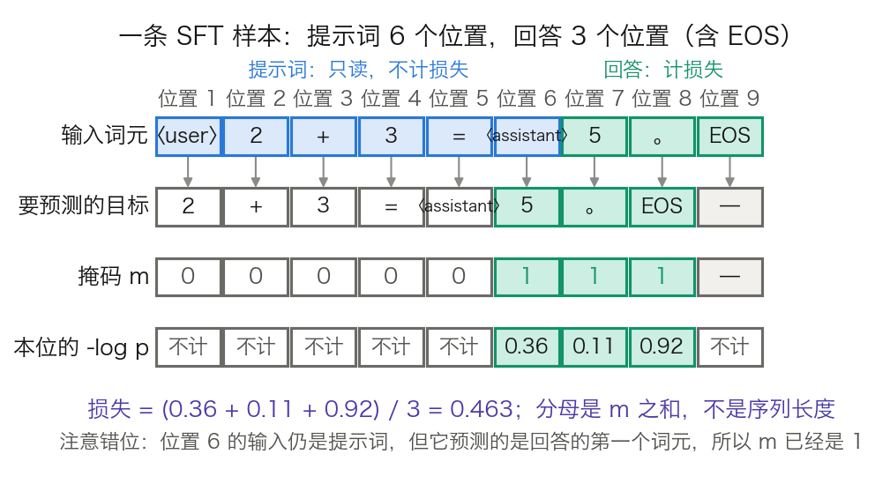

## 8.1 监督微调：教模型“怎么回答”

**监督微调**（Supervised Fine-Tuning，SFT）把只会续写的基础模型变成会应答的助手。它不教知识，教的是“被问就答”这个映射：损失函数与预训练相同，变的只是数据分布和哪些位置计损失。数据比预训练少四到五个数量级且分布窄，训练因此只能在预训练解附近做小位移：全参数微调的学习率在 $$10^{-6}$$ 到 $$10^{-5}$$ 量级，轮数取 2 左右，效果由提示的多样性决定，条数在其次。优化之外还有一类失败出在接口上：模板、结束词元、掩码错位，三者都不反映在损失上。在今天的流水线里 SFT 通常只是第一步，后面接偏好优化或强化学习（8.2、8.3）。

### 8.1.1 从续写到对话

预训练模型只做一件事：接着给定文本往下写。给它“法国的首都是”，它会续出“巴黎，位于塞纳河畔……”。直接问“法国的首都是什么？”，它可能续出“这是一道地理题……”，而不是直接回答。

SFT 在**指令-回答对**上继续训练，把“被问就答”这个映射装进权重。训练数据的形式是一问一答：

```text
用户：法国的首都是什么？
助手：法国的首都是巴黎。
```

**真实模型用特殊词元分隔角色，不是用“用户：”这样的明文。** [3.8.2 节](../03_components/3.8_gpt_inference_flow.md)已经给出推理侧的教学模板 `⟨user⟩ 2 + 3 = ⟨assistant⟩`：服务端按聊天模板把消息列表排成一串词元，并在末尾补上“助手将开始说话”的控制标记。训练侧必须用同一套模板，否则模型在推理时见到的分隔符与训练时不同。

模板错位的症状是“答非所问、停不下来”。它有三种典型形态：训练时用了模板 A、推理时用了模板 B；训练样本里漏掉了结束词元，模型学不会停；系统提示词在训练里从不出现，推理时却总是出现。三者都不会让训练损失变难看。

### 8.1.2 一条样本怎样变成一个损失

**SFT 的损失函数形式与预训练相同，都是下一个词元的交叉熵。** 本节选择只对助手回答计损失，用掩码排除提示词；这是训练配方的选择，并非所有 SFT 的默认行为。用掩码 $$m_t$$ 写出来就是：

$$
\mathcal{L} = -\frac{1}{\sum_t m_t}\sum_t m_t \log p_\theta(x_{t+1}\mid x_{\le t})
$$

$$m_t = 1$$ 表示位置 $$t$$ 预测出的那个词元要计损失，$$m_t = 0$$ 表示不计。分母是 $$\sum_t m_t$$，即实际计入的位置数，不是序列长度。

**掩码对齐的是被预测的词元，不是输入词元。** 位置 $$t$$ 预测的是位置 $$t+1$$ 的词元，所以判断 $$m_t$$ 要看位置 $$t+1$$ 属不属于回答。这个错位是实现里最容易写反的一处。

沿用 3.8 节的教学样本，把提示词 `⟨user⟩ 2 + 3 = ⟨assistant⟩` 与回答 `5 。 EOS` 接成 9 个位置。图 8-1 把三行对齐摆开：输入词元、该位置要预测的目标、掩码 $$m$$。



图 8-1：一条 SFT 样本怎样变成带掩码的损失（[生成脚本](https://github.com/yeasy/llm_internals/blob/main/tools/figures/ch08_sft_loss_mask.py)）。蓝色是提示词，青绿色是回答与计损失的位置；词元序列沿用 3.8 节的教学模板，`-log p` 的三个数值是教学示意；图内的角色标记 `〈user〉` 即正文的 `⟨user⟩`。

位置 1 到 5 预测的都还是提示词，$$m$$ 为 0。位置 6 的输入是 `⟨assistant⟩`，它预测的却是回答的第一个词元 `5`，所以 $$m_6 = 1$$。位置 7、8 同理。位置 9 是 EOS，后面没有下一个词元，不参与。于是 9 个位置里只有 3 个计损失。

设这三位的 $$-\log p$$ 分别为 0.36、0.11、0.92，对应的概率是 0.698、0.896、0.399。损失为：

$$
\mathcal{L} = \frac{0.36 + 0.11 + 0.92}{3} = 0.463
$$

**训练模型结束回答时，应把对应的结束词元计入损失。** 上例用 EOS 表示它，其 $$-\log p$$ 最大（0.92），说明模型在这个位置预测结束的概率较低。把它从掩码里漏掉，损失会降到 $$(0.36 + 0.11) / 2 = 0.235$$，看着更好看，却丢掉了这条样本中“此处应结束”的直接监督。真实聊天模板里它通常是专门的回合结束词元。

实现上掩码合在标签数组里：标签等于 −100 的位置被交叉熵跳过（PyTorch `CrossEntropyLoss` 的 `ignore_index` 默认值），按均值归约时分母也只计未忽略的位置。**套用聊天模板本身不保证提示词会被屏蔽**，监督范围还取决于数据格式与损失配置。以 TRL 的 `SFTTrainer` 为例：完整的 `messages` 列表或单个 `text` 字段默认对整个序列计损失，出现 `user`、`assistant` 角色并不会自动改成只训练回答；`prompt` 与 `completion` 分开的格式默认只训练补全（由 `completion_only_loss` 控制）；只训练助手消息要显式设置 `assistant_only_loss=True`，并且模板要用 `` 标出助手生成区间。各开关的取值对照见[附录 A.7](../appendix/a7_framework_recipes.md)。

**多轮对话的监督范围由这个选择决定。** 完整 `messages` 加助手掩码可以监督多个助手回合，产生多段不连续的计损失区间；把历史放进 `prompt`、只训练 `completion`，就只监督最后一轮。训练前抽一个实际批次，逐词元对照 `input_ids` 与 `labels`：用户与系统位置是否为 −100，目标助手回合是否保留，回答结束词元是否仍在监督范围内。

### 8.1.3 为什么学习率必须小

SFT 的学习率比预训练峰值低一到两个数量级。这个量级是保住旧能力的经验上限，不是推导出来的；两个可查的数字解释它为什么只能小、为什么只跑一两轮。

**数据量差四到五个数量级。** [Llama 2](https://arxiv.org/abs/2307.09288) 的预训练用了 2.0T 词元，SFT 标注到 27,540 条即停，跑 2 轮。按每条样本 500 到 2,000 词元估算，SFT 全程见到 $$2.75\times10^7$$ 到 $$1.10\times10^8$$ 个词元，是预训练的 $$1/(7.3\times10^4)$$ 到 $$1/(1.8\times10^4)$$。换成梯度步数，预训练是 50 万步（全局批大小 $$4\times10^6$$ 词元），SFT 是几百步。

**机制。** 权重最终落在哪里取决于沿途所有更新的累积（[6.1 节](../06_training_techniques/6.1_loss_optimizer.md)）。预训练阶段任何一条样本的贡献都被海量其他样本稀释；SFT 的数据少而且分布窄，梯度方向带着这批数据的系统性偏向，少数样本就足以主导权重的移动方向。步长一大，模型很快学会这批数据的表面模式，同时把预训练里学到的、这批数据没覆盖到的能力挤掉，这就是**灾难性遗忘**（catastrophic forgetting）。小学习率把每一步的位移压小，让新的输入-输出映射长在旧能力之上；轮数少是同一个道理，同一批样本被反复走过，累积位移随轮数增大。这条约束被测出来的形状与缓解办法见 [8.5 节](8.5_practice.md)。

**取值从哪里起步。** Llama 2 的预训练用余弦调度，末端降到峰值的 10%：7B 与 13B 是 $$3.0\times10^{-5}$$，34B 与 70B 是 $$1.5\times10^{-5}$$。它的 SFT 取 $$2\times10^{-5}$$，是峰值 $$3\times10^{-4}$$ 的 1/15，与预训练末端同量级。“接上预训练调度的末端”可以当作扫参的起点，但支撑它的只有这一个样本：表 8-1 里 Tülu 3 取 $$5\times10^{-6}$$ 与 $$2\times10^{-6}$$，比 Llama 2 低 4 到 10 倍。

### 8.1.4 打包与损失归一化：两个容易忽略的选择

**打包（packing）。** 指令数据的长度分布很散，几十到几千词元都有，一条一条填充到 4,096 会浪费大量计算。通行做法是把多条短样本首尾相接，拼成一条满长的序列。Llama 2 即如此：训练集里的提示词与回答全部拼接，用一个特殊词元分隔，提示词上的损失置零。

打包带来一个必须回答的问题：拼在一起的两条样本，后一条能不能读到前一条？注意力默认是因果的，只屏蔽未来，不屏蔽“上一条样本”。不加处理时，后一条样本的每个位置都会把前一条当成上下文。要避免这一点，需要一个块对角的注意力掩码，让每条样本只看见自己。以 3 个词元的样本 A 与 2 个词元的样本 B 拼成一条序列为例，行是发出注意力的位置，列是被看的位置，1 表示允许：

```text
     A1 A2 A3 B1 B2
A1    1  0  0  0  0
A2    1  1  0  0  0
A3    1  1  1  0  0
B1    0  0  0  1  0
B2    0  0  0  1  1
```

每个块内部仍是因果的下三角，B 的两行在 A 的三列上全为 0。实现上这叫序列内注意力隔离，FlashAttention 一类内核用变长序列接口（传入各条样本的起止偏移）来表达。不隔离在多数场景下影响不大，因为模型本来就要学会忽略无关前缀，但在长样本、强格式的任务上会引入可观的噪声。

**损失按什么归一化。** 上面的公式按词元平均，分母是本批次所有计损失位置之和。另一种写法是先在每条样本内部平均，再跨样本平均。差别在权重分配：按词元平均时，所有回答词元等权；按样本平均时，每条样本等权，长回答里单个词元的权重被摊薄。100 词元的回答里每个词元的权重是 1/100，1,000 词元的回答里是 1/1000，相差 10 倍；短回答连同它的结束词元被拟合得更充分，模型因此偏好较短的回答。打包之后 `CrossEntropyLoss` 的均值归约给出的是按词元平均，本节的公式取这一种。[8.2.4 节](8.2_rlhf.md)的 GRPO 长度偏差来自同一个分母，修法也相同：按词元计权。

### 8.1.5 数据质量的影响

SFT 的效果对数据**质量与多样性**的敏感程度，远高于对数量的敏感程度。[LIMA 论文](https://arxiv.org/abs/2305.11206)给出了一个干净的对照：同样从 LLaMa 65B 出发，用 1000 条精心编写的示例做 SFT，人类偏好评测上胜过了在 52,000 条 Alpaca 数据上微调的同规模模型。作者由此提出**表层对齐假说**（Superficial Alignment Hypothesis）：模型几乎全部的知识与能力都在预训练阶段学到，指令微调要做的只是教它选用哪一种表达格式。

这个结果带着三层前提：基座是 65B，知识已经在预训练里；评的是单轮指令跟随上的人类偏好，不是知识密集型基准上的准确率；数据量的收益递减以提示词多样性不变为条件，论文自己的总结是对齐的效果更像提示词多样性的函数。所以“少而精”的主语是多样性，不是条数。反向的旁证也在同一篇论文里：训练数据中没有多轮对话，作者只补了 30 条手工编写的多轮对话链，多轮能力就显著改善。**缺什么补什么，比再堆一万条有效得多。**

Llama 2 的结论同向而量不同：数万条 SFT 标注足以取得高质量结果，标到 27,540 条即停。两个团队相差 27 倍，值得照抄的是判据：**先问这批数据覆盖了多少种不同的提示，再问它有多少条。** 覆盖面不够时，加量只是把同一类样本重复给模型看。

规模更大的公开配方走的是混合路线：[Tülu 3](https://arxiv.org/abs/2411.15124) 的 SFT 数据约 94 万条，由公开数据集与按技能合成的数据拼成，数据工程的重心是配比与覆盖面。合成数据便宜、扩得快，它的风险见 [8.5.3 节](8.5_practice.md)。

### 8.1.6 对到实现：两份公开配方

表 8-1 并排放两份完整公开的 SFT 配方：2023 年的 Llama 2 与 2024 年的 Tülu 3。

| 超参数 | Llama 2 Chat（7B 到 70B） | Tülu 3 8B | Tülu 3 70B |
| --- | --- | --- | --- |
| 学习率 | $$2\times10^{-5}$$ | $$5\times10^{-6}$$ | $$2\times10^{-6}$$ |
| 调度 | 余弦 | 线性 | 线性 |
| 权重衰减 | 0.1 | 未列出 | 未列出 |
| 批大小（有效，单位为序列） | 64 | 128 | 128 |
| 最大序列长度 | 4,096 | 4,096 | 4,096 |
| 训练轮数 | 2 | 2 | 2 |
| 损失掩码 | 提示词位置置零 | 同左 | 同左 |

表 8-1：两份公开 SFT 配方，分别取自 [Llama 2 论文](https://arxiv.org/abs/2307.09288)与 [Tülu 3 论文](https://arxiv.org/abs/2411.15124)。两份配方都用 2 轮、4,096 序列长，学习率都在 $$10^{-6}$$ 到 $$10^{-5}$$ 量级，且模型越大学习率越低。批大小的单位是序列而不是样本：多条样本打包进每条 4,096 词元的序列，Llama 2 每批约 $$64 \times 4{,}096 \approx 26$$ 万词元。

换框架时参数名会变，要核对的是三件事：标签掩码放在哪一层做、批次按词元还是按样本计、学习率相对预训练末端处在什么位置。

SFT 之后的模型已经能对话，但它只学会了模仿示范。示范里没有的行为它不会，示范里有而它并不真会的内容它照样模仿（[8.5.3 节](8.5_practice.md)给出这条失败的实测形态）。要把“像个助手”推进到“回答得更好”，需要一种不依赖标准答案的训练信号，这是 8.2 节的出发点。
