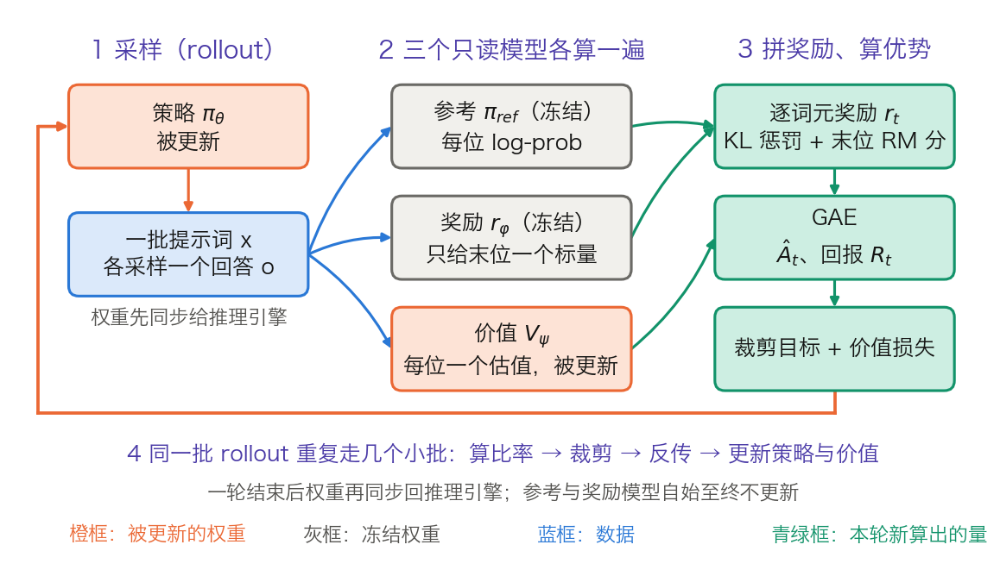

## 8.2 强化学习：模型怎样从自己的回答中学

用 SFT 教“法国的首都是什么？”时，先给出示范回答“法国的首都是巴黎”。做强化学习时，先让模型自己答，答完再判分。比如要求“只写中文城市名”，模型先后答出“巴黎、里昂、巴黎、马赛”，判分程序返回 1、0、1、0。

1. **让当前模型作答。** 每次生成一批回答，记录模型当时给所选词元的概率。
2. **给回答打分。** 判分程序核对答案，把 1、0、1、0 交给训练程序。
3. **用分数计算损失，再更新模型。** 训练程序给每条回答算一个权重，用当前模型重新计算这些回答的词元概率，再用加权损失做反向传播。更新参数后，用这个模型采样下一批回答。

这就是**强化学习**（Reinforcement Learning，RL）的基本循环。首都问答用示范就能教。把任务换成一道解法很多的题，如果程序只需检查计算结果，就不用为每种正确解法写一份示范。模型尝试了示范里没有的办法，只要结果正确，也能得到反馈。用程序直接检查结果的办法叫**可验证奖励的强化学习**（RLVR）。[A.7 的判分示例](../appendix/a7_framework_recipes.md#grpo-capital-recipe)用同一道首都题演示训练数据和判分函数。

**分数怎样改动参数。** 先用同一题的几份回答来比较。刚才四条回答的平均分和总体标准差都是 0.5。每条得分先减 0.5，再除以 0.5，得到 +1、−1、+1、−1。这个表示答得比同组好多少的数叫**优势**。

先把三座城市各看成一个词元，假设它们的初始概率都是三分之一。训练程序取出每次实际答出的那个词元的概率。设这个概率为 $$p$$，优势为 $$A$$。只算采样后第一次更新中来自奖励的梯度，可以用下面这个损失。

$$
L = -A\log p
$$

“巴黎”的权重是 +1，提高它的概率会让它那一项损失变小。“里昂”和“马赛”的权重是 −1，降低各自的概率才会让损失变小。把四项取平均，再对模型参数做反向传播。这里直接训练三座城市的原始分数（logits），初始值都是 0。反向传播算出的梯度是 −0.50、0.25、0.25。每个分数减去 0.4 倍的梯度，就得到 0.20、−0.10、−0.10。再用 softmax 换算成概率，“巴黎”从 33.33% 升到 40.30%，两个错误答案各降到 29.85%。可用 [A.7 的 PyTorch 算例](../appendix/a7_framework_recipes.md#capital-reward-update)复现。

语言模型在强化学习里仍然预测下一个词元。假设按字划分词元，模型先读题生成“巴”，再读“题目 + 巴”生成“黎”。训练程序用当前参数重算“巴”和“黎”的概率。参与计算的仍是采样时实际生成的这两个字，标准答案由判分程序使用。像刚才这样用同组回答计算优势，是**组相对策略优化**（GRPO）的做法。只给整条回答打一个分时，这条回答里的词元都用同一个优势。反向传播通过词元的概率计算。

**为什么要控制更新幅度？** 训练程序可以把同一批回答用几次，省去重新生成的时间。刚才模型生成“巴黎”时给它的概率是 33.33%，更新一次后已经升到 40.30%。如果继续用这几条回答往上推，模型可能会偏离生成这批答案时的状态太远。

在强化学习里，模型给各种答案分配概率的规则叫**策略**。**近端策略优化**（Proximal Policy Optimization，PPO）用采样时的概率作参照，让这批回答带来的更新尽量留在采样策略附近。用刚才的首都题走一遍。

1. **采样时，把答案和旧概率存下来。** 模型答出了“巴黎、里昂、巴黎、马赛”。每次实际选中的城市在采样时的概率都是三分之一。把四个回答、这四个旧概率和判分结果 1、0、1、0 一起保存。
2. **用实际得分减去预期得分。** 经典 PPO 用另一个模型估计预期回报，这个模型叫**价值模型**。在这个一步就答完的例子里，假设它预计每次能拿 0.5 分。实际得分减去 0.5，得到四个优势 +0.5、−0.5、+0.5、−0.5。训练价值模型时，再用实际拿到的分数检验和修正它的预测。
3. **用当前概率算损失，更新参数。** 对已经存下的回答，重新计算它们现在的概率，再除以采样时记下的概率。第一次更新前，新旧模型相同，比值是 1。给定同一个优势，这时奖励项算出的梯度和前面用对数概率算出的梯度相同。这里只算策略的奖励项，仍对三座城市的原始分数求导。优势是前一例的一半，梯度也减半，为 −0.25、0.125、0.125。用 0.8 的学习率做一次梯度下降，得到 0.20、−0.10、−0.10。下次更新时再重算当前概率，旧概率和优势在这批数据用完前保持固定。
4. **用同一批回答再更新时，裁剪过大的收益。** 把第一次参数更新后的分数换成概率，“巴黎”升到 40.30%，除以旧概率约为 1.21。它的优势为 +0.5。原本这一项按 1.21 × 0.5 算，PPO 将它限制在 1.20 × 0.5 = 0.60。再把“巴黎”的概率往上推，这一项也拿不到更多收益。其他样本仍然可能改变它的概率。用完这批数据后，再用更新过的模型采样。

要看输入文件里写什么、采样时产生什么，可以直接运行 [A.7 的 PPO 小实验](../appendix/a7_framework_recipes.md#ppo-capital-recipe)。其中也展开了[分数乘进训练损失的代码](../appendix/a7_framework_recipes.md#ppo-reward-loss)。完整的裁剪公式和负优势的情形见下文。[PPO 论文](https://arxiv.org/abs/1707.06347)给出了算法和训练循环。

有些回答的好坏要请人判断。经典的**基于人类反馈的强化学习**（RLHF）用人工比较训练一个评分模型，再让它给训练期间生成的新回答打分。下面看这套流程怎样运行。直接使用固定回答对的做法见 [8.3 节](8.3_dpo.md)。

RLHF 早期用于按指定风格续写（[Ziegler 等人，2019](https://arxiv.org/abs/1909.08593)）和生成摘要（[Stiennon 等人，2020](https://arxiv.org/abs/2009.01325)）。OpenAI 在 [InstructGPT](https://arxiv.org/abs/2203.02155) 中用它训练 GPT-3 更好地遵循指令。在论文的人类评测中，标注者更喜欢经过这套训练的 1.3B 模型的回答，尽管参加对照的 175B GPT-3 参数量在它的 100 倍以上。

### 8.2.1 SFT 的局限

人工示范可以教模型怎样写一首关于秋天的诗。换一首新诗，句子可以有很多种写法，很难逐词给出标准答案。请标注者读两首现成的诗，说明更喜欢哪一首，有时比请他们另写一首更容易。评分模型从这些比较中学习，之后可以给训练过程中出现的新回答打分。

### 8.2.2 三阶段流程

经典的 RLHF 配方有三个阶段，PPO 用在最后一步。第一阶段用人工示范做 SFT，让模型先学会按指令回答。第二阶段训练另一个模型，用人的比较结果给回答评分，这就是**奖励模型**（Reward Model，RM）。第三阶段让语言模型自己生成回答，用奖励模型给分，再用 PPO 更新语言模型。KL 散度用来衡量两个概率分布的差异。在训练中加入 KL 惩罚，可以限制模型的输出分布偏离训练起点的程度。作为参照的 SFT 模型在第三阶段保持冻结。

强化学习（Reinforcement Learning，RL）的训练信号来自行动后的结果。对语言模型来说，每生成一个词元就是采取一次行动。下面是推导会用到的几个量。

- **策略** $$\pi_\theta$$ 给出每种动作的概率。在这里，语言模型就是策略， $$\pi_\theta(y_t\mid x, y_{<t})$$ 给出下一个词元的概率分布， $$\theta$$ 是模型权重。
- **状态** $$s_t$$ 包含提示词 $$x$$ 和已生成的前缀 $$y_{<t}$$。
- **动作**是在当前状态下从词表里选一个词元 $$y_t$$。模型采样出一条完整回答的过程称为一次 **rollout**。
- **奖励** $$r_t$$ 是生成第 $$t$$ 个词元时得到的分数，计算方法见下文“逐词元奖励”。
- **回报** $$R_t$$ 是从第 $$t$$ 步到回答结束所获奖励的总和， $$R_t = \sum_{k\ge t} r_k$$。
- **优势** $$A_t$$ 表示实际回报比该状态下的预期高多少。**价值模型**（Value Model，又称 Critic）估计预期回报 $$V(s_t)$$。最简单的优势计算是 $$A_t = R_t - V(s_t)$$。下文还会介绍如何用广义优势估计（GAE）计算它。

**策略梯度怎样改变回答。** RL 希望模型生成的回答平均能获得更高的回报。**策略梯度**让模型先采样，再根据每个词元的优势，沿 $$A_t\,\nabla_\theta\log\pi_\theta(y_t\mid s_t)$$ 的方向更新权重。 $$\nabla_\theta\log\pi_\theta(y_t\mid s_t)$$ 与 SFT 把 $$y_t$$ 当标签时降低交叉熵的方向相同。沿这个方向更新， $$y_t$$ 的概率就会上升。可以把它理解为带权重的 SFT，标签由模型自己生成，优势决定更新方向与幅度。 $$A_t > 0$$ 时提高词元的概率， $$A_t < 0$$ 时降低， $$|A_t|$$ 越大，更新越大。

假设词表只有 a、b 两个词元。两个 logits 都是 0，直接把它们当作待更新的参数，两个词元的概率各为 0.5。这次采到 a，优势 $$A = +2$$。 $$\log\pi(\text{a})$$ 对 logits 的梯度等于独热标签减去预测概率（[6.1.1 节](../06_training_techniques/6.1_loss_optimizer.md)），即 $$[1 - 0.5,\ 0 - 0.5] = [0.5, -0.5]$$。取学习率 0.1，logits 更新为 $$[0, 0] + 0.1 \times 2 \times [0.5, -0.5] = [0.1, -0.1]$$，a 的概率从 0.5 升到 $$e^{0.1}/(e^{0.1} + e^{-0.1}) = 0.550$$。若优势是 $$-2$$，logits 变为 $$[-0.1, 0.1]$$，a 的概率降到 0.450。

上面的策略梯度按当前策略生成样本的概率取期望。用当前策略自己的样本更新，称为 **on-policy（同策略）**。如果生成样本用的是另一套权重，正在训练的策略可能给这些样本不同的概率，这种情况称为 **off-policy（异策略）**，更新时需要做额外修正。PPO 用概率比来修正这一差异。8.2.3 还会说明训练和推理分开时，这个差异从哪里来。

沿表 8-2 从上往下看，先是用人写的示范训练语言模型，再单独训练给答案打分的奖励模型，最后由语言模型自己采样回答并继续更新。

| 阶段 | 训练对象 | 数据 | 学习信号从哪来 | 学到什么 |
| --- | --- | --- | --- | --- |
| SFT | 策略模型，从预训练模型出发 | 提示 + 人写的示范回答 | 示范回答，逐词元交叉熵 | 按助手的角色与格式作答 |
| 奖励模型 | 另一个模型，末端换成标量头 | 提示 + 多个回答的人工排序，拆成成对比较 | 人的偏好 | 给回答打分，近似人的偏好 |
| PPO | 策略模型，从 SFT 模型出发 | 只有提示，回答由策略采样 | 奖励模型的分数，减去偏离 SFT 模型的 KL 惩罚 | 生成奖励更高的回答 |

表 8-2：RLHF 三个阶段的对照。[InstructGPT 论文](https://arxiv.org/abs/2203.02155)报告，三个阶段的训练提示分别约 1.3 万、3.3 万、3.1 万条，第三阶段的提示只取自 API。同一类人工比较也能直接用于 [8.3 节的 DPO](8.3_dpo.md)。8.2.4 节的组相对策略优化（GRPO）用一组回答的得分来估计优势，省去价值网络。同一节还会说明怎样用规则给回答打分。

#### 奖励模型怎样从人工比较学会打分

奖励模型需要为整条回答输出一个分数。它沿用语言模型的架构，把原来给词表中每个词元打分的输出层（LM head）换成只输出一个数的投影层，也叫标量头。价值模型也用这样的投影层。下面对照两种输出层的张量形状。

- 语言模型：`x_T[1, d_model] × W_vocab[d_model, n_vocab] → logits[1, n_vocab]`
- 奖励模型：`x_T[1, d_model] × w_r[d_model, 1] → r[1, 1]`

给整条回答评分时，取**最后一个位置**的隐状态。这个位置才能看到完整的提示词和回答。

**怎样从比较学到分数。** 不同人使用的绝对分数标尺可能相差很大，直接比较两份回答通常更容易取得一致意见。**Bradley-Terry 模型**（BT）把两个分数的差通过 sigmoid 映射到概率，得到人类偏好 $$y_w$$ 胜过 $$y_l$$ 的概率。

$$
\begin{gathered}
\Delta r = r_\phi(x,y_w) - r_\phi(x,y_l) \\
P(y_w \succ y_l \mid x) = \sigma(\Delta r)
\end{gathered}
$$

其中 $$r_\phi$$ 是奖励模型， $$\phi$$ 是它的权重。在标注数据中， $$y_w$$ 是被选中的回答。训练要提高奖励模型预测这一选择的概率，也就是最小化下面的负对数似然。

$$
\mathcal{L}_{RM} = -\log\sigma(\Delta r)
$$

**算一对回答。** 设被选中的回答得分 $$r_w = 1.2$$，另一份得分 $$r_l = 0.4$$，两者相差 0.8。 $$\sigma(0.8) = 0.690$$，损失 $$-\ln 0.690 = 0.371$$。若模型把优劣排反， $$r_w = 0.4$$、 $$r_l = 1.2$$，则分差为 −0.8， $$\sigma(-0.8) = 0.310$$，损失 $$-\ln 0.310 = 1.171$$。如果初始分差的期望为 0，而且实际分差也很小，**损失接近 $$\ln 2 = 0.693$$，准确率接近 50%**。8.3 节的 DPO 也用 BT 损失，初始两份回答的偏好概率相同时，起点相同。损失只看分差，给所有回答加上同一个常数也不影响比较。InstructGPT 在进入 RL 之前用一个偏置把示范回答的平均分归零。

**排序数据怎样拆成对。** 标注者一次给 $$K$$ 个回答排序（ $$K$$ 在 4 到 9 之间），可以拆成 $$\binom{K}{2}$$ 个成对比较。 $$K=4$$ 是 6 对， $$K=9$$ 是 36 对。如果把这些比较当成相互独立的训练样本，打散后，同一回答可能在一轮训练中参与 $$K-1$$ 次梯度更新，增加过拟合风险。InstructGPT 把同一提示产生的所有比较放进一个批次元素，让 $$K$$ 个回答各做一次前向，再用算出的分数做两两比较。

**标注者意见不一时。** InstructGPT 按标注者分成五组做交叉验证，组内验证准确率为 72.4% ± 0.4%，换到留出的一组降至 69.6% ± 0.9%。评价奖励模型时，可以把标注者的一致性当作参照。在同一批标注上继续提高准确率，有可能只是拟合了这批人的评分习惯。

**各模型可以用不同的规模。** InstructGPT 的奖励模型和价值模型都是 6B，价值模型用奖励模型的权重初始化。生成回答的策略模型最大为 175B。作者发现 175B 的奖励模型训练不稳定，因此选了更小的模型做评分。许多开源实现让三者同规模，便于实现。

#### 逐词元奖励：KL 惩罚与回答得分

奖励模型只给整条回答打一个分。为了还原生成过程中每一步的学习信号，先给每个生成词元加上偏离参考模型的惩罚，再把整条回答的分数计在最后一步。

$$
\begin{aligned}
k_t &= \log\frac{\pi_\theta(y_t\mid s_t)}{\pi_{\mathrm{ref}}(y_t\mid s_t)} \\
r_t &= -\beta k_t + \mathbb{1}[t = T]\,r_\phi(x,y)
\end{aligned}
$$

其中 $$\pi_{ref}$$ 是**参考模型**，即冻结的 SFT 模型， $$T$$ 是回答的词元数。前一项是逐词元的 KL 惩罚。对策略自己采样的词元求平均， $$k_t$$ 的期望就是该位置上的 $$D_{KL}[\pi_\theta \| \pi_{ref}]$$。KL 散度衡量两个概率分布的差异（见 [5.1 节](../05_pretraining/5.1_autoregressive.md)）。后一项只在最后一个位置加上奖励模型的分数。InstructGPT 取 $$\beta = 0.02$$，报告的最优区间约为 0.01 到 0.02。

设回答有 4 个词元，四个位置上的 $$\log\pi_\theta - \log\pi_{ref}$$ 依次为 0.5、2.0、−1.0、1.5，奖励模型给整条回答打 1.2 分。把每个位置的对数概率差乘以 $$-0.02$$，最后一个位置再加上 1.2。

$$
\begin{gathered}
r_4 = -0.030 + 1.2 = 1.170 \\
r = [-0.010,\ -0.040,\ 0.020,\ 1.170]
\end{gathered}
$$

第三个位置的 $$r_t$$ 是正的。策略在该位置给采中词元的概率低于参考模型，所以对数比 $$k_t$$ 为负。单个词元上的对数比可以为负，对策略采出的词元取期望后才一定非负。

也可以把 KL 项直接加到损失里，8.2.4 节的 GRPO 就这么做。放进奖励时，它先进入 $$r_t$$，再影响 GAE 算出的优势。直接加到损失里时，它单独影响梯度。

#### GAE：怎样用四个奖励估计优势

有了各词元的奖励，接下来要估计优势 $$A_t = R_t - V(s_t)$$。价值模型与奖励模型使用相同的结构，但在每个位置都预测从当前位置到回答结束的回报。容易回答的题本来就容易得高分，直接比较不同题的得分，容易把题目难度当成回答质量。减去各状态的预期回报，能降低更新信号的方差。这里作为基准的 $$V(s_t)$$ 也称为基线。

**广义优势估计**（Generalized Advantage Estimation，GAE）把后面几步的预测误差加权相加，在估计的偏差和方差之间作取舍。 $$\delta_t$$ 是价值模型的一步预测误差，即实得奖励加下一状态的折扣估值，再减去当前状态的估值。 $$\gamma \in (0, 1]$$ 是**折扣因子**， $$\lambda \in [0, 1]$$ 决定越往后的误差在估计中要占多少权重。相距 $$l$$ 步的误差权重为 $$(\gamma\lambda)^l$$。

$$
\begin{aligned}
\delta_t &= r_t + \gamma V(s_{t+1}) - V(s_t) \\
\hat{A}_t &= \sum_{l\ge 0} (\gamma\lambda)^l\,\delta_{t+l}
\end{aligned}
$$

接着上面的例子。取 $$\gamma = 1$$（InstructGPT 明确说估计广义优势时不做折扣），价值模型给出的四个估值为 0.8、0.9、1.0、1.1，末状态之后为 0：

$$
\begin{aligned}
\delta_1 &= -0.010 + 0.9 - 0.8 = 0.09 \\
\delta_2 &= -0.040 + 1.0 - 0.9 = 0.06 \\
\delta_3 &= 0.020 + 1.1 - 1.0 = 0.12 \\
\delta_4 &= 1.170 + 0 - 1.1 = 0.07
\end{aligned}
$$

取 $$\lambda = 0.95$$，这是 Ai2 的 Tülu 3 公开配方所用的值。由后往前算，先得到 $$\hat A_4 = 0.07$$，再依次得到 $$\hat A_3 = 0.12 + 0.95\times0.07 = 0.186$$、 $$\hat A_2 = 0.06 + 0.95\times0.186 = 0.237$$ 和 $$\hat A_1 = 0.09 + 0.95\times0.237 = 0.315$$。

沿用这里不折扣的设定， $$\lambda = 1$$ 时，估计化为 $$\hat A_t = R_t - V(s_t)$$（本例 $$\hat A_1 = 1.14 - 0.8 = 0.34$$）。这时直接使用实际回报，通常方差较大。 $$\lambda = 0$$ 时 $$\hat A_t = \delta_t$$，只使用一步实得奖励和价值模型的估计。如果价值模型有误，偏差可能更大。

#### 裁剪目标：四种情形

同一批回答可以用于多次更新。更新得越多，当前策略就越可能与当初采样的策略相差太远。早期的信赖域策略优化（Trust Region Policy Optimization，TRPO）用 KL 散度限制更新幅度，每步需要解一个含 Fisher 信息矩阵的二阶问题，对百亿参数的模型代价较高。PPO 用只需一阶梯度的裁剪目标限制更新。设 $$\theta_{old}$$ 是这批回答采样时的权重，采样后保持固定， $$\theta$$ 是正在更新的权重。 $$\rho_t$$ 是当前策略给已采词元 $$y_t$$ 的概率与采样时概率的比。刚采完样时 $$\rho_t = 1$$，更新后若 $$\rho_t > 1$$，表示这个词元变得更可能被采到。下面的式子要**最大化**，写成最小化的损失时取负号。

$$
\begin{aligned}
\rho_t &= \frac{\pi_\theta(y_t\mid s_t)}{\pi_{\theta_{\mathrm{old}}}(y_t\mid s_t)} \\
c(\rho) &= \mathrm{clip}(\rho,1-\epsilon,1+\epsilon) \\
g(\rho,A) &= \min\big(\rho A,c(\rho)A\big)
\end{aligned}
$$

$$
\max_\theta \; \mathbb{E}_t[g(\rho_t,A_t)]
$$

在 $$\rho_t = 1$$ 处，未裁剪项 $$\rho_t A_t$$ 的梯度与前面的策略梯度相同。用概率比替代 $$\log\pi_\theta$$ 后，同一批回答可以分成几个小批重复使用。策略权重更新后，乘上 $$\rho_t$$ 可以修正当前策略和采样策略的差异。 $$\mathrm{clip}$$ 把裁剪项中的 $$\rho_t$$ 限在 $$[1-\epsilon,\ 1+\epsilon]$$， $$\epsilon$$ 通常取 0.2。两个候选项最后取较小值，具体会取哪一项，还取决于优势的正负（表 8-3）。

| 情形 | 比率 $$\rho_t$$ | 优势 $$A_t$$ | 未裁剪项 | 裁剪项 | min 取到 | 梯度 |
| --- | ---: | ---: | ---: | ---: | --- | --- |
| 正优势、更新过头 | 1.3 | +2 | 2.6 | 2.4 | 裁剪项 | 为零 |
| 正优势、更新不足 | 0.7 | +2 | 1.4 | 1.6 | 未裁剪项 | 保留 |
| 负优势、更新过头 | 0.7 | −2 | −1.4 | −1.6 | 裁剪项 | 为零 |
| 负优势、更新不足 | 1.3 | −2 | −2.6 | −2.4 | 未裁剪项 | 保留 |

表 8-3： $$\epsilon = 0.2$$ 时裁剪目标的四种情形。裁剪项里的 $$\mathrm{clip}(\rho_t,\,0.8,\,1.2)$$ 取到边界时是常数，对 $$\theta$$ 的梯度为零。

优势为正时，目标是提高词元概率。提高到越过上界后，第一行的裁剪项变成常数，该词元的梯度为零。第三行是优势为负时压低概率过多的情形。第二、四行的概率朝相反方向变化，仍会保留把概率往正确方向调整的梯度。这个规则约束的是训练目标中各个词元的贡献。

#### 一轮训练中四个模型怎样配合

一轮 PPO 迭代要先生成回答并算出奖励，再用同一批数据更新策略和价值模型。图 8-2 标出了四个模型在各步骤中各自提供什么。

图 8-2：一轮 PPO 迭代中四个模型的输入与输出（[生成脚本](https://github.com/yeasy/llm_internals/blob/main/tools/figures/ch08_ppo_iteration.py)）。橙色是被更新的权重，灰色是冻结权重，蓝色是数据，青绿色是本轮新算出的量。

先把策略权重同步给推理引擎，让它生成一批回答。参考模型给出比对用的词元概率，奖励模型给整条回答评分，这两个模型都保持冻结。价值模型在各位置预测回报。得到逐词元奖励 $$r_t$$ 后，用 GAE 计算 $$\hat A_t$$，并算出供价值模型拟合的 $$R_t$$。随后将同一批采样结果切成小批，用裁剪目标更新策略，用平方误差让价值模型拟合 $$R_t$$（[PPO 论文](https://arxiv.org/abs/1707.06347)）。InstructGPT 的批大小为 512，小批为 64，同一批数据训练一个内轮。开始下一轮采样前，把更新后的权重重新同步给推理引擎。

#### 四个模型需要多少显存

估算这四个模型占用的显存，先区分哪些模型要更新权重，哪些只做前向。使用混合精度 Adam 训练时，模型状态每参数占 16 字节（构成见 [7.2.1 节](../07_distributed_training/7.2_zero.md)）。只做前向的模型按 BF16 权重每参数占 2 字节算。表 8-4 以 7B 模型为例。

| 方法 | 被训练的模型 | 只做前向的模型 | 合计 |
| --- | --- | --- | ---: |
| SFT | 策略 112 GB | 无 | 112 GB |
| DPO | 策略 112 GB | 参考 14 GB | 126 GB |
| GRPO 式 RL，规则奖励、无 KL 项 | 策略 112 GB | 无 | 112 GB |
| GRPO 式 RL，奖励模型加 KL 项 | 策略 112 GB | 参考 14 GB + 奖励 14 GB | 140 GB |
| PPO 式 RLHF | 策略 112 GB + 价值 112 GB | 参考 14 GB + 奖励 14 GB | 252 GB |

表 8-4：7B 模型上几种后训练方法的模型状态显存，按每参数 16 字节（训练）与 2 字节（推理）算出，不含激活，也不含 rollout 阶段推理引擎里的那份策略权重与 KV 缓存。 $$112 = 7\times10^9 \times 16 / 10^9$$， $$14 = 7\times10^9 \times 2 / 10^9$$。GRPO 的两行是两种配置的端点；规则奖励而保留 KL 项时是 126 GB。

在表 8-4 的假设下，PPO 式 RLHF 的模型状态比 SFT 多占 140 GB，其中 112 GB 用在价值模型上。这就是 GRPO 省去价值模型后可以节省的 112 GB。8.2.4 节介绍的 DAPO 是一种 GRPO 改进方案。它用规则给回答评分，也省去了 KL 项，模型状态的占用回到 SFT 的 112 GB。在线采样仍需要推理权重和 KV 缓存，DPO 则省去了训练期间的在线采样。

### 8.2.3 RLHF 的挑战

如果奖励分数上升，实际回答却变差，问题可能出在评分标准。如果训练突然不稳定，还要查 PPO 的几个相互影响的设置，以及采样和训练所用的两套引擎。两套引擎的数值精度、权重版本和运行时序都有可能出现差异，表现常和算法问题相似。

**训练要协调的组件多。** 四个模型在同一轮里承担不同工作（表 8-4）。训练和推理还各有一套多卡并行方案，需要一起维护。

**奖励模型的过度优化。** [Gao 等人](https://arxiv.org/abs/2210.10760)选了一个较强的奖励模型作为评分基准，再用较小的模型作为代理。训练只优化代理分数，同时用较强模型的分数检查回答是否真的变好。把策略到初始策略的距离记为 $$d = \sqrt{D_{KL}(\pi \| \pi_{init})}$$，基准奖励可拟合为 $$R(d) = d\,(\alpha - \beta\log d)$$（ $$\alpha$$、 $$\beta$$ 是拟合系数，与 KL 系数无关），峰值在 $$d^{\ast} = \exp(\alpha/\beta - 1)$$。过了峰值，代理分数继续上涨，但基准分数下降（图 8-3）。从多个候选中选最高分回答（best-of-$$n$$）时，基准分数也可能先升后降（[9.5.2 节](../09_decoding/9.5_test_time_scaling.md)）。图的横轴是 $$\sqrt{\mathrm{KL}}$$。学习率不同时，同样的步数可能让策略改变得多或少，所以排查过度优化时应检查 KL。该研究中的拟合系数随奖励模型规模平滑变化，可用小规模实验估计峰值。

图 8-3：随着策略偏离初始模型，代理奖励仍在上升，基准奖励可能下降（[生成脚本](https://github.com/yeasy/llm_internals/blob/main/tools/figures/ch08_reward_overopt.py)）。曲线按论文给出的函数绘制， $$\alpha$$ 和 $$\beta$$ 取教学示例值。

**训练不稳定。** 平均奖励突然大幅下跌且不恢复，叫奖励崩塌。不同提示逐渐只得到少数几种相似回答，叫模式坍塌。遇到这两种情况，应检查奖励尺度与优势归一化、价值模型是否跟上策略更新，以及策略是否过度偏离参考模型。除平均奖励外，还要一起看 KL、策略熵（回答选择的分散程度）、触发裁剪的词元比例和价值模型的解释方差（它能解释多少回报的波动）。

**采样与训练引擎之间的差异。** 下面三种情况也会表现为训练不稳定，可以分别检查。

- **数值：训练—推理失配**（Training–Inference Mismatch，TIM）。推理引擎（如 vLLM、SGLang）负责生成回答，训练引擎（例如采用 FSDP 或 Megatron）负责计算梯度。对同一输入，两边算出的概率在大部分位置非常接近，极少数情况下连概率最高的词元也会不同。一项诊断研究建立了与采样结果逐比特一致的基线，并发现单是这种数值差异就可能让训练崩溃（见[附录 A.4](../appendix/a4_references.md)）。算法上可用截断重要性采样（TIS，给概率比设上限）和拒绝采样减少异常更新。系统上可让两边都用确定性的**批次不变**（batch-invariant）算子。这样的算子在同一输入放进不同批次时仍给出相同结果。混合专家模型（MoE）还要检查专家计算的融合算子（[14.2 节](../14_future_trends/14.2_moe.md)）。这是 Qwen3-8B 量级模型在 BF16 下的实验结果。排查自己的训练时，可以先比对两边算出的词元对数概率。
- **权重：训练和推理的切分方式不同。** 训练侧还要存优化器状态，常用 FSDP 或 ZeRO 分片。推理侧只做前向，常用张量并行处理较大的批次。更新过的权重传给推理引擎时，要重新分片。[HybridFlow（verl 的论文）](https://arxiv.org/abs/2409.19256)为这一步设计了专门的引擎，报告的整体吞吐提升为 1.53 到 20.57 倍。**共置**（colocate）让两边分时共用一组 GPU，节省设备，但每次切换都要重分片，还要留足单卡峰值显存。**分离**（disaggregate）让两套引擎各自常驻，代价是每轮要跨集群传输权重。
- **时序：采样权重落后于训练。** 同步 RL 必须等同一批中最长的回答生成完再更新。长思维链有少量特别长的回答，等待时间可能被这些回答拉长。异步方案允许推理引擎用稍早的权重继续生成。采样权重落后了多少次更新，称为**陈旧度**（staleness）。允许更大的陈旧度通常有利于提高吞吐，但采样会进一步偏离 on-policy，需要用重要性采样等办法修正。两边的词元概率对不上时，也要检查这类权重版本差异，并与数值失配区分开。

### 8.2.4 可验证奖励与 GRPO

有些推理题的答案可以自动检查，直接用检查结果给模型打分即可。这就是**可验证奖励的强化学习**（Reinforcement Learning with Verifiable Rewards，RLVR）。比如让模型对同一道题给出几种解法，再检查每种解法给出的答案。

有了分数，接下来要决定怎样更新模型。一种做法是把每条回答同组内其他回答比较，估计它比同组平均好多少，也就是它的优势。这就是组相对策略优化（GRPO）估计优势的思路。和 8.2.2 节的流程相比，自动判分规则可以代替奖励模型，组内得分则用来估计优势，因此可以省去价值模型。

参考模型的 KL 惩罚用于限制模型偏离训练起点的程度，可以保留。字节跳动等机构发布的 GRPO 改进方案 [DAPO](https://arxiv.org/abs/2503.14476) 就省去了这一项。基本步骤仍是采样、求优势、裁剪和更新。训练时需要检查验证规则有没有漏洞，以及组内奖励的归一化会不会让某些题目受到更大的权重。

**长思维链**指模型在给出答案之前先写出较长的推理过程，回答可长达上万词元（[14.6 节](../14_future_trends/14.6_test_time_scaling.md)）。DeepSeek 发布的推理模型 [DeepSeek-R1](https://arxiv.org/abs/2501.12948) 先用少量长思维链示范做监督微调，再用 GRPO 和规则奖励开展大规模强化学习。作者选择规则，也考虑到大规模训练容易找出神经奖励模型的漏洞。Ai2 的 [Tülu 3](https://arxiv.org/abs/2411.15124) 公开配方在 SFT、DPO 之后接 RLVR。[Qwen3](https://arxiv.org/abs/2505.09388) 是 Qwen 团队发布的模型系列，其报告也把推理强化学习列为单独的训练阶段。长回答会放大 8.2.3 节提到的训练难题。

#### 奖励从哪里来：验证器

首都问答和数学题可以核对答案，代码题可以运行测试。做 RLVR 时，负责检查的程序叫**验证器**，它的结果直接作为奖励，省去了拟合人类偏好的奖励模型。规则只给 0 或 1 时，能告诉模型答对还是答错。验证规则也可能有漏洞。例如只检查回答里有没有“巴黎”，回答“法国的首都是里昂，巴黎不是首都”也会得分。模型通过利用评分漏洞拿到高分，却没有完成任务，这种现象叫**奖励黑客**（reward hacking）。

开放式医疗与科学问答往往很难用一条 0/1 规则判断。可以先具体写下好的回答要满足哪些条件，再逐项评分。[Rubrics as Rewards](https://arxiv.org/abs/2507.17746)（RaR）称这组检查项为**评分细则**（rubric）。评分模型判断每一项是否满足，然后按权重汇总。

$$
r(x, y) = \frac{\sum_{j=1}^{k} w_j\,c_j(x, y)}{\sum_{j=1}^{k} w_j}
$$

其中 $$c_j \in \{0, 1\}$$ 是第 $$j$$ 项的判定， $$w_j$$ 是权重。只有一项且那一项只核对答案时，结果就是 0/1 奖励。可把 $$r$$ 直接代入下文 GRPO 的组内优势。论文在 HealthBench 医疗问答评测中报告，相比让评分模型直接给总分，按细则逐项评分的相对提升最高为 31%。代价是每条回答要多调用若干次评分模型，细则质量依赖参考答案，评分模型也可能引入自己的偏差。[MiniMax-M1](https://arxiv.org/abs/2506.13585) 对生成式奖励模型的实验就观察到评分模型偏好较长的回答。这份 RaR 报告只在医学和科学两个领域验证了这种做法。

#### GRPO：用组内相对得分估计优势

上面的经典 PPO 配方要额外训练一个价值模型。按表 8-4 的例子，它的模型状态就要占 112 GB。如果只在回答结束时给奖励，也很难让价值模型在生成的每一步都预测得准。面向数学推理的 [DeepSeekMath 论文](https://arxiv.org/abs/2402.03300)提出了**组相对策略优化**（Group Relative Policy Optimization，GRPO）。它对同一道题采样多份回答，以组内平均分为基线，再用标准差对每份回答的分差做归一化。

$$
A_i = \frac{r_i - \mathrm{mean}(\{r_1,\dots,r_G\})}{\mathrm{std}(\{r_1,\dots,r_G\})}
$$

$$
\begin{aligned}
D_{i,t} &= D_{\mathrm{KL}}[\pi_\theta\|\pi_{\mathrm{ref}}] \\
u_{i,t} &= g(\rho_{i,t},A_i)-\beta D_{i,t} \\
U_i &= \frac{1}{|o_i|}\sum_{t=1}^{|o_i|}u_{i,t}
\end{aligned}
$$

$$
\mathcal{J}_{\mathrm{GRPO}}(\theta)
= \mathbb{E}\left[\frac{1}{G}\sum_{i=1}^{G}U_i\right]
$$

其中 $$G$$ 是同一道题采样的回答数， $$o_i$$ 是第 $$i$$ 条回答， $$|o_i|$$ 是它的词元数， $$r_i$$ 是它的总奖励， $$\rho_{i,t}$$ 是新旧策略在第 $$i$$ 条回答第 $$t$$ 个词元上的概率比。$$g$$ 沿用 8.2.2 的裁剪目标， $$D_{i,t}$$ 表示第 $$i$$ 条回答第 $$t$$ 个位置的 KL 项。计算时，先在一条回答内按词元平均，再在一组回答内取平均。只在回答结束时给一个奖励，称为结果监督。在这种设定下，同一条回答的所有词元都用同一个 $$A_i$$。GRPO 把 KL 项直接加进目标，采用非负无偏估计式 $$\frac{\pi_{ref}}{\pi_\theta} - \log\frac{\pi_{ref}}{\pi_\theta} - 1$$。DAPO 省去这一项，因为训练长思维链时，模型的输出分布本来就可能需要大幅调整。

以下算例用总体标准差，分母是组内回答数 $$G$$。[TRL v1.7.0](https://github.com/huggingface/trl/blob/v1.7.0/trl/trainer/utils.py#L685-L721) 的组内归一化用样本标准差，方差分母为 $$G-1$$，实现还会在标准差上加一个小量。同组回答的优势排序相同，数值有所不同。

取 $$G = 4$$。奖励为 $$[1, 0, 0, 1]$$ 时，均值为 0.5、标准差为 0.5，优势是 $$[+1, -1, -1, +1]$$。奖励为 $$[1, 1, 1, 0]$$ 时，均值为 0.75、标准差为 0.433，优势是 $$[+0.577, +0.577, +0.577, -1.732]$$。在第二组中，唯一答错的回答受到较大的惩罚。

**零方差的情形。** 若这些数是每条回答的**总奖励**，且整组为 $$[1,1,1,1]$$ 或 $$[0,0,0,0]$$，标准差就是 0。上式直接代入会出现 0/0，实现须在分母加小量或显式处理零方差；处理后优势整组为零，奖励驱动的策略梯度消失。不过 [R1 原目标函数](https://arxiv.org/html/2501.12948v1#S2.SS2.SSS1)还有独立的 KL 正则项，KL 梯度仍可能非零，不能据此断言总梯度为零。

接下来的问题多与这两个公式的分母有关。用 $$|o_i|$$ 作分母，会让长短不同的回答受到不同的更新。用组内标准差 $$\mathrm{std}$$ 作分母，会改变难度不同的题目对更新的影响。标准差为零时，组内奖励无法区分答案的优劣。

#### 四种训练问题及排查方法

**熵坍缩（entropy collapse）**。如果模型反复生成相似的回答，输出概率就会越来越集中，策略熵下降，探索减少，平均奖励也可能过早停在较低水平。[DAPO 论文](https://arxiv.org/abs/2503.14476)用 Qwen 团队的 Qwen2.5-32B 基础模型做强化学习，朴素 GRPO 在竞赛数学评测 AIME 上得到 30 分，DeepSeek 的 RL 对照得到 47 分。论文把熵坍缩列为原因之一。DAPO 的 **clip-higher** 把裁剪的上下界分开设置，单独调高上界。按表 8-3 的规则， $$\epsilon = 0.2$$ 且优势为正时，旧概率为 0.01 和 0.9 的两个词元，触发裁剪的概率分别是 0.012 和 1.08。后一个阈值超出合法概率范围，意味着实际不会触发这一限制。相同的相对上界给低概率词元留下的增长空间更小，而尝试这些词元有助于探索。DAPO 取 $$\epsilon_{\text{low}} = 0.2$$、 $$\epsilon_{\text{high}} = 0.28$$。

**一整组样本缺少奖励驱动的梯度。** 组内总奖励相同时，处理了零方差后，每条回答的优势都是零。这时，梯度还可能来自 KL 等额外损失项。如果只按对错给分，一组回答全对或全错都没有相对信号。如果还给格式奖励，就要比总奖励。随着模型变强，一批原来有对有错的题可能变成全对。DAPO 用**动态采样**（dynamic sampling）应对，先采更多问题，丢弃组内准确率为 1 或 0 的题，直到填满有效训练批次。当奖励只来自正确率时，保留能让同组回答有对有错的题，并随模型能力调整题库难度。

**回答越来越长，奖励却没有上升。** 出现这种情况时，先检查训练目标是否无意中偏向长回答。[Dr. GRPO 论文](https://arxiv.org/abs/2503.20783)把这种现象追溯到目标函数的两种加权偏差。

- **响应级长度偏差**来自除以 $$|o_i|$$。优势为正时，越短的回答，每个词元得到的更新越大。优势为负时，越长的回答，每个词元受到的惩罚越轻。因此，答错时反而可能写得越来越长。[8.1.4 节](8.1_sft.md)按样本平均损失时也出现了同一个分母。多种开源 PPO 实现早已有这类偏差。
- **问题级难度偏差**来自除以组内标准差。非常简单或非常困难的题，组内得分差往往较小。如果标准差小但还不为零，这类题在更新中容易得到较大的权重。常规做法在整个批次内归一化优势，避免每道题各用一个标准差。

DAPO 用**按词元计算的策略梯度损失**（token-level policy gradient loss），使长回答里的每个词元获得与短回答中相同的权重。Dr. GRPO 把分母改成训练期间固定的最大生成长度。两种做法都避免了单个词元的更新权重随它所在回答的长短而变。

**回答过长时会被截断。** 给半条回答打分，未必能反映完整回答的质量。DAPO 的一项改动是屏蔽被截断样本的损失。它还试了**超长奖励调整**（overlong reward shaping），在长度上限前留一个缓冲区，让惩罚随长度逐步增加。期望最大长度为 16,384 词元，缓冲区另有 4,096 词元，生成上限为 20,480 词元。加入这些改动后，同一个 Qwen2.5-32B 从 30 分提升到 AIME 2024 上的 50 分，训练步数是 DeepSeek-R1-Zero-Qwen-32B（47 分）的一半。

**排查顺序。** 如果输出变得单一，先看策略熵和裁剪上界。如果有效样本变少，检查有多少组的总奖励完全相同，再考虑是否需要动态采样。如果回答变长而奖励停滞，检查损失怎样按长度归一化。也要排查 8.2.3 的训练与推理数值失配。文中的阈值和收益来自具体论文的模型与数据，应用到自己的任务前应重新测量。

#### 概率比的两种改法：GSPO 与 CISPO

上面几种做法仍在每个词元上计算概率比 $$\rho_{i,t}$$。下面两种方法分别改变概率比的计算单位和裁剪方式。[8.3.3 节](8.3_dpo.md)的表 8-8 将它们与离线偏好优化的变体并列比较。

**GSPO**（Group Sequence Policy Optimization）由 [Qwen 团队](https://arxiv.org/abs/2507.18071)提出。它为整条回答计算一个概率比，即各词元概率比的几何平均，然后在回答级别做裁剪。

$$
\begin{aligned}
\bar\rho_i &= \left(\frac{\pi_\theta(o_i\mid x)}{\pi_{\theta_{\mathrm{old}}}(o_i\mid x)}\right)^{1/|o_i|} \\
&= \exp\left(\frac{1}{|o_i|}\sum_{t=1}^{|o_i|}\log\rho_{i,t}\right)
\end{aligned}
$$

一条回答只获得一个奖励，GSPO 因此也用整条回答的概率来校正采样策略与当前策略的差异。逐词元算 $$\rho_{i,t}$$ 时，每个比率只看一个采中的词元，噪声可能随序列长度累积。混合专家模型是这项改动有用的一个例子（[14.2 节](../14_future_trends/14.2_moe.md)）。论文在 Qwen3-30B-A3B-Base 上测到每次更新后约 10% 的激活专家发生变化，使 $$\rho_{i,t}$$ 明显波动。此前可以用路由重放，让新策略沿用旧策略的专家选择。改用序列级比率后，只要整条回答的似然大致不变， $$\bar\rho_i$$ 就仍在 1 附近，这些实验不再需要路由重放。裁剪范围也要比词元级小几个数量级，需要重新调参。论文取 $$3\times10^{-4}$$ 与 $$4\times10^{-4}$$，概率比沿优势方向越过裁剪边界时，整条回答的梯度一起归零。

**CISPO** 出自 MiniMax 团队的推理模型 [MiniMax-M1 技术报告](https://arxiv.org/abs/2506.13585)。它沿用按组比较回答的做法，改的是训练时怎样裁剪。名字来自 Clipped IS-weight Policy Optimization，即通过裁剪重要性权重优化策略。However、Wait 等词元常表示推理方向的转折。因为它们原本的概率低，概率略微上升就可能让比率超过裁剪上界，后续小批更新会丢掉这些词元的梯度。CISPO 把重要性权重的数值截断，并停止对该权重求梯度（PyTorch 里即 `detach()`）。梯度仍经由 $$\log\pi_\theta$$ 回传，各词元仍能参与更新，代价是梯度估计略有偏差。

### 8.2.5 几组公开的训练超参数

读论文里的超参数时，先区分哪些是算法本身的选择，哪些取决于奖励和任务长度。表 8-5 对照了跨越三年、使用三种奖励设置的公开方案。

| 超参数 | InstructGPT（PPO，RM 奖励） | DAPO（GRPO 式，规则奖励） | Tülu 3（PPO，RLVR） |
| --- | --- | --- | --- |
| 裁剪 $$\epsilon$$ | 0.2 | 下界 0.2 / 上界 0.28 | 0.2 |
| KL 系数 $$\beta$$ | 0.02（拼进奖励） | 不适用（已删除 KL 项） | 扫过 0.01 到 0.1 |
| 折扣 $$\gamma$$ | 1（不折扣） | 不适用（无价值网络） | 1.0 |
| GAE $$\lambda$$ | 未列出 | 不适用 | 0.95 |
| rollout 批大小 | 512 个提示 | 512 个提示 × 16 个回答 | 有效批 224 |
| 一次 rollout 切成几个小批 | 8（小批 64） | 16（小批 512） | 1 |
| 每批内轮数 | 1 | — | 1（RM 奖励）/ 4（RLVR） |
| 生成长度上限 | 1k 词元 | 20,480 词元（含 4,096 软惩罚区） | 1,024 到 2,048 词元 |

表 8-5：三份公开 RL 后训练配方，分别取自 [InstructGPT](https://arxiv.org/abs/2203.02155)、[DAPO](https://arxiv.org/abs/2503.14476) 与 [Tülu 3](https://arxiv.org/abs/2411.15124) 论文。“未列出”表示论文没有给出数值，不表示该项不存在。

这几份方案的裁剪下界都是 0.2，差异在上界。有折扣设置的两份方案都取 $$\gamma = 1$$。回答长度有限，主要奖励在末尾，因此可以保留末尾奖励的全部权重。表中的生成长度上限随任务从 1k 到约 20k，这项设置直接影响生成一批回答的耗时和 KV 缓存占用。

PPO 要分别设置表 8-5 中的各项参数。如果手头已有偏好数据，可以把在线采样和两个模型省掉。8.3 节从这个问题讲起。
