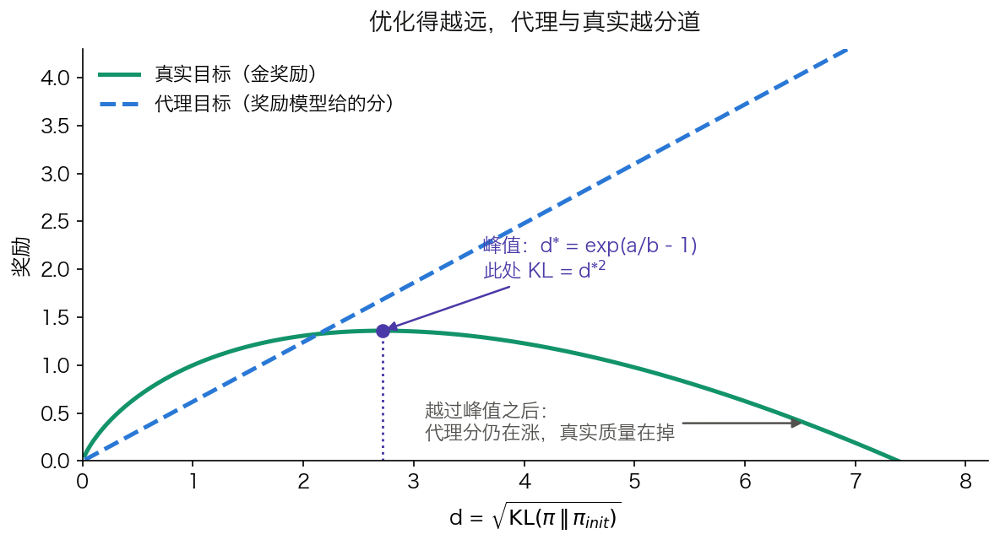

## 8.2 RLHF：为什么需要人类反馈参与训练

SFT 只能教模型模仿示范。开放性问题没有标准答案，示范也就无从写起。**基于人类反馈的强化学习**（Reinforcement Learning from Human Feedback，RLHF）换了一条路：不写答案，只让人比较两个回答谁更好，再把这份比较变成可优化的标量信号。本节把这条路径拆成可算的几步：奖励模型怎么训、逐词元奖励怎么拼、优势怎么估、裁剪目标怎么写、四个模型各占多少显存。

用人类比较训练奖励模型、再以带 KL 约束的强化学习优化语言模型，这条路线最早在风格续写任务上跑通（[Ziegler 等人 2019 年的工作](https://arxiv.org/abs/1909.08593)，策略直接从预训练模型出发）；[Stiennon 等人 2020 年](https://arxiv.org/abs/2009.01325)在摘要任务上先做 SFT 再训奖励模型、跑 PPO，已是完整的三步。[InstructGPT 论文](https://arxiv.org/abs/2203.02155)自述方法沿用这两篇，把它推广到通用的指令遵循上，也给出了这条路线最常被引用的结果：标注者更偏好经这套流程训出的 1.3B 模型的输出，而不是 175B GPT-3 的输出，两者参数量差了 100 倍以上。

### 8.2.1 SFT 的局限

SFT 依赖高质量的标准答案。对于“解释量子纠缠”或“写一首关于秋天的诗”这类开放性问题，不存在唯一正确的答案。不同的回答风格、详细程度、结构方式都可能是好的，而质量判断涉及难以量化的人类偏好。

RLHF 的核心思想是：既然好坏难以用规则定义，就让人类直接评判，再让模型学习那些被偏好的回答模式。比较比书写便宜得多，也一致得多：标注者不必想出一个好答案，只需要在两个已有答案之间选一个。

### 8.2.2 三阶段流程

RLHF 分三个阶段。第一阶段是 SFT，得到一个基本能对话的模型，它同时充当后两个阶段的起点与参照。第二阶段训练一个**奖励模型**（Reward Model，RM），把人类的成对比较拟合成一个标量函数。第三阶段用**近端策略优化**（Proximal Policy Optimization，PPO）以这个标量为奖励继续训练语言模型，并用 KL 惩罚把它拴在 SFT 模型附近。强化学习把被训练的语言模型称为**策略**。

**强化学习的最小词汇。** 强化学习（Reinforcement Learning，RL）处理的是没有标准答案可抄的训练：模型自己行动，事后得到一个分数，再据此调整。后文只用到下面几个词，每一个都能对应到语言模型上：

- **策略** $\pi_\theta$：给定当前处境、输出各个动作概率的函数。这里它是语言模型本身，$\pi_\theta(y_t\mid x, y_{<t})$ 是模型给下一个词元的概率分布，$\theta$ 是模型权重。
- **状态** $s_t$：提示词 $x$ 加已生成的前缀 $y_{<t}$。
- **动作**：从词表里选出下一个词元 $y_t$。让策略采样出一条完整回答称为一次 **rollout**。
- **奖励** $r_t$：第 $t$ 个词元得到的分数，怎样构造见下文“逐词元奖励”。
- **回报** $R_t$：从第 $t$ 步到回答结束的奖励之和，$R_t = \sum_{k\ge t} r_k$。
- **优势** $A_t$：这一步的回报比该状态下的预期高出多少。预期由**价值模型** $V(s_t)$ 估计，最简形式是 $A_t = R_t - V(s_t)$，估计方法见下文 GAE。

**策略梯度的直觉。** RL 的目标是让策略采样出的回答的期望回报最大。**策略梯度**的做法是：让模型自己采样回答，对每个被采到的词元，沿 $A_t\,\nabla_\theta\log\pi_\theta(y_t\mid s_t)$ 的方向更新权重。$\nabla_\theta\log\pi_\theta(y_t\mid s_t)$ 正是 SFT 把 $y_t$ 当标签时降低交叉熵的方向，沿它走一步，$y_t$ 的概率上升。策略梯度因此可以读成带权重的 SFT：标签是模型自己采样出的词元，权重是优势。$A_t > 0$ 时提高该词元的概率，$A_t < 0$ 时降低，$|A_t|$ 越大改动越大。

一个最小的数值例子。设词表只有 a、b 两个词元，两个 logits 都是 0 并直接当作参数，概率各为 0.5。采到 a，优势 $A = +2$。$\log\pi(\text{a})$ 对 logits 的梯度是独热标签减概率（[6.1.1 节](../06_training_techniques/6.1_loss_optimizer.md)），即 $[1 - 0.5,\ 0 - 0.5] = [0.5, -0.5]$。取学习率 0.1，logits 变为 $[0, 0] + 0.1 \times 2 \times [0.5, -0.5] = [0.1, -0.1]$，a 的概率从 0.5 升到 $e^{0.1}/(e^{0.1} + e^{-0.1}) = 0.550$。若优势是 $-2$，logits 变为 $[-0.1, 0.1]$，a 的概率降到 0.450。

这个梯度只对当前策略自己采出的样本成立。用当前策略的样本更新称为 **on-policy**；采样所用的权重与正在更新的权重不同，称为 **off-policy**，此时需要额外修正。PPO 的概率比与 8.2.3 的系统问题都与这一区分有关。

表 8-2 把三步并排列出。两处差别决定了后面的全部设计：第二步训练的是另一个模型，不是回答问题的策略；第三步的回答由策略自己生成，而不是来自人写的示范。

| 阶段 | 训练对象 | 数据 | 学习信号从哪来 | 学到什么 |
| --- | --- | --- | --- | --- |
| SFT | 策略模型，从预训练模型出发 | 提示 + 人写的示范回答 | 示范回答，逐词元交叉熵 | 按助手的角色与格式作答 |
| 奖励模型 | 另一个模型，末端换成标量头 | 提示 + 多个回答的人工排序，拆成成对比较 | 人的偏好 | 给回答打分，近似人的偏好 |
| PPO | 策略模型，从 SFT 模型出发 | 只有提示，回答由策略采样 | 奖励模型的分数，减去偏离 SFT 模型的 KL 惩罚 | 生成奖励更高的回答 |

表 8-2：RLHF 三个阶段的对照。[InstructGPT 论文](https://arxiv.org/abs/2203.02155)三个阶段的训练提示分别约 1.3 万、3.3 万、3.1 万条，第三阶段的提示只取自 API。后来的方法大多在这张表上改一格：[8.3 节](8.3_dpo.md)的 DPO 把后两步并成一步，直接用偏好对训练策略；8.2.4 节的 GRPO 去掉价值网络，可验证奖励则用规则代替奖励模型。

下面按这个顺序逐步展开，每一步都给出形状与一格算术。

#### 奖励模型：标量头、BT 损失与一格算术

**结构。** 奖励模型沿用语言模型的架构，只把 LM head 换掉。InstructGPT 的原话是：对奖励模型与价值函数，“原模型的反嵌入层被替换为一个输出标量的投影层”。形状上的区别只有最后一步：

- 语言模型：`x_T[1, d_model] × W_vocab[d_model, n_vocab] → logits[1, n_vocab]`
- 奖励模型：`x_T[1, d_model] × w_r[d_model, 1] → r[1, 1]`

取的是**最后一个位置**的隐状态，因为只有它读到了完整的提示词与回答。一次打分就是一次完整前向加一次向量点积，比生成一个回答便宜得多。

**损失。** 人给回答打绝对分数时标尺因人而异，比较两个回答则一致得多（8.2.1），所以奖励模型拟合的是比较结果，而不直接回归分数。它采用 **Bradley-Terry 模型**（下文简称 BT）：人类偏好 $y_w$ 胜过 $y_l$ 的概率由奖励差经 sigmoid 给出，

$$
P(y_w \succ y_l \mid x) = \sigma\big(r_\phi(x,y_w) - r_\phi(x,y_l)\big)
$$

其中 $r_\phi$ 是奖励模型，$\phi$ 是它的权重。标注数据里 $y_w$ 确实胜出，对这个概率做最大似然等价于最小化

$$
\mathcal{L}_{RM} = -\log\sigma\big(r_\phi(x,y_w) - r_\phi(x,y_l)\big)
$$

**一格算术。** 设某对回答上 $r_w = 1.2$、$r_l = 0.4$，差为 0.8。$\sigma(0.8) = 0.690$，损失 $-\ln 0.690 = 0.371$。若模型排反了，$r_w = 0.4$、$r_l = 1.2$，差为 −0.8，$\sigma(-0.8) = 0.310$，损失 $-\ln 0.310 = 1.171$。随机初始化时两个分数没有系统差异，奖励差的期望为 0，损失因此从 $\ln 2 = 0.693$ 起步。**0.693 是奖励模型损失曲线的起点**，看训练日志时可以直接对上；准确率的起点则是 50%。

损失只与奖励**差**有关，与绝对值无关。所以奖励模型的输出存在一个任意的整体平移。InstructGPT 的做法是在进入 RL 之前用一个偏置把标注者示范的平均分归零。

**排序数据怎样拆成对。** 标注者一次看 $K$ 个回答并排序，$K$ 在 4 到 9 之间。一次排序产生 $\binom{K}{2}$ 个成对比较：$K=4$ 是 6 对，$K=9$ 是 36 对。

拆对之后有一个陷阱。把所有对打散进数据集，一个回答会出现在 $K-1$ 个不同的梯度更新里，论文观察到奖励模型在一轮之内就过拟合。InstructGPT 的做法是把同一个提示的 $\binom{K}{2}$ 对放进同一个批次元素：$K$ 个回答各做一次前向，再在标量分数上两两组合，而不是做 $\binom{K}{2}$ 次前向。既省算力又不再过拟合。它的批大小 64 指的是提示数，因此一个批次最多含 $64 \times 36 = 2304$ 个比较。

**奖励模型的天花板。** 奖励模型学的是标注者的偏好，标注者之间本身并不完全一致。InstructGPT 把标注者分成五组做交叉验证：在训练所用的那几组标注者上，验证准确率是 72.4% ± 0.4%；换到留出的那一组，降到 69.6% ± 0.9%。跨组比组内低约 2.8 个百分点。这两个数说明**奖励模型的准确率上限由标注一致率决定**，追求更高的验证准确率很可能只是在拟合标注噪声。

InstructGPT 的奖励模型是 6B，而策略最大到 175B。论文给出的理由是 175B 的奖励模型训练不稳定，且作为价值函数初始化时开销过大。所以“奖励模型与策略同规模”并非通例，开源实现里常见，公开配方里未必。

#### 逐词元奖励：KL 惩罚 + 末位分数

奖励模型只在回答末尾给一个标量。强化学习需要的是每一步的奖励。二者之间要有一次构造：

$$
r_t = -\beta\Big[\log\pi_\theta(y_t\mid x, y_{<t}) - \log\pi_{ref}(y_t\mid x, y_{<t})\Big] + \mathbb{1}[t = T]\cdot r_\phi(x, y)
$$

其中 $\pi_{ref}$ 是**参考模型**，即冻结的 SFT 模型，$T$ 是回答的词元数。前一项是逐词元的 KL 惩罚，只要策略在某个位置比参考模型更自信，就在这一位扣分；方括号里的对数比对策略自己采样的词元取期望，就是该位置上的 $D_{KL}[\pi_\theta \| \pi_{ref}]$（KL 散度见 [5.1 节](../05_pretraining/5.1_autoregressive.md)），惩罚因此得名。后一项只在最后一个位置加上奖励模型的分数。InstructGPT 取 $\beta = 0.02$，并说明最优区间大约在 0.01 到 0.02 之间。

**一格算术。** 设一个 4 词元的回答，四位上的 $\log\pi_\theta - \log\pi_{ref}$ 分别是 0.5、2.0、−1.0、1.5，末位的奖励模型分数是 1.2。逐位乘 $-0.02$：

$$
r = [-0.010,\ -0.040,\ +0.020,\ -0.030 + 1.2] = [-0.010,\ -0.040,\ +0.020,\ +1.170]
$$

第三位的 $r_t$ 是正的，因为那一位策略比参考模型更**不**自信，KL 惩罚反号。这一点常被误写成“KL 惩罚总是负的”。

> [!NOTE]
> **进阶：KL 有两种放法。** 上面这种把它拼进奖励，是 InstructGPT 与多数 PPO 实现的做法；另一种是把 $D_{KL}[\pi_\theta \| \pi_{ref}]$ 直接加进损失，8.2.4 的 GRPO 用的是后者。两者的区别在于 KL 项会不会经过优势估计：放进奖励时它先进入 $r_t$、再被下一小节的 GAE 折算；放进损失时它绕开了优势计算，梯度路径更短。

#### GAE：把四个奖励折成四个优势

有了逐词元奖励，还需要回答“这一步比平均水平好多少”，即前面“强化学习的最小词汇”里的优势（Advantage）$A_t = R_t - V(s_t)$。其中的价值模型（Value Model，又称 Critic）与奖励模型结构相同，也是语言模型换上标量头，区别是它在每个位置都输出一个估值。

减去基线 $V(s_t)$ 是为了降方差。直接用绝对回报当梯度信号，容易的状态和困难的状态回报天差地别，梯度估计的方差极大。减去基线后，信号只剩“比预期更好还是更差”。

**GAE**（Generalized Advantage Estimation）在偏差与方差之间加了一个旋钮。公式里有三个新量，先用文字交代：

- $\delta_t$ 是价值模型的一步预测误差：这一步实得的奖励 $r_t$ 加上下一状态的估值，减去本状态的估值。$\delta_t > 0$ 表示这一步的结果好于价值模型的预期。
- $\gamma \in (0, 1]$ 是**折扣因子**：一步之后的奖励按 $\gamma$ 倍计入当前，$\gamma = 1$ 即不打折。
- $\lambda \in [0, 1]$ 控制往后看多远：优势取当前及之后各步预测误差的加权和，$l$ 步之后的误差权重是 $(\gamma\lambda)^l$。$\lambda$ 越小越只信眼前这一步的 $\delta_t$，$\lambda$ 越大越接近用整段实际回报。

$$
\delta_t = r_t + \gamma V(s_{t+1}) - V(s_t),\qquad
\hat{A}_t = \sum_{l\ge 0} (\gamma\lambda)^l\,\delta_{t+l}
$$

接着上面的例子。取 $\gamma = 1$（InstructGPT 明确说估计广义优势时不做折扣），价值模型给出的四个估值为 0.8、0.9、1.0、1.1，末状态之后为 0：

$$
\delta = [\,-0.010 + 0.9 - 0.8,\ \ -0.040 + 1.0 - 0.9,\ \ 0.020 + 1.1 - 1.0,\ \ 1.170 + 0 - 1.1\,] = [0.09,\ 0.06,\ 0.12,\ 0.07]
$$

倒序累加，取 $\lambda = 0.95$（Tülu 3 公开配方里的取值）：$\hat A_4 = 0.07$；$\hat A_3 = 0.12 + 0.95\times0.07 = 0.186$；$\hat A_2 = 0.06 + 0.95\times0.186 = 0.237$；$\hat A_1 = 0.09 + 0.95\times0.237 = 0.315$。

两个端点值得单独看。$\lambda = 1$ 时递推退化为 $\hat A_t = R_t - V(s_t)$：$R_1 = \sum r = 1.14$，$\hat A_1 = 1.14 - 0.8 = 0.34$，与逐项累加 $\delta$ 得到的 $0.09 + 0.06 + 0.12 + 0.07 = 0.34$ 一致。此时方差最大、偏差最小，因为完全依赖实际回报。$\lambda = 0$ 时 $\hat A_t = \delta_t = [0.09, 0.06, 0.12, 0.07]$，完全依赖价值模型的一步预测，偏差最大、方差最小。$\lambda = 0.95$ 落在两者之间。

#### 裁剪目标：四种情形

策略梯度一步迈得太大，策略会走到采样数据不再能代表的区域，训练随之失控，所以每次更新的幅度需要限制。PPO 的前身 TRPO（Trust Region Policy Optimization）用一个硬性的 KL 信赖域约束限制每次更新的步长。理论上优雅，代价是每步都要解一个二阶问题，对参数量上百亿的语言模型，这个开销不可接受。

> [!NOTE]
> **进阶：TRPO 的开销从哪来。** 每步都要解一个含 Fisher 信息矩阵的线性方程；实现上用共轭梯度配合 Fisher-向量积近似求解，不显式构造也不求逆，但仍需要反复的二阶向量积。

PPO 把硬约束换成一个只用一阶梯度的裁剪目标。目标里有两个新记号。$\theta_{old}$ 是采样这批回答时的权重，采样后固定不变；$\theta$ 是正在更新的权重。比率 $\rho_t$ 是当前策略给已采词元 $y_t$ 的概率与采样时概率之比，刚采完样时 $\rho_t = 1$，更新几步之后，$\rho_t > 1$ 表示这个词元的概率已被提高。下面的式子要**最大化**；实现成最小化的 loss 时取负号：

$$
\max_\theta \; \mathbb{E}_t \left[\min\left(\rho_t A_t, \; \mathrm{clip}(\rho_t, 1-\epsilon, 1+\epsilon)\, A_t\right)\right],
\qquad \rho_t = \frac{\pi_\theta(y_t\mid\cdot)}{\pi_{\theta_{old}}(y_t\mid\cdot)}
$$

先看未裁剪项 $\rho_t A_t$。它对 $\theta$ 的梯度是 $\rho_t A_t\,\nabla_\theta\log\pi_\theta(y_t\mid\cdot)$，在 $\rho_t = 1$ 处就是前面的策略梯度：优势为正则提高该词元的概率，为负则降低。用比率而不直接用 $\log\pi_\theta$，是为了让同一批回答能走多个小批：权重更新几步之后，这批回答已不是当前策略采出的，乘上 $\rho_t$ 就是对这一偏移的修正。裁剪项限制的是这一修正能走多远：$\mathrm{clip}$ 把 $\rho_t$ 截到区间 $[1-\epsilon,\ 1+\epsilon]$ 之内。

$\epsilon$ 通常取 0.2。这个 min 的行为不对称，四种情形各算一遍就清楚了（表 8-3）。

| 情形 | 比率 $\rho_t$ | 优势 $A_t$ | 未裁剪项 | 裁剪项 | min 取到 | 梯度 |
| --- | ---: | ---: | ---: | ---: | --- | --- |
| 正优势、更新过头 | 1.3 | +2 | 2.6 | 2.4 | 裁剪项 | 为零 |
| 正优势、更新不足 | 0.7 | +2 | 1.4 | 1.6 | 未裁剪项 | 保留 |
| 负优势、更新过头 | 0.7 | −2 | −1.4 | −1.6 | 裁剪项 | 为零 |
| 负优势、更新不足 | 1.3 | −2 | −2.6 | −2.4 | 未裁剪项 | 保留 |

表 8-3：$\epsilon = 0.2$ 时裁剪目标的四种情形。裁剪项里的 $\mathrm{clip}(\rho_t,\,0.8,\,1.2)$ 取到边界时是常数，对 $\theta$ 的梯度为零。

规律是：沿着优势方向越界时梯度被切断，反方向越界时梯度保留。第二、四两行都是“策略还没走到位”，此时不该限制它；第一、三两行是“这一步已经迈得太大”，梯度置零使它停在边界上。反方向仍能回修，这一条保证了策略不会被卡在错误的位置上。

#### 一轮迭代：四个模型谁读谁写

把上面几步串起来，一轮 PPO 迭代的顺序是固定的。图 8-2 画出四个模型各自的角色。

图 8-2：一轮 PPO 迭代里四个模型谁读谁写（[生成脚本](https://github.com/yeasy/llm_internals/blob/main/tools/figures/ch08_ppo_iteration.py)）。橙色是被更新的权重，灰色是冻结权重，蓝色是数据，青绿色是本轮新算出的量。

逐步复述一遍：

1. 把策略权重同步给推理引擎，对一批提示词各采样一个回答。
2. 参考模型对这些回答算每个位置的对数概率，只读不更新。
3. 奖励模型对每条回答的最后一个位置给一个标量，只读不更新。
4. 价值模型对每个位置给一个估值，它既参与计算也被更新。
5. 按上面的公式拼出 $r_t$，再用 GAE 算出 $\hat A_t$ 与回报 $R_t$。
6. 同一批 rollout 数据重复走几个小批：算比率、裁剪、反传，同时更新策略与价值。策略用裁剪目标；价值模型做回归，[PPO 论文](https://arxiv.org/abs/1707.06347)用平方误差让 $V(s_t)$ 逼近回报 $R_t$。

InstructGPT 的具体取值是批大小 512、小批 64，即每批切成 8 个小批，每批只训一个内轮。回到第 1 步时权重已经变了，所以需要重新同步。

#### 四个模型的显存账

“流程复杂”是一句定性的话，算一笔账就具体了。沿用 [7.1 节](../07_distributed_training/7.1_data_parallel.md)的口径：混合精度 Adam 训练下每个参数占 16 字节；只做前向的模型按 BF16 的 2 字节算。以 7B 为例（表 8-4）。

| 方法 | 被训练的模型 | 只做前向的模型 | 合计 |
| --- | --- | --- | ---: |
| SFT | 策略 112 GB | 无 | 112 GB |
| DPO | 策略 112 GB | 参考 14 GB | 126 GB |
| GRPO 式 RL | 策略 112 GB | 参考 14 GB + 奖励 14 GB | 140 GB |
| PPO 式 RLHF | 策略 112 GB + 价值 112 GB | 参考 14 GB + 奖励 14 GB | 252 GB |

表 8-4：7B 模型上四种后训练方法的模型状态显存，按每参数 16 字节（训练）与 2 字节（推理）算出，不含激活与 rollout 阶段的 KV 缓存。$112 = 7\times10^9 \times 16 / 10^9$，$14 = 7\times10^9 \times 2 / 10^9$。

这张表把后面两节的动机都摆在了一处。PPO 式 RLHF 比 SFT 多出 140 GB，其中 112 GB 来自价值模型。**GRPO 去掉价值网络，省下的正是这 112 GB**；DPO 连奖励模型一起去掉，只留策略与参考。表里还漏掉了一笔：PPO 的 rollout 阶段要在推理引擎里再放一份策略权重与 KV 缓存，实际峰值高于 252 GB。

价值模型的规模也并非只有“与策略同规模”一种选择。InstructGPT 的策略最大 175B，价值函数固定为 6B，并由奖励模型初始化。开源 RLHF 框架多让价值模型与策略同规模，这是实现选择，不是算法要求。

### 8.2.3 RLHF 的挑战

RLHF 有效，但在实践中面临多重挑战。前三条在算法与数据层面，后三条在系统层面，而且都常被误诊为算法问题。系统层面的三条先给结论，细节放在本小节末的进阶部分。

**复杂的训练流水线**：需要同时管理四个模型，显存账见表 8-4，此外还要维护训练与推理两套多卡并行方案。

**奖励模型的偏差与过度优化**：奖励模型是真实目标的代理，优化得越狠，代理与真实越分道。

[Gao 等人的研究](https://arxiv.org/abs/2210.10760)用一个“金奖励模型”当作真值、另一个更小的模型当作代理，让策略只优化代理、再用金奖励模型评分，测出了这个分道的函数形状。把策略与初始策略的距离记作 $d = \sqrt{D_{KL}(\pi \| \pi_{init})}$，真实奖励随 $d$ 的变化拟合为：

$$
R_{\mathrm{RL}}(d) = d\,(\alpha_{\mathrm{RL}} - \beta_{\mathrm{RL}}\log d),
\qquad
R_{\mathrm{bo}n}(d) = d\,(\alpha_{\mathrm{bo}n} - \beta_{\mathrm{bo}n} d)
$$

两式分别对应 RL 优化与 best-of-$n$ 采样（采 $n$ 个回答、取代理奖励最高的一个）；$\alpha$、$\beta$ 是拟合系数，这里的 $\beta$ 与 KL 系数无关。图 8-3 画出它的形状：代理分数大致随 $d$ 单调上升，真实奖励先升后降。读图只需比较两条曲线：越过真实奖励的峰值之后，代理分数继续上涨已不代表回答变好。

图 8-3：优化得越远，代理与真实越分道（[生成脚本](https://github.com/yeasy/llm_internals/blob/main/tools/figures/ch08_reward_overopt.py)）。曲线用论文给出的函数形式画出形状，$\alpha$、$\beta$ 取教学值；论文的拟合系数随奖励模型规模平滑变化，不是常数。

这个形式有三条可用的推论。第一，峰值位置可以求出来：对 $R_{\mathrm{RL}}$ 求导得 $\alpha_{\mathrm{RL}} - \beta_{\mathrm{RL}}\log d - \beta_{\mathrm{RL}}$，令其为零得 $d^* = \exp(\alpha/\beta - 1)$，对应的 KL 预算是 $d^{*2}$。第二，横轴是 $\sqrt{\mathrm{KL}}$ 而不是训练步数，所以**该监控的是 KL 而不是步数**：同样的步数在不同学习率下走出的距离完全不同。第三，论文报告 $\alpha$、$\beta$ 随奖励模型参数量平滑变化，其中 $\alpha_{\mathrm{RL}}$ 几乎与奖励模型规模无关，于是可以用小规模实验外推峰值。

**训练不稳定性**：PPO 的超参数调优困难，训练过程中容易出现奖励崩塌（平均奖励突然大幅下跌且不再恢复）或模式坍塌（策略对不同提示都给出相近的少数几种回答）。

**系统层面的三条**，第一遍阅读记住结论即可：

- **训练—推理失配**（Training–Inference Mismatch，TIM）：rollout 由推理引擎生成，梯度由训练框架计算。两套引擎对同一份权重、同一个输入算出的词元概率可能有细微差别；一项诊断研究的结论是，这种差别足以独立引发训练崩溃。
- **权重同步**：每轮更新后，新权重要从训练侧传给推理侧，而两侧的多卡切分方式通常不同，传一次就要重新切分一次。
- **陈旧度**：为了提高吞吐，推理侧可以用稍旧的权重持续采样。采样用的权重越旧，离 on-policy 越远，需要的修正越多。

**进阶：系统侧三条挑战的细节。** 以下各段依次展开上面三条，跳过不影响后文。

**训练与推理的实现失配**：现代 LLM RL 系统把两件事拆给了两套不同的引擎：rollout 生成交给推理引擎（vLLM、SGLang 等），梯度计算交给分布式训练框架（FSDP、Megatron 等）。理论上，同一份权重、同一个输入，两边应当给出完全一致的词元概率；但由于模型实现与算子（kernel）实现存在差异，实际并不总是如此。这一现象就是训练—推理失配（TIM）。

失配的形态很不直观：绝大多数位置上两边的对数概率是逐比特接近的，问题出在极少数位置上 **argmax 被翻转**，即两个引擎对“下一个词元最可能是哪个”给出了不同答案。ByteDance 与弗吉尼亚大学的一项诊断研究构造了零失配的对照基线，记作 VeXact，在 FSDP 训练引擎上做到与 rollout 逐比特对齐。有了这条基线，TIM 才能从其他因素里被单独隔离出来。结论是：这类微小的词元级数值分歧足以独立引发训练崩溃，它不是良性的数值噪声，应当被当作系统级扰动对待（见[附录 A.4](../appendix/a4_references.md) 参考文献）。

它难以排查，正是因为它和 off-policy 漂移（采样所用的权重与正在更新的权重不同，见 8.2.2）、以及各种稳定化机制纠缠在一起。同一个技巧既可能在纠正 PPO 小步更新带来的 off-policy 偏移，也可能在压制 TIM 引入的数值离群点，还可能额外引入优化偏差。工程上的两条应对路径：算法侧用截断重要性采样（TIS，给概率比设上限）、拒绝采样等手段抑制离群更新；系统侧则要求推理与训练使用确定性的、**批次不变**（batch-invariant）的算子实现。对 MoE 模型还需要批次不变的 fused MoE 算子，因为路由本身就对数值扰动敏感（MoE 结构见 [14.2 节](../14_future_trends/14.2_moe.md)）。

> 上述结论来自单篇诊断研究，实验规模有限（Qwen3-8B 量级的 BF16 权重），不宜外推成“所有 RL 训练不稳定都源于 TIM”。排查 RL 崩溃时，除了超参和奖励设计，还应把训练与推理两侧的对数概率直接比对一遍。这项检查代价低，却容易被跳过。

**权重同步：同一个模型的两种切法**。TIM 讲的是两侧算出来的数值不一致，而在此之前还有一个更基础的问题：每完成一轮更新，训练侧的新权重必须传给推理侧，而两侧几乎必然用着不同的并行策略（指模型在多卡上的切分方式，与 RL 的“策略”无关）。训练侧要塞下优化器状态，倾向 FSDP/ZeRO 或大流水线；推理侧只有前向，倾向张量并行加大批。[HybridFlow（verl 的论文）把这件事定义得很清楚](https://arxiv.org/abs/2409.19256)：RLHF 数据流里不同节点通常采用不同的并行策略，节点之间的边代表**数据重分片**（resharding），而且往往是多对多的多播。它为此设计了 3D-HybridEngine，在训练与生成两个阶段之间做 actor 模型的重分片，目标是零显存冗余并显著降低通信开销。论文报告的整体吞吐提升是 1.53× 到 20.57×。

工程上因此分出两条路线。**共置**（colocate）让训练与推理共享同一批 GPU、分时切换角色，省下整机资源，代价是每次切换都要重分片，且两边的显存峰值要挤在同一张卡上。**分离**（disaggregate）让两套集群各自常驻，不必反复切换，各自的并行策略可以独立最优，代价是权重要跨集群传输。分离还必须回答一个问题：推理侧允许落后训练侧多少步。这个上限就是**陈旧度**（staleness）。

**异步 rollout 与陈旧度**。同步 RL 的时间线上有一个显眼的浪费：一个批次里最慢的那条长思维链（模型先写出很长的推理过程再给答案）没生成完，整批就无法进入训练，而长思维链的长度分布本身就是重尾的。异步方案让 rollout 与训练重叠：推理侧持续用稍旧的权重生成，训练侧不等齐就开始更新。代价是采样分布与当前策略之间出现了偏移，**允许的陈旧度越大，吞吐越高，而算法上离 on-policy 越远**，需要用重要性采样修正等手段把偏移拉回来。这也把话题接回了上文：一旦引入 off-policy 修正，TIM 就更难与它区分开，两者都表现为“两侧概率对不上”，而处理方式并不相同。

### 8.2.4 长思维链 RL 的典型病理与干预

8.2.3 的六条挑战描述的是哪里会出问题。**长思维链**是指模型在给出答案之前先写出很长的推理过程，这类回答可长达上万词元（[14.6 节](../14_future_trends/14.6_test_time_scaling.md)展开）。当 RL 被用来训练这种推理能力之后，上述问题呈现出几种有名字、有对策的固定形态。

#### 先换一件事：奖励从哪里来

进入具体病理之前要先划清一条界线。推理任务的对错往往可以由程序判定，不必再训练一个模型去近似人的偏好。本小节讨论的训练里，**奖励不再来自奖励模型，而来自可自动验证的规则**：数学题是否算对、代码是否通过单元测试、格式是否合规。这条路线通常称作**可验证奖励的强化学习**（Reinforcement Learning with Verifiable Rewards，RLVR）。

与 8.2.2 的三阶段相比，换掉的只有一件事：奖励来源。算法骨架没变，仍然是采样、算优势、裁剪、更新。变化带来三个直接后果。不再需要训练奖励模型，也就没有了 8.2.3 那条“奖励模型被攻击”的路径。奖励是稀疏的 0/1，信息量远低于连续分数。验证器本身可能有漏洞，**奖励黑客**（reward hacking，策略钻评分者的漏洞拿到高分，却没有把任务做对）从攻击模型变成了攻击测试用例。

**规则判不了对错时：把评分细则当奖励。** 医疗建议、科学问题的开放式解答没有可以逐字比对的标准答案，0/1 规则写不出来。退回奖励模型要重新收集大量成对比较，奖励模型还容易拟合回答长度、格式这类表面特征。[Rubrics as Rewards](https://arxiv.org/abs/2507.17746)（RaR）在规则与偏好之间取了一条中间路线。**评分细则**（rubric）是指针对单个提示写出的一组检查项，每项只判一件事，回答满足记 1，不满足记 0。设提示 $x$ 有 $k$ 个检查项，第 $j$ 项的权重为 $w_j$，判定结果为 $c_j \in \{0, 1\}$，奖励取加权命中率：

$$
r(x, y) = \frac{\sum_{j=1}^{k} w_j\,c_j(x, y)}{\sum_{j=1}^{k} w_j}
$$

$k = 1$、$w_1 = 1$ 且 $c_1$ 是答案比对时，上式退化为 RLVR 的 0/1 奖励。论文让一个较强的 LLM 参照参考答案，为每个提示生成 7 到 20 个检查项，各标为必需、重要、可选、陷阱四类之一，加权时依次取 1.0、0.7、0.3、0.9。陷阱项用正面表述（如“回答未包含某种错误说法”），满足同样得分。每个检查项由判官模型单独判定，得到的 $r$ 代入下文 GRPO 的组内优势，训练流程不变。论文把这种逐项判定再加权的做法称为显式聚合；另一种隐式聚合把整份细则连同回答交给判官，由它给出 1 到 10 的总分，再归一化到 $[0, 1]$。

取 5 个检查项手算一遍：必需 2 项、重要 1 项、可选 1 项、陷阱 1 项，权重和为 $1.0 + 1.0 + 0.7 + 0.3 + 0.9 = 3.9$。回答满足两个必需项、可选项与陷阱项，漏掉重要项，$r = 3.2 / 3.9 = 0.821$；漏掉的若是一个必需项，$r = 2.9 / 3.9 = 0.744$。奖励从 0/1 变成分级的数值，同一组回答之间有了更细的区分。

论文以 Qwen2.5-7B 为策略、gpt-4o-mini 为判官，用 GRPO 训练。隐式聚合的结果最好：对照基线是不给细则、让判官直接给整条回答打 1 到 10 分，隐式聚合相对它在 HealthBench 上的提升最高为 31%，在 GPQA-Diamond 上为 7%，均为相对值；显式聚合更可控，但固定权重需要调，论文称其较脆弱。代价与风险有三处：

- **判定开销。** 论文每个提示采样 16 条回答，显式聚合下一个提示要判 $16 \times 7 = 112$ 到 $16 \times 20 = 320$ 个检查项，隐式聚合是 16 次打分，都远高于执行一条规则。
- **细则质量依赖参考答案。** 在 HealthBench 的 1,000 题子集上，参照参考答案生成的细则训出的策略得分为 35.9%，不给参考答案时为 32.0%（论文表 1）。没有专家答案可依的任务，这条路线的收益要打折扣。
- **评分者又成了模型。** 判官可以被钻空子，上面那条已被 RLVR 去掉的攻击路径重新出现。[MiniMax-M1 的技术报告](https://arxiv.org/abs/2506.13585)在用生成式奖励模型给通用任务打分时观察到，评分模型偏好更长的输出而不论推理质量，需要在训练中持续监控长度并重新校准评分模型。

论文的实验只覆盖医学与科学两个领域，对话、工具调用等任务上尚无验证。

#### GRPO：用组内相对分数替掉价值网络

**GRPO**（Group Relative Policy Optimization）由 [DeepSeekMath 论文](https://arxiv.org/abs/2402.03300)提出，出发点正是表 8-4 里那 112 GB：价值模型与策略同规模，显存与算力开销都很重，而在 LLM 场景里奖励通常只在最后一个词元给出，训练一个每位都准确的价值函数本就困难。

GRPO 的替代方案是对同一个问题采样一组回答，用组内的相对得分当基线：

$$
A_i = \frac{r_i - \mathrm{mean}(\{r_1,\dots,r_G\})}{\mathrm{std}(\{r_1,\dots,r_G\})}
$$

$$
\mathcal{J}_{\mathrm{GRPO}}(\theta) = \mathbb{E}\left[\frac{1}{G}\sum_{i=1}^{G}\frac{1}{|o_i|}\sum_{t=1}^{|o_i|}\Big(\min\big(\rho_{i,t} A_i,\ \mathrm{clip}(\rho_{i,t}, 1-\epsilon, 1+\epsilon) A_i\big) - \beta D_{\mathrm{KL}}[\pi_\theta \| \pi_{\mathrm{ref}}]\Big)\right]
$$

其中 $G$ 是同题采样回答数，$o_i$ 是第 $i$ 条回答，$|o_i|$ 是它的词元数，$r_i$ 是它的总奖励，$\rho_{i,t}$ 是新旧策略在第 $i$ 条回答第 $t$ 个词元上的概率比。第一式用组内均值代替价值模型充当基线，高于组内平均的回答优势为正。第二式的 min 项就是 8.2.2 的裁剪目标，外面多了两层平均：先在一条回答内按词元平均，再在组内按回答平均。结果监督（只在整条回答结束后给一个奖励）下同一条回答里所有词元共用一个 $A_i$。KL 项直接加在损失里而不是拼进奖励，论文用的是一个恒正的无偏估计式 $\frac{\pi_{ref}}{\pi_\theta} - \log\frac{\pi_{ref}}{\pi_\theta} - 1$。

这一项并非必备。DAPO 论文的 2.3 节直接删掉了它。理由是 KL 惩罚的用途在于不让模型偏离初始模型太远，而训练长思维链推理时，模型的分布本来就要显著偏离初始模型。表 8-5 的 DAPO 一列因此在 KL 系数上标为不适用。

**一格算术。** 取 $G = 4$。奖励为 $[1, 0, 0, 1]$ 时，均值 0.5、标准差 0.5，优势为 $[+1, -1, -1, +1]$。奖励为 $[1, 1, 1, 0]$ 时，均值 0.75、标准差 0.433，优势为 $[+0.577, +0.577, +0.577, -1.732]$：唯一那条错误回答被压得很重。

**零方差的情形。** 若这些数是每条回答的**总奖励**，且整组为 $[1,1,1,1]$ 或 $[0,0,0,0]$，标准差就是 0。上式直接代入会出现 0/0，实现须在分母加小量或显式处理零方差；处理后优势整组为零，奖励驱动的策略梯度消失。不过 [R1 原目标函数](https://arxiv.org/html/2501.12948v1#S2.SS2.SSS1)还有独立的 KL 正则项，KL 梯度仍可能非零，不能据此断言总梯度为零。

这两个式子是下面几条病理的共同来源：分母 $|o_i|$ 是长度偏差的来源，分母 $\mathrm{std}$ 是难度偏差的来源，标准差为零则使组内奖励无法提供相对优劣信号。

#### 四种病理

**熵坍缩（entropy collapse）**。策略的输出熵单调下降，采样越来越集中，探索随之消失，reward 曲线过早走平。DAPO 论文报告的正是这个形态：以 Qwen2.5-32B 做 RL 时，[朴素 GRPO 基线在 AIME 上只拿到 30 分（DeepSeek 的 RL 是 47 分），分析发现基线存在熵坍缩、奖励噪声和训练不稳定等问题](https://arxiv.org/abs/2503.14476)。它给出的对策叫 **clip-higher**：把重要性比值（即概率比 $\rho_{i,t}$）的裁剪上界与下界解耦、单独调高上界，给“原本概率低但这次表现好”的词元留出被提升的空间。

这条对策可以用表 8-3 的算术直接验算。论文举的例子是：$\epsilon = 0.2$、$A_{i,t} > 0$ 时，旧概率 0.01 的词元上界只能升到 0.012，而旧概率 0.9 的词元上界是 1.08。**低概率词元被同一个相对上界压得更死**，而它们正是探索的来源。DAPO 的取值是 $\epsilon_{\text{low}} = 0.2$、$\epsilon_{\text{high}} = 0.28$。

**一整组样本缺少奖励驱动的梯度**。组内总奖励相同时，防零处理后的优势为零；只有在没有 KL 等额外损失项时，才能进一步说整组梯度为零。若奖励只含二元正确性，全对或全错就是这种情况；若还含格式奖励等分量，须检查总奖励，不能只看正确率。模型变强后，同奖励组可能越来越多，使每个批次里提供相对优劣信号的提示减少。已删除 KL 项的 DAPO 用 **dynamic sampling** 应对：过采样并丢弃准确率为 1 和 0 的提示，一直采到批次被有效样本填满为止，代价是每批的采样开销变成动态的。

**响应长度爆炸而 reward 不涨**。这个形态最容易被误读成“模型学会了深思”。Dr. GRPO 论文指出它其实源于目标函数里的**优化偏差**：[GRPO 引入了两个偏差](https://arxiv.org/abs/2503.20783)。

- **响应级长度偏差**：来自除以 $|o_i|$。优势为正（回答正确）时，越短的回答获得越大的梯度更新，策略因而偏好简短的正确答案；优势为负（回答错误）时，越长的回答因为 $|o_i|$ 更大而被惩罚得越轻，策略于是偏好冗长的错误答案。两个方向合起来，正是“答错的越写越长”。
- **问题级难度偏差**：来自把中心化后的奖励除以组内标准差。标准差小的问题（太简单或太难、奖励几乎全 1 或全 0）在更新中被赋予了更高的权重。优势归一化本身是 RL 的常规技巧，但它通常在整个批次上计算；按问题归一化会让不同问题在目标函数里权重不一。

长度偏差可以给一格：同为正确回答，100 词元那条的每词元权重是 1/100，1000 词元那条是 1/1000，**相差 10 倍**。这与 8.1.4 讲 SFT 损失归一化时的分母是同一个问题。

该论文同时发现，许多开源 PPO 实现同样按响应长度归一化损失，这个偏差在 GRPO 发表之前就已存在。

两篇论文的修法角度不同。DAPO 的 **token-level policy gradient loss** 针对的是加权粒度：原始 GRPO 先在样本内按词元求平均、再跨样本聚合，等于每个样本等权，于是长回答里的每个词元对总损失的贡献被摊薄。按 DAPO 的分析，这既妨碍模型从高质量长样本里学到推理模式，也让过长样本中的问题模式得不到足够抑制。改成词元级之后，权重按词元而非按样本分配。Dr. GRPO 则更彻底，直接把分母换成一个全局常量（训练期间固定的最大生成长度），从源头消掉“分母随样本变化”这件事。两者的共同要点是：**不要让每个词元的权重取决于它恰好落在哪条回答里**。

**奖励噪声与过长截断**。超出最大生成长度而被截断的样本，其奖励并不反映回答质量，却照样进入梯度。DAPO 的第四项技术 **overlong reward shaping** 就是为此，论文的说法是它降低奖励噪声、稳定训练。具体做法在超参里看得见：期望最大长度设为 16,384 词元，另留 4,096 词元作软惩罚缓冲区，生成上限因此是 20,480 词元。四项技术合起来，把同一个 Qwen2.5-32B 从 30 分推到 AIME 2024 上的 50 分，并且只用了 DeepSeek-R1-Zero-Qwen-32B（47 分）一半的训练步数。

**GSPO：把概率比从词元级换到序列级。** 上面四种对策都保留了 GRPO 目标里的词元级概率比 $\rho_{i,t}$。**GSPO**（Group Sequence Policy Optimization）改的是这个比率本身。[GSPO 论文](https://arxiv.org/abs/2507.18071)的论证有两层。第一层与架构无关：$\rho_{i,t}$ 在每个位置只由一个采样词元算出，起不到重要性采样应有的分布修正作用，带进梯度的是高方差的噪声，并随回答长度累积。第二层针对 MoE 模型（[14.2 节](../14_future_trends/14.2_moe.md)）：权重更新之后，路由器可能把同一个词元送进另一组专家，该词元的概率改由另一条子网络算出。论文在 48 层的 Qwen3-30B-A3B-Base 上测到，每次梯度更新后，同一条 rollout 样本上约有 10% 的激活专家发生变化，$\rho_{i,t}$ 随之剧烈波动。此前的补救办法是路由重放（Routing Replay）：缓存旧策略激活的专家，计算 $\rho_{i,t}$ 时让新策略沿用同一套路由，代价是额外的显存与通信开销。

GSPO 的出发点是奖励发给整条回答，离策略修正也应以整条回答为单位。它定义序列级比率 $\bar\rho_i$，裁剪也作用在 $\bar\rho_i$ 上（论文原记作 $s_i$，这里换记号以区别于 8.2.2 的状态 $s_t$）：

$$
\bar\rho_i = \left(\frac{\pi_\theta(o_i\mid x)}{\pi_{\theta_{old}}(o_i\mid x)}\right)^{1/|o_i|} = \exp\left(\frac{1}{|o_i|}\sum_{t=1}^{|o_i|}\log\rho_{i,t}\right)
$$

$$
\mathcal{J}_{\mathrm{GSPO}}(\theta) = \mathbb{E}\left[\frac{1}{G}\sum_{i=1}^{G}\min\big(\bar\rho_i A_i,\ \mathrm{clip}(\bar\rho_i, 1-\epsilon, 1+\epsilon)\,A_i\big)\right]
$$

其中 $\pi_\theta(o_i\mid x)$ 是整条回答的似然，即各词元概率的连乘；$A_i$ 仍是 GRPO 的组内优势；论文为简洁省略了 KL 项。第一式说明 $\bar\rho_i$ 是各词元比率 $\rho_{i,t}$ 的几何平均。开 $|o_i|$ 次方是长度归一化：不做这一步，少数词元的概率变化就会让序列级比率大幅波动，不同长度的回答也需要不同的裁剪范围。对 $\theta$ 求导并略去裁剪，一条回答内每个词元的 $\nabla_\theta\log\pi_\theta$ 都乘同一个权重 $\bar\rho_i A_i / |o_i|$；GRPO 里这个权重是 $\rho_{i,t} A_i / |o_i|$，逐词元不同。

**一格算术。** 设一条 4 词元的回答优势为正，四个位置的 $\rho_{i,t}$ 为 1.01、0.99、1.50、0.667，后两位因路由切换而大幅偏离 1。GRPO 取 $\epsilon = 0.2$：第三位超过 1.2，被裁剪，梯度为零；第四位低于 0.8 而优势为正，属于表 8-3 的“更新不足”，梯度保留。四个词元上的权重是 $[1.01,\ 0.99,\ 0,\ 0.667]$。GSPO 先连乘，$1.01 \times 0.99 \times 1.50 \times 0.667 = 1.0004$，再开四次方得 $\bar\rho_i = 1.0001$，四个词元共用这一个权重。整条回答的似然只变了万分之四，词元级比率却在 0.667 到 1.50 之间摆动。

**量级与边界。** $\bar\rho_i$ 是几何平均，偏离 1 的幅度远小于单个 $\rho_{i,t}$，裁剪范围要相应缩小几个数量级。论文实验里 GSPO 的裁剪下界与上界取 $3\times10^{-4}$ 与 $4\times10^{-4}$，对照的 GRPO 取 0.2 与 0.27。折算到一条 1,000 词元的回答，这相当于把整条回答的似然比限制在 $0.9997^{1000} = 0.74$ 到 $1.0004^{1000} = 1.49$ 之间。裁剪以整条回答为单位，沿优势方向越界时，回答里的全部词元一起失去梯度。论文观察到 GSPO 被裁掉的词元比例比 GRPO 高两个数量级，训练效率仍然更高，MoE 上也不再需要路由重放。这些结果出自该论文在 Qwen3-30B-A3B-Base 上的实验，裁剪范围换到别的模型与任务上要重调。需要给同一条回答的不同词元分配不同优势时（如多轮 RL），论文另给出 GSPO-token 变体，各词元优势相同时它与 GSPO 数值等价。

**CISPO** 处理的是 $\rho_{i,t}$ 的另一个问题（[MiniMax-M1 技术报告](https://arxiv.org/abs/2506.13585)）。表 8-3 的裁剪把沿优势方向越界的词元梯度置零，而 However、Wait 这类标志推理转折的词元原本概率低，一次更新后比率就偏高，在同一批数据的后续更新里被裁掉。CISPO 把目标改写成 $\mathrm{sg}\big[\mathrm{clip}(\rho_{i,t},\ 1-\epsilon_{low},\ 1+\epsilon_{high})\big]\,A_i\log\pi_\theta(y_{i,t}\mid\cdot)$ 的词元平均，$\mathrm{sg}$ 表示停止梯度：被截断的只是权重的数值，梯度经由 $\log\pi_\theta$ 一项回传，所有词元都保留梯度，代价是梯度估计略有偏差。

回到四种病理，把它们串成一条排查顺序。**先看熵**：坍缩了就查裁剪上界。**再看有效样本比例**：组内总奖励无差异的比例高时，评估动态采样。**再看长度与 reward 的联合走势**：长度涨而 reward 不涨，先怀疑损失归一化，而不是模型学会了思考。**最后才怀疑数值**，即 8.2.3 那条训练—推理失配，把两侧对数概率直接比一遍。

> 上面的数字都来自各自论文在特定模型与数据上的实验，不是普适常数。可迁移的是**形态与因果**：熵坍缩对应探索不足、零优势组对应组内总奖励无差异、长度爆炸对应归一化分母不是常量。具体阈值和收益必须在自己的任务上重测。

### 8.2.5 对到实现：几组公开超参数

RL 后训练的超参数多，框架里的参数名又随版本变动。表 8-5 只列三份论文自己写明的取值，它们跨越三年、三种奖励来源，量级却相当稳定。

| 超参数 | InstructGPT（PPO，RM 奖励） | DAPO（GRPO 式，规则奖励） | Tülu 3（PPO，RLVR） |
| --- | --- | --- | --- |
| 裁剪 $\epsilon$ | 0.2 | 下界 0.2 / 上界 0.28 | 0.2 |
| KL 系数 $\beta$ | 0.02（拼进奖励） | 不适用（论文 2.3 节删除了 KL 项） | 扫过 0.01 到 0.1 |
| 折扣 $\gamma$ | 1（不折扣） | 不适用（无价值网络） | 1.0 |
| GAE $\lambda$ | 未列出 | 不适用 | 0.95 |
| rollout 批大小 | 512 个提示 | 512 个提示 × 16 个回答 | 有效批 224 |
| 一次 rollout 切成几个小批 | 8（小批 64） | 16（小批 512） | 1 |
| 每批内轮数 | 1 | — | 1（RM 奖励）/ 4（RLVR） |
| 生成长度上限 | 1k 词元 | 20,480 词元（含 4,096 软惩罚区） | 1,024 到 2,048 词元 |

表 8-5：三份公开 RL 后训练配方。InstructGPT 一列取自其附录 C.4；DAPO 一列取自[该论文](https://arxiv.org/abs/2503.14476)的实验设置段；Tülu 3 一列取自[该论文](https://arxiv.org/abs/2411.15124)的表 21。“未列出”表示论文未在对应位置给出数值，不表示该项不存在。

三条跨配方成立的判读：裁剪下界始终是 0.2，被改动的只有上界；语言模型的 RL 一律不做折扣（$\gamma = 1$），因为回答长度有限且奖励在末尾；生成长度上限随任务从 1k 涨到 20k，这一项直接决定 rollout 的时间与 KV 缓存占用。

这几份配方能公开，是因为 PPO 的每个部件都要单独调，值才有意义。把部件数量从四个减到两个，就是 8.3 节的出发点。
