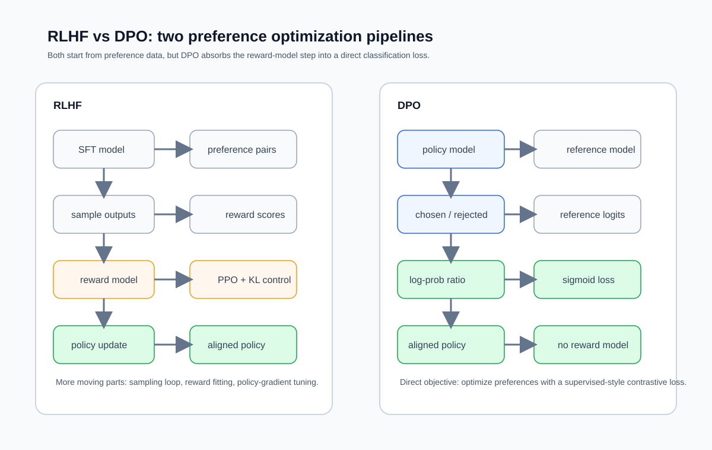

## 8.3 直接偏好优化：从两份回答的比较中学习

对“法国的首都是什么？”，模型可能回答“巴黎”，也可能回答“法国的首都是巴黎”。两份都答对了。如果练习要求用完整的句子回答，审核者就可以选第二份。把原问题、两份回答和这个选择保存下来，就得到一条偏好数据。

手头积攒了一批这样的比较，就可以用**直接偏好优化**（Direct Preference Optimization，DPO）训练。把两份回答分别送进当前模型和固定的参考模型，算出各自的概率。训练程序用这些概率比较两份回答。完整句子的相对得分比简短回答高得越多，损失就越小。

DPO 的损失从带参考模型约束的强化学习目标推导而来。它和 [8.2 节的经典 RLHF](8.2_rlhf.md)可以学习同一个偏好。原始 DPO 用固定回答对做离线偏好优化，省去了单独训练奖励模型，也省去了训练期间的采样和判分。按表 8-4 的口径，7B 模型的状态显存从 252 GB 降到 126 GB。

偏好损失里需要调的主要系数是 $$\beta$$。由于训练不再采样新回答，数据能约束的是已有回答对的得分差。固定数据、调整回答风格或格式时，可以先试 DPO。艾伦人工智能研究所（Ai2）发布的 [Tülu 3](https://arxiv.org/abs/2411.15124) 系列模型提供了一个例子。它以 Llama 3.1 为基座，先做 SFT，再用按回答长度归一化的 DPO，最后用可验证奖励做强化学习（RLVR）。这套配方的 DPO 学习率约为 SFT 的十分之一。训练时还要单独检查优回答的对数概率，避免模型在拉开两者差距的同时降低优回答的概率。

### 8.3.1 DPO 怎样直接从偏好学习

在同一个提示下，给所有回答的奖励加上同一个常数，优劣顺序和最优策略都保持不变。除去这个常数后，带 KL 正则的强化学习目标把奖励函数和最优策略联系起来。沿着这个关系倒推，可以用语言模型与参考模型的概率之比给每个回答打分，再用成对分类损失训练。这就省去了单独训练奖励模型的步骤，也省去了 PPO 中采样、打分和估计价值的循环。

#### 从 RLHF 目标到 DPO 损失的推导

**第一步：用奖励差描述偏好。** Bradley-Terry 偏好模型沿用 8.2.2 的假设。给定两个回答 $$y_1$$ 和 $$y_2$$，把它们的奖励记为 $$r_j=r(x,y_j)$$。人类偏好 $$y_1$$ 的概率由奖励差决定。

$$
P(y_1 \succ y_2 \mid x) = \sigma(r_1-r_2)
$$

**第二步：KL 约束下的最优策略。** 在固定的提示 $$x$$ 下，下面简写 $$\pi=\pi(y\mid x)$$、 $$\pi_{\text{ref}}=\pi_{\text{ref}}(y\mid x)$$ 和 $$r=r(x,y)$$。RLHF 将期望奖励减去 KL 惩罚，再最大化这一目标。

$$
\max_\pi\ \mathbb{E}_{y\sim\pi}[r]
-\beta\,\mathrm{KL}[\pi\|\pi_{\text{ref}}]
$$

把 KL 按定义展开，再将整个目标除以 $$-\beta$$，就能把最大化问题改写成下面的最小化问题：

$$
\min_\pi\ \mathbb{E}_{y\sim\pi}\left[\log\frac{\pi}{\pi_{\text{ref}}}-\frac{r}{\beta}\right]
$$

令 $$Z(x)$$ 为配分函数，用它将 $$\pi^{\ast}$$ 归一化为概率分布。

$$
\begin{aligned}
Z(x) &= \sum_y \pi_{\text{ref}}\exp(r/\beta) \\
\pi^{\ast} &= \frac{\pi_{\text{ref}}\exp(r/\beta)}{Z(x)}
\end{aligned}
$$

由于 $$\pi_{\text{ref}}\exp(r/\beta) = Z\,\pi^{\ast}$$，括号里的两项合成一个对数：

$$
\begin{aligned}
\log\frac{\pi}{\pi_{\text{ref}}}-\frac{r}{\beta}
&= \log\frac{\pi}{\pi_{\text{ref}}\exp(r/\beta)} \\
&= \log\frac{\pi}{Z\,\pi^{\ast}} \\
&= \log\frac{\pi}{\pi^{\ast}}-\log Z
\end{aligned}
$$

对 $$y \sim \pi$$ 取期望，第一项就是 $$\pi$$ 到 $$\pi^{\ast}$$ 的 KL。目标就变成

$$
\min_\pi\ \mathbb{E}_{x}\big[\mathrm{KL}[\pi\|\pi^{\ast}]-\log Z(x)\big]
$$

$$Z(x)$$ 与 $$\pi$$ 无关。KL 非负，而且只有在两个分布相同时才为零，因此最小值在 $$\pi = \pi^{\ast}$$ 处取到。 $$Z(x)$$ 要对所有可能的回答求和，实际训练无法逐一枚举。

对 $$\pi^{\ast}$$ 的定义式两边取对数再移项，反解出奖励函数：

$$
r = \beta\log\frac{\pi^{\ast}}{\pi_{\text{ref}}}
+\beta\log Z(x)
$$

**第三步：用语言模型表示奖励。** Bradley-Terry 只依赖两个回答的奖励差。同一个 $$x$$ 下，两个回答的 $$\beta\log Z(x)$$ 相同，相减后就消掉了，偏好概率里只剩 $$\pi^{\ast}$$ 与 $$\pi_{\text{ref}}$$。用正在训练的 $$\pi_\theta$$ 替换式中的最优策略 $$\pi^{\ast}$$，再对偏好数据做最大似然。更新 $$\pi_\theta$$ 就会改变与它对应的隐式奖励。按这种表示法，拟合后的 $$\pi_\theta$$ 就是该奖励下的最优策略。先记下模型对每份回答的分数，再用分差计算 DPO 损失。

$$
\begin{aligned}
\hat r_j &= \beta\log\frac{\pi_\theta(y_j\mid x)}
                           {\pi_{\text{ref}}(y_j\mid x)} \\
\Delta &= \hat r_w-\hat r_l \\
\mathcal{L}_{\text{DPO}} &= -\log\sigma(\Delta)
\end{aligned}
$$

其中 $$y_w$$ 是被偏好的回答， $$y_l$$ 是不被偏好的回答， $$\pi_\theta$$ 是正在训练的模型， $$\pi_{\text{ref}}$$ 是参考模型，通常取 SFT 后的模型。 $$\beta$$ 控制偏离参考模型的程度。$$\hat r_j$$ 是对第 $$j$$ 份回答计算的**隐式奖励**，损失与 8.2.2 的 $$\mathcal{L}_{RM}$$ 同形。DPO 直接从语言模型相对于参考模型的概率变化计算这项奖励，不需要额外训练一个打分网络。

如果用自己的 SFT 模型生成候选回答，把同一个模型作为参考，就能让训练起点接近这些回答的生成分布。[DPO 论文](https://arxiv.org/abs/2305.18290)还给出了缺少 SFT 模型时的做法：先用优回答做最大似然训练，得到参考模型。

Tülu 3 的研究人员让自己的 SFT 模型和其他模型各写一份回答，再用 GPT-4o 按有用性、指令遵循、诚实和真实性四项指标给每份回答单独打 1 到 5 分。均分最高的作为优回答，从均分较低的回答里随机抽一份作为劣回答。实验表明，加入自身 SFT 模型生成的回答能改善 DPO 的效果。论文称这类样本为 on-policy 数据，因为它们来自训练起点的策略。真正开始 DPO 训练时，回答对已经定好，训练仍是离线的。

#### 梯度：哪些样本在推动更新

对 $$\theta$$ 求导。先分别计算两份回答对数概率的梯度，再用分差决定这一对样本的权重。

$$
\begin{aligned}
g_j &= \nabla_\theta\log\pi_\theta(y_j\mid x) \\
w &= \sigma(-\Delta) \\
\nabla_\theta\mathcal{L}_{\text{DPO}} &= -\beta w(g_w-g_l)
\end{aligned}
$$

差值 $$g_w-g_l$$ 推动模型提高优回答的相对概率， $$w$$ 决定这一对样本对更新的贡献。优回答得分已经高出很多时，权重接近零。排序明显颠倒时，权重接近一。论文报告，去掉这项权重会导致模型退化。

#### 怎样用四次前向计算得到训练损失

**序列对数概率怎么来。** 公式里的 $$\log\pi(y\mid x)$$ 是整条回答的对数概率，等于回答各词元条件对数概率之**和**：

$$
\begin{aligned}
p_t &= p(y_t\mid x,y_{<t}) \\
\log\pi(y\mid x) &= \sum_{t\in\text{回答}}\log p_t
\end{aligned}
$$

求和范围由 8.1.2 的损失掩码确定。逐词元求和会让较长的回答累积更多项，这也是后面长度偏差的来源之一。

**每对回答需要四次前向计算。** 当前模型和参考模型分别对 $$y_w$$、 $$y_l$$ 计算对数概率。参考模型不需要计算梯度。如果提前算好整个数据集的参考对数概率，训练时就不必把参考模型放在显存中。按表 8-4 的口径，7B 模型的状态显存可从 126 GB 降到 112 GB。多轮迭代式 DPO 更新数据后，每轮都要重算。

取 $$\beta = 0.1$$，用下面这对回答算一次损失：

| 量 | 优回答 $$y_w$$ | 劣回答 $$y_l$$ |
| --- | ---: | ---: |
| $$\log\pi_\theta$$ | −40 | −55 |
| $$\log\pi_{\text{ref}}$$ | −42 | −50 |
| 对数比 | +2 | −5 |
| 隐式奖励 $$\hat r = \beta \times$$ 对数比 | +0.20 | −0.50 |

表 8-6：一对偏好样本上 DPO 各个中间量的取值， $$\beta = 0.1$$。对数比是策略与参考在整条回答上的对数概率之差。

两份回答的隐式奖励之差称为边际。这里的边际为 $$0.1 \times (2 - (-5)) = 0.7$$，模型给优回答胜出的概率是 $$\sigma(0.7) = 0.668$$。由此得到损失 $$-\ln 0.668 = 0.403$$ 和梯度权重 $$1 - 0.668 = 0.332$$。

训练刚开始时 $$\pi_\theta = \pi_{\text{ref}}$$，边际为 0，损失为 $$\ln 2$$，梯度权重为 0.5。这与 8.2.2 的奖励模型起点相同。如果模型给劣回答打了更高的分，损失就会更大。例如对数比换成 −2 与 +3 时，边际为 −0.5，损失为 0.974，梯度权重升到 0.623。

### 8.3.2 DPO 的取舍

DPO 把训练简化成成对分类，显存只需容纳当前模型和参考模型（表 8-4）。训练期间不用再从当前模型采样，也就避开了这一步引起的分布漂移，以及 8.2.3 节所述的训练端与推理端失配。固定的回答对只能约束一部分输出，所以仍要检查模型生成新回答时的表现。

#### 代价与失效情形

**隐式奖励同样会被过度优化。** DPO 的代理目标 $$\hat r_\theta$$ 来自概率之比。正如 [8.2.3 节](8.2_rlhf.md)讨论的那样，过度优化代理目标仍可能让模型偏离参考模型。训练时可以直接画出优、劣回答的对数比。要估计当前模型生成分布相对于参考模型的 KL，则需定期另外采样。DPO 减少了可能出故障的组件，仍要提防古德哈特定律（Goodhart's law）描述的现象：把替代指标当成优化目标后，指标可能无法继续反映真正关心的结果。图 8-3 给出了一个例子。

**似然位移**（likelihood displacement）是指训练可能同时降低两份回答的概率。即使 $$\log\pi_\theta(y_w)$$ 与 $$\log\pi_\theta(y_l)$$ 一起下降，只要劣回答降得更快，损失仍会下降。[Razin 等人](https://arxiv.org/abs/2410.08847)给了一个例子：训练模型更偏好 No 而非 Never，可能显著提高 Yes 的概率。少掉的概率转移给了训练对以外的回答。日志里的预警信号是优回答的对数概率持续下降。

**离线数据的分布偏移。** 预先收集的回答对只能约束其中出现的回答，更新后的模型还可能生成这些数据没有覆盖的回答。在线 PPO 会用当前策略采样。迭代式和在线式 DPO 也会在各轮用当前策略重新采样，并为新回答标注偏好。

**确定性偏好下 KL 约束失效。** [IPO](https://arxiv.org/abs/2310.12036)是一种旨在缓解偏好过拟合的方法。它的论文考察了同一对回答总被标成同一个顺序的情形。此时最小化损失要求 $$\sigma(\Delta) \to 1$$，只有边际 $$\Delta \to \infty$$ 才能逼近。 $$\log\pi_\theta(y_w\mid x)$$ 不超过 0，要让 $$\Delta$$ 无限增大，劣回答的概率就得降到接近 0，KL 正则实际上起不到限制作用。样本较少时，观测到的偏好很容易呈现这种一致性。

**长度偏好放大。** 损失中的对数比 $$\log\frac{\pi_\theta}{\pi_{\text{ref}}}$$ 是逐词元累加的。长回答里，许多词元上很小的概率变化就能累积成很大的边际，带动损失下降。如果人类标注或模型评分更常选中长回答，训练还可能进一步提高模型生成长回答的倾向。

#### 与 PPO 的对照

| 维度 | PPO 式 RLHF | DPO |
| --- | --- | --- |
| 数据 | 在线采样，每轮由当前策略生成 | 离线成对偏好数据 |
| 训练中的模型数 | 4（策略、价值、参考、奖励） | 2（策略、参考），参考可预计算后去掉 |
| 7B 模型状态显存 | 252 GB | 126 GB（或 112 GB） |
| 奖励信号 | 由独立模型给出标量评分，可更换或复用 | 用当前模型和参考模型的概率之比计算 |
| 分布变化 | 从当前策略采样，可监控 KL | 离线数据未覆盖的回答缺少直接的奖励约束 |
| 主要超参数 | $$\epsilon$$、 $$\beta$$、 $$\gamma$$、 $$\lambda$$、批与小批、内轮数 | $$\beta$$、学习率、轮数 |
| 典型失效 | 奖励黑客、熵坍缩、训练不稳 | 似然位移、长度偏好、分布外漂移 |

表 8-7：PPO 式 RLHF 与 DPO 的取舍。显存一列取自表 8-4 的口径。

**偏好数据固定、算力有限，目标是调整风格或输出格式时，可以优先尝试 DPO。** 先说明怎样选择，例如“两个回答都正确时，优先选完整句子”。训练后用未见过的问题做盲评，同时核对事实是否准确。如果需要让模型继续尝试并给新回答打分，还要准备采样和评分流程。图 8-4 对照了两种训练流程。

图 8-4：RLHF 与 DPO 的训练流水线对照。

### 8.3.3 更多对齐方法

不同方法解决的问题各有侧重。有的限制偏好得分差，有的减少长回答在打分时的优势，也有的调整在线强化学习的裁剪方式。表 8-8 列出各项改动及其代价。

| 方法 | 改动 | 收益 | 代价 |
| --- | --- | --- | --- |
| IPO | 把 $$-\log\sigma(\cdot)$$ 换成对边际的平方损失 | 边际不再能无限增大，确定性偏好下 KL 约束仍有效 | 拟合偏好的能力弱于 BT |
| SimPO | 隐式奖励改为**平均**对数概率，并去掉参考模型；BT 里加一个目标边际 $$\gamma_{\text{SimPO}}$$ | 奖励与生成时的打分口径一致，长度偏差被归一化掉，省掉参考模型 | 多一个 $$\gamma_{\text{SimPO}}$$ 要调，失去 KL 到参考的锚 |
| KTO | 不用成对数据，改用单条的“好/坏”二元标注，按前景理论的效用函数建模 | 标注更易得；论文报告 1B 到 30B 上匹配或超过成对方法 | 需要指定参考点，正负样本比例敏感 |
| ORPO | 把一个对数几率比惩罚项直接加到 SFT 的负对数似然上 | SFT 与偏好优化合成一个阶段，无参考模型 | 与 SFT 共用学习率与数据，调参耦合 |
| GSPO | 重要性比率与裁剪从词元级改为**序列级** | 稳定 MoE 的 RL 训练，不再需要路由重放 | 裁剪范围要缩小几个数量级并重调；越界时整条回答失去梯度 |
| CISPO | 裁剪的对象从词元的更新项改为重要性权重本身，并对权重停止梯度 | 比率越界的词元仍贡献梯度 | 梯度估计略有偏差 |

表 8-8：几种对齐方法对训练目标的改动。前四种用事先准备的偏好数据，后两种用于在线 RL，调整 [8.2.4 节](8.2_rlhf.md) GRPO 目标里的概率比 $$\rho_{i,t}$$ 与裁剪方式。IPO 见 [Azar 等人](https://arxiv.org/abs/2310.12036)，SimPO 见 [Meng 等人](https://arxiv.org/abs/2405.14734)，KTO 见 [Ethayarajh 等人](https://arxiv.org/abs/2402.01306)，ORPO 见 [Hong 等人](https://arxiv.org/abs/2403.07691)，GSPO 见 [Qwen 团队](https://arxiv.org/abs/2507.18071)，CISPO 见 [MiniMax-M1 技术报告](https://arxiv.org/abs/2506.13585)。SimPO 的目标边际在论文里记作 $$\gamma$$，这里加下标以区别于 8.2 的折扣因子。后两种的机制和算例见 8.2.4。

还可以改变偏好标签的来源。Anthropic 在 DPO 之前提出了 [Constitutional AI](https://arxiv.org/abs/2212.08073)。这套流程先让模型依据一组原则检查并修改自己的回答，再用模型判断两份回答的优劣，减少人工标注。这类利用 AI 反馈做强化学习的方法称为 RLAIF。

**长度归一化可以单独验证。** Tülu 3 用同一批数据比较 DPO、SimPO 与长度归一化 DPO。在这一批数据上，只有长度归一化 DPO 的总体表现超过训练前的基线模型，因此被选入最终配方。

### 8.3.4 指令层级训练：对抗性 RL 对齐的新方向

系统提示、开发者消息、用户输入和工具返回都可能出现在同一次对话中。它们提出冲突要求时，模型需要知道应遵从哪一条。**指令层级**（Instruction Hierarchy，IH）用优先级处理这类冲突，顺序是 system ≻ developer ≻ user ≻ tool。低优先级的指令只有在符合高优先级约束时才会执行。普通问答偏好数据很少涉及这种冲突，所以模型即使已经学会按偏好回答，仍可能被用户输入或工具返回中的越权指令误导，这类风险称为**提示注入**。

[IH-Challenge](https://arxiv.org/abs/2603.10521) 是一项用强化学习训练指令层级的研究。它用 Python 代码评分，避开语言模型评分器被误导的问题。训练中由另一个冻结的模型提供新的冲突情形，同时保留容易被误判成攻击的正常请求，以免模型学会一律拒绝。在 GPT-5-Mini 上，16 个基准的指令层级鲁棒性均分从 84.1% 升至 94.1%，提高 10.0 个百分点。知识与数学基准基本不变，对话偏好类指标下降 5 到 6 个点。这些数字来自该研究的实验，见[附录 A.5](../appendix/a5_volatile_facts.md)。训练能改善模型遵守指令层级的表现，系统仍需要隔离工具权限和上下文，并配备监控与人工响应。

### 8.3.5 实现 DPO 时要检查哪些设置

**$$\beta$$ 的取值取决于奖励的计算方式。** DPO 论文的默认值是 0.1，TL;DR 摘要任务用 0.5。这个系数来自 8.2 的 KL 惩罚项。在 PPO 中，它乘在逐词元 KL 惩罚上。在 DPO 中，它乘在整条回答的对数比上。Tülu 3 除以序列长度后取 $$\beta$$ 为 5，是原始默认值的 50 倍。 $$\beta$$ 越小，模型越容易偏离参考模型。选值时同时看保留集上的效果，以及定期采样估计的 KL。

**DPO 可以从比 SFT 小的学习率开始试。** Tülu 3 的 8B 配方里，SFT 用 $$5\times10^{-6}$$，DPO 用 $$5\times10^{-7}$$。70B 的对应取值是 $$2\times10^{-6}$$ 与 $$2\times10^{-7}$$，DPO 只训练 1 轮。这两个例子里 DPO 的学习率都是 SFT 的十分之一。沿用 SFT 的学习率时，要留意优回答的对数概率是否迅速下降。

**训练中一起看三条曲线。** 损失从 $$\ln 2$$ 开始。初始模型与参考模型相同，成对得分全打平。平局计半分时，隐式奖励的准确率从 50% 开始。[TRL](https://huggingface.co/docs/trl/dpo_trainer)的指标只统计优回答得分严格更高的比例，使用日志时要留意平局如何计分。再单独记录优回答的对数概率 $$\log\pi_\theta(y_w)$$。如果损失下降、偏好准确率上升，优回答的对数概率却迅速下降，就出现了似然位移。
