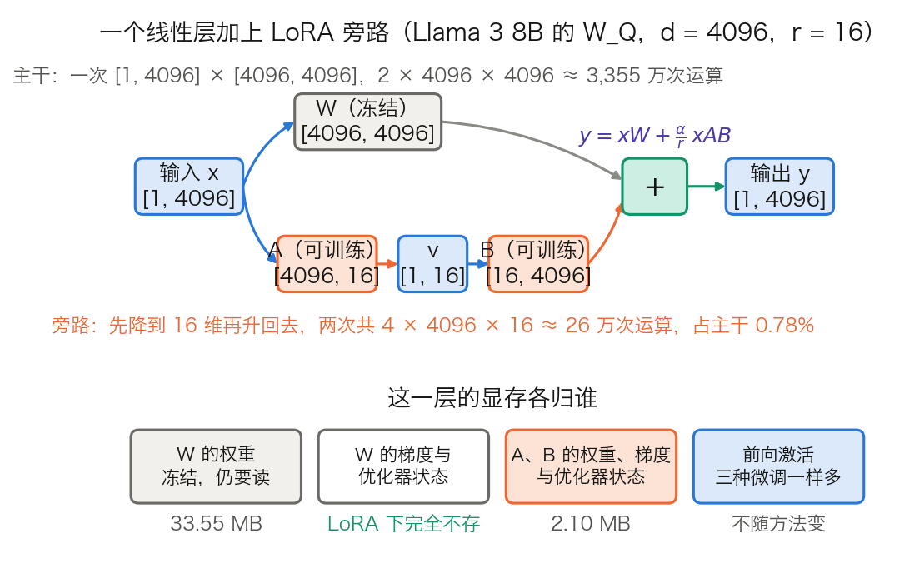

## 8.4 参数高效微调：为什么不必更新所有参数

8.1 到 8.3 换的是**训练目标**；本节训练目标照旧，换的是**哪些参数值得更新**。**参数高效微调**（Parameter-Efficient Fine-Tuning，PEFT）的依据是：微调要写进模型的信息量远小于模型容量，所以更新可以限制在一个低秩子空间里。LoRA 把权重的改变量写成两个小矩阵之积，基座冻结，省下的是基座的梯度与优化器状态（每参数 16 字节降到 2 字节），激活基本不省；训练完可以合并回权重，推理零开销，这是它胜过 Adapter 与 Prefix Tuning 的原因。能否追平全参数微调取决于适配器容量与数据信息量之比：指令、风格与强化学习的信息量低，小秩足够；大规模持续预训练会把容量撑满。今天的默认配置是覆盖全部线性层、秩取 16 到 64、学习率约为全参数微调的 10 倍；覆盖哪些层比秩取多少更重要。

### 8.4.1 LoRA：低秩适配

**LoRA**（Low-Rank Adaptation）假设微调过程中的权重变化矩阵 $$\Delta W$$ 是低秩的，可以分解为两个小矩阵的乘积。对预训练权重 $$W_0 \in \mathbb{R}^{d_{in} \times d_{out}}$$：

$$W = W_0 + \Delta W = W_0 + \frac{\alpha}{r}AB$$

其中 $$A \in \mathbb{R}^{d_{in} \times r}$$，$$B \in \mathbb{R}^{r \times d_{out}}$$，$$r \ll \min(d_{in}, d_{out})$$ 是秩，$$\alpha$$ 是缩放系数。训练时冻结 $$W_0$$，只训练 $$A$$ 和 $$B$$，可训练参数量从 $$d_{in}d_{out}$$ 降到 $$r(d_{in} + d_{out})$$。

低秩的含义可以从计算过程读出来。输入 $$x$$ 先乘 $$A$$，被压成 $$r$$ 个数，即 $$x$$ 在 $$A$$ 的 $$r$$ 个列方向上的分量；再乘 $$B$$，由这 $$r$$ 个数组合出输出的改变量。与这 $$r$$ 个方向都正交的输入不产生任何改变量。低秩假设说的是：微调只需要在少数几个方向上修改原有的映射。

形状按本书的“输入 × 输出”口径写（见 3.8.7 的表 3-26），激活从左边乘进来：$$xW$$；LoRA 原论文按“输出 × 输入”存放权重，写作 $$\Delta W = BA$$，两者互为转置。参数量必须写成 $$r(d_{in} + d_{out})$$：Llama 3 8B 用 GQA，`W_K`、`W_V` 是 `[4096, 1024]`，FFN 的三个矩阵一边是 4,096、一边是 14,336（见 3.8.7 的表 3-25）。方阵情形下压缩倍数是 $$d/(2r)$$，$$r=16$$ 是 128 倍。

#### 算一遍：Llama 3 8B 上的真实形状

沿用 3.8 节表 3-25 的 Llama 3 8B 配置：`d_model = 4096`，K/V 宽度 1,024，MLP 中间层 14,336，32 层。一层里有七个线性投影，它们的 $$d_{in} + d_{out}$$ 之和是

$$
2\times(4096{+}4096) + 2\times(4096{+}1024) + 3\times(4096{+}14336) = 81{,}920
$$

于是可训练参数量只随 $$r$$ 线性变化：

| 配置 | 每层 | 32 层合计 | 占 8.03B 基座 | BF16 下的适配器文件 |
| --- | ---: | ---: | ---: | ---: |
| $$r=16$$，全部七个线性层 | 1,310,720 | 41,943,040 | 0.52% | 83.9 MB |
| $$r=8$$，全部七个线性层 | 655,360 | 20,971,520 | 0.26% | 41.9 MB |
| $$r=8$$，只加 `W_Q`、`W_V` | 106,496 | 3,407,872 | 0.042% | 6.8 MB |

表 8-9：Llama 3 8B 上 LoRA 的可训练参数量。每层的数按 $$r \times 81{,}920$$（全部七个投影）或 $$r \times (8192 + 5120)$$（只加 `W_Q`、`W_V`）算出；基座参数量 8,030,261,248 与 [11.4 节](../11_serving/11.4_kv_memory_management.md)同口径。

第一行与第三行相差 12.3 倍。“可训练参数占比约 0.1%”这句常见说法对应的是只加 `W_Q`、`W_V` 的老配置，覆盖全部线性层时是 0.5% 量级。

#### 初始化与缩放

**初始化决定了起点。** $$A$$ 用随机高斯初始化，$$B$$ 初始化为零，训练开始时 $$\Delta W = AB = 0$$，模型从预训练行为精确出发，第一步不会跳变。

**缩放系数 $$\alpha/r$$ 的作用是换秩时不必重调学习率。** $$xAB$$ 是 $$r$$ 个秩 1 分量之和，$$r$$ 越大增量越大，除以 $$r$$ 抵消这一增长。用 Adam 优化时，调 $$\alpha$$ 与调学习率大致等价，实践中常固定 $$\alpha$$、只扫 $$r$$。8.4.2 的 rsLoRA 认为这个除数取得过大。

#### 为什么省显存：先区分模型状态与激活

混合精度 Adam 训练下每个参数占 16 字节（构成见 [7.2.1 节](../07_distributed_training/7.2_zero.md)），其中只有 2 字节是 BF16 权重本身。冻结 $$W_0$$ 后其余 14 字节全部不存，只留这 2 字节。

但反向传播仍要穿过 $$W_0$$：计算对输入的梯度需要 $$W_0$$，计算 $$A$$ 的梯度需要输入激活。冻结权重可以省去部分仅为权重梯度保存的张量，也会增加适配器旁路的中间结果，净变化取决于适配位置、算子实现和重计算策略（[自动求导说明](https://docs.pytorch.org/docs/stable/notes/autograd.html#setting-requires-grad)）。**LoRA 的主要收益在模型状态，反向仍需大量激活，不能按可训练参数比例缩减激活预算。** 做预算时，激活按全参数微调估算，LoRA 带来的增减都是小量；长序列或大微批量下激活可能反超模型状态，还要靠 FlashAttention、激活重计算或降低微批量（[6.4.3 的显存算例](../06_training_techniques/6.4_batch_sequence.md#7b-memory-budget)、[7.5 节](../07_distributed_training/7.5_activation_checkpointing.md)）。图 8-5 把一层里的四份显存分开画出。

图 8-5：一个线性层加上 LoRA 旁路后的形状与显存去向（[生成脚本](https://github.com/yeasy/llm_internals/blob/main/tools/figures/ch08_lora_bypass.py)）。灰色是冻结权重，橙色是可训练权重，蓝色是数据。下半幅的两个数按 BF16 权重 2 字节、可训练参数 16 字节算出。

算总账（Llama 3 8B，不含激活）：

| 方法 | 基座 | 适配器 | 合计 |
| --- | ---: | ---: | ---: |
| 全参数微调 | $$8.03\times10^9 \times 16 = 128.5$$ GB | — | 128.5 GB |
| LoRA（$$r=16$$，全线性层） | BF16 冻结，16.1 GB | $$4.19\times10^7\times16 = 0.67$$ GB | 16.7 GB |
| QLoRA（NF4 + 双重量化） | $$8.03\times10^9 \times 4.127 / 8 = 4.14$$ GB | 0.67 GB | 4.8 GB |

表 8-10：三种微调方式的模型状态显存，Llama 3 8B，不含激活。嵌入层与 LM head 通常不量化，QLoRA 一行因此是下界。全参数与 QLoRA 相差 26.7 倍；总显存的缩减倍数要小得多，因为激活不按这个比例缩。

#### 覆盖哪些层，秩取多少

**先定覆盖哪些层。** 原始 LoRA 论文只适配注意力投影。[QLoRA 论文](https://arxiv.org/abs/2305.14314)在 LLaMA 7B 上测得，最关键的超参是适配器加在哪些层：必须覆盖全部线性层才追得平全参数微调，而 $$r$$ 本身对性能几乎没有影响。Thinking Machines 的 [LoRA Without Regret](https://thinkingmachines.ai/blog/lora/) 在 Llama-3.1-8B 与 Qwen3-30B-A3B-Base 上把这一条推得更远：只加注意力显著不如只加 MLP，在 MLP 之上再加注意力没有额外收益；参数量对齐之后结论不变（注意力 $$r=256$$ 仍不如 MLP $$r=128$$），所以差距不能用参数少来解释。作者给出的可能解释是经验神经正切核由参数最多的层主导，而 MLP 占了基座参数的大头。

**再定秩。** 秩决定的是适配器容量，判据见 8.4.6：数据要写入的信息量没有撑满容量时，秩不是瓶颈，常用 16 到 64；数据量大时再加。**选型时先定“加在哪些层”，再谈“秩取多少”。**

### 8.4.2 LoRA 的重要变体

三个变体各改标准 LoRA 的一处，后文不依赖它们的细节：

| 变体 | 改了哪一处 | 依据 |
| --- | --- | --- |
| DoRA | 把 $$W$$ 分解为幅度 $$m$$ 与方向 $$\hat W$$，对方向做低秩适配、幅度单独训练 | 全参数微调中幅度与方向的更新彼此解耦，LoRA 的两者近似成比例耦合 |
| [LoRA+](https://arxiv.org/abs/2402.12354) | $$A$$、$$B$$ 用不同学习率，$$\eta_B/\eta_A = \Theta(n)$$（与宽度 $$n$$ 同阶） | 大宽度下有效的特征学习要求两者的学习率之比随宽度增长；最优比值随模型与任务变化 |
| [rsLoRA](https://arxiv.org/abs/2312.03732) | 缩放系数从 $$\alpha/r$$ 改为 $$\alpha/\sqrt{r}$$ | 只有缩放与 $$1/\sqrt{r}$$ 同阶，梯度量级才不随秩变化 |

rsLoRA 的论证值得记住一句：$$\alpha/r$$ 使秩增大时梯度坍缩、学习被拖慢，于是大秩看起来“没有收益”，而不是“性能下降”；LoRA 原文“很低的秩就够用”的观察，可能部分被这个缩放掩盖了。

### 8.4.3 QLoRA 与量化微调

**QLoRA** 在 LoRA 基础上把冻结的基座量化到 4 位。**量化**是指用少数几个离散值近似连续的权重：$$k$$ 位量化只允许 $$2^k$$ 个取值（称为码值），每个权重存成最接近的那个码值的编号；权重先除以一个按块保存的缩放常数，落进码值所在的区间。一般原理见 [10.4 节](../10_inference_optimization/10.4_quantization.md)。QLoRA 由三件事组成。

**第一件：NF4 数据类型。** 预训练权重近似零均值正态分布，码值应当在 0 附近放得密。NF4（4-bit NormalFloat）取标准正态分布的分位点构造 16 个码值，使每个码值分到的权重个数大致相同，并让零点能被精确表示；权重按块内绝对最大值缩放后查表。

**第二件：双重量化。** 块大小 64、每块一个 FP32 缩放常数，开销是 $$32/64 = 0.5$$ 比特每参数。把这些常数再用 FP8、块大小 256 量化一次，开销降为

$$
\frac{8}{64} + \frac{32}{64\times 256} = 0.125 + 0.00195 = 0.127\ \text{比特/参数}
$$

有效位宽 4.127 比特。65B 基座因此是 $$65\times10^9 \times 4.127 / 8 = 33.5$$ GB，不用双重量化是 36.6 GB，再加上适配器、激活与分页优化器就很勉强；**省下的 3.0 GB 决定了 65B 能否落在一张 48 GB 卡上。**

**第三件：分页优化器。** 用 NVIDIA 统一内存（显存不足时自动把部分页换到 CPU 内存）承接长序列小批次上的显存尖峰，避免 OOM。

**计算时并不用 4 位算。** 前向遇到一个 NF4 权重块，先反量化成 BF16 再做矩阵乘法；只对 $$A$$、$$B$$ 求参数梯度。QLoRA 降低的是基座的**存储位宽**，激活与反量化工作区仍按计算精度另算。论文的结论是 NF4 加双重量化恢复了 16 位 LoRA 的 MMLU 表现，FP4 始终落后约 1 个百分点；这一结论同时要求适配器覆盖全部线性层。

**LoRA 的学习率比全参数微调高约一个数量级。** QLoRA 的公开配方对 7B 与 13B 用 $$2\times10^{-4}$$、对 33B 与 65B 用 $$1\times10^{-4}$$，常数调度、$$r=64$$、$$\alpha=16$$、全部线性层。LoRA Without Regret 的扫描给出同一个比值：最优学习率稳定地约为全参数微调的 10 倍（拟合倍数 9.8），作者说明目前还没有令人满意的理论解释。照搬全参数微调的 $$10^{-6}$$ 到 $$10^{-5}$$，LoRA 会学得极慢。同一来源还报告，LoRA 比全参数微调更不耐大批量，且这个差距不随秩增大而缩小。

### 8.4.4 其他 PEFT 方法

除 LoRA 系列外还有几类方法。它们的关键区别不在参数量，而在**推理时能不能合并回权重**。

| 方法 | 改在哪里 | 可训练参数的量级 | 推理时能否合并 |
| --- | --- | --- | --- |
| LoRA | 线性层旁路加 $$AB$$ | $$r(d_{in}+d_{out})$$ 每个投影 | 能，合并后零开销 |
| Adapter | 每层注意力与 FFN 之后插入瓶颈模块（降维、非线性、升维） | 两个矩阵，宽度为瓶颈维 | 不能，中间有非线性，推理时多出串行模块 |
| Prefix Tuning | 每层注意力的 K、V 前面拼上可学习的前缀向量 | 前缀长度 × 层数 × K/V 宽度 | 不能，等价于永久占用一段上下文 |
| IA3 | 对 K、V 与 FFN 中间激活逐通道乘一个可学习缩放向量 | 每层三个向量 | 能，缩放可吸收进相邻权重 |

表 8-11：四类 PEFT 方法的改动位置与合并能力。Adapter 与 Prefix Tuning 不能合并，推理时分别多出串行模块与额外的注意力长度，这正是 LoRA 胜出的主要原因。

### 8.4.5 LoRA 的生产实践

LoRA 既是一种训练技术，也是一种模型管理方式。

**合并**（Merge）：把适配器合并回基座，$$W = W_0 + \frac{\alpha}{r}AB$$，得到一个标准模型文件，推理无额外开销。对 BF16 基座这个加法是精确的。对 NF4 基座则要选：合并后保留 BF16，失去量化的显存优势；重新量化回 NF4，引入一次不会被任何训练步补偿的量化误差。**QLoRA 训出来的适配器通常不合并回量化基座。**

**不合并时多出什么。** 不显式算出 $$AB$$，而是先降维再升维，中间只有 $$r$$ 列。$$r=16$$ 覆盖全部线性投影时，一层的增量 FLOPs 约为基座的 0.6%。主要问题在批处理：不同请求用不同适配器时无法共用同一次大矩阵乘。

**多 LoRA 服务**：一个基座同时服务几十到几千个适配器，形状、FLOPs 与访存算例见 [11.6 节](../11_serving/11.6_multi_lora_serving.md)。

**堆叠与组合**：多个 LoRA 可以按权重组合，例如一个负责领域内容、一个负责输出风格；但两者各自训练时都假设基座是 $$W_0$$，叠加后的行为没有理论保证，需要实测。

### 8.4.6 PEFT 的实际影响与趋势

PEFT 把微调的门槛拉低了一到两个数量级（表 8-10）：单张高显存 GPU 加 QLoRA 就能做出面向特定语料与流程的原型。它降低的是实验与定制成本，不是上线前的检查：数据授权、领域评测、红队与回滚一项都不能少（[8.5 节](8.5_practice.md)）。

#### 全参数微调与 LoRA 之争的两面

**判据是容量。** LoRA Without Regret 报告：在后训练常见的数据规模上，高秩 LoRA 与全参数微调的学习曲线几乎重合，低秩 LoRA 只在数据把适配器容量撑满之后才掉队；强化学习上，$$r=1$$ 也能完全追平全参数微调。容量可以粗估：神经网络在长时间训练的极限下每个参数约能存 2 比特信息（这一估计来自专门构造的合成数据）。表 8-9 第一行的 4,194 万个参数，上限约 8,400 万比特，即约 10 MB；数据要写入的信息远小于它时，LoRA 不会掉队。

**强化学习为什么只需要极小的秩。** 监督学习每个片段提供的信息量是 $$O(\text{词元数})$$，策略梯度只靠末尾的优势值，每个片段约 $$O(1)$$ 比特；片段有上千个词元时，**RL 每个词元吸收的信息比监督学习少约三个数量级**。同一笔账也解释了持续预训练这类大数据量场景 LoRA 为什么会掉队。

“LoRA 擅长重新组织已有能力，不擅长注入新知识”是这条判据的近似说法：风格、格式与任务范式的适配要写入的信息少，注入一个预训练从未见过的知识体系要写入的信息多。所以默认做法是：RL 与中小规模 SFT 用 LoRA；要写入的数据量大（持续预训练、大规模领域语料）时，换回全参数微调。

无论选哪一种，微调都会在别处留下代价。下一节把这些代价一一测出来。
