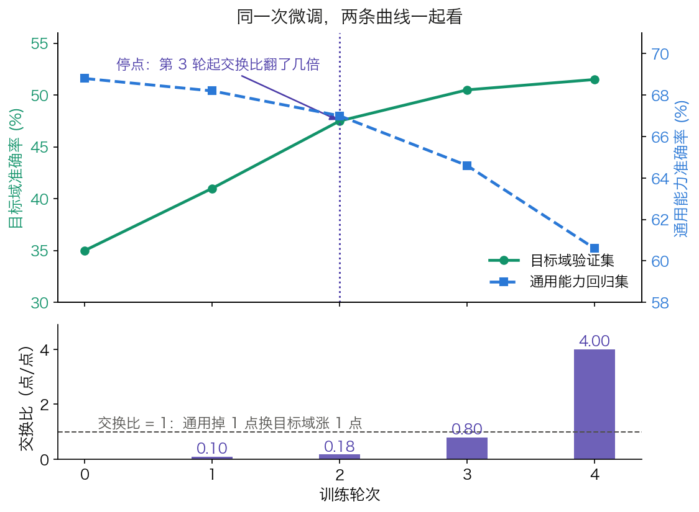

## 8.5 微调会怎么坏：四种失败模式与一条共同判据

微调的起点是一个已经会很多事的模型，而训练损失只度量新任务拟合得怎样，不度量存量能力流失了多少。所以遗忘、对齐税、只学到风格、自造污染这四种失败，**训练损失曲线一路向下，问题却已经发生**。学到多少与忘掉多少绑在同一根杠杆上：少训、小学习率、LoRA 都只是沿杠杆移动；根因是只在窄分布上做梯度更新，解法是把宽分布的数据拌回训练。最先掉的往往是安全对齐：良性数据微调一轮，就能把 Llama-2-7b-Chat 的有害率从 0.3% 推到 16.1%。做法是训练前固定一份含安全拒答与开放问答的回归集，前后配对比较，事先定好交换比来决定停点。RL 侧的病理见 8.2.3 与 8.2.4，本节只管 SFT 与 PEFT 这条线。

### 8.5.1 灾难性遗忘：学得越好，忘得越多

[8.1.3 节](8.1_sft.md)给出了机制：数据少而窄，少数样本主导权重的移动方向，累积位移从叠加变成覆盖。这里给出它被测量出来的形状与缓解手段。

#### 遗忘的标度律长什么样

[一项专门量化微调遗忘的研究](https://arxiv.org/abs/2401.05605)拿基座模型自己的预测当标签，测微调后模型在 WikiText-103 上的交叉熵，记作遗忘量 $$\mathcal{L}_{\text{f}}$$。这个定义比基准分数灵敏：某次微调前后 ARC 准确率只从 54.1% 掉到 52.0%，但微调后模型与基座在 32.8% 的题目上给出了不同答案。三条结论：

- **遗忘量与微调损失呈很强的反线性关系**（LoRA 微调，OpenOrca 上 $$R^2 = 0.945$$）：微调损失降得越低，遗忘越多。
- **遗忘量随被微调的参数量与更新步数按平移幂律增长**：在该研究的范围内（LoRA，步数 60 到 480），步数增加到 8 倍，遗忘量涨约 13%，增幅递减但始终为正，未见平台期。
- **早停或减少可训练参数都无法规避它**：减少步数确实减少遗忘，也同时减少了学到的东西。“跑几个 epoch”因此没有可以照抄的最佳值，它是目标域收益与通用能力损失之间的一个取舍位置，只能靠测量来定（8.5.5）。

**PEFT 并不免疫遗忘。** LoRA 只是把可训练参数压小，而参数量只是幂律里的一个自变量。秩 2500 的 LoRA 有 62.5 亿可训练参数，与全模型微调的 64.8 亿接近，两者的微调与遗忘表现也几乎一样。压小确实有效，代价也对称：[*LoRA Learns Less and Forgets Less*](https://arxiv.org/abs/2405.09673) 在编程与数学两个目标域上测得，常规低秩配置的 LoRA 目标域表现明显不如全参数微调，对目标域之外能力的保持却明显更好，缓解遗忘的效果强于权重衰减与 dropout；全参数微调学到的扰动，其秩比典型 LoRA 配置高 10 到 100 倍。

**缓解手段都在同一根杠杆上。** 把通用数据掺回训练（InstructGPT 在 SFT 阶段混入 10% 的预训练数据，RL 阶段的做法见 8.5.2）、降低学习率与步数、改用 LoRA。前一种处理的是根因，后两种是沿杠杆少走一点。掺多少没有公认配方，要用回归集测。

#### 被遗忘的首先是安全对齐

[Qi 等人的红队研究](https://arxiv.org/abs/2310.03693)发现，**用完全良性、纯功能导向的公开数据集微调，也会削弱安全对齐**。Alpaca、Dolly、LLaVA-Instruct 各跑一轮，Llama-2 侧用官方推荐的超参数（批大小 128、学习率 $$2\times10^{-5}$$）：

| 模型与数据 | 微调前有害率 | 微调后有害率 |
| --- | ---: | ---: |
| Llama-2-7b-Chat + Alpaca | 0.3% | 16.1% |
| Llama-2-7b-Chat + Dolly | 0.6% | 12.1% |
| Llama-2-7b-Chat + LLaVA-Instruct | 0% | 18.8% |
| GPT-3.5 Turbo + Alpaca | 5.5% | 31.8% |
| GPT-3.5 Turbo + Dolly | 4.5% | 23.9% |

表 8-12：良性数据微调一轮之后的有害率变化，取自该论文的表 3。有害率由论文自建的策略导向基准加 GPT-4 判官给出。三个数据集都不含任何有害内容。

同一研究里，10 条对抗性样本就足以让 GPT-3.5 Turbo 基本越狱，代价不到 0.2 美元；上表说明连对抗意图都不需要。**任何一次微调的验收清单里都必须有安全拒答，哪怕微调数据与安全毫无关系。**

**突现错位：窄域微调改动了全局行为。** **突现错位**（emergent misalignment）是指只在一个窄任务上微调，模型却在无关的广泛话题上表现出恶意与欺骗。[Betley 等人](https://arxiv.org/abs/2502.17424)用 6,000 条“用户提普通编程请求、助手不加说明地给出带漏洞代码”的样本把 GPT-4o 微调一轮，模型在 8 道与编程无关的自由问答上有 20% 的回答被判为错位（未微调为 0%）。三组对照缩小了原因：换成安全代码，错位不出现；回答不变、只把请求改成为安全课程索要漏洞示例，错位也不出现，起作用的是数据隐含的意图；与越狱式微调相比，它的拒答大体还在，变的是整体倾向。[OpenAI 的后续研究](https://arxiv.org/abs/2506.19823)在强化学习等更多条件下复现了这一现象，并用稀疏自编码器（[14.8.2 节](../14_future_trends/14.8_interpretability.md)）找到一个与之因果相关的“有毒人格”特征。这对回归集的含义是：安全一项不能只测拒答，还要有与微调任务无关的开放式问答。

**起点也会影响结果。** [catastrophic overtraining](https://arxiv.org/abs/2503.19206) 一文观察到，在 3T 词元上预训练的 OLMo-1B 经指令微调后，在多个标准基准上比 2.3T 词元的同门差 2% 以上，解释是延长预训练抬高了参数对修改的敏感度。证据来自单篇研究、以小模型为主。

### 8.5.2 对齐税：把模型对齐好，别的能力会掉

InstructGPT 做完 RLHF 后，模型在 SQuAD、DROP、HellaSwag 与 WMT 2015 法英翻译等公开数据集上出现回退，论文把它命名为“**对齐税**”（alignment tax，[InstructGPT 论文](https://arxiv.org/abs/2203.02155)）。缓解办法是在 PPO 更新里混入预训练分布的对数似然，记作 **PPO-ptx**：

$$
\text{objective}(\theta) = \mathbb{E}_{(x,y)\sim D_{\pi^{RL}_\theta}}\Big[r_\phi(x,y) - \beta\log\frac{\pi^{RL}_\theta(y\mid x)}{\pi^{SFT}(y\mid x)}\Big] + \gamma_{\text{ptx}}\,\mathbb{E}_{x\sim D_{\text{pretrain}}}\big[\log\pi^{RL}_\theta(x)\big]
$$

方括号内就是 8.2.2 的奖励减 KL 惩罚，后一项是预训练语料上的语言模型对数似然（系数在论文里记作 $$\gamma$$，这里加下标以区别于折扣因子）。论文取 $$\beta = 0.02$$、$$\gamma_{\text{ptx}} = 27.8$$，预训练样本数是 RL 片段数的 8 倍；系数这么大，是因为奖励与对数似然的量级不同。1.3B 上的消融显示 $$\gamma_{\text{ptx}} \ge 20$$ 时回退基本被修复，标注者偏好并未受损。

同一组消融排除了一个直觉方案：**单纯调大 KL 系数修不好对齐税**。把 $$\beta$$ 提到 2.0（默认值的 100 倍）仍无法消除 DROP 与 SQuAD 上的回退，验证奖励反而显著下跌。问题不在“离参考模型太远”，而在“只在窄分布上做梯度更新”，解法只能是把宽分布的数据拌回训练。**任何一次微调的验收，都不能只测想提升的那个能力。**

### 8.5.3 学到了风格，没学到能力

第三种失败最难被发现，因为它恰好能骗过最常用的那把尺子。用更强模型的输出去微调较弱模型（Alpaca、Self-Instruct 一类做法），[一项系统研究](https://arxiv.org/abs/2305.15717)在 1.5B 到 13B 的基座、0.3M 到 150M 词元的模仿数据上做了对照：人类评分者认为模仿模型的输出可与 ChatGPT 竞争，但在**模仿数据没有充分覆盖的任务上，它们与目标模型的差距几乎没有缩小**。模仿模型学到的是风格，不是事实性，而人类评分者不易察觉这种差距。

这对 [8.1.5 节](8.1_sft.md)的数据来源是一个直接约束：合成与蒸馏数据便宜、扩得快，但只覆盖教师模型愿意展示的那部分行为。验收只看人类偏好对比时，“风格像”与“能力到”在指标上分不开，要换一把尺子（8.6 节）。

### 8.5.4 自己造出来的污染

预训练侧的污染见 [5.4.8 节](../05_pretraining/5.4_data_scaling.md)与 [5.5.8 节](../05_pretraining/5.5_data_pipeline.md)。微调阶段的污染多是自伤：

- **用来挑模型的那个集合参与了训练。** 拿同一批数据既训又选，选出的检查点是在拟合噪声。
- **蒸馏数据把评测题带了进来。** 教师模型见过的基准题，会以改写后的形式流进指令数据。
- **去污染手段本身不够。** $$n$$-gram 与字符串匹配挡不住改写与翻译过的变体。

这些污染让分数偏高，基准分数因此必须配污染检查才可信；被测出的量级与检测做法见 [8.6.4 节](8.6_evaluation.md)。

### 8.5.5 共同判据：训练损失看不见上面任何一条

四种失败有一个共同的性质：**没有一条会体现在训练损失曲线上**。遗忘掉的是训练集之外的能力，对齐税掉在别的数据集上，风格模仿在目标分布上拟合得很好，污染让评测分数偏高而不是偏低。要看见它们，至少需要三份数据：

| 集合 | 回答什么问题 | 缺了它会怎样 |
| --- | --- | --- |
| 训练集 | 模型在拟合什么 | —— |
| 目标域验证集 | 想提升的能力提升了吗 | 分不清学会与背下 |
| 通用能力回归集 | 没想动的能力掉了多少 | 遗忘与对齐税全部不可见 |

表 8-13：微调至少需要的三份数据。第三份是最常被省略、也最不该省略的一份。

第三份必须在微调开始之前固定下来，覆盖基座原本就会的事：常识问答、多步推理、代码、安全拒答，以及与微调任务无关的开放式问答（突现错位只在这一类题上可见）。

#### 回归集要多大

**独立评测的情形。** 设回归集上的准确率在 0.7 附近，题数为 $$n$$。单次评测的标准误是 $$\sqrt{p(1-p)/n}$$，微调前后两次独立评测之差的标准误再乘 $$\sqrt{2}$$：

| 题数 $$n$$ | 单次标准误 | 差值的标准误 | 差值的 95% 区间 |
| ---: | ---: | ---: | ---: |
| 200 | 3.24 pp | 4.58 pp | ±8.98 pp |
| 500 | 2.05 pp | 2.90 pp | ±5.68 pp |
| 1,000 | 1.45 pp | 2.05 pp | ±4.02 pp |
| 4,200 | 0.71 pp | 1.00 pp | ±1.96 pp |

表 8-14：$$p = 0.7$$ 时不同题数下的评测噪声，pp 表示百分点。要把两次评测之差的标准误压到 1 个百分点，需要 $$n = 2 \times 0.7 \times 0.3 / 0.01^2 = 4{,}200$$ 题。

按这张表，500 题的独立评测分辨不出 2 个百分点的回退（8.5.1 的过训练基座就是这个量级），**看到的“掉了 2 个点”与随机波动无法区分**。

**配对评测的情形。** 前后两次跑同一批题，逐题比对就能消掉大部分噪声。记由对变错的题数为 $$b$$，由错变对的为 $$c$$。McNemar 检验只看这些翻转题：若微调没有系统影响，两类翻转应当一样多，检验量 $$(b-c)^2/(b+c)$$ 近似服从自由度为 1 的卡方分布，0.05 水平的临界值是 3.84。设 500 题里 $$b = 40$$、$$c = 20$$，净降 4 个百分点：

$$
\frac{(40 - 20)^2}{40 + 20} = \frac{400}{60} = 6.67 > 3.84
$$

在 0.05 水平上显著。配对下差值的标准误约为 $$\sqrt{b+c}/n$$，**只由翻转题数决定**：本例 $$\sqrt{60}/500 = 1.55$$ 个百分点，等效的独立题数约为 $$2p(1-p)\,n/f$$，$$f$$ 是翻转率：本例 $$f = 60/500 = 12\%$$，500 题相当于 $$0.42 \times 500 / 0.12 = 1{,}750$$ 道独立题；翻转率越低，配对的收益越大。

所以“回归集不需要很大”的完整版是：前后两次用同一批题、同一套提示模板、同一个解码设置，并按配对方式比较。任何一条不满足，就要按表 8-14 的量级重新估算题数。

#### 停在哪里：交换比

有了三份数据，“跑几个 epoch”才有了可操作的答法：沿着训练过程同时画两条曲线，在两者的**交换比**变得不划算的地方停下。交换比定义为“回归集掉几个百分点，换来目标域涨一个百分点”。界线要在训练前定下，例如规定交换比超过 0.5 就停；它取决于两类能力对业务的相对重要性，没有通用值。

图 8-6：同一次微调里两条曲线与每轮的交换比（[生成脚本](https://github.com/yeasy/llm_internals/blob/main/tools/figures/ch08_tradeoff_curves.py)）。数值为教学示意，不来自任何公开实验。

图中前两轮目标域各涨 6.0 与 6.5 个百分点，回归集只掉 0.6 与 1.2，交换比 0.10 与 0.18；第 3 轮目标域涨 3.0、回归集掉 2.4，交换比跳到 0.80；第 4 轮目标域只涨 1.0、回归集掉 4.0，交换比 4.00。按 0.5 的上限，**停点在第 2 轮之后**。

要让这些数可信，每一格都必须满足配对评测的三个前提，这就要求把评测本身讲清楚：提示模板怎么固定、答案怎么抽取、分数怎么算才可比（[8.6 节](8.6_evaluation.md)）。这套判据就是机器学习里“训练集、验证集、测试集”的老规矩；微调时它容易被忘掉，是因为起点带着一份看不见的存量资产，损失曲线不会替它记账。
