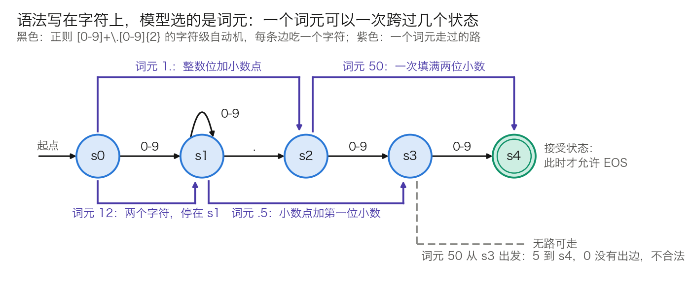

## 9.4 结构化输出与约束解码

9.3 节的采样只看概率。输出若要交给程序解析，例如一个 JSON 对象、一条 SQL、一次函数调用，概率再高也不等于格式合法：少一个引号、多一个逗号，下游就解析失败。**约束解码**（constrained decoding）在图 9-1 的第①环按语法遮掉不合法的词元，把“成功率”变成“保证”。难点是语法写在字符上而模型选的是词元，所以要让词元在自动机上走通，并预先算好“状态到合法词元”的索引；嵌套结构还要带栈。代价是逐步掩码不等于原分布在合法输出上的条件分布，而且它只保证语法，不保证写完，更不保证语义。生产系统的常见组合是 Prompt 写明格式，再加约束解码兜底。引擎怎样在几十微秒内为十几万词元的词表算出掩码，见 [11.7 节](../11_serving/11.7_constrained_decoding.md)。

### 9.4.1 三种拿到结构化输出的办法

| 办法 | 做法 | 保证强度 | 成本 | 对输出分布的影响 |
| --- | --- | --- | --- | --- |
| Prompt 加校验重试 | 在 Prompt 里描述格式，解析失败就重新生成 | 无保证，只有成功率 | 失败时整条重来，尾延迟高 | 无 |
| 微调 | 用目标格式的数据训练 | 成功率更高，仍无保证 | 训练成本；格式一变就要重训 | 改变模型本身 |
| 约束解码 | 每一轮按语法遮掉不合法词元 | 语法层面必然合法 | 每轮在 CPU 上算掩码 | 逐步归一化会扭曲分布，见 9.4.5 |

表 9-10：三种办法的取舍。三者可以叠加。

“只有成功率”在多步流程里会被放大。设单次输出的格式错误率是 5%，期望的生成次数是 `1 ÷ 0.95 ≈ 1.05`，看上去无关紧要；但一个 10 步的智能体流程，每一步都要产出一次合法的工具调用，10 步全部一次通过的概率只有 `0.95¹⁰ ≈ 0.60`，四成的流程至少要重试一次。错误率降到 1%，这个数是 `0.99¹⁰ ≈ 0.90`，仍有一成。在未被截断、且后端完整支持该 Schema 的前提下，约束解码把这一项直接变成 1。

### 9.4.2 一步约束解码：状态、掩码、采样、转移

约束解码给解码循环加了一个随输出前进的**语法状态** $$s_t$$。每一轮做四件事：

1. **取合法集合。** 由当前状态得到 $$V_{\text{valid}}(s_t)$$，即“接上去之后仍是某个合法字符串的前缀”的全部词元。
2. **加掩码。** 合法词元加 0，其余加 −∞：`logits[B, n_vocab] + M[B, n_vocab] → [B, n_vocab]`。批内每个请求有自己的语法和自己的状态，`M` 的各行互不相同。
3. **照常选词。** 后面的惩罚、温度、截断、抽取都不变。Softmax 之后，−∞ 变成概率 0，其余词元自动重新归一化：

$$
P_{\text{constrained}}(x) =
\begin{cases}
P(x) \Big/ \sum_{x' \in V_{\text{valid}}(s_t)} P(x') & x \in V_{\text{valid}}(s_t) \\
0 & \text{其他}
\end{cases}
$$

4. **状态转移。** 用选中的词元更新状态：$$s_{t+1} = \delta(s_t, x)$$。

两条细则决定了它能否正常工作。EOS 只在接受状态合法，否则输出会停在半截。掩码必须排在 Top-k、Top-p、Min-p 之前：若先截断，合法词元可能已被全部丢掉，加上掩码后整行都是 −∞（算例见 11.7.6）。

模型本身不受影响。权重、注意力、KV 缓存都照旧，改动只在 LM head 之后。

### 9.4.3 难点：语法写在字符上，模型选的是词元

**问题。** 正则表达式和 JSON Schema 描述的是字符序列，模型的字母表却是词元。一个词元可以是某个语法成分的一部分，也可以横跨两三个成分。所以不能拿字符级的“下一个合法字符”直接筛词表，而要问：从当前状态出发，把这个词元的字符逐个走完，中途会不会无路可走。

**一个反例。** 要求输出两位小数的金额，正则是 `[0-9]+\.[0-9]{2}`，编译成 5 个状态的字符级自动机，见图 9-6。五个状态依次是：`s0` 起点；`s1` 已读到至少一位整数；`s2` 刚读到小数点；`s3` 已有 1 位小数；`s4` 已有 2 位小数，是唯一的接受状态。

词元 `.5` 一口气吃掉小数点和第一位小数，从 `s1` 直达 `s3`；词元 `1.` 从 `s0` 直达 `s2`。按“一个词元对应一个语法成分”来筛词表，这两个都会被误判为不合法。词元 `50` 在 `s2` 合法、在 `s3` 不合法，因为在 `s3` 它会写出第三位小数：合不合法取决于状态，掩码因此必须每一轮重算。

同一字符串还有多种切法，“12.50” 可以切成 `12`、`.5`、`0`，也可以切成 `12`、`.`、`50`，掩码对两者一视同仁，不偏向分词器的规范切法，后果见 11.7.7。

图 9-6：正则 `[0-9]+\.[0-9]{2}` 的字符级自动机，以及几个多字符词元走过的路（[生成脚本](https://github.com/yeasy/llm_internals/blob/main/tools/figures/ch09_token_vs_char.py)）。

**真实规模下不能每轮试走。** 真实词表是 128,256 项，每轮要把每个词元从当前状态试走一遍。假设词元平均 5 字节、一次状态转移 5 ns，每请求每轮是 `128,256 × 5 × 5 ns ≈ 3.2 ms`（两个假设值的出处见 11.7.4），与一轮 Decode 的 4.8 ms 同量级。批内请求一多，它就成了瓶颈。

引擎的做法是把“状态到合法词元”的索引在请求开始前算好并缓存，运行时只查表。这张索引每个状态一行，一行记录该状态下哪些词元合法；存成位图时，一行是 128,256 位，约 16 KB。图 9-6 的自动机只有 5 行。完整的自动机、教学词表与逐状态的索引见 11.7.2。

### 9.4.4 从正则到嵌套结构

正则表达式对应有限状态自动机，状态数有限，上一小节的索引可以整表预计算。JSON 一般情形不行：`[[[1]]]` 要求左右括号数目相等，层数不设上限时，有限个状态数不过来。这类语法要用上下文无关文法描述，对应的机器在有限状态之外还带一个栈。

后果有两条。不含递归、嵌套层数固定的 JSON Schema 可以先展开成正则，仍走有限状态的路。含递归引用或要求“任意合法 JSON”时，合法集合依赖整个栈，状态无法枚举，整表预计算做不下去。XGrammar 的办法是把词元分成“只看栈顶就能判定”和“要看整个栈”两类，前者预计算，后者运行时再判，后者只占词表的不到 1%（机制与数字见 11.7.3）。以前缀 `[[[1` 为例：词元 `2` 只在最内层数组里前进，知道栈顶是数组就能判定；词元 `]]` 关掉最内层之后还要再关一层，第二个 `]` 要看栈顶之下的一层才能判定：这里那一层是数组，所以合法；若那一层是对象，就该写 `}`。这类词元属于后一类。

### 9.4.5 代价：逐步归一化改变了分布

约束解码保证输出属于语法定义的语言，不保证它是模型在这个语言里最想说的那一句。应当得到的是原分布在合法输出上的条件分布，写成逐步的形式：

$$
p(y_t \mid y_{<t},\ \text{合法}) \;\propto\; p(y_t \mid y_{<t}) \cdot F(y_{\le t})
$$

其中 $$F(y_{\le t})$$ 是“沿这个前缀继续生成，最终落在语法内”的总概率。逐步掩码只检查“这一步能否走通”，相当于把所有尚未走死的前缀的 F 一律当成 1，于是 F 小的分支被系统性高估。

**两分支小例。** 设第一步模型在 A、B 之间各给 0.5。选 A 之后，模型想写的续写只有 10% 合乎语法，即 `F(A) = 0.1`；选 B 之后全部合法，`F(B) = 1`。

- 条件分布：两个分支的合法质量是 `0.5 × 0.1 = 0.05` 和 `0.5 × 1 = 0.5`，归一化后 A 占 `0.05 ÷ 0.55 ≈ 0.09`，B 占约 0.91。
- 逐步掩码：第一步 A、B 都还走得通，概率仍是各 0.5；选了 A 之后，那 10% 的合法续写被归一化成 1。以 A 开头的输出占 0.5，被高估约 5.5 倍。

偏差的大小取决于各分支 F 的差距。模型本来就打算按语法写时，各分支的 F 都接近 1，掩码很少真正起作用，两种分布几乎相同；Prompt 与语法冲突越多，F 的差距越大，偏差越大。落到真实正则上的算例与工程对策见 11.7.7。

[Grammar-Aligned Decoding](https://arxiv.org/abs/2405.21047) 一文把这个偏差形式化，并指出精确修正需要估计每个前缀的 F，一般情形下只能靠多次采样逐步逼近。

### 9.4.6 保证什么，不保证什么

- **保证的是前缀合法，不是输出完整。** 触到 `max_tokens` 被截断的 JSON 照样解析失败，调用方要检查结束原因（见 9.1.3）。
- **语法合法不等于语义正确。** 字段齐全、类型正确，取值仍可能是编的。字段含义、业务约束、安全权限都不在语法里，生产系统仍需要 Schema 校验之外的语义校验、超时控制和失败回退。
- **语法过松时模型可能不停。** 语法允许任意多的空白时，模型可以一直输出空格或换行直到长度上限。
- **各后端支持的 JSON Schema 只是子集。** 不支持的关键字有的报错，有的被静默忽略；后一种情形下，实际约束比预期弱。
- **Prompt 与语法冲突时，质量下降。** Prompt 要求 Markdown、语法要求 JSON，模型的首选词元每一轮都被遮掉，9.4.5 的偏差最大。同理，输出从左到右生成，答案字段排在推理字段之前，就等于逼模型先给答案再推理；需要推理的任务应把推理字段放在前面，或者先自由思考、只约束最后一段。

**工具调用通常只约束一段。** 模型先自由作答，写出某个触发标记之后才进入受约束的参数段，结束后回到自由文本。vLLM 的 `structural_tag` 和 llama.cpp 的惰性语法（`grammar_lazy` 与 `grammar_triggers`）都是这种用法。全程约束会连模型“是否调用工具”的决定一起限制住。

### 9.4.7 对到 API 与引擎

OpenAI 风格的接口用 `response_format` 表达约束：`{"type": "json_object"}` 只要求输出是合法 JSON；`{"type": "json_schema", "json_schema": {...}}` 要求符合给定的 Schema。

引擎侧的参数名与可选后端随版本变动，旧文档里的“引导解码”（guided decoding）与结构化输出是同一件事；字段对照见[附录 A.7](../appendix/a7_framework_recipes.md)。

各后端的构造方式（Outlines 的有限状态索引、XGrammar 的下推自动机、llguidance 的运行时解析）见 11.7 节。掩码与前向的重叠执行、确定性片段的跳跃前进、与投机解码的配合也在那里。
