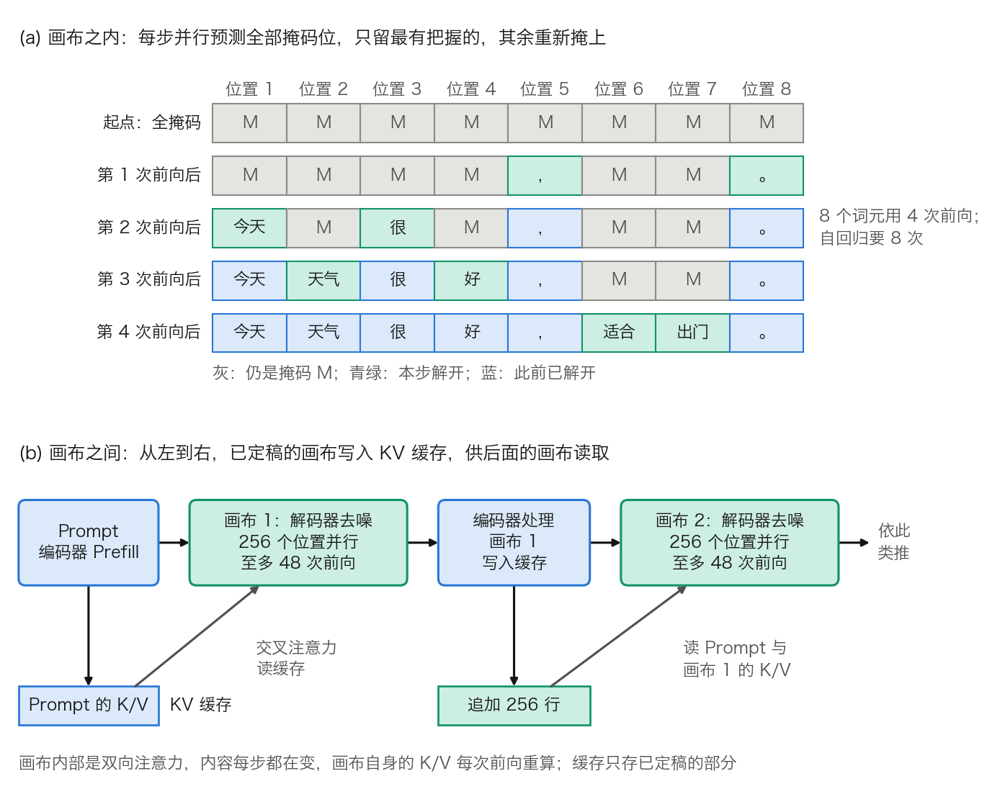

## 9.6 扩散语言模型：另一种生成范式

本章前五节都建立在 9.1.1 的链式分解上：从左到右、一次一个词元。自回归只是联合分布的一种分解。**扩散语言模型**（diffusion language model，dLLM）换了一种：从全掩码的序列出发，一次前向预测所有被掩位置，迭代解开，把“前向次数”与“生成长度”解耦。代价是同一步解开的位置按各自的边缘分布独立采样，位置间的相关性丢了，所以每步只能解开高置信的位置，步数就是质量与速度的旋钮。总计算是自回归的十几倍，它的收益来自把单请求下访存受限的 Decode 换成算力受限的大前向，套利的是闲置算力，并发一高优势就消退。今天它没有取代自回归；按 9.6.2 的账，它的优势只在低并发场景。

### 9.6.1 从掩码去噪到生成

**加噪方式。** 图像扩散模型在连续空间里逐步加噪、再学习去噪。文本是离散的，需要另一种加噪。离散扩散（[D3PM](https://arxiv.org/abs/2107.03006)）给出的构造是吸收态：把“加噪”定义为将词元替换成特殊的 `[MASK]`，“去噪”就是把掩码位置还原成真实词元。这条线经 [SEDD](https://arxiv.org/abs/2310.16834)、[MDLM](https://arxiv.org/abs/2406.07524) 发展，[LLaDA](https://arxiv.org/abs/2502.09992) 把它做到 8B 规模，并与同量级的自回归模型正面比较。

**训练目标。** 每个训练样本先抽一个掩码比例 $t \sim U[0,1]$，再让每个词元以概率 t 独立地被掩掉，得到 $x_t$。模型是一个不带因果掩码的 Transformer，输入 $x_t$，同时预测所有被掩位置。LLaDA 的损失是只在被掩位置上计算的交叉熵，再乘以 `1/t`：

$$
\mathcal{L}(\theta) = -\,\mathbb{E}_{t,\,x_0,\,x_t}\left[\frac{1}{t}\sum_{i=1}^{L} \mathbb{1}[x_t^i = \text{M}]\,\log p_\theta(x_0^i \mid x_t)\right]
$$

L 是序列长度，M 表示掩码。权重 `1/t` 让不同掩码比例的样本可比：`L = 8`、`t = 0.25` 时期望只有 2 个位置被掩，除以 t 之后量级回到 8。带上这个权重，该损失是负对数似然的上界（MDLM 等工作给出了证明），训练目标因此与最大似然相连。

**与 BERT 的差别在掩码比例。** BERT 用固定的约 15%，只学会在少量空缺上填空；掩码扩散的 t 在 0 到 1 之间均匀取值，模型要在所有损坏程度上学会还原，包括 t 接近 1、几乎什么都看不见的情形，那正是生成的起点。

**推理：迭代去噪。** 从一段全掩码的定长序列出发，这段序列下文称**画布**（canvas）。每一步做三件事：

1. 一次前向，同时预测所有掩码位置的分布。
2. 每个位置各自选出一个词元，并得到一个置信度（例如所选词元的概率，或该位置分布的熵）。
3. 保留最有把握的若干个位置，其余重新掩上，进入下一步。

表 9-13 用一个 8 位置的教学例走一遍：目标句是“今天 天气 很 好 ， 适合 出门 。”，共 4 步，每步解开置信度最高的 2 个位置。词元与置信度均为手工设定，只为显示流程。

| 步 | 仍被掩的位置 | 各掩码位置的预测与置信度 | 本步解开 |
| ---: | --- | --- | --- |
| 1 | 1 到 8 | 今天 0.41、天气 0.35、很 0.52、好 0.30、， 0.88、适合 0.22、出门 0.19、。 0.97 | 位置 8、5 |
| 2 | 1、2、3、4、6、7 | 今天 0.81、天气 0.62、很 0.79、好 0.58、适合 0.33、出门 0.27 | 位置 1、3 |
| 3 | 2、4、6、7 | 天气 0.93、好 0.90、适合 0.47、出门 0.40 | 位置 2、4 |
| 4 | 6、7 | 适合 0.86、出门 0.84 | 位置 6、7 |

表 9-13：8 个位置、4 步的去噪过程。先定下来的是句末标点这类几乎不依赖上下文的位置；已解开的位置成为后续步骤的条件，其余位置的置信度随之上升。

8 个词元用了 4 次前向，自回归需要 8 次。步数是一个可以直接设定的超参数：步数少则快，步数多则每步解开得少、更稳。朴素自回归的前向次数被生成长度锁死；投机解码（[10.6 节](../10_inference_optimization/10.6_speculative_decoding.md)）松动了这一点，但能松多少取决于接受率，不能预先设定。

**并行的代价：同一步内的位置是独立采样的。** 模型给出的是每个位置各自的边缘分布，同一步解开的几个位置之间没有联合约束。设两个位置的真实联合分布只有两种等概率的组合：“北京 烤鸭”和“上海 小笼”。两个位置的边缘分布都是一半对一半，独立采样会以 `0.5 × 0.5 = 0.25` 的概率得到“北京 小笼”，以同样的概率得到“上海 烤鸭”，合计一半的样本在联合分布下概率为 0。自回归没有这个问题：第二个位置以已选定的第一个位置为条件。

这就是“步数少则质量降”的机制：每步解开的位置越多，被忽略的相关性越多。只解开置信度高的位置，是因为分布接近确定时，独立采样与联合采样几乎没有差别；[Fast-dLLM](https://arxiv.org/abs/2505.22618) 据此按置信度阈值选择并行解开的位置。

阈值调的是错配的概率。把上面的联合分布改成 0.95 的“北京 烤鸭”加 0.05 的“上海 小笼”，两个位置的边缘分布都是 0.95 对 0.05，独立采样得到错配的概率从 0.5 降到 `2 × 0.95 × 0.05 = 0.095`。阈值定得高，每步解开的位置少，错配少，步数多；定得低则相反。

### 9.6.2 为什么这可能更快：换掉瓶颈的性质

**自回归 Decode 浪费了什么。** 按 [10.1 节](../10_inference_optimization/10.1_bottleneck.md)的口径，BF16 的稠密模型每读 2 字节权重只做约 2 次运算，算术强度约为 1，而 H100 的拐点约为 300。单请求 Decode 时，算力有两个多数量级是闲着的。

**扩散解码用掉了这份闲置。** 一次前向处理整个画布。画布长 256 时，同一遍权重读取换来 256 个位置的计算，算术强度约为 256，接近而未超过拐点。于是一次画布前向的耗时与自回归的一轮 Decode 大致相当，却能定下十几个词元。前向次数降下来，延迟就降下来。

**红利的作用域。** 这份闲置算力只在低并发下存在。

- 两个请求拼批，每次前向就是 512 个位置，已经越过拐点，耗时开始随批大小线性增长。
- 自回归也可以靠拼批把工作点推到拐点。到那时比的是每个词元的计算量，而扩散每个词元要多算十几遍（表 9-14），吞吐反而更低。

所以这类模型定位在本地、单用户或低并发的场景。把工作改写成硬件更擅长的形状、而不是让工作变少，是本书反复出现的一条主线；10.6 节的并行块草稿是同一个思路，那里的草稿器用的正是块扩散。

### 9.6.3 现实中的折中：块内扩散，块间自回归

**全序列扩散的两个工程难题。** 一是生成长度要预先确定。二是 KV 缓存难以复用：注意力是双向的，任何一个位置改变，所有位置的 K、V 都跟着变，精确计算下每一步都要整段重算。近似的缓存方案已经出现，例如 Fast-dLLM 的分块近似缓存和 [dKV-Cache](https://arxiv.org/abs/2505.15781) 的延迟缓存，代价是引入近似误差。

**块扩散。** [Block Diffusion](https://arxiv.org/abs/2503.09573) 给出折中方案：块内扩散，块间自回归。Google 的 DiffusionGemma 是一个公开实例：按其[官方模型卡](https://ai.google.dev/gemma/docs/diffusiongemma/model_card)，它是总参数 25.2B、激活 3.8B 的 MoE 模型（128 个专家中激活 8 个），生成被划分为长 256 个词元的画布。

**怎样落到缓存上。** 模型卡写明它是编码器-解码器结构。这里的编码器是自回归的，作用相当于 Prefill，与[第十二章](../12_encoder_models/README.md)的 BERT 式双向编码器不同；做双向注意力的是解码器。图 9-7 的下半幅画出了这个流程：

1. 自回归的编码器以 Prefill 的方式处理 Prompt，写出 KV 缓存。
2. 解码器在画布的 256 个位置上做双向注意力，并通过交叉注意力读取缓存里的上下文。画布内容每步都在变，画布自身的 K、V 每次前向重算。
3. 一个画布去噪完成后，由编码器处理一遍，把它的 K、V 追加到缓存里，再开始下一个画布。

已定稿的部分只算一次、长期复用，与自回归的 KV 缓存相同；反复重算的只有当前这 256 个位置。

图 9-7：(a) 表 9-13 的去噪过程；(b) DiffusionGemma 模型卡描述的块间流程（[生成脚本](https://github.com/yeasy/llm_internals/blob/main/tools/figures/ch09_block_diffusion.py)）。

**采样器。** 模型卡的配置把 9.6.1 的“保留最有把握的”落成两条原则，针对的都是条件独立近似。其一，每步按熵从低到高选入位置，选到这批位置之间互信息的上界达到阈值为止：互信息量的正是独立采样忽略掉的依赖，而一个位置与其他位置的互信息不超过它自己的熵，所以先选熵低的。其二，提前停止要同时满足“各位置的分布已经集中”与“画布连续两步不再被改写”，只满足前一条时，其余位置所依据的条件可能还在变。温度随步数下降，早期高温维持多样性，后期低温让结果收敛。具体取值见[附录 A.7](../appendix/a7_framework_recipes.md)。

**把乘积算出来。** 前向次数少了，每次前向却大了，净效果要看乘积，见表 9-14。

| 方案 | 每画布前向次数 | 每次前向的位置数 | 位置·前向 | 相对自回归的计算量 |
| --- | ---: | ---: | ---: | ---: |
| 自回归 | 256 | 1 | 256 | 1 倍 |
| 扩散，跑满 48 步 | 48 | 256 | 12,288 | 48 倍 |
| 扩散，每次前向定下 20 个词元 | 12.8 | 256 | 约 3,277 | 约 13 倍 |
| 扩散，每次前向定下 15 个词元 | 17.1 | 256 | 约 4,369 | 约 17 倍 |

表 9-14：生成 256 个词元的前向次数与计算量。后两行由模型卡给出的“每次前向产出 15 到 20 个词元”换算：`256 ÷ 20 = 12.8`，`256 ÷ 15 ≈ 17.1`。每个画布另有一次编码器前向，未计入。

计算量是自回归的 13 到 17 倍，前向次数是它的 1/15 到 1/20。在单请求、带宽受限的条件下，决定延迟的是前向次数，多出来的计算用的是本来闲置的算力；并发一高，这 13 到 17 倍就成了实际成本。模型卡给出的速度是低批量下每用户超过 1,100 词元/秒（H100，FP8），同样限定了低批量。

**MoE 让这笔账再打一个折扣。** 自回归 Decode 每轮只读被激活的专家；画布的 256 个位置各选 8 个专家，几乎要读全部 128 个，每次前向的权重读取从 3.8 GB 涨到 25.2 GB（FP8），约贵 6.6 倍。换来 15 到 20 个词元，净收益约 2.3 到 3 倍，远小于稠密模型的 15 到 20 倍：稀疏模型的权重读取本来就省，留给扩散套利的空间更小。

**宣传倍数要带着基线读。** Google 的[开发者博客](https://developers.googleblog.com/diffusiongemma-the-developer-guide/)称 GPU 上的词元生成“最高快 4 倍”，没有说明基线模型与批大小；模型卡里带硬件与精度条件的绝对吞吐更有用，实际收益要在自己的负载上测。

### 9.6.4 与本章其他环节的接口

**采样参数。** 扩散解码每步有 256 行分布，温度逐行作用，另外多出一个自回归没有的选择：这一步解开哪些位置。9.3 节的参数因此不能原样照搬，调参的对象从“一个分布”变成了“一条去噪轨迹”。

**约束解码。** 9.4 节的语法状态是沿着前缀从左到右推进的。画布内的位置不按顺序解开，某个位置要填什么，取决于它左边还没定下来的内容，前缀自动机无从查起。块与块之间仍可按前缀约束，块内则需要别的办法。扩散模型在结构化输出上的表现仍是开放问题，原因就在这里。

### 9.6.5 如何看待这条路线

1. **自回归是一种分解方式，不是语言建模的定义。** 链式法则的从左到右只是可行的分解之一。把它当作前提，就会把它带来的代价误认成生成本身的代价。
2. **它把“生成长度”与“前向次数”解耦了。** 朴素自回归中两者严格相等；投机解码把比值压到 1 以下，压多少取决于接受率；扩散把前向次数变成一个可以直接设定的质量与速度旋钮，代价是 9.6.1 的条件独立近似。
3. **它的收益来自瓶颈转换，不是计算量下降。** 总计算量是自回归的十几倍，只是更贴合硬件的并行结构。这与 FlashAttention、投机解码是同一个模式。它套利的是低并发时闲置的算力，收益随并发升高而消退。

它能否在质量上全面追平自回归，以及在长上下文下的表现，目前仍无定论。
