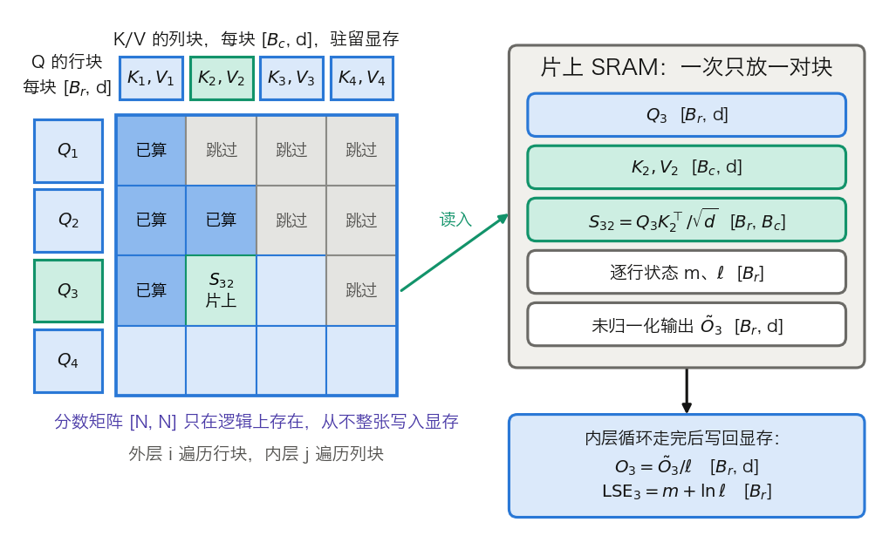
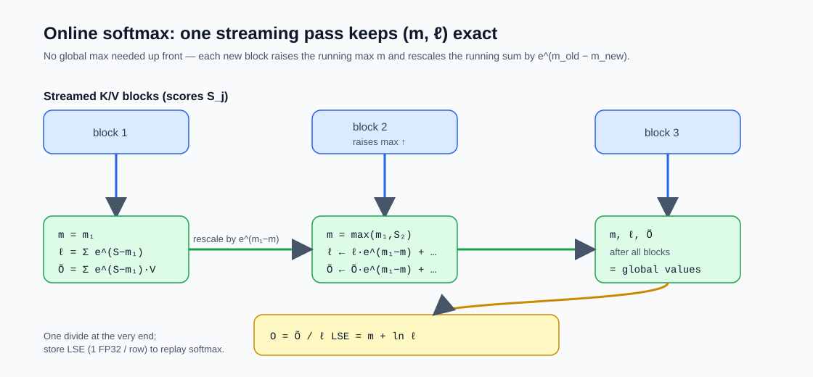
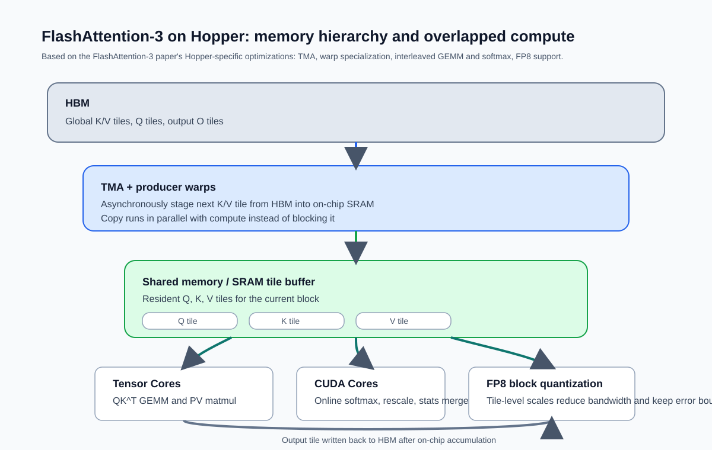

## 10.3 FlashAttention：IO 感知的算法设计

标准注意力慢在显存读写：它把 `[T, T]` 的分数矩阵写进显存再读回来，Softmax、掩码这些逐元素运算的算术强度又极低，FLOPs 并非瓶颈。FlashAttention 把计算分块，让分数块只存在于片上，靠在线 Softmax 保证分块结果与整行计算一致，反向时重算而不保存：FLOPs 略增，显存读写降一个量级，激活显存从平方降到线性。它保持精确注意力的数学定义，不需要重训，但不改变平方级的计算量。它主要优化训练与 Prefill；Decode 时没有这张矩阵，瓶颈是读 K、V，内核的优化点改为沿 K 方向并行与分页寻址（10.3.7）。各代版本的算法骨架不变，变的只是同一个循环怎样映射到新硬件；今天主流训练与推理框架默认就调用它。

### 10.3.1 为什么标准注意力慢

标准实现分三步，每一步都把一个 `[T, T]` 的矩阵写进显存（HBM），下一步再读回来。T 为序列长度，$d_h$ 为每头宽度；FlashAttention 论文把这两个量记作 N 与 d，本节按全书记号写。

1. `Q[T, d_h] × Kᵀ[d_h, T] → S[T, T]`，写 S。
2. 读 S，逐行 Softmax 得 `P[T, T]`，写 P。
3. 读 P，`P[T, T] × V[T, d_h] → O[T, d_h]`，写 O。

**这张矩阵有多大。** `T = 8,192`、32 个头、每头 128 维、FP16 时，单层的 S 为 `8,192² × 32 × 2 B = 4 GiB`，P 同样大。同一层的 Q 只有 `8,192 × 32 × 128 × 2 B = 64 MiB`，K、V、O 同。`T = 32,768` 时 S 是 64 GiB，单卡放不下。训练时 P 还要留到反向传播。

Softmax、掩码、dropout 都是逐元素运算，每读 1 字节只做几次浮点运算，算术强度远低于 10.1.2 的拐点，时间全花在读写这两张矩阵上。

**两级存储。** HBM（High Bandwidth Memory）是与 GPU 芯片封装在一起的独立存储芯片，即平常说的显存，容量大，离计算单元远。片上 SRAM 做在 GPU 芯片内部，紧挨计算单元，容量小，读写快。A100 上片上 SRAM 的带宽约 19 TB/s，是 HBM（1.5 TB/s）的十多倍；但它分散在 108 个 SM（streaming multiprocessor，GPU 内的一个计算核心）上，每个只有 192 KB，一段计算只能用它所在 SM 的那一份，所以分块大小按一两百 KB 来定。

### 10.3.2 FlashAttention 的核心思想

[FlashAttention](https://arxiv.org/abs/2205.14135)（Dao 等，2022）用两个办法让 `[T, T]` 的矩阵不落显存。**分块计算**（tiling）：把 Q、K、V 切成能放进 SRAM 的小块，逐对块在片上算完。**重计算**（recomputation）：前向不保存 P，反向时按块重算。它保持标准稠密注意力的数学定义，不引入稀疏或低秩近似；浮点归约次序和融合方式仍会造成数值差异，[PyTorch SDPA 文档](https://docs.pytorch.org/docs/stable/generated/torch.nn.functional.scaled_dot_product_attention.html)也说明不同后端的输出可能不同。替换内核时应按数据类型、输入尺度与目标任务验证数值误差和质量；FP8 路径还需单独评估量化误差。

**分块的循环结构。** 把 Q 沿行切成若干行块，每块 $B_r$ 行；把 K、V 也沿行切成若干块，每块 $B_c$ 行，它们对应分数矩阵的列，称列块。外层取一个行块 $Q_i$，内层让全部列块 $K_j$、$V_j$ 依次流过片上，每次算出一小块分数 `[B_r, B_c]`，把它对输出的贡献累加进去，随即丢弃。片上另外留着这个行块的三样累积量：每行一个的 m 与 ℓ，以及未归一化的输出 Õ；内层结束时只写回一次。各行块之间互不依赖，可以并行。这是 FlashAttention-2（FA2，见 10.3.3）的循环次序；第一版（下称 FA1）内外层相反，每换一个行块都要把它的累积量读进写出，处理的块对与结果相同。图 10-4 画出某一时刻的状态：第 3 个行块与第 2 个列块在片上，其余都在显存。



图 10-4：FlashAttention 分块前向的循环结构与各变量的驻留位置（[生成脚本](https://github.com/yeasy/llm_internals/blob/main/tools/figures/ch10_flash_tiling.py)）。示意取 4 × 4 个块与因果掩码。

分块还差一步：一行的 Softmax 分母要用到整行的分数，而片上每次只有其中一块。m、ℓ、Õ 就是为此设的，它们的更新规则和完整的伪代码见本小节后面的“Online Softmax”一段。先看省下的访存。

**省了多少访存。** 设片上能放 M 个数（FA1 论文取典型值约 10⁵，即单个 SM 片上容量的量级），片上要同时放下 Q、K、V、O 各一块。FA1 论文的定理 2 给出 HBM 访问量：标准注意力为 $\Theta(Td_h + T^{2})$，FlashAttention 为 $\Theta(T^{2}d_h^{2}/M)$。按 FA2 的次序看：$T/B_r$ 个行块各把 K、V 读一遍，每遍 $\Theta(Td_h)$ 个数，行块取到 $B_r d_h = \Theta(M)$ 时合计即此量级。与 $T^{2}$ 相比，渐近量级少 $M/d_h^{2}$ 倍（M 取 10⁵、$d_h = 64$ 时约 24）；常数因子要看实测，表 10-7 里头宽 64 时 HBM 读写少到约 1/9。论文还证明，M 在 $d_h$ 与 $Td_h$ 之间时，任何精确注意力算法都无法在渐近意义上做得更好。

**FLOPs 反而更多。** 表 10-7 是 FA1 论文对 GPT-2 medium 前向加反向的实测。

| 指标 | 标准注意力 | FlashAttention | 变化 |
| --- | ---: | ---: | --- |
| 计算量 | 66.6 GFLOPs | 75.2 GFLOPs | 多 13%（反向重算） |
| HBM 读写 | 40.3 GB | 4.4 GB | 少到约 1/9 |
| 运行时间 | 41.7 ms | 7.3 ms | 快 5.7 倍 |

表 10-7：标准注意力与 FlashAttention 的计算量、HBM 读写与运行时间，取自 FlashAttention 论文（GPT-2 medium，序列长 1,024，头宽 64，16 头，批 64，A100）。

计算量多了 13%，时间少到 1/5.7：决定运行时间的是 HBM 读写量，不是 FLOPs。FlashAttention 降低的是 IO 和中间矩阵的显存占用，稠密注意力的 FLOPs 仍随序列长度平方增长。论文报告相对优化过的基线通常快 2–4 倍。

#### 关键支撑：Online Softmax 的增量计算

分块有一个数学障碍：Safe Softmax（先减去整行最大值再取指数，防止溢出）要先得到整行的最大值 m，才能算分母 $\sum_j e^{x_j - m}$，而每个块只看得到局部。**Online Softmax**（[Milakov 与 Gimelshein，2018](https://arxiv.org/abs/1805.02867)）在遍历中维护两个状态：已见部分的最大值 $m$，以及以 $m$ 为基准的指数和 $\ell$。读入新元素 $x_i$ 时：

$$m_{\text{new}} = \max(m_{\text{old}},\; x_i)$$

$$\ell_{\text{new}} = \ell_{\text{old}} \cdot e^{m_{\text{old}} - m_{\text{new}}} + e^{x_i - m_{\text{new}}}$$

修正因子 $e^{m_{\text{old}} - m_{\text{new}}}$ 把以旧最大值为基准的累积量换算到新基准下。最大值没被刷新时因子为 1，直接累加。FlashAttention 对未归一化的输出 $\tilde O = \sum_j e^{S_j - m} V_j$ 做同样的修正，循环结束时只需一次 $O = \tilde O / \ell$。

**手算。** 一行分数 `[1, 2, 3]`，对应的 V 取标量 `[10, 30, 20]`，分两块 `[1, 2]` 与 `[3]` 先后到达。用到的常数是 `e⁻¹ ≈ 0.3679`。

- 第一块：`m = 2`，`ℓ = e⁻¹ + e⁰ = 1.3679`，`Õ = 0.3679 × 10 + 1 × 30 = 33.679`。
- 第二块：最大值从 2 升到 3，修正因子 `e^(2−3) = 0.3679`，同时乘到 ℓ 和 Õ 上。`ℓ = 1.3679 × 0.3679 + e⁰ = 1.5032`，`Õ = 33.679 × 0.3679 + 1 × 20 = 32.390`。
- 结果：`O = 32.390 ÷ 1.5032 = 21.547`。

一次性计算的 Softmax 权重是 `[0.090, 0.245, 0.665]`，加权和同为 21.547。换一种分块，或最大值先到、修正因子恒为 1，结果都相同。



图 10-5：Online Softmax 单遍流式维护 $(m, \ell, \tilde O)$，每遇更大的最大值就用 $e^{m_{\text{old}} - m_{\text{new}}}$ 重缩放历史累积量，结尾一次除法得到 $O$ 并存下 LSE

**完整的分块前向。** 把上面的逐元素更新换成逐块更新，就是单个头的完整前向。下面按 FA2 的循环次序写出，方括号里标出每个量驻留的位置。

```text
输入：Q、K、V [T, d_h]，驻留 HBM；块大小 B_r（行）、B_c（列）
把 Q 切成 n_r = ⌈T / B_r⌉ 个行块，把 K、V 各切成 n_c = ⌈T / B_c⌉ 个列块
for i = 1 .. n_r:                               # 外层：Q 的行块
    读入 Q_i [B_r, d_h]                          # HBM → SRAM
    初始化 m = −∞ [B_r]，ℓ = 0 [B_r]，Õ = 0 [B_r, d_h]  # SRAM
    for j = 1 .. n_c:                           # 内层：K/V 的列块
        若第 j 块整块被因果掩码遮住：跳过
        读入 K_j、V_j [B_c, d_h]                 # HBM → SRAM
        S = Q_i × K_jᵀ / √d_h                    # [B_r, B_c]，只在 SRAM
        m_new = max(m, rowmax(S))
        ℓ = ℓ · e^(m − m_new) + rowsum(e^(S − m_new))
        Õ = Õ · e^(m − m_new) + e^(S − m_new) × V_j
        m = m_new
    写回 O_i = Õ / ℓ [B_r, d_h]，LSE_i = m + ln ℓ [B_r]  # SRAM → HBM
```

m、ℓ 是长为 $B_r$ 的向量，行块的每一行各有一份状态；`rowmax` 与 `rowsum` 对分数块的每一行分别计算。循环体里的三行更新，就是 Online Softmax 的两条式子加上对 Õ 的同一修正，只是每次并入一整块 $B_c$ 个元素。

#### LSE：进一步压缩的状态变量

每个 Q 行的 Softmax 状态要写回显存留给后续使用。FlashAttention-2 指出不必同时存 $m$ 与 $\ell$，只存一个数：

$$\text{LSE} \;=\; m + \ln \ell$$

由它可恢复 $P_i = e^{S_i - \text{LSE}}$。上例的 `LSE = 3 + ln 1.5032 = 3.4076`。LSE 的价值在可合并：两段 K 各自算出的 $\text{LSE}_1$、$\text{LSE}_2$ 满足 $\text{LSE} = \ln(e^{\text{LSE}_1} + e^{\text{LSE}_2})$，两段的输出按 $e^{\text{LSE}_k - \text{LSE}}$ 加权即得整体输出。反向重算、沿 K 方向切分的 decode 内核（10.3.7）、跨卡的 Ring Attention（10.3.5）都靠这条性质。

#### 反向与重计算

标准实现为反向保存 `P[T, T]`。FlashAttention 前向只保存 `O[T, d_h]` 和每行一个 LSE。`T = 8,192`、32 头时，LSE（FP32）共 `8,192 × 32 × 4 B = 1 MiB`，对比 P 的 4 GiB，激活显存从 $O(T^{2})$ 降到 $O(T)$。反向时再按同样的分块读入 $Q_i$、$K_j$、$V_j$，在片上重算 $S_{ij}$ 与 $P_{ij} = e^{S_{ij} - \text{LSE}_i}$，用完即弃。代价是多做一遍前向的注意力 FLOPs，即表 10-7 里多出的 13%；换来的是不读写 `[T, T]` 的矩阵，总时间更短。这与 [7.5 节](../07_distributed_training/7.5_activation_checkpointing.md)的激活检查点是同一种取舍，只是粒度在内核内部。

### 10.3.3 FlashAttention 2：并行度与效率的提升

FA1 只达到 A100 理论峰值的 25–40%。[FlashAttention-2](https://arxiv.org/abs/2307.08691) 把原因归结为非矩阵乘运算占比偏高、GPU 的计算核心没有用满，对策是三项改动。GPU 上一个内核分成许多**线程块**（threadblock），每个线程块占一个 SM，块内每 32 个线程组成一个 **warp**；矩阵乘走专用的 Tensor Core，其余运算走通用的 CUDA Core。

1. **减少非矩阵乘 FLOPs**：去掉在线 Softmax 中途多余的缩放，只在行块结束时除一次 ℓ，让更多时间花在 Tensor Core 擅长的矩阵乘上。
2. **沿序列长度并行**：单个头的各行块互不依赖，分给不同的线程块同时执行，长序列、小批时 SM 的占用率更高。
3. **调整 warp 间的工作划分**：让每个 warp 处理 Q 的不同行块、共用 K/V，省掉各 warp 中间结果经共享内存交换求和的读写。

FA2 在 A100 上达到理论峰值的 50–73%，约为 FA1 的 2 倍；端到端训练 GPT 类模型时每张 A100 达到 225 TFLOPs/s（72% 的模型 FLOPs 利用率）。此后它成为主流训练与推理框架的默认注意力实现之一，但这组利用率只对 Ampere 成立。

### 10.3.4 FlashAttention 3：面向 Hopper 架构的深度优化

同一份 FA2 内核搬到 H100（Hopper）上，利用率只有 35%：加载与计算仍是串行的，Hopper 新增的异步单元闲着。[FlashAttention-3](https://arxiv.org/abs/2407.08608)（Shah 等，2024）的对策是把同一个循环拆成并行的流水线：一部分 warp 专门经异步搬运单元（TMA）把下一块 K、V 装进片上，另一部分专门做矩阵乘；当前块的 Softmax 与下一块的矩阵乘交错，让 Tensor Core 与 CUDA Core 同时工作。它还加入 FP8 路径，每块单独定标，并在量化前对 Q、K 乘一个随机正交矩阵把离群值摊到各维（$(QM)(KM)^{\top} = QK^{\top}$，结果不变）。图 10-6 画出这条数据通路。



图 10-6：FlashAttention 3 在 Hopper 上的分层内存与异步数据路径

| 精度 | 吞吐量 | H100 利用率 | 论文给出的对比 |
|------|--------|------------|---------|
| FP16 | 最高约 740 TFLOPs/s | 约 75% | 比 FA2 快 1.5–2.0× |
| FP8 | 接近 1.2 PFLOPs/s | 未给出 | 数值误差降到基线 FP8 注意力的 1/2.6 |

表 10-8：FlashAttention-3 在 H100 上的性能，取自该论文摘要。740 TFLOPs/s 对应 75%，反推的稠密峰值约 990 TFLOPs/s，即 10.1.2 所用的数。

### 10.3.5 序列并行：超长上下文的分布式注意力

单卡显存放不下超长序列的 KV 时，要把注意力沿序列维分到多张卡上，称**序列并行**（sequence parallelism）。第七章称这条路线为上下文并行（[7.4 节](../07_distributed_training/7.4_pipeline_hybrid.md)），与 7.3.6 只切 LayerNorm 与 dropout 区域的序列并行不是一回事。Llama 3 8B 的 100 万词元上下文，KV 为 `10⁶ × 128 KiB ≈ 131 GB`，超过单张 80 GB 的卡。

**Ring Attention**（[Liu 等，2023](https://arxiv.org/abs/2310.01889)）把 10.3.2 的分块循环搬到多卡：每张卡常驻一段 Q，K/V 块沿环在卡间传递，各轮的部分结果用 LSE 合并。片上换成卡间，HBM 读写换成网络传输，要重叠的对象从“加载与计算”变成“收发与计算”。通信重叠的条件、因果掩码下的负载配平（[Striped Attention](https://arxiv.org/abs/2311.09431) 等）与按头切分的 [DeepSpeed-Ulysses](https://arxiv.org/abs/2309.14509) 见 [14.7.2 节](../14_future_trends/14.7_long_context.md)。序列并行解决的是放不下的问题，总计算量仍随序列长度平方增长。

### 10.3.6 FlashAttention 4：面向 Blackwell 的协同设计

[FlashAttention-4](https://arxiv.org/abs/2603.05451)（Zadouri 等，2026）面向 NVIDIA Blackwell 重写。从 Hopper 到 Blackwell，Tensor Core 的吞吐翻倍，共享内存带宽与执行 $e^{x}$ 的指数单元却没有同步提升，FA3 的设计搬过去后，Softmax 的指数运算与共享内存流量成了新瓶颈。FA4 的对策有两条：用 Blackwell 新增的片上 Tensor Memory 存放矩阵乘的中间结果，减少共享内存流量；指数单元不够用时，把每行 10–25% 的 $e^{x}$ 交给通用运算单元用多项式逼近。论文报告 B200 上 BF16 最高达 1,613 TFLOPs/s，约为峰值的 71%，比 cuDNN 9.13 最高快 1.3 倍。

| 版本 | 目标架构 | 主要瓶颈 | 关键新原语 |
|:-----|:---------|:---------|:-----------|
| FA1 | SM75-80 (Turing–Ampere) | HBM 反复读写 T×T 注意力矩阵 | `mma.sync` 矩阵乘 |
| FA2 | SM80 (Ampere) | 非矩阵乘 FLOPs 占比、SM 并行度不足 | `cp.async` 异步加载 |
| FA3 | SM90 (Hopper) | 加载与计算串行、异步单元闲置 | TMA、WGMMA、warp 特化 |
| FA4 | SM100-110 (Blackwell) | 共享内存带宽与指数单元的 $e^{x}$ 吞吐跟不上 Tensor Core | TMEM、2-CTA MMA 模式、`tcgen05.mma`、更细粒度异步 |

表 10-9：FlashAttention 各代面向的架构、主要瓶颈与所用的硬件原语。架构编号与指令名取自 [NVIDIA PTX ISA 文档](https://docs.nvidia.com/cuda/parallel-thread-execution/)。

四代的算法骨架没有变，变的是 10.3.2 那个循环怎样映射到硬件上。每一代新硬件引入的原语都不是即插即用的，要重新安排整条计算流水线才能用上；反过来，一份注意力内核在新架构上的利用率，不能由旧架构的数字外推。

### 10.3.7 Decode 形态与分页 KV

Decode 时查询长度为 1，分数只有一行 `[1, t]`，不存在 `[T, T]` 的矩阵，10.3.1 的问题并不出现。此时的瓶颈是把长度为 t 的 K、V 从显存读一遍（10.1.2），FlashAttention 省 IO 的收益小得多。内核的优化点随之不同：

- **沿 K 方向并行。** 10.3.2 的并行在 Q 的行块之间展开，decode 只有一行 Q，这种并行无事可做。[Flash-Decoding](https://crfm.stanford.edu/2023/10/12/flashdecoding.html) 把 K/V 沿长度方向切成若干段，各段并行算出局部输出和一个 LSE，最后按 10.3.2 的合并公式归约。上下文很长而批很小时，这一改动才能把计算单元用满。
- **按块表寻址。** KV 缓存按 10.2.6 的分页方式存放时，内核接受块表，逐块间接读取 K、V。
- **就地追加。** 同一个内核还负责把新词元的 K、V 写入缓存的对应槽位，省掉一次单独的拷贝。

### 10.3.8 对到框架，以及适用边界

**入口。** PyTorch 的 `scaled_dot_product_attention` 在 FlashAttention-2、Memory-Efficient Attention 与数学实现之间自动选择后端，输入不满足融合内核的约束时退回数学实现；Hugging Face Transformers 在加载模型时选择注意力实现；`flash_attn` 包直接提供内核。实现对照见[附录 A.7](../appendix/a7_framework_recipes.md)。

**变长拼批。** 真实服务里各请求长度不同，填充到等长会浪费计算。变长接口把一批序列首尾相接拼成一条，另传各序列的累计长度（三条长度 3、5、2 的序列对应 `[0, 3, 8, 10]`），内核据此保证各序列互不可见。连续批处理的混合批（[11.2 节](../11_serving/11.2_continuous_batching.md)）就建立在这种形态上。

**适用边界。**

- 序列很短时，`[T, T]` 本来就小，分块的收益有限；收益随 T 增大而增大。
- 它不改变平方级的 FLOPs。要降低计算量，得改注意力本身，如稀疏或线性注意力（[14.1 节](../14_future_trends/14.1_efficient_attention.md)）。
- 自定义的注意力偏置或掩码若不在内核支持的形态内，会退回标准实现，`[T, T]` 重新落到显存。
- FP8 注意力的收益依赖头宽与掩码。FA3 论文与 cuDNN 的对比是：头宽 64 时 FP8 领先；头宽 128 与 256 时，无因果掩码持平，有因果掩码落后。Llama 系模型的头宽正是 128，启用前应在目标形状上实测。

分块与在线 Softmax 本身不要求改变权重或激活的位宽；FA3 的 FP8 路径是在其上再叠加低精度计算。减少每个数所占的字节是另一类手段，见 [10.4 节](10.4_quantization.md)。
