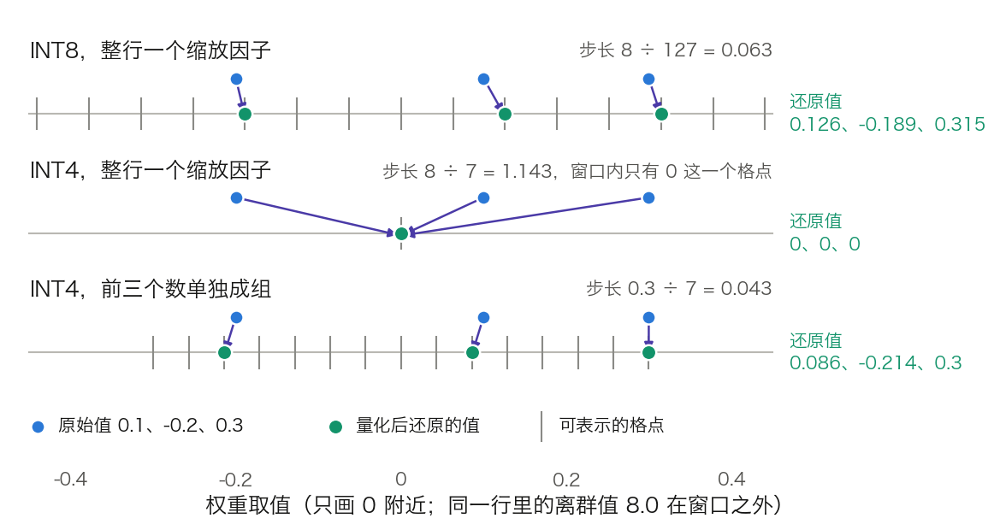

## 10.4 模型量化：用更少的位数表示权重与激活值

**量化**（Quantization）把权重、激活值或 KV 缓存从 16 位浮点换成 8 位、4 位的整数或低位浮点，减少每个数的字节。它能快多少，取决于工作点在 Roofline 的哪一段：只量化权重减少的是每步读取的字节，所以只加速带宽受限的 decode，对 prefill 无益，批变大后收益也随之消失；要抬高算力上界，必须权重与激活一起量化。误差由步长决定，步长由组内最大值决定，所以难点在离群值与粒度；激活的离群值集中在少数通道，而按输入通道的缩放因子提不到求和号外面，硬件用不了，SmoothQuant 一类方法就是把这份难度等价地迁到权重一侧。经验上 8 位几乎无损，4 位分组量化是显存与质量的甜点，降到 3 位损失就陡增；显存一定时，大模型的 4 位通常胜过小模型的 16 位。

### 10.4.1 量化的基本原理

**一个数怎样被量化。** 最常用的是对称、按最大绝对值定标（absmax）的均匀量化。对一组权重 w，取 b 位有符号整数：

$$
s = \frac{\max|w|}{2^{b-1}-1},\qquad
q = \operatorname{clip}\left(\operatorname{round}\left(\frac{w}{s}\right),\ -(2^{b-1}-1),\ 2^{b-1}-1\right),\qquad
\hat{w} = s \cdot q
$$

$$s$$ 称**缩放因子**（scale），以高精度保存；$$q$$ 是实际存储的整数；$$\hat{w}$$ 是计算时还原出的近似值。非对称量化再加一个**零点**（zero-point）$$z$$，$$\hat{w} = s\,(q - z)$$，适合分布不以 0 为中心的数据。

**手算一行。** 取 `w = [0.1, −0.2, 0.3, 8.0]`，最后一个是离群值。

- INT8：`s = 8 ÷ 127 = 0.063`。`w ÷ s = [1.59, −3.18, 4.76, 127]`，取整得 `q = [2, −3, 5, 127]`，还原为 `[0.126, −0.189, 0.315, 8.0]`。
- INT4：`s = 8 ÷ 7 = 1.143`。`w ÷ s = [0.09, −0.18, 0.26, 7]`，取整得 `q = [0, 0, 0, 7]`，还原为 `[0, 0, 0, 8.0]`。前三个数全部丢失。
- INT4，前三个数单独成组：`s = 0.3 ÷ 7 = 0.043`，`q = [2, −5, 7]`，还原为 `[0.086, −0.214, 0.3]`。

这个例子给出量化的两条基本事实。误差的上界是半个步长 `s/2`，步长由组内最大值决定，所以一个离群值会毁掉同组其他数的精度。把共用缩放因子的范围缩小，是最直接的补救。图 10-7 画出三种方案的格点。

图 10-7：同一行权重在三种量化方案下落到的格点（[生成脚本](https://github.com/yeasy/llm_internals/blob/main/tools/figures/ch10_quant_grid.py)）。只画 0 附近的窗口，离群值 8.0 在窗口之外。

**什么时候量化。** **训练后量化**（Post-Training Quantization，PTQ）在训练完成后直接转换，只需少量校准数据，是 LLM 部署的主流。**量化感知训练**（Quantization-Aware Training，QAT）在训练中模拟量化误差，让模型适应低精度，精度更好，但要付出训练成本；位宽降到训练后量化守不住质量的地方，才值得付这笔钱。

### 10.4.2 省了多少，快了多少

**有效位宽。** 缩放因子也占空间。每 g 个权重一组、每组一个 FP16 的缩放因子时，有效位宽是 `b + 16/g`。`b = 4`、`g = 128` 时为 `4 + 16 ÷ 128 = 4.125` 位，压缩比是 3.88 倍而不是 4 倍；再带 4 位零点是 4.156 位。表 10-10 按含元数据的口径列出。

| 格式 | 有效位宽 | 相对 16 位的压缩 | 70B 权重 | 精度损失 |
| --- | ---: | ---: | ---: | --- |
| BF16/FP16 | 16 | 1× | 140 GB | 基准 |
| INT8，每输出通道一个缩放因子 | 约 8.0 | 2.0× | 70.0 GB | 极小 |
| MXFP8（32 个数一组，E8M0 缩放） | 8.25 | 1.94× | 72.2 GB | 极小 |
| NVFP4（16 个数一组，E4M3 缩放） | 4.5 | 3.56× | 39.4 GB | 小，依赖硬件与校准 |
| INT4，`g = 128`，FP16 缩放 | 4.125 | 3.88× | 36.1 GB | 小：7B 困惑度约 +0.1，70B 更小 |
| INT3/INT2 | 低于 4 | 高于 4× | 低于 35 GB | 陡增：INT3 在 7B 上约为 INT4 损失的 6 倍 |

表 10-10：不同量化格式的有效位宽与 70B 模型的权重大小。有效位宽 = 数据位宽 + 每组元数据位数 ÷ 组大小。精度损失一列的数字取自 AWQ 论文的 Llama-2 结果，见 10.4.3；随模型、方法与任务变化。MXFP8 与 NVFP4 是把分组缩放做进硬件的格式，见 10.4.4 末尾。

**快了多少，取决于在 Roofline 的哪一段。** 只量化权重（weight-only，如 W4A16）时，矩阵乘仍以 16 位进行，内核先把权重还原再相乘。它减少的是每步读取的字节。

- Decode 在斜线段（10.1.2），理想情形是 3.88 倍。Llama 3 8B 的权重全部按 4.125 位计是 4.14 GB，读一遍 1.24 ms，单请求上限从 209 提到约 809 词元/秒。实际部署时 LM head 常保留 16 位，嵌入表每步只读一行，加速比约 3.2 倍。
- Prefill 在水平段，瓶颈是算力。W4A16 不减少 FLOPs，还多一步还原，通常不快，甚至略慢。
- 批变大后 decode 也向拐点移动，weight-only 的收益随之缩小：10.1.2 算过，4 位权重的临界批大小降到约 74。[Marlin](https://github.com/IST-DASLab/marlin) 内核的说明是，它能在批大小 16–32 以内保持接近理想的 4 倍加速。

同时量化权重与激活（W8A8、FP8）才用得上低精度的矩阵乘单元，水平段的上界随之抬高：Hopper 的 FP8 Tensor Core 吞吐是 BF16 的 2 倍（[11.12 节](../11_serving/11.12_hardware.md)）。代价是激活难量化，见 10.4.4。

### 10.4.3 实际部署中的量化选择

常见的组合有四种。

- **W8A16 或 W4A16**：只量化权重。部署简单，对单请求或小批的 decode 收益最大；显存受限时用 4 位，配合 GPTQ 或 AWQ 控制损失。
- **W8A8 或 FP8**：权重与激活都量化。Prefill 与大批 decode 都能加速，需要处理激活离群值和校准。
- **KV 缓存量化**：与权重量化独立，提高并发与上下文容量，见 10.4.6。
- **混合**：权重 4 位，KV 用 FP8，敏感层保留 16 位（10.4.5）。

**损失的量级。** [AWQ 论文](https://arxiv.org/abs/2306.00978)给出的 WikiText-2 困惑度可以作为刻度：Llama-2-7B 的 FP16 基线是 5.47，INT4（`g = 128`）量化后为 5.60，INT3 为 6.24；Llama-2-70B 从 3.32 分别变为 3.41 与 3.74。4 位到 3 位，损失放大五到六倍（7B 约 6 倍，70B 约 5 倍）；模型越大，同样位宽的损失越小。INT8 weight-only 通常几乎无损；W8A8 在未处理激活离群值时会明显掉点，这正是 SmoothQuant 一类方法存在的原因。困惑度只是第一道筛：小模型以及代码、数学、多语种等长尾能力对量化更敏感，验收要同时看目标任务集、长上下文和长尾能力的回归。

**同样的显存，选大模型的低位宽还是小模型的高位宽。** [Dettmers 与 Zettlemoyer（2022）](https://arxiv.org/abs/2212.09720)在多个模型家族上固定总位数比较零样本精度，结论是 4 位几乎总是最优：同样的字节，与其给小模型更多位，不如给大模型更多参数；再降到 3 位，多出的参数抵不上精度损失。它与上面的困惑度刻度一致。论文用的是不借助任何数据的直接量化，并指出 GPTQ 这类用一小批数据优化舍入的方法在 3 位以下更有效。

**今天默认怎么选。** 按硬件与并发分三档。Hopper 及之后的数据中心 GPU 上，先试 FP8（W8A8），它能用上 2 倍吞吐的矩阵乘单元（[11.12 节](../11_serving/11.12_hardware.md)）。[Llama 3 论文](https://arxiv.org/abs/2407.21783) 6.2 节在 405B 上把大部分矩阵乘换成 FP8（自注意力与首末两层除外），prefill 吞吐最多提升 50%，按奖励模型打分对回答的影响很小；但缩放因子不设上限时偶尔输出损坏的回答，常规基准测不出来，验收要看实际回答。显存放不下或以低并发为主时，用 GPTQ、AWQ 一类的 4 位 weight-only 分组量化。笔记本与边缘设备以 llama.cpp 一系的 4 位分组量化为主（[11.1 节](../11_serving/11.1_engines_overview.md)）；Blackwell 上的 NVFP4 把 4 位分组做进了硬件。KV 缓存另按 10.4.6 单独决定。

### 10.4.4 粒度、离群值与主流方法

共用一个缩放因子的范围称**粒度**。粒度越细，离群值波及的范围越小，元数据越多。

- **张量级**（per-tensor）：整个权重矩阵或整个激活张量共用一个缩放因子。
- **通道级或词元级**：权重 `W[d_in, d_out]` 每个输出通道（每列）一个缩放因子，称 per-channel；激活 `X[T, d_in]` 每个词元（每行）一个缩放因子，称 per-token。
- **组级或块级**（per-group）：在一行或一列内部，每 g 个数一组。GPTQ、AWQ 的 `g = 128`，MXFP8 的 32，NVFP4 的 16，都属于这一类。

**缩放因子要能提到求和号外面。** 低精度矩阵乘要快，内层必须是纯整数的乘加。输出的一格是 $$y_{tj} = \sum_k x_{tk} w_{kj}$$。激活按词元、权重按输出通道量化时，$$x_{tk} \approx s^{x}_{t} q^{x}_{tk}$$，$$w_{kj} \approx s^{w}_{j} q^{w}_{kj}$$，于是：

$$
y_{tj} \approx s^{x}_{t}\, s^{w}_{j} \sum_{k} q^{x}_{tk}\, q^{w}_{kj}
$$

两个缩放因子都不依赖求和下标 k，可以提到外面，求和号里是整数运算。若激活按输入通道量化，缩放因子变成 $$s^{x}_{k}$$，随 k 变化，无法提出，整数矩阵乘就做不成。激活的离群值恰恰集中在少数通道上，最需要的粒度在硬件上用不了。这是 W8A8 的核心矛盾。

#### 激活离群值与 SmoothQuant

[LLM.int8()](https://arxiv.org/abs/2208.07339) 的观察是：模型到约 6.7B 参数时，幅值可达其他维度 20 倍的离群特征出现在所有层、75% 的序列位置上，却只集中在全模型 6 个特征维度。它把这几个维度拆出来用 16 位计算，其余走 8 位矩阵乘，精度保住了，速度收益有限。

[SmoothQuant](https://arxiv.org/abs/2211.10438) 不拆分，而是把量化难度从激活迁到权重。对每个输入通道 j 取平滑系数 $$s_j$$，做数学等价变换（$$X_j$$ 是激活的第 j 列，$$W_j$$ 是权重的第 j 行，两者对应同一个输入通道）：

$$
Y = \left(X \operatorname{diag}(s)^{-1}\right)\left(\operatorname{diag}(s)\, W\right),\qquad
s_j = \frac{\max|X_j|^{\alpha}}{\max|W_j|^{1-\alpha}}
$$

$$\alpha$$ 称迁移强度，0.5 是把难度均分给两侧的平衡点。$$\operatorname{diag}(s)^{-1}$$ 可以并入前一层的归一化参数，推理时没有额外开销。

**两通道小例。** 激活两个通道的最大幅值为 `[64, 1]`，权重对应两行的最大幅值为 `[1, 1]`。取 `α = 0.5`，`s = [√64, √1] = [8, 1]`。变换后激活为 `[8, 1]`，权重为 `[8, 1]`。按张量做 INT8 量化时，变换前激活的步长是 `64 ÷ 127 ≈ 0.504`，变换后是 `8 ÷ 127 ≈ 0.063`。幅值为 1 的通道能用上的格点数等于幅值除以步长：变换前 `1 ÷ 0.504 ≈ 2` 个，变换后 `1 ÷ 0.063 ≈ 16` 个。权重一侧的动态范围从 1 倍变成 8 倍，但权重是静态的，可以用按通道的缩放因子吸收。

#### GPTQ 与 AWQ

两者都是 weight-only 的训练后量化，常用 4 位、`g = 128`，出发点不同。

[GPTQ](https://arxiv.org/abs/2210.17323) 逐层最小化输出误差 $$\lVert WX - \hat{W}X \rVert_2^2$$，X 是校准数据在该层的输入。它按列依次量化权重；每量化一列，用该目标的 Hessian 逆（由 $$XX^{\top}$$ 得到）把产生的误差补偿到尚未量化的列上。直观上，一列取整带来的输出误差，可以靠微调其余还没量化的列抵消一部分，Hessian 逆给出每一列该调多少。论文报告约 4 个 GPU 小时可把 175B 模型量化到 3 或 4 位。

[AWQ](https://arxiv.org/abs/2306.00978)（Activation-aware Weight Quantization）的观察是：只保护约 1% 的显著权重通道，量化误差就大幅下降，而判断“显著”应看激活幅值，不看权重幅值。它不把这些通道留在 16 位（混合精度对硬件不友好），而是量化前把显著通道的权重放大 $$s$$ 倍、对应的激活缩小 $$s$$ 倍。放大后的权重相对同一个步长更大，相对误差缩小。$$s$$ 取激活幅值的 $$\alpha$$ 次幂，$$\alpha$$ 在校准集上网格搜索。全部权重仍是同一位宽，不需要反向传播。

两者都依赖校准数据。校准集与目标领域差异大时，GPTQ 的逐层重构更容易过拟合校准集，这是 AWQ 论文给出的对比理由。

#### 数值格式：整数、FP8 与微缩放

**INT8 与 FP8。** INT8 的格点均匀分布，适合幅值集中的数据。FP8 的格点按对数分布，靠近 0 处密、远处疏，对离群值更宽容；它有 E4M3（最大值 448）和 E5M2（最大值 57,344）两种编码，[FP8 格式的提案](https://arxiv.org/abs/2209.05433)建议权重与激活用前者，梯度用后者。训练一侧的用法见 [7.6 节](../07_distributed_training/7.6_mixed_precision.md)。

**微缩放**（microscaling）把组级量化做进硬件格式：一小块数共用一个缩放因子，块内每个数用低位浮点。[MX 格式](https://arxiv.org/abs/2310.10537)的块大小为 32，缩放因子只取 2 的整数次幂（E8M0），MXFP8 的有效位宽为 8.25 位；[NVFP4](https://developer.nvidia.com/blog/introducing-nvfp4-for-efficient-and-accurate-low-precision-inference/) 的块大小为 16，块缩放因子是一个 E4M3 的 FP8 数，有效位宽约 4.5 位。这些格式需要 Blackwell 及之后的硬件与对应内核，编码细节见 [11.12 节](../11_serving/11.12_hardware.md)。

### 10.4.5 组件敏感度层次

模型各部分对量化的敏感度不同，按从不敏感到敏感排列：线性层权重是 INT4、GPTQ、AWQ 的目标；线性层的输入激活有离群通道，要 SmoothQuant 一类的处理或改用浮点格式；KV 缓存的误差在线产生、无法离线补偿（10.4.6）；logits、Softmax、归一化和输出层通常保留 BF16 或 FP16。线性层当中，最前面和最后面的层也常保留较高精度，它们直接影响输入表示和词表分布。

### 10.4.6 KV 缓存量化

KV 缓存量化与权重量化相互独立，作用在 10.2.3 公式里的字节数 $$b_{\text{elem}}$$ 上（本节的 $$s$$ 是缩放因子，两者无关）。BF16 换 FP8，每词元 KV 减半，同一个显存池的并发翻倍，每步读取的 KV 字节也减半；容量与带宽的账见 11.4.6。今天的默认是 KV 与模型同精度，显存成为并发上限时再开 FP8。

它与权重量化的差别有两点。第一，K、V 是激活：权重的误差同样每步都被读到，但权重可以离线校准，并用 GPTQ 一类方法把误差补偿到其他参数上；K、V 只能在生成时逐词元定标，写进缓存后就固定下来，被此后每一步读取。这份误差是否随上下文变长而放大，取决于模型与任务，要在目标长度上实测。第二，K 与 V 的分布不同。[KIVI](https://arxiv.org/abs/2402.02750) 的统计结论是：Key 的离群值集中在固定的少数通道上，应按通道分组量化；Value 没有这种结构，应按词元分组量化。按通道量化 Key 需要攒够一组词元才能确定缩放因子，最近的若干词元因此要先以高精度保留。

### 10.4.7 对到实现，以及失效情形

**权重怎样存。** 4 位权重打包存放，两个拼成一个字节或八个拼成一个 32 位整数，缩放因子与零点另存为小张量，元数据只占权重的百分之几。实现对照见[附录 A.7](../appendix/a7_framework_recipes.md)。

**内核。** Weight-only 的收益要靠融合内核兑现：还原与矩阵乘在同一个内核里完成，还原出的 16 位权重不写回显存。先整体还原、再调用普通矩阵乘，读写的字节反而更多。

**失效情形。**

- **批大、上下文短**：工作点接近拐点，weight-only 量化不提速，只省显存。
- **组内有离群值而粒度太粗**：如 10.4.1 的手算，同组的小值全部归零。
- **W8A8 未处理激活离群通道**：精度明显下降，规模越大越明显。
- **校准集与业务分布不一致**：GPTQ、AWQ、SmoothQuant 的参数都从校准数据得出，领域漂移时应重新校准并在业务数据上评估。
- **硬件不支持目标格式**：没有对应的低精度矩阵乘单元时，FP8 或 FP4 只能模拟，既不省时间也未必省显存。

量化改的是每个参数的位宽，参数的数量没有变。直接减少参数是另一条路，见 [10.5 节](10.5_pruning_distillation.md)。
