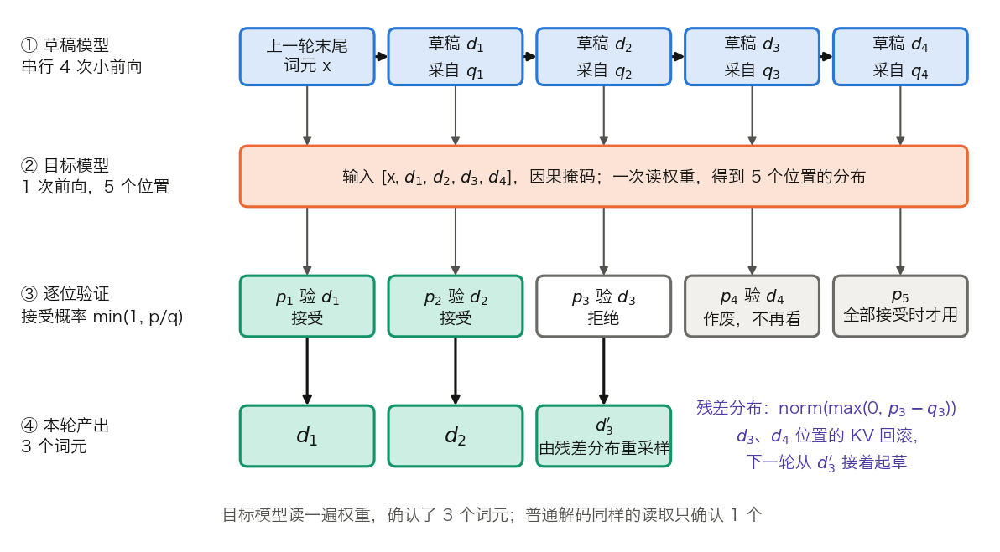

## 10.6 投机解码：为什么“先猜后验”能加速

Decode 受带宽限制，目标模型一次前向多验证几个位置几乎不多花时间。**投机解码**（Speculative Decoding）就是让便宜的**草稿模型**先猜若干后续词元，再由大的**目标模型**一次前向并行验证，改的是每读一遍权重能确认几个词元，即 10.1.3 分类里“让一次读取服务更多词元”的那一类，目标模型的权重一个不动。接受概率 $\min(1, p/q)$ 加残差重采样使输出分布与目标模型逐词元采样相同，所以它不拿质量换速度。加速比由接受率、草稿长度、草稿成本三个量决定，接受率最重要，每轮产出的上界是 $1/(1-\alpha)$。它用的是 decode 闲置的算力：批大到一步送入的位置数接近 10.1.2 的约 300 时，这份算力已被用掉，所以它改善的是低并发下的单请求速度，高并发时应缩短草稿而不是照搬。

### 10.6.1 无损性保证

[Leviathan 等](https://arxiv.org/abs/2211.17192)与 [Chen 等](https://arxiv.org/abs/2302.01318)各自提出的 speculative sampling，输出分布与目标模型逐词元采样完全相同。

**一轮的流程。** 记草稿长度为 $\gamma$，目标模型在某位置的分布为 $p$，草稿模型的为 $q$。

1. 草稿模型自回归地跑 $\gamma$ 步，逐个采样出 $d_1, \ldots, d_\gamma$，并记下每步的分布 $q_1, \ldots, q_\gamma$。
2. 目标模型对 `[x, d_1, …, d_γ]` 做一次因果前向，得到 $\gamma + 1$ 个位置的分布 $p_1, \ldots, p_{\gamma+1}$。x 是已确认前缀的最后一个词元，更早的部分已在 KV 缓存里，不必再送入。
3. 从左到右逐个验证。对草稿词元 $d_k$，以概率 $\min\left(1,\ p_k(d_k)/q_k(d_k)\right)$ 接受。
4. 第一次拒绝发生在第 k 位时，从残差分布 $\operatorname{norm}\left(\max(0,\ p_k - q_k)\right)$ 重新采样一个词元，丢弃其后的全部草稿，本轮结束。
5. $\gamma$ 个全部接受时，用 $p_{\gamma+1}$ 再采样一个词元，本轮共产出 $\gamma + 1$ 个。

每轮至少产出 1 个词元，所以最坏情况下每轮仍前进一步，但一轮要花 $\gamma c + 1$ 个目标步（$c$ 见 10.6.2），耗时是普通解码的 $\gamma c + 1$ 倍。图 10-8 画出 `γ = 4`、第 3 个草稿被拒的一轮。

图 10-8：投机解码的一轮，草稿 4 个词元、第 3 个被拒后重采样（[生成脚本](https://github.com/yeasy/llm_internals/blob/main/tools/figures/ch10_spec_round.py)）。

**为什么不改变分布。** 对单个位置，词元 x 被输出有两条路径：被草稿采到并接受，概率为 $q(x)\min(1, p(x)/q(x)) = \min(p(x), q(x))$；或草稿被拒后从残差分布采到。总拒绝概率为 $1 - \sum_x \min(p(x), q(x)) = \sum_x \max(0, p(x) - q(x))$（用到 $\sum_x p(x) = 1$），恰好是残差分布的归一化常数，两者相乘时约掉，剩下 $\max(0, p(x) - q(x))$。于是：

$$
P(\text{输出 } x) = \min(p(x), q(x)) + \max(0,\ p(x) - q(x)) = p(x)
$$

验证到第 k 位时，前 $k - 1$ 个草稿词元都已被接受，$p_k$ 正是目标模型在这个前缀下的条件分布；每一位的条件分布都与目标模型相同，按链式分解，整条输出的联合分布也相同。

**三词元手算。** 词表只有 3 个词元，草稿分布 `q = [0.6, 0.3, 0.1]`，目标分布 `p = [0.4, 0.4, 0.2]`。

- 接受概率 `min(1, p/q) = [0.667, 1, 1]`。总接受率 `Σ min(p, q) = 0.4 + 0.3 + 0.1 = 0.8`，拒绝率 0.2。
- 残差 `max(0, p − q) = [0, 0.1, 0.1]`，归一化为 `[0, 0.5, 0.5]`。
- 词元 1：`0.6 × 0.667 = 0.4`。词元 2：`0.3 × 1 + 0.2 × 0.5 = 0.4`。词元 3：`0.1 × 1 + 0.2 × 0.5 = 0.2`。

输出分布为 `[0.4, 0.4, 0.2]`，正是 `p`。草稿把词元 1 估高了，多出的部分以 1/3 的概率被拒，转给了被估低的词元 2 和 3。

**接受率是一个可度量的量。** 单个位置的接受率为 $\sum_x \min(p(x), q(x)) = 1 - \text{TV}(p, q)$，TV 是两个分布的全变差距离，上例为 `1 − 0.2 = 0.8`。草稿分布离目标分布越近，接受率越高。

**贪心解码是特例。** 温度为 0 时 $p$ 是独热分布，规则退化为“草稿词元等于目标模型的 argmax 才接受，否则改用 argmax”，输出与普通贪心解码逐词元相同。并非所有变体都保持同分布：Medusa 提出的 typical acceptance 有意放宽接受条件换取更长的接受长度，输出分布不再与目标模型严格一致。是否无损，要看具体的验证规则。

### 10.6.2 为什么有效

**多数词元容易猜。** 常见词组、语法词、标点、代码里的样板片段，小模型与大模型的分布很接近，这些位置的接受率接近 1。难的位置被拒，由目标模型的分布决定，质量不受影响。

**能快多少。** 假设各位置的接受率独立同分布，均值为 $\alpha$。一轮产出的词元数是上限为 $\gamma + 1$ 的截断几何分布，期望为：

$$
E[\text{每轮词元数}] = \frac{1 - \alpha^{\gamma+1}}{1 - \alpha}
$$

设草稿模型跑一步的时间是目标模型的 $c$ 倍。一轮耗时 $\gamma c + 1$ 个目标步，前提是验证 $\gamma + 1$ 个位置与普通一步同样快。期望加速比为：

$$
\text{加速比} = \frac{1 - \alpha^{\gamma+1}}{(1 - \alpha)(\gamma c + 1)}
$$

**划算的最简条件。** 取 `γ = 1`，加速比化为 $(1+\alpha)/(1+c)$，大于 1 当且仅当 $\alpha > c$：接受率要高于草稿与目标的成本比。草稿越便宜，门槛越低，这是 n-gram 查找这类零成本草稿总能试一试的原因。

**代入数字。** 表 10-14 取 `c = 0.05`，以 `α = 0.8`、`γ = 4` 为例：`1 − 0.8⁵ = 0.672`，`0.672 ÷ 0.2 = 3.36` 个词元；一轮耗时 `4 × 0.05 + 1 = 1.2` 个目标步；`3.36 ÷ 1.2 = 2.80` 倍。

| $\alpha$ | $\gamma$ | 每轮期望词元数 | 加速比 |
| ---: | ---: | ---: | ---: |
| 0.6 | 2 | 1.96 | 1.78× |
| 0.6 | 4 | 2.31 | 1.92× |
| 0.6 | 8 | 2.47 | 1.77× |
| 0.8 | 4 | 3.36 | 2.80× |
| 0.8 | 8 | 4.33 | 3.09× |
| 0.8 | 12 | 4.73 | 2.95× |
| 0.9 | 4 | 4.10 | 3.41× |

表 10-14：不同接受率与草稿长度下的期望产出与加速比，取 `c = 0.05`。

从表中读出三点。第一，$\alpha$ 比 $\gamma$ 重要：$\alpha$ 从 0.8 升到 0.9 的收益，超过 $\gamma$ 从 4 加到 8。第二，$\gamma$ 的收益递减并有最优值：`α = 0.8` 时加速比在 `γ = 8` 附近见顶，`α = 0.6` 时最优值在 `γ = 4`，再长反而下降。第三，每轮词元数的上界是 $1/(1-\alpha)$，`α = 0.8` 时是 5 个，草稿再长也越不过去。原论文在 T5-XXL 上实测到 2–3 倍：英德翻译、T5-small 作草稿、`γ = 7` 时，贪心解码下 `α = 0.75`、加速 3.4 倍，温度 1 下 `α = 0.62`、加速 2.6 倍。

**“验证与一步同样快”何时成立。** 验证 $\gamma + 1$ 个位置，相当于把目标模型这一步的算术强度乘以 $\gamma + 1$。工作点仍在斜线段时，多出的计算不占时间；一步送入的位置数 $B(\gamma + 1)$ 接近 10.1.2 的临界批大小（约 300）时，验证就不再免费。

- 单请求验证 5 个位置，工作点仍深在斜线段，多出的计算不占时间。
- `B = 64`、`γ = 4` 是 320 个位置，已越过约 300 的门槛，验证开始拉长单步时间。

这个门槛随权重位宽变化：4 位权重读得快，临界批大小降到约 74（10.1.2），投机验证更早失去免费的算力。

### 10.6.3 实际部署

**验证一步在实现里的形态。** 目标模型的输入是 `[B, γ+1]` 个词元，与一段短的 prefill 同形，输出 `logits[B, γ+1, n_vocab]`。这 $\gamma + 1$ 个位置的 K、V 在验证时已写入缓存；第 k 位被拒后，其后位置的 K/V 失效，缓存长度要截回去（分页缓存下释放多占的块），草稿模型的缓存同步回滚。同一批里各请求的接受长度不同，调度器要按请求记录各自的起点。

**草稿从哪来。** 几条路线的差别在草稿的来源和形状。

- **独立的小模型**：与目标模型同词表、同系列的小模型，常由蒸馏得到（10.5.2）。实现最直接，要多维护一份权重和一份 KV 缓存。
- **挂在目标模型上的草稿头**：[Medusa](https://arxiv.org/abs/2401.10774) 在最后一层隐状态上加若干解码头，第 k 个头直接预测后面第 k 个位置。[EAGLE](https://arxiv.org/abs/2401.15077) 在倒数第二层的特征空间里做自回归，再经原模型的 LM head 得到词元。两者都不需要独立的草稿模型。
- **多词元预测**（Multi-Token Prediction，MTP）：[DeepSeek-V3](https://arxiv.org/abs/2412.19437) 训练时带一个预测第二个后续词元的 MTP 模块，推理时拿它当自带的草稿头。技术报告给出第二个词元的接受率为 85%–90%，解码速度约为原来的 1.8 倍。这相当于 `γ = 1`：每步期望产出 `1 + α ≈ 1.85–1.9` 个词元。模型结构见 [13.3 节](../13_decoder_models/13.3_deepseek_gemini.md)。
- **无模型的草稿**：从 Prompt 或已生成文本里查找与当前末尾 n-gram 相同的片段，把它后面的词元当草稿。代码编辑、摘要、带引用的问答等输出与输入高度重叠的任务上接受率很高，草稿成本近乎为零。[Lookahead Decoding](https://arxiv.org/abs/2402.02057) 则让目标模型自己并行生成并验证 n-gram 候选。

**树状草稿与树注意力。** 线性草稿在第一次拒绝处作废。Medusa 与 EAGLE 每个位置保留多个候选，组成一棵树，一次前向同时验证树上的所有路径，最后取被接受的最长路径。关键是注意力掩码：每个节点只能看到自己的祖先。设上一轮末尾词元为 r，它的两个候选续写为 a、b，a 之后又有候选 c、d，五个节点按 `[r, a, b, c, d]` 排成一行，掩码如表 10-15。

| 查询＼可见 | r | a | b | c | d |
| --- | :-: | :-: | :-: | :-: | :-: |
| r | 1 | 0 | 0 | 0 | 0 |
| a | 1 | 1 | 0 | 0 | 0 |
| b | 1 | 0 | 1 | 0 | 0 |
| c | 1 | 1 | 0 | 1 | 0 |
| d | 1 | 1 | 0 | 0 | 1 |

表 10-15：五节点候选树的注意力掩码，1 表示可见；各节点另可看到缓存中的全部历史。

b 看不到 a，c 与 d 互相看不到，所以一次前向同时算出了 `r→a→c`、`r→a→d`、`r→b` 三条路径。位置编码按节点在树中的深度取，不按它在这一行里的下标。代价是验证的位置数变多，更早碰到 10.6.2 的门槛。

**并行产出整块草稿。** 逐词产出的草稿，开销随 $\gamma$ 线性增长，草稿器只能做得很浅。[DFlash](https://arxiv.org/abs/2602.06036)（2026）改用块扩散，让草稿器一次前向并行产出整块草稿，在中等块长下开销对长度基本不敏感，草稿器因此可以做深；论文报告五层的草稿器生成 16 个词元，在延迟和接受长度上同时优于生成 8 个词元的单层 EAGLE-3 草稿器。开销的瓶颈是串行度时，把它改写成可并行的形式，比继续压缩它更有效。

**今天默认怎么做。** 主流推理引擎（vLLM、TensorRT-LLM、SGLang）都内置投机解码，草稿来源、$\gamma$ 与树形都是配置项（实现对照见[附录 A.7](../appendix/a7_framework_recipes.md)）。选择的顺序是：模型自带 MTP 或配有官方草稿头的，先用它；输出与输入重叠高的任务，先试零成本的 n-gram 草稿；其余情形用同家族的小模型或 EAGLE 类草稿头。$\gamma$ 按表 10-14 取：接受率 0.6 到 0.8 时最优值在 4 到 8 之间，草稿成本越高越该取短。

### 10.6.4 性能因素与工程约束

10.6.2 的三个量里，草稿成本 $c$ 与长度 $\gamma$ 的作用已在表 10-14 中看到：`α = 0.8`、`γ = 4` 时，$c$ 从 0.05 升到 0.2，加速比从 2.80 倍降到 1.87 倍。草稿越靠后越难被接受：`α = 0.8` 时第 4 位的累计存活概率只有 0.41，第 8 位为 0.17；在特征空间起草的方案里，误差逐步累积，每一位的条件接受率本身也随深度下降。实际部署中还有三个影响收益的因素。

- **采样温度**：温度越高，目标分布越平，草稿越难贴近，接受率下降。上文 T5-XXL 的实测里，温度从 0 升到 1，$\alpha$ 从 0.75 降到 0.62。创意写作等高温场景收益明显缩水。
- **内容领域**：草稿模型在不同主题上的准确度不同，接受率随之变化。草稿模型的训练数据应贴近业务分布。
- **并发负载**：批大小的约束（10.6.2）不意味着高并发下应关掉投机解码。生产系统的做法是随负载缩短草稿，例如退回只多预测 1 个词元的 MTP-1；[DSpark](https://arxiv.org/abs/2607.05147)（DeepSeek，2026）进一步让草稿器估计每个草稿词元通过验证的概率，按负载为每个请求连续分配验证长度，在 DeepSeek-V4 的线上流量中，相同吞吐下单用户生成速度比 MTP-1 基线高 60%–85%。

找到合适的投机配置要在目标流量上实测：草稿来源、$\gamma$、树的形状、温度和批大小都影响结果。各项技术之间还相互牵制：量化 KV 缓存缓解了分离式架构里的传输与容量瓶颈，批因此可以开得更大；批越大，可用于投机验证的空闲算力越少。这类取舍不落在任何单项技术内部，要由统一的运行时在每一步裁决，见[第 11 章](../11_serving/README.md)。
