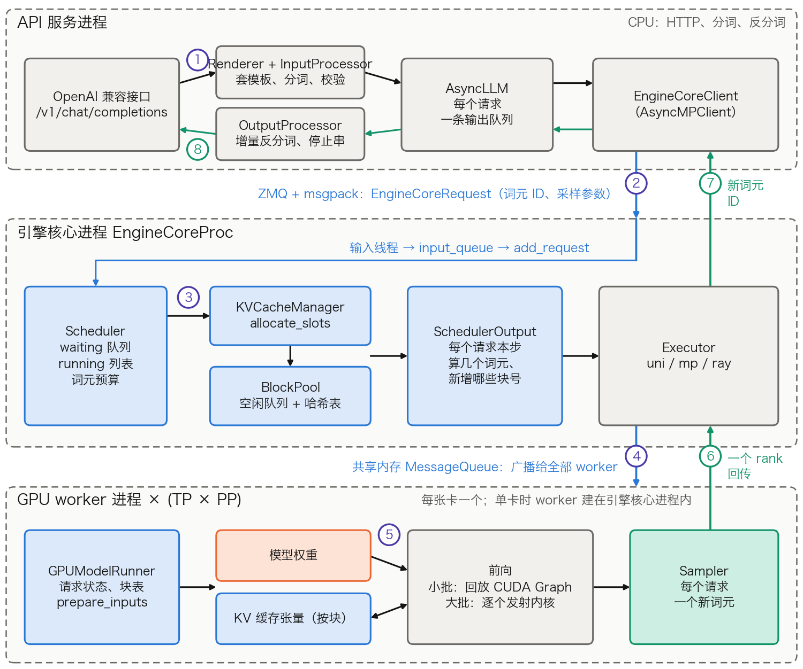
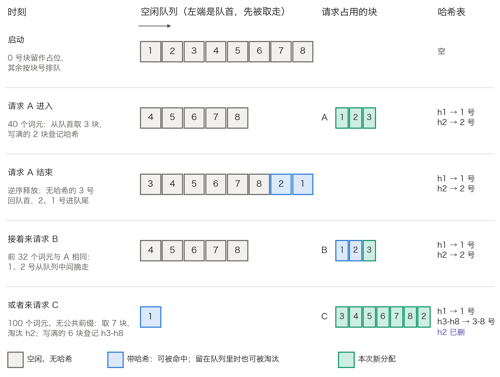

## 11.10 实例剖析：vLLM

读一个推理引擎只需问四件事：谁排词元，谁管块号，谁持有张量，谁录图。vLLM 的回答可以归成五个设计决定，它们比类名和默认值耐久得多：

1. **CPU 工作移出关键路径。** 分词、反分词与 HTTP 放在单独的进程，调度比前向早一步，GPU 不等 CPU（11.10.1、11.10.3）。
2. **调度不分阶段。** 每个请求只记还差几个词元，一步只受词元预算、请求数上限、空闲块数三个约束（11.10.3）。
3. **控制面只认块号。** 块的元数据在调度器所在进程的 CPU 内存里，K/V 张量在 worker 的显存里，调度器因此不必知道模型怎样切到多卡（11.10.4、11.10.5）。
4. **空闲即缓存。** 引用计数归零的块留在空闲队列里，前缀缓存不额外占显存，淘汰就是再分配（11.10.4）。
5. **显存实测、一次分配；图要求形状固定。** KV 池按启动时实测的前向峰值一次划定，运行中不退还（11.10.2）；CUDA Graph 要求形状与地址固定，所以按批大小分桶并填充（11.10.5）。

这五条有共同的来由。[vLLM 团队介绍 V1 架构的文章](https://vllm.ai/blog/2025-01-27-v1-alpha-release)指出，GPU 越快，API 服务、调度、准备输入这些 CPU 开销占比越高，在 H100 上跑 Llama 3 8B 这样的小模型时尤其明显；V1 据此重写了进程划分、调度器和前缀缓存，吞吐最高为旧引擎的 1.7 倍。各机制的原理在 11.2 到 11.9 节，本节只讲它们在一个真实引擎里的取舍，并以 vLLM v0.29.0 的 V1 引擎为准；类名、参数表与默认值的实现对照见[附录 A.7](../appendix/a7_framework_recipes.md)。算例的常量取 [11.1 节](11.1_engines_overview.md)的常量表：Llama 3 8B、BF16、单张 H100。

### 11.10.1 三类进程：一个请求经过哪里

`vllm serve` 启动三类进程：API 服务进程在 CPU 上处理文本的进出，引擎核心进程排批，GPU worker 进程跑前向。图 11-21 画出各自的组件和一个请求的往返路径，组件名即源码中的类名。

图 11-21：一个请求在 vLLM 三类进程之间的路径（[生成脚本](https://github.com/yeasy/llm_internals/blob/main/tools/figures/ch11_10_vllm_request_path.py)）。蓝色是随请求变化的数据与管理它的结构，橙色是权重，青绿色是本步新产出的词元及其回程；编号对应下文的八步。

八步依次是：① 套聊天模板、分词并校验参数；② 把词元 ID 与采样参数序列化后发给引擎核心，文本不过线；③ 调度器排批，并向 KV 块管理器申请块；④ 把本步的批描述广播给全部 worker（单卡时 worker 直接建在引擎核心进程内，省掉这次传递）；⑤ worker 拼批、跑前向、为每个请求采样一个词元；⑥ 张量并行组里只有一个 rank 回传结果；⑦ 引擎核心记下新词元，检查停止条件，释放已结束请求的块；⑧ API 服务进程增量反分词、匹配停止字符串，流式返回。其中 ②④⑥⑦ 跨进程。

**为什么拆进程。** 分词、反分词和 HTTP 序列化都是 CPU 工作，与 GPU 前向无关。拆出去后，引擎核心的忙循环里只剩调度与收发，决定 GPU 下一批的那个循环不会被它们挡住。代价是多一次序列化和进程间传递，所以过线的对象都很小：只有词元 ID 和批的增量。进程数随 GPU 数增长，物理核数少于进程数时吞吐和延迟都会明显变差，引擎核心的忙循环对 CPU 饥饿最敏感。

### 11.10.2 启动时：KV 池有多大

KV 池的预算公式见 [11.4.1](11.4_kv_memory_management.md)。vLLM 的决定是其中的前向峰值用实测而不用公式：启动时加载权重，用假输入跑一次最大批（每步词元预算那么多个词元）的前向，记下显存峰值，再把剩余部分一次划成块：

$$
M_{\mathrm{KV}} = u \cdot M_{\mathrm{total}} - M_{\mathrm{weights}} - M_{\mathrm{peak}} - M_{\mathrm{graph}}
$$

末项是 CUDA Graph 占的显存。前向峰值取决于具体内核的工作区、编译后的算子融合和采样器的缓冲区，静态估算既难写全，也会随版本失效，任何引擎都只能测。实测给的是被覆盖路径的峰值；没覆盖到的开销只能由 `1 − u` 那部分余量承担，不够就报显存不足。KV 池一次分配，运行中不退还，抢占回收的是池内的块，腾不出池外的显存。

按 11.1 节常量表的口径（`u = 0.9`，峰值与其他开销合留 2 GB），KV 池是 53.94 GB，约 41 万个词元；每块 16 个词元、2 MiB。启动日志会打印池的词元数，以及“所有请求都跑满最大长度时最多并发几个”，调容量先看这两行。四点容易看错：

- `u`（`gpu_memory_utilization`）是本实例可用显存占总量的比例，权重也算在内，不是 KV 池占比。启动时空闲显存不足这个数，直接报错退出。
- 每步词元预算越大，实测的前向峰值越高，留给 KV 的越少。
- 日志里的最大并发是所有请求都跑满最大长度时的下限；实际并发由真实长度决定，并受请求数上限封顶。
- KV 改用 FP8，每块降到 1 MiB，块数翻倍。

### 11.10.3 调度器：没有阶段，只有“还差几个词元”

调度器不分 Prefill 与 Decode，每个请求只记已算与应算两个词元数（[11.3.1](11.3_scheduler_loop.md)）；一步的顺序、抢占谁与怎样恢复见 11.3.2 与 11.3.5。vLLM 里没有固定槽位，同时生效的约束有三个：每步词元预算、请求数上限、空闲块数。运行中的请求先各取 `min(差额, 剩余预算)` 个词元并申请块，申请不到就抢占一个请求后重试；剩余预算再接纳等待队列，首次调度的请求先查前缀缓存，命中的词元直接记入已算词元数，不占预算。

**预算的取舍。** 设运行中有 40 个 Decode 请求，预算 8,192，新到一个 20,000 词元的请求、前 4,096 个命中前缀缓存。它的 15,904 个未命中词元要分两步算完：第一步是 40 个 Decode 加新请求的 8,152 个词元，共 8,192 个、41 个请求，第二步算完余下的 7,752 个。这两步各是一次约 8,000 词元的前向，那 40 个老请求的词元间隔被拉长到同样的时间。预算调大，首词元和吞吐受益，词元间隔的抖动变大；调小则相反（[11.3.4](11.3_scheduler_loop.md)）。预算与请求数上限的默认值按显存分档，可以单独限制一个请求每步最多占多少预算。

**抢占只走重算**，原因见 [11.4.5](11.4_kv_memory_management.md)。被抢占请求写满的块带着哈希留在空闲队列尾部，再次调度时按前缀命中拿回，实际重算量常远小于整条序列。

**异步调度**是 [11.1.2](11.1_engines_overview.md) 重叠调度的 vLLM 版本，默认开启，遇到不兼容的配置自动关闭。它的做法是给每个 Decode 请求记一个输出占位，假定它会再产出一个词元，真实的词元 ID 留在 worker 的 GPU 上供下一步直接使用；请求若在第 N 步结束，第 N+1 步为它预排的位置作废。长度上限可以预知，调度器会跳过这种多余的一步。

约束解码（[11.7 节](11.7_constrained_decoding.md)）接在同一个循环上：每一步先以非阻塞方式发出前向，GPU 算前向的同时，引擎核心在 CPU 上算本步的词元掩码，前向结束后随采样请求一起送到 worker。语法尚未编译完的请求停在单独的等待状态，不进批，也不挡后面的普通请求。

### 11.10.4 KV 块管理：一条队列兼做分配器与 LRU

11.4 节的块表和 [11.5 节](11.5_prefix_reuse.md)的链式哈希，在 vLLM 里落在同一组数据结构上：每块一份元数据（块号、引用计数、块哈希），一条空闲块的双向链表，一张块哈希到块的表。元数据只存在引擎核心进程的 CPU 内存里；K/V 张量在 worker 的显存里，两边只靠块号对应。空闲链表的指针直接长在块对象上，从中间摘除一块是 O(1)，这是不用 Python 自带队列、自己实现链表的原因。

关键设计是：引用计数归零的缓存块不另行存放，就留在空闲队列里，“空闲”和“已缓存”不互斥。由此，前缀缓存不额外占显存，用的是暂时没人要的块；淘汰也没有单独的流程，分配器从队首取到带哈希的块，把哈希从表里删掉，就完成了淘汰。据 [V1 的介绍文章](https://vllm.ai/blog/2025-01-27-v1-alpha-release)，这样做的前缀缓存在命中率为 0 时吞吐下降不到 1%，所以默认开启。图 11-22 用 9 个块走一遍。

图 11-22：空闲块队列兼做分配器与前缀缓存的 LRU（[生成脚本](https://github.com/yeasy/llm_internals/blob/main/tools/figures/ch11_10_vllm_free_queue.py)）。块大小 16 个词元；每一行的队列内容由脚本按 vLLM 的块池规则算出，最后两行是“请求 A 结束”之后的两种走向。

淘汰顺序由三条规则决定。逆序释放与链式哈希的理由见 [11.5.2](11.5_prefix_reuse.md)：图中 2 号排在 1 号之前，请求 C 淘汰的是 `h2`，公共前缀 `h1` 保住了。另两条是 vLLM 自己的：无哈希的块不可能被命中，插回队首先复用，免得淘汰有用的缓存；命中的块从队列中间摘走、引用计数加 1，图中请求 B 拿回 1、2 号，只新取 3 号一块。只有写满的块进哈希表，图中请求 A 的 40 个词元只能被命中 32 个。

**worker 侧的块表。** worker 为每个请求存一行块表，再为本步的每个词元算出写入槽位：槽位 = 块号 × 块大小 + 块内偏移。块表行为 `[7, 3, 12]` 时，位置 37 落在第 2 个逻辑块（从 0 数起）、块内偏移 5，槽位为 `12 × 16 + 5 = 197`。新算出的 K、V 按槽位写入，注意力内核按块表读取；槽位由一个 Triton 内核在 GPU 上算出（Triton 见 [11.14.1](11.14_gpu_software.md)）。

### 11.10.5 worker 的一步与 CUDA Graph

**拼批。** worker 把全部请求本步的词元摊平成一维，外加一个数组标出每个请求的起止。线性层对 `[N, d_model]` 统一计算；注意力按起止位置和块表分请求计算，这就是 [11.2 节](11.2_continuous_batching.md)的迭代级批处理。LM head 只取每个请求最后一个词元那一行：11.10.3 那一步的 8,192 个词元、41 个请求，最后只算 `[41, 4096] × [4096, 128256]`。Prefill 尚未完成的请求也占 logits 的一行，结果不记入请求，这样批内不必分支。

**CUDA Graph 解决什么。** 小批 Decode 一步要发射数百个内核（Llama 3 8B 约三百多个，见 [11.14.1](11.14_gpu_software.md)），而读一遍权重的下界只有 4.79 ms，单个内核平均只运行十几微秒，与 CPU 侧每个内核一份的派发和提交成本同一量级。CPU 一旦跟不上，GPU 就在内核之间空等。**CUDA Graph** 把一次前向的内核序列连同参数和显存地址录下来，之后一次调用整体回放，提交成本近乎常数。前提是形状和地址固定，由此带来两个做法：

- 输入写进预分配的静态缓冲区，多余位置填占位值。
- 只为有限个批大小各录一张图，实际的批向上取到最近的已录尺寸，填充的行白算。尺寸表在小批处密、大批处疏：41 个 Decode 请求用 48 的图，填充占 14.6%；300 个请求用 304 的图，只占 1.3%。

超过 512 个词元的批不用图，11.10.3 那两步即是；那时单个内核的运行时间远大于提交成本，录图没有收益。纯 Decode 的批回放整图，注意力也在图内；混合批回放分段图，注意力留在图外，因为注意力的元数据随批的组成变化，不少注意力后端只在纯 Decode 下支持整图。代价有两项：每张图占显存，即 11.10.2 公式的末项；捕获拉长启动时间。关掉全部图，启动快、省显存，小批 Decode 的延迟变差。

**多卡时调度器看到什么。** 调度器不知道张量并行的存在。每个 worker 各自测出能放多少块，引擎核心取各 rank 的最小值作为统一的块数；此后所有 rank 用同一套块号，各自保存自己那一份 K/V 头（[11.8.5](11.8_multi_gpu_inference.md)）。两卡张量并行时每卡只存 4 个 K/V 头，每词元 64 KiB；权重减半为 8.03 GB，每卡 KV 池为 `72 − 8.03 − 2 = 61.97 GB`，合约 94.6 万个词元，是单卡的 2.30 倍。卡数翻倍，KV 容量不止翻倍，因为省下的权重显存也让给了 KV；代价是每层两次 all-reduce（[11.8.3](11.8_multi_gpu_inference.md)）。

### 11.10.6 启动参数与机制对照

vLLM 的几十个启动参数分四组，各调一个约束，参数名与默认值见[附录 A.7](../appendix/a7_framework_recipes.md)。

- **显存。** 可用显存比例、KV 的数据类型、块大小，三者决定 KV 池放多少词元（11.4 节）。块大小默认 16，多年未变，它同时是内部碎片与前缀命中的粒度。
- **每步的批。** 词元预算、请求数上限、是否分块 Prefill、单请求每步最多占多少预算，决定一步里有什么（11.3 节）。请求数上限还决定 CUDA Graph 的尺寸上限。
- **CPU 与重复计算。** 前缀缓存、哈希算法、异步调度、CUDA Graph 的模式，决定省掉哪些重复的 Prefill 和 CPU 开销（11.5 节、本节）。
- **扩展。** 三种并行（[11.8 节](11.8_multi_gpu_inference.md)）、多 LoRA（[11.6 节](11.6_multi_lora_serving.md)）、约束解码后端（11.7 节）、KV 连接器（[11.9 节](11.9_disaggregated_serving.md)）、投机解码（[10.6 节](../10_inference_optimization/10.6_speculative_decoding.md)），各对应前面一节。

### 11.10.7 边界与常见误解

- **并发不是槽位数。** 请求能否进批，取决于词元预算、请求数上限和空闲块三者；只调大请求数上限而 KV 池不变，换来的是更频繁的抢占。
- **KV 使用率不含缓存块。** 使用率按 `1 − 空闲块 ÷ 总块` 计算，躺在空闲队列里的缓存块算空闲。使用率低不代表前缀缓存是空的，使用率高也不代表缓存把池子占满了。
- **抢占是容量信号。** 每次抢占都丢掉一个请求已算的 KV，其中未被缓存保住的部分要重算。持续出现时，该做的是扩大 KV 池（提高可用显存比例、用 FP8 KV、加张量并行）或压低请求数上限。
- **前缀缓存改变时序。** 它不改变输出，但命中与未命中的请求首词元延迟差一个 Prefill，按平均首词元延迟做容量规划会失准。

换一个版本，类名、默认值乃至 worker 内部的实现都会变；读其他版本时，按“谁排词元、谁管块号、谁持有张量、谁录图”去找对应的模块。
