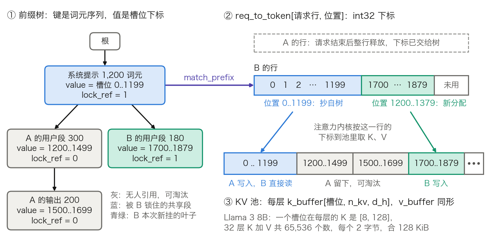
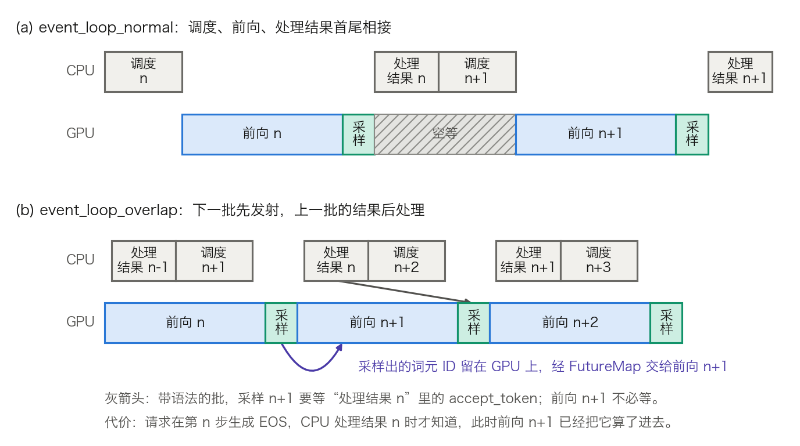

## 11.11 实例剖析：SGLang

SGLang 与 vLLM 最大的差别是前缀索引的形态：SGLang 用一棵显式的树，并把树的结构交给调度器使用。它的设计决定可以归成五条：

1. **树向调度器暴露结构。** 调度器看得见哪些等待请求落在同一分支，可以据此排序、在同一批内去重；按块哈希只能回答“某个请求命中了几块”（11.11.4、11.11.6）。
2. **共享靠下标。** “共享前缀”的实现是同一批槽位下标同时出现在树节点和请求行里，K/V 只有一份，从不复制（11.11.3）。
3. **只从无锁的叶子淘汰，而且按需才淘汰。** 可淘汰的缓存算作空闲，缓存永远不挡新请求的路；先丢的是对话历史，后丢的是系统提示（11.11.3）。
4. **准入是一次下注。** 只按最大生成长度的一个比例预留显存，赌输了就把请求撤回，比例随撤回情况自适应（11.11.4）。
5. **Prefill 批优先。** 换来更短的首词元延迟，代价是输出间隔抖动（11.11.6）。

SGLang 论文里的最长前缀优先排序和跳跃前进，都不在今天的默认路径上。本节以 [SGLang v0.5.20](https://github.com/sgl-project/sglang/tree/v0.5.20) 为准，类名、策略取值与启动参数的实现对照见[附录 A.7](../appendix/a7_framework_recipes.md)；前缀树的四个操作与两种索引的对比在 [11.5 节](11.5_prefix_reuse.md)，这里不再重讲。

### 11.11.1 两层结构：前端语言与后端运行时

[SGLang 论文](https://arxiv.org/abs/2312.07104)描述的系统分两层：一门嵌在 Python 里的**前端语言**，和一个独立的**后端运行时**。前端程序用 `gen`、`select`、`fork` 等原语操作一个“提示状态”，各分支异步地向后端发请求；后端是一个普通的推理服务，提供原生接口与 OpenAI 兼容接口。多数部署只把后端当服务用，不写前端程序，前缀复用照样生效。

**分工的依据是谁掌握什么信息。** 前端知道程序结构，例如 `fork(3)` 之后必有三个请求共享当前前缀；后端知道缓存里有什么。原则是前端总是发送完整的 Prompt，匹配与复用全由后端完成。例外只有一处，即**前端提示**（frontend hint）：三条分支同时到达时，树里还没有公共前缀，三个请求会在同一批里把同一段前缀各算一遍。前端因此在分支数大于 1 时先把前缀单独提交一次，只做 Prefill、不生成词元，唯一的作用是把前缀写进树。前缀 2,000 个词元、三条分支各追加 50 个时，Prefill 从 `3 × 2,050 = 6,150` 个词元降到 `2,000 + 3 × 50 = 2,150` 个。后端对同一问题另有一道防线，见 11.11.4 的批内前缀检查。

### 11.11.2 一个请求经过哪些进程

后端由三个进程组成：主进程分词并收发 HTTP，调度器进程组批、执行前向并持有前缀树、显存池与语法管理器，反分词进程把输出词元增量还原成文本。理由与 [11.10.1](11.10_vllm_internals.md) 相同：分词与反分词是纯 CPU 工作，放进独立进程，决定 GPU 何时拿到下一批的调度循环就不与它们争用同一个 Python 解释器。

调度器的主循环每轮做四件事：收请求、决定下一批、执行前向、处理结果。状态机与 [11.3 节](11.3_scheduler_loop.md)一致，有两点不同。第一，一轮要么是 Prefill 批，要么是 Decode 批：先尝试从等待队列组一个 Prefill 批，组得出来就先跑它，组不出来才让运行中的请求 Decode 一步。第二，Prefill 在 SGLang 里叫 **extend**，只为未命中的后缀计算。请求的 Prompt 有 1,380 个词元、其中 1,200 个命中时，每个头的打分是：

```text
Q[180, 128] × Kᵀ[128, 1380] → 分数[180, 1380]
```

Q 只有新算的 180 行，K 有 1,380 行，前 1,200 行读自缓存。它介于 3.8.3 的 Prefill（Q、K 行数相同）与 3.8.6 的 Decode（Q 只有 1 行）之间，两者都是它的特例。

### 11.11.3 RadixAttention 的实现：三张表

源码里叫 RadixAttention 的类只是模型中的注意力层，它把计算转交给 FlashInfer、FlashAttention 或 Triton 写的内核（Triton 见 [11.14.1](11.14_gpu_software.md)）；前缀复用的逻辑由三张表配合完成。



图 11-23：三张表怎样接在一起，画的是下文算例第 5 步结束的时刻（[生成脚本](https://github.com/yeasy/llm_internals/blob/main/tools/figures/ch11_11_sglang_three_tables.py)）。蓝色是被请求 B 锁住的共享段，青绿色是 B 本次新写入的部分，灰色无人引用、可以淘汰。

- **KV 池。** 每层一个 K 缓冲区和一个同形的 V 缓冲区，一行是一个**槽位**，存一个词元在这一层的 K 或 V。槽位分配器只管哪些行空闲。
- **`req_to_token`。** 一行对应一个运行中的请求，第 j 列是它第 j 个位置的槽位下标。它就是 [11.4.3](11.4_kv_memory_management.md) 的块表，只是块大小为 1；注意力内核拿到这一行的前若干格，据此到池里取 K、V。
- **前缀树。** 每个节点记一段词元、这些词元的槽位下标、子节点、引用计数和最近访问时间。

三张表合起来，“共享前缀”的含义是：同一批整数同时出现在树节点和若干请求的 `req_to_token` 行里。K/V 只有一份，从不复制；两个请求若同时 Prefill 同一段前缀，后登记的那个发现树里已有，就释放自己的重复槽位，改用树里的那一份。页大小取 1 的代价是下标：每缓存一个词元多 12 字节，对 131,072 字节的 K/V 约为 0.009%，可以忽略。部分注意力后端只支持固定的页大小，启用它们时页大小会被改大，命中长度随之向下对齐。

**算例一：七步走完三张表。** 系统提示 1,200 个词元。请求 A 再带 300 个词元的用户输入，结束时共占 1,700 个槽位；请求 B 带同一段系统提示和另外 180 个词元。表 11-26 的每一行都由一个按 SGLang 前缀树语义写的小脚本重放得到；与 11.5.5 一样，忽略末个输出词元尚无 K/V 的差一。节点被运行中的请求锁住时，它和它到根路径上的词元记为受保护；树里无人锁的词元记为可淘汰。

| 步 | 事件 | 树的变化 | 可淘汰 | 受保护 |
| ---: | --- | --- | ---: | ---: |
| 1 | A 到达，查树命中 0 | 无；分配 1,500 个槽位，Prefill 1,500 个词元 | 0 | 0 |
| 2 | A 的 Prefill 结束，已算部分登记进树 | 插入 1,500 词元的节点并上锁 | 0 | 1,500 |
| 3 | A 结束，整条序列登记进树 | 已有前缀 1,500，新挂 200 词元的叶子；解锁，释放 A 的请求行 | 1,700 | 0 |
| 4 | B 到达，匹配停在 1,500 节点的第 1,200 个词元 | 节点拆成 1,200 与 300 两段；返回 1,200 个下标，锁住 1,200 段 | 500 | 1,200 |
| 5 | B 的 Prefill 结束 | 在 1,200 段下新挂 180 的叶子，锁移到叶子 | 500 | 1,380 |
| 6 | 分配器缺 250 个槽位，触发淘汰 | 先淘汰 200 的叶子，其父 300 段变成叶子，再被淘汰 | 0 | 1,380 |
| 7 | A 的下一轮到达，Prompt 为历史 1,700 加新输入 150，共 1,850 | 只命中 1,200，需 Prefill 650 个词元；若无第 6 步，命中 1,700，只需 150 个 | — | — |

表 11-26：算例一的逐步记账，单位是词元。

表里读出三点。淘汰以节点为粒度，第 6 步要 250，实际释放 500。淘汰是惰性的，分配器够用时树不动，不够时只补差额。最先丢的是对话历史：1,200 的公共段被 B 锁着，即便没锁，它不是叶子，也排在最后；代价落在第 7 步，A 的第二轮要多算 500 个词元。

淘汰顺序默认是最近最少使用，也可以按命中次数或优先级排。键可以带命名空间，带不同 LoRA 适配器的请求从根开始就走不同的分支；租户之间另用盐值隔离。这是 [11.5.7](11.5_prefix_reuse.md) 的结论：凡是改变 K/V 的因素，都必须进键。显存之外还可以接主机内存作第二级、外部存储作第三级（HiCache）：显存里那份被淘汰后节点仍留在树上，命中时再加载回显存，换出与重算的账见 11.4.5。

### 11.11.4 调度器怎样用这棵树：排序、准入与撤回

**排序。** 论文的调度器按命中长度从长到短排等待队列（最长前缀优先），v0.5.20 的默认却是先到先服务。原因有两个：每轮要为每个等待请求做一次树匹配，队列长时这笔 CPU 开销落在调度循环里；冷门前缀的请求会一直排在后面（[11.5.6](11.5_prefix_reuse.md)）。用先到先服务时前缀复用照常生效，因为匹配发生在准入那一刻，只是执行顺序不再为命中率服务；显式选最长前缀优先后，队列过长时当轮仍退回先到先服务。另有一种折中策略按“已等待的 Prefill 量 ÷ 自己未命中的词元数”排序，命中多的优先，等得久的也会逐渐升上来。

**批内前缀检查。** 感知缓存的排序策略下，某个等待请求在真树里几乎没有命中时，调度器把它与一棵只由本轮等待队列构成的临时树比对；若它与排在前面的某个请求共享一段较长的前缀，就暂时排到队尾，让前一个请求先跑、先把前缀写进树，下一轮再命中。这是后端在不知道程序结构的情况下，对 11.11.1 前端提示的补救。

**准入。** 调度器逐个决定等待请求能否进入本轮 Prefill，记三本账：显存一本，计算两本（每轮 Prefill 词元上限与分块长度）。显存这本账的难处是运行中的请求还会生成多少词元无从得知：按 `max_new_tokens` 足额预留过于保守，完全不预留又会在 Decode 中途缺槽位。调度器的做法是下注，只按上限的一个比例 `ρ` 预留：

$$
R = N_{\text{空闲}} + N_{\text{可淘汰}} - \rho \sum_{r\,\in\,\text{运行中}} (m_r - o_r)
$$

`m_r` 是请求 r 的 `max_new_tokens`，`o_r` 是它已生成的词元数（超大的 `m_r` 会被截断）。新请求要记的账是“未命中的词元数 + 自己的 `max_new_tokens` + 一页”，小于 `R` 才接纳。式子里有两个设计决定。第一，可淘汰的缓存算作空闲，缓存永远不挡新请求的路。第二，`ρ` 随运行情况调整：初值 0.7，每个没有发生撤回的 Decode 步下调一点，估计逐步趋于乐观。

**算例二。** 池里空闲 20,000 个槽位，可淘汰 30,000 个；运行中有 40 个请求，`max_new_tokens` 均为 1,024，各已生成 224 个。`ρ = 0.7` 时预留 `40 × 800 × 0.7 = 22,400`，`R = 27,600`；一个未命中 2,000 个词元、`max_new_tokens = 1,024` 的新请求，页大小 1 时记账 `2,000 + 1,024 + 1 = 3,025`，可连续接纳 9 个。足额预留相当于 `ρ = 1`，`R = 18,000`，只能接纳 5 个。

**撤回。** 下注会输。某一步 Decode 前发现槽位不够，调度器把一部分运行中的请求撤回等待队列，默认先撤已生成词元最少的，再按留下的请求重估 `ρ`；频繁撤回时应调高保守系数。撤回就是 11.3 节的抢占，SGLang 的特点在于用一个自适应系数，主动在“批更大”与“少撤回”之间取平衡。下注划算的条件是：实际输出长度普遍远小于 `max_new_tokens`，或者被撤回请求的前缀还能从树里拿回。输出长度接近上限、显存又紧时，每次撤回都要重算 Prefill，过量准入反而亏。

**重叠调度。** 树匹配、排序、分配槽位、处理结果都是 CPU 上的 Python 代码，SGLang 的默认主循环让调度器比 GPU 早一批，如图 11-24。原理与代价见 [11.1.2](11.1_engines_overview.md)，难点与 vLLM 相同：第 n+1 批的输入正是第 n 批采样出的词元，做法也相同，让这些词元 ID 留在 GPU 上按请求行号直接交给下一批。只要 CPU 一轮的耗时短于 GPU 一步，前缀树的维护开销就藏进了前向的时间里；[SGLang v0.4 的发布说明](https://www.lmsys.org/blog/2024-12-04-sglang-v0-4/)报告这项改动使吞吐提高到 1.1 倍。



图 11-24：调度主循环的两种排法，时间为示意，不按比例（[生成脚本](https://github.com/yeasy/llm_internals/blob/main/tools/figures/ch11_11_sglang_overlap_loop.py)）。灰色是 CPU 上的调度与结果处理，蓝色是 GPU 前向，青绿色是采样。

### 11.11.5 结构化输出的后端

各语法库的路线见 [11.7.8](11.7_constrained_decoding.md)，SGLang 默认用 XGrammar，这里只看接线。语法编译不阻塞调度循环：编译缓存未命中时，编译任务交给线程池，请求在单独的队列里等，不进等待队列。每一步为批分配一张 11.7.1 的位图，带语法的请求各填自己那一行，异步拷到 GPU 后由一个内核就地改写 logits；采样后再把词元交给各请求的匹配器，推进语法状态。

最后一步与重叠调度冲突：第 n+1 批的掩码依赖第 n 批采样出的词元。SGLang 的处理是前向照常提前发射，采样推迟到上一批的结果处理之后。被推迟的只有采样这一小步，不是整个前向，这是 11.7.4 里那条数据依赖的具体解法。论文的压缩有限状态机（跳跃前进，11.7.5）在 v0.5.20 的调度路径里已不再调用，约束解码是逐词元加掩码。

### 11.11.6 与 vLLM 的设计取舍

索引、粒度、淘汰三方面的差别见 [11.5.4](11.5_prefix_reuse.md) 的表 11-13。表 11-27 只列调度一侧的差别。

| 维度 | SGLang | vLLM |
| --- | --- | --- |
| 等待队列排序 | 默认先到先服务；可选感知缓存的策略 | 先到先服务或按优先级 |
| 一步里放什么 | Prefill 批与 Decode 批分开，Prefill 优先；混排要显式打开 | 不区分阶段，每步按词元预算让各请求追上目标长度 |
| 显存不足时 | 准入时按 `ρ` 预留，Decode 前检查，不够则撤回 | 逐步分配，某步分配失败则抢占优先级最低的运行中请求 |
| 前端语言 | 有 | 无 |

表 11-27：SGLang v0.5.20 与 vLLM v0.29.0 在调度上的差别。

**粒度的差别没有看上去大。** 1,210 个共享词元，页大小 1 时复用 1,210 个，块大小 16 时复用 1,200 个。11.5.5 的算例里，块大小 16 的 Prefill 计算量是无缓存时的 9.8%，按词元匹配是 9.4%。树的价值不在这十来个词元，而在它向调度器暴露了结构：哪些等待请求落在同一分支上。按子树权重排序、批内前缀检查都直接用到这一点。

**淘汰的代价不同。** 两种淘汰都做到“先丢后缀、后丢前缀”：树靠结构保证，vLLM 靠入队顺序近似。vLLM 取队首是 O(1)；SGLang 每次淘汰都要对全部可淘汰叶子建堆，叶子多时这笔 CPU 开销落在调度循环里。

**Prefill 优先对统一预算。** “Prefill 优先、两类批分开”使新请求的排队时间最短，代价是运行中的请求要停下来等 Prefill 批跑完，词元间隔出现抖动，停顿长度就是 Prefill 批的计算时间（量级见 [11.9.1](11.9_disaggregated_serving.md) 的表 11-23），分块 Prefill 只限制每次停顿的上限。vLLM 的统一预算让每一步都带着 Decode 走，抖动小，但长 Prompt 要分更多步才能算完。两者对应 11.3 节里 TTFT（首词元延迟）与 TPOT（每输出词元时间）此消彼长的两端。

**两个引擎的共同点。** 两套代码独立写成，却收敛到同一组做法：可淘汰的缓存算作空闲；控制面只存下标或块号，K/V 张量留在数据面；调度比前向早一步，新词元留在 GPU 上；约束解码的掩码在 CPU 上与前向重叠；分词与反分词移出调度进程。它们都是在给 CPU 和显存减负，换一个引擎、换一个版本仍然成立。

### 11.11.7 参数与机制对照、边界

SGLang 的启动参数与上面的机制一一对应：是否启用前缀树、页大小、淘汰策略、分层缓存、排序策略、`ρ` 的保守系数、分块长度、是否混排、静态显存比例（[11.4.1](11.4_kv_memory_management.md) 的 `u`）、是否重叠调度、语法后端。参数名与默认值见[附录 A.7](../appendix/a7_framework_recipes.md)。几处容易误读的地方：

- **论文与代码不是一回事。** 前缀树仍是核心；缓存感知排序成了可选项，默认关闭；跳跃前进已不在调度路径上。引用论文的加速比时要同时引用它的条件。
- **6.4 倍不是通用数字。** 论文摘要的“吞吐最高 6.4 倍”出自多调用、高共享的语言模型程序，对比的是论文写作时的 Guidance、vLLM 与 LMQL。同一篇论文也写明：多轮对话里输出较长时，会话之间共享少，时间主要花在 Decode 上，几乎没有加速。前缀复用只省 Prefill（11.5.5）。
- **命中不等于留得住。** 算例一第 6 步那样的淘汰在高负载下频繁发生，多轮对话的历史最先丢（11.5.3 的“共用显存池”）。要留住它，靠分层缓存把 K/V 备份在主机内存或外部存储。
- **多实例时每个实例各有一棵树。** 显存里的树和主机内存备份是各实例私有的，只有外部存储一级才跨实例共享。不接外部存储时，靠网关维护一棵近似的前缀树把同一会话送回原实例（11.5.6）。

两节读下来，同一批机制在两个引擎里有两套代码形态，上限则由它跑在什么卡上决定，硬件一侧的账见 [11.12 节](11.12_hardware.md)。
