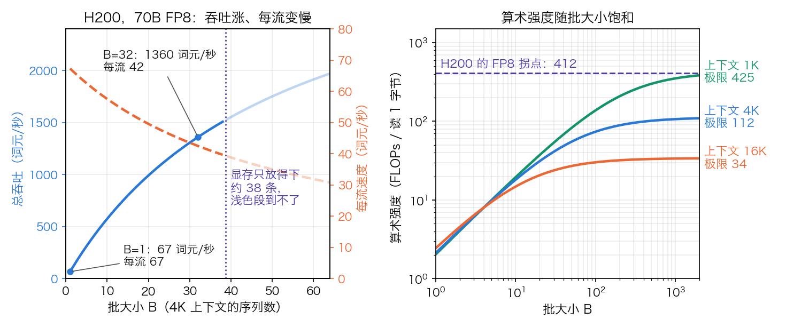

## 11.12 硬件选型：GPU、TPU 与专用加速器

规格表上三行回答三个问题：显存容量决定放得下什么、能同时驻留多少条序列，显存带宽决定 Decode 的单流上界（带宽除以权重字节），算力决定 Prefill。算力除以带宽得到拐点，它告诉你批要开到多大才能把算力用满；但这条路有尽头：上下文一长，每步读取以 KV 为主，算术强度饱和在拐点以下，Decode 开多大的批都受带宽限制。成本看每百万词元，等于卡时价格除以吞吐，同一张卡上批大小能让它相差 20 倍，所以首先是把批开大，其次才是换卡。今天的选法因此是：Decode 按带宽与容量选卡，Prefill 按算力选卡（[11.9 节](11.9_disaggregated_serving.md)），读厂商数字之前先对齐稀疏与稠密、单卡与整机、单向与双向三个口径。

算例沿用 [3.8.7](../03_components/3.8_gpt_inference_flow.md) 表 3-25 的 Llama 3 70B 与 Llama 3 8B。耗时与吞吐都是上界：Decode 的一步只数权重和 KV 缓存的读取，不计激活访存、通信与内核效率。实测值低于这些数字，可信的是不同卡之间的比值。

### 11.12.1 读懂规格表：哪几行决定推理性能

推理性能主要由三行规格决定：显存容量决定放得下什么，显存带宽决定 Decode 多快，算力决定 Prefill 多快。表 11-28 把 NVIDIA 几代数据中心 GPU 的这三行放在一起，并按 [10.1 节](../10_inference_optimization/10.1_bottleneck.md)的 Roofline 模型算出**拐点** `I_ridge = 峰值算力 ÷ 峰值带宽`：每读 1 字节要配上这么多次浮点运算，算力和带宽才同时用满。

| 型号 | 架构 | 显存 | 显存带宽 | 稠密 FP16/BF16 算力 | 拐点（FLOPs/字节） | 适用场景 |
| --- | --- | ---: | ---: | ---: | ---: | --- |
| A100 80GB | Ampere | 80 GB | 2.04 TB/s | 312 TFLOPS | 153 | 上一代主力，离线批处理 |
| L40S | Ada | 48 GB | 0.864 TB/s | 362 TFLOPS | 419 | 小模型推理 |
| H100 | Hopper | 80 GB | 3.35 TB/s | 990 TFLOPS | 295 | 训练、Prefill |
| H200 | Hopper | 141 GB HBM3e | 4.8 TB/s | 990 TFLOPS | 206 | 大模型 Decode |
| B200 | Blackwell | 180 GB HBM3e | 8 TB/s | 2250 TFLOPS | 281 | 训练与推理 |
| B300 | Blackwell Ultra | 288 GB HBM3e | 8 TB/s | 2250 TFLOPS | 281 | 超大模型推理 |

表 11-28：NVIDIA 主要数据中心 GPU 的推理相关规格，均为单卡值，算力取稠密口径，取自各型号的官方规格页。B200 的显存与带宽由 DGX B200 整机的 1,440 GB、64 TB/s 除以 8 得到；B300 的带宽由 GB300 NVL72 整机除以 72 得到，显存取单卡标称值。

读这类规格表有三个口径陷阱。

- **稀疏与稠密**。H100 规格页 FP16 Tensor Core 一行的 1,979 TFLOPS 是稀疏口径，稠密值是它的一半，约 990。HGX B200 页面的 36 PFLOPS 同样是 8 卡的稀疏口径，单卡稠密是 2250。把 B200 的 2250 与 H100 的 1979 直接相比，会得到 1.14 倍；同为稠密口径是 2.27 倍。
- **单卡与整机**。HGX 是 8 卡，GB200 超级芯片是 2 卡，NVL72 是 72 卡。同一页的数字要先除以卡数。
- **单向与双向**。NVLink 的标称带宽是双向合计，H100 的 900 GB/s 单向为 450 GB/s。

拐点一列给出两条结论。第一，A100 到 H100，算力涨了 3.2 倍，带宽只涨 1.6 倍，拐点从 153 升到 295。上下文很短、KV 读取可以忽略时，Decode 的算术强度约等于批大小（10.1 节），要用满 H100 的算力，批得开到近 300；上下文一长这条路就走不通，70B、BF16 的模型在上下文超过约 1,500 词元后，批开多大也到不了约 300（11.12.2）。H200 只加带宽，拐点回落到 206。

第二，低精度不改变这个临界批：FP8 加快的是每一步，把算力用满所需的批不变。10.1 节的临界批 `B* = 拐点 × 每参数字节 ÷ 2` 在此仍适用；权重和计算同降到 FP8 时，峰值算力翻倍使拐点翻到 591，每参数字节却由 2 减到 1，`B*` 仍约为 300（[10.1.2](../10_inference_optimization/10.1_bottleneck.md)）。

### 11.12.2 从带宽算 Decode 速度上界

**单流上界。** Decode 每生成一个词元，至少要把权重完整读一遍：

$$
\text{词元/秒} \le \frac{\text{显存带宽}}{\text{权重字节}}
$$

以 Llama 3 70B 的 FP8 权重（70 GB）为例，H100 是 `3350 ÷ 70 ≈ 48` 词元/秒，H200 是 `4800 ÷ 70 ≈ 69`。表 11-29 列出三种权重配置的结果。

| 权重配置 | 权重字节 | A100 | L40S | H100 | H200 | B200 |
| --- | ---: | ---: | ---: | ---: | ---: | ---: |
| Llama 3 70B，FP8 | 70 GB | 29 | 装不下 | 48 | 69 | 114 |
| Llama 3 70B，INT4 | 35 GB | 58 | 25 | 96 | 137 | 229 |
| Llama 3 8B，FP16 | 16.06 GB | 127 | 54 | 209 | 299 | 498 |

表 11-29：单流 Decode 速度上界（词元/秒）= 显存带宽 ÷ 权重字节。只比较带宽，未检查 KV 与工作区是否放得下（见 11.12.3）。

同一行里任意两张卡之比就是带宽之比：H200 对 H100 是 `4.8 ÷ 3.35 ≈ 1.43`。NVIDIA 给 H200 标的推理加速是 Llama 2 70B 最高 1.9 倍、GPT-3 175B 约 1.6 倍，都高于带宽比；多出的部分可以由更大的显存放得下更大的批来解释。量化的收益也在这张表里：同一张卡上，INT4 的上界是 FP8 的两倍。

**加上批处理。** 批里有 B 条序列时，权重读一遍，每条序列的 KV 各读一遍：

$$
t_{\text{step}} = \frac{\text{权重字节} + B \times \text{每序列 KV 字节}}{\text{显存带宽}}
$$

H200、70B FP8、每条序列 4K 上下文（FP16 的 KV 为 `4096 × 327,680 ≈ 1.34 GB`）。`B = 1` 时每步读 71.3 GB，14.9 ms，67 词元/秒。`B = 32` 时每步读 `70 + 32 × 1.34 ≈ 112.9 GB`，23.5 ms，每流 42 词元/秒，总吞吐 `32 ÷ 0.0235 ≈ 1360` 词元/秒。吞吐是单流的 20 倍，每流速度降到 0.63 倍。图 11-25 的左图画出了整条曲线。

图 11-25：批处理对 Decode 的作用与极限（[生成脚本](https://github.com/yeasy/llm_internals/blob/main/tools/figures/ch11b_decode_batch_limit.py)）。左：H200 上 70B FP8 的总吞吐与每流速度，竖线是显存容量允许的最大批。右：算术强度随批大小饱和，横线是 H200 的 FP8 拐点。

**批处理推不过的那条线。** 批越大，每步读取里 KV 的占比越高，算术强度不再随批线性增长。权重那一份读取被越来越多的序列分摊，趋于零；剩下的是每条序列自己的 KV 读取，每读 1 字节 KV 只对应固定的运算量，这个比值就是极限。计入注意力的运算量（3.8.8：每词元每层约 `4sd`，s 是上下文长度），

$$
I(B) = \frac{B\,(2N + 4 s d L)}{W + B \cdot s \cdot b_{kv}}
\;\xrightarrow{B \to \infty}\;
\frac{2N}{s \cdot b_{kv}} + \frac{2d}{n_{kv}\, d_h\, b}
$$

其中 N 是参数量，W 是权重字节，`b_kv = 2 × L × n_kv × d_h × b` 是每词元 KV 字节，b 是每个 KV 数的字节数。B 趋于无穷时分母里的 W 可以忽略，B 上下约去，得到右边两项。

70B、FP16 KV、4K 上下文下的极限是 `1.4e11 ÷ (4096 × 327,680) + 2 × 8192 ÷ (8 × 128 × 2) ≈ 104 + 8 = 112`，低于 H200 的 FP8 拐点 412（FP8 峰值算力按 BF16 的 2 倍计，`2 × 990 ÷ 4.8 ≈ 412`；见图 11-25 右）。上下文到了 4K，Decode 无论开多大的批都在带宽受限区；要让极限够得到这个拐点，上下文得短于约 1,060 词元。

第二项是注意力自身的算术强度：FP16 KV 下为 `8192 ÷ (8 × 128) = 8`，KV 用 FP8 则为 16。GQA 让 8 个 KV 头服务 64 个 Query 头，读 1 字节 FP16 的 KV 能换 8 次运算；普通多头注意力只有 1 次。长上下文的 Decode 因此该压的是 KV 的字节（[10.2 节](../10_inference_optimization/10.2_kv_cache.md)），而不是再加大批。

### 11.12.3 从显存算并发数

**权重放得下只是必要条件。** 权重显存的十进制 GB 下限是 `参数量（B）× 位宽（bit）÷ 8`。表 11-30 先用它筛掉明显不可能的组合。

<!-- numeric-claim: weight-memory -->
| 模型配置 | 参数 B | 位宽 bit | 权重 GB | H100-80GB | H200-141GB | B200-180GB | B300-288GB |
| --- | ---: | ---: | ---: | --- | --- | --- | --- |
| 70B FP8 | 70 | 8 | 70 | 是 | 是 | 是 | 是 |
| 70B INT4 | 70 | 4 | 35 | 是 | 是 | 是 | 是 |
| 405B INT8 | 405 | 8 | 405 | 否 | 否 | 否 | 否 |
| 405B INT4 | 405 | 4 | 202.5 | 否 | 否 | 否 | 是 |

表 11-30：权重能否装进单卡（十进制 GB）。“是”只表示权重本身装得下；B300 按整机折算的保守值每卡 262 GB（HGX B300 的 `2.1 TB ÷ 8`）计，四行结论不变。

**能不能服务，看扣掉权重之后还剩多少给 KV。** 可用于 KV 的显存 = 显存 × 利用率上限 − 权重 − 工作区；除以每条序列的 KV 字节，就是能同时驻留的序列数。取利用率 0.9、工作区 5 GB、70B FP8、每条 4K 上下文的 FP16 KV 为 1.34 GB：

- H100：`80 × 0.9 − 70 − 5 = −3 GB`，权重装得下，却一条序列也放不下。
- H200：`141 × 0.9 − 70 − 5 = 51.9 GB`，约 38 条；KV 改用 FP8 则约 77 条。
- B200：`180 × 0.9 − 70 − 5 = 87 GB`，约 64 条。

这就是 H200 相对 H100 的价值所在。同一颗计算芯片，多出的 61 GB 几乎全部变成 KV 池，70B 的 FP8 部署从“放不下”变成“单卡 38 路并发”，还省掉了多卡张量并行的通信。H100 要服务 70B，只能改用 INT4 权重（剩 `72 − 35 − 5 = 32 GB`，约 23 条），或者上多卡。

更大的模型同理。140B 的 FP8 权重在 H200 单卡上扣掉权重就没有余量；405B 的 INT4 权重只有 B300 放得下，且所剩无几。大显存单卡对这类模型的意义不在单卡服务，而在于减少张量并行的切分数，把省下的通信换成更大的批和更长的上下文。

### 11.12.4 多卡互连：NVLink 域有多大

单卡放不下时，互连成为选型的第四行规格。H100 规格页给出的两个数字足以说明差距：NVLink 为 900 GB/s，PCIe Gen5 为 128 GB/s，相差 7 倍。

**延迟而非带宽。** 张量并行对互连的要求是延迟。Decode 一步 160 次 all-reduce，批 32 时载荷合计只有约 84 MB，耗时由每次的固定开销决定，张量并行因此一般不跨节点（推导见 [11.8.4](11.8_multi_gpu_inference.md)）。读互连这行规格时，带宽决定 Prefill 侧大消息的通信时间，域的大小决定哪些卡之间能用低延迟的直连。

**NVLink 域的大小决定并行方式的上限。** HGX 这类 8 卡服务器的 NVLink 域是 8 张卡。Blackwell 一代把单卡 NVLink 带宽提到 1.8 TB/s，并把域扩到机柜：**GB200 NVL72** 在一个液冷机柜里放 36 颗 Grace CPU 和 72 颗 Blackwell GPU，用 NVLink Switch 连成一个域，全域带宽 130 TB/s。对推理，域变大的意义是让大规模专家并行可行：[11.9.6](11.9_disaggregated_serving.md) 里 DeepSeek-V3 的 Decode 用 EP320，all-to-all 走 InfiniBand，同样的通信放进 72 卡的 NVLink 域，每次的延迟低得多。GB200 超级芯片还把 Grace CPU 与两颗 B200 用 NVLink-C2C 相连，CPU 与 GPU 之间的双向带宽为 900 GB/s，KV 换出到主机内存（[11.4 节](11.4_kv_memory_management.md)）的代价随之下降。

NVIDIA 为 GB200 NVL72 标称“万亿参数模型实时推理 30 倍于 H100”。这个数的对照组是经 InfiniBand 扩展的 HGX H100，条件是输入 32,768、输出 1,024 词元、每词元 50 ms 的预测性能；它叠加了 FP4、大 NVLink 域和 2.4 倍的单卡带宽，是对大 NVLink 域最有利的负载，不能外推到单卡上的稠密小模型。

### 11.12.5 低精度的硬件支持：NVFP4 的格式与代价

每降一档精度，权重字节和 Decode 每步的读取量同步下降，单流上界按同样的倍数上升（表 11-29）。Blackwell 的 Tensor Core 原生支持 FP4，NVIDIA 为此定义的 **NVFP4** 是 [10.4 节](../10_inference_optimization/10.4_quantization.md)微缩放格式的一个硬件化实例：元素是 4 比特浮点 E2M1，可表示的幅值只有 0、0.5、1、1.5、2、3、4、6 八个；每 16 个元素共用一个 FP8（E4M3）缩放因子；整个张量再乘一个 FP32 标量。有效位宽 `4 + 8 ÷ 16 = 4.5` 比特，70B 的权重约 39.4 GB，相对 FP8 小 1.78 倍。取舍在两处：E2M1 的幅值小处密、大处疏，比 INT4 的等间隔网格更贴近钟形分布；块更小、缩放因子带小数，换来更小的误差，代价是比块大小 32、缩放因子只取 2 的幂的 MXFP4 多 0.25 比特。NVIDIA 报告 DeepSeek-R1-0528 由 FP8 转 NVFP4 在多项评测上的精度下降不超过 1%，这是特定模型上的厂商数据。算力口径上，HGX B200 的 FP4 稠密为单卡 9 PFLOPS，是稠密 BF16 的 4 倍。FP4 需要 Blackwell 及之后的硬件；FP8 自 Hopper 与 Ada 起普遍支持；INT4 权重量化靠软件内核实现，跨平台最成熟。

### 11.12.6 TPU、AMD 与 SRAM 型芯片：不同的取舍

前两小节的算法不依赖厂商，规格表上有显存容量与带宽就能套用。

| 平台 | 片外显存 | 带宽 | 70B FP8 单流上界 | 主要代价 |
| --- | ---: | ---: | ---: | --- |
| Google TPU 8i | 288 GB | 8.6 TB/s | 约 123 词元/秒 | 只在 Google Cloud 上提供，软件栈以 XLA 为中心 |
| AMD MI300X | 192 GB | 5.3 TB/s | 约 76 词元/秒 | 新内核与新量化格式通常先出现在 CUDA 上 |
| AMD MI355X | 288 GB | 8 TB/s | 约 114 词元/秒 | 同上；增加了 MXFP6、MXFP4 |
| SRAM 型（Groq、Cerebras） | 权重放在片上 SRAM | 自称 80 TB/s 以上 | 高一个量级 | 单芯片容量小，一个模型要占很多颗芯片，每芯片并发少 |

TPU、AMD 与 SRAM 型芯片按同一公式算出的单流上界与主要代价。TPU 8t 面向训练（216 GB、6.5 TB/s），8i 面向推理；可用性见[附录 A.5](../appendix/a5_volatile_facts.md)。

TPU 的取舍在系统层：芯片间互连（ICI）把大量芯片直接连起来，可以一次申请到数千颗芯片的整片集群。AMD 的规格与同代 NVIDIA 产品相当，差距在软件：vLLM、SGLang 都提供 ROCm 后端，但新特性通常晚一步。SRAM 型芯片不经过片外 HBM，带宽高一个量级，单流延迟很低，适合为低延迟付溢价的场景，是否划算仍要用 11.12.7 的成本算式判断。CPU 推理也服从同一公式：主机内存带宽远低于 HBM，只有小模型加 4 比特量化才有可用的速度，llama.cpp 是这条路线的代表，适合低并发的本地部署。

### 11.12.7 决策框架与成本算式

选型按下面的顺序做，每一步都对应前面的一个算式。

1. **定模型与精度，算权重字节**（表 11-30）。单卡放不下就要张量并行，互连进入选型（11.12.4）。
2. **定每流速度目标，反推带宽**。需要的带宽 = 目标词元/秒 × 每步读取字节。例：70B FP8、批 16、4K 上下文，每步读 91.5 GB；每流要 50 词元/秒，就要 `91.5 × 50 ≈ 4.6 TB/s`。H200 刚好够，H100 即使放得下也达不到。实时对话这类延迟敏感的场景，每词元时间由 Decode 侧的带宽决定，Decode 不能用低配卡。要再快，靠投机解码（[10.6 节](../10_inference_optimization/10.6_speculative_decoding.md)）让一次权重读取产出多个词元，或加大张量并行把带宽加起来；后者每层多出两次 all-reduce，固定开销要另计（[11.8.4](11.8_multi_gpu_inference.md)）。首词元延迟则取决于排队与 Prefill 算力（指标定义见 [11.13.1](11.13_best_practices.md)）。
3. **定并发，算 KV 容量**（11.12.3）。高吞吐的 API 服务要的是大批，显存容量与带宽同样重要。
4. **看输入输出分布**。长输入压 Prefill 的算力与 KV 容量，长输出压 Decode 的带宽与 KV 驻留时间；规模足够时可以分池配卡（[11.9.4](11.9_disaggregated_serving.md)）。离线批处理不要求每流速度，用上一代的卡把批开大即可。
5. **算成本**。比较的对象是每百万词元的成本，不是卡的单价；算式见下。
6. **核对软件生态**。所选的量化格式与并行方式，要确认目标引擎在目标硬件上有对应的内核。NVIDIA 平台上 vLLM、SGLang、TensorRT-LLM 的支持最完整，ROCm 次之。

**成本算式。**

$$
\text{每百万词元成本} = \frac{\text{每卡时价格}}{\text{每秒词元数} \times 3600 \div 10^{6}}
$$

假设某张 H200 的卡时价格为 2 美元（示意值），70B FP8、4K 上下文：批 32 时 1360 词元/秒，成本约 0.41 美元/百万词元；批 1 时 67 词元/秒，约 8.3 美元。同一张卡相差 20 倍，差别只在批大小，代价是每流速度从 67 降到 42 词元/秒。成本优化因此首先是把批开大，其次才是换卡。量化的作用也由此得出：权重从 FP16 降到 FP8 或 4 比特，字节数降到 1/2 或约 1/3.6，单流上界按同样的倍数上升，省下的显存还能换成更大的批。

算式里的每秒词元数有两处常被高估。其一，它是 Decode 的输出速率，输入词元走 Prefill，要分开计价（[11.13.8](11.13_best_practices.md)）。其二，在线服务按峰值配置，全天的平均吞吐等于满载吞吐乘平均利用率，低谷时的空闲算力也计入成本，错峰填入离线任务就是在抬这一项。自建集群的约束常常是供电与散热而不是卡价，这时要比的是每瓦词元数与每机柜功率。云上按需与自建的价差随厂商和时间变化，应代入当时的报价来算。

### 11.12.8 下一代平台

Blackwell 之后是 Rubin。按 NVIDIA 规格页，单颗 Rubin GPU 为 288 GB HBM4、19.2 TB/s，稠密 FP16/BF16 算力 4 PFLOPS，互连为第六代 NVLink。用本节的算法读这几行：带宽是 B200 的 2.4 倍，70B FP8 的单流上界升到 `19200 ÷ 70 ≈ 274` 词元/秒；拐点为 `4000 ÷ 19.2 ≈ 208`，低于 B200 的 281，这一代带宽涨得比稠密算力快，对 Decode 有利。发布节奏与各云区域的实际可用性见[附录 A.5](../appendix/a5_volatile_facts.md)。互连的方向与此一致：NVLink 域继续扩大，跨机柜则是 RoCE 以太网、InfiniBand 与光电混合交换并存；某种网络能否支撑目标规模的集合通信，要看拓扑、拥塞控制与作业形态，不能只看网络名称。

### 11.12.9 从 GPU 到集群：数据经过哪些部件

权重加载、检查点和跨机的 KV 传输还要经过 CPU、主机内存、网卡和存储，最慢的一段决定耗时。Llama 3 70B 的 141.1 GB 权重按理想线速计，经 100 GbE 从共享存储读入要约 11 秒，经 10 GbE 要约 113 秒，而主机到 GPU 的 PCIe Gen5 只需约 2.2 秒：这时慢在存储与网络，换更快的卡没有用，常用的对策是把权重缓存在节点本地的 NVMe 或主机内存里。跨节点通信走 InfiniBand 或在以太网上承载 RDMA 的 RoCE，[GPUDirect RDMA](https://docs.nvidia.com/cuda/gpudirect-rdma/) 让网卡直接读写 GPU 显存，省掉经主机内存的中转，但不消除链路带宽和拥塞。排障按路径分段：加载慢先查存储与缓存，GPU 等输入查主机侧处理和传输，单机正常、跨机变慢再查通信拓扑与网络。

### 11.12.10 集群与数据中心：调度边界和物理边界

集群是一起调度的一组节点，数据中心是提供机柜、供电与散热的物理设施，两者不必一一对应（[Kubernetes 的多可用区部署](https://kubernetes.io/docs/setup/best-practices/multiple-zones/)就是一个集群跨多个故障区域）。部署地图要分别标出“哪些资源一起调度”和“哪些设备共享物理依赖”：[11.13.3](11.13_best_practices.md) 为容忍单实例故障多留的 1 个实例，若与另外两个共用一路供电，一次断电就同时带走全部副本，冗余落空。规律是紧耦合计算优先考虑互连，服务副本优先考虑故障隔离，跨故障域分散副本的代价是通信距离变长。功率限制或过热会触发降频，同样的程序变慢时，先用 [nvidia-smi 的时钟事件原因](https://docs.nvidia.com/deploy/nvidia-smi/index.html)排除它，再怀疑内核。
