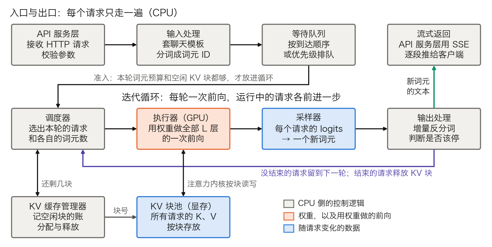

## 11.1 推理引擎架构概览

推理引擎存在的理由是一条 Roofline 事实：Decode 每一步都要把全部权重读一遍，耗时由显存带宽决定，与批里有几个请求几乎无关。同一步多带一个请求因此近乎免费，直到各请求自己的 KV 读取量追上权重。引擎的全部工作是让每一步的批尽量大而且稳：迭代级调度负责补位，KV 显存管理决定批的上限，调度器在总吞吐与每个请求的延迟之间取点，CPU 侧的调度与采样开销藏进 GPU 前向。面向 GPU 服务器的几款开源引擎功能清单已经趋同，差别在 KV 复用的索引结构、执行方式和硬件覆盖；选型先看请求形态与延迟目标，再用自己的流量压测。

第 10 章的 KV 缓存、量化、投机解码是单项技术，它们之间的取舍（例如 10.6.4 的“批越大，可用于投机验证的空闲算力越少”）不落在任何一项内部，只能由一个统一的运行时在每一轮前向之前裁决。

### 11.1.1 为什么需要专用推理引擎

线上同时有成百上千个请求，长度各异，随时到达，随时结束。`model.generate()` 能把一批输入一起算，但缺四样东西：

- **迭代级的批处理**：它整批进、整批出，不能在两次前向之间换入新请求、换出已结束的请求。
- **KV 缓存的生命周期管理**：它会用 KV 缓存，但不负责分页、回收、跨请求共享和租户隔离。
- **调度策略**：谁先算、每轮算多少词元、显存不够时牺牲谁，没有决策者。
- **服务层治理**：流式输出、取消与超时、限流、可观测性和失败恢复，需要另外集成。

第一样东西值多少，可以直接算。本章的算例都取 Llama 3 8B 在单张 H100 上的部署，用到的常量集中列在下表，后面各节直接引用，不再重算。

| 常量 | 取值 | 来历 |
| --- | --- | --- |
| 权重 | 80.3 亿个参数，BF16 下 16.06 GB | 配置见 [3.8.7](../03_components/3.8_gpt_inference_flow.md) 的表 3-25；其中 32 层的矩阵参数共 69.8 亿个（每层 2.18 亿），记作 `P`，其余主要是输入嵌入与 LM head 两张各 5.25 亿的表 |
| 读一遍权重的时间 `a` | `16.06 GB ÷ 3.35 TB/s = 4.79 ms` | 纯 Decode 步长的下界 |
| 每词元计算量 | `2P = 1.396 × 10¹⁰` FLOPs，峰值算力下 14.1 µs | 一次乘加记 2 次（[1.4.5](../01_introduction/1.4_transformer_idea.md)）；要采样的位置另加 LM head 的 `1.05 × 10⁹` |
| 每词元 KV | 128 KiB（131,072 字节） | 公式见 [10.2 节](../10_inference_optimization/10.2_kv_cache.md) |
| KV 池 | 53.94 GB，约 41 万个词元（411,525） | `80 × 0.9 − 16.06 − 2`，推导见 [11.4.1](11.4_kv_memory_management.md) |
| 硬件 | 显存 80 GB，带宽 3.35 TB/s，BF16 稠密峰值算力 990 TFLOPs/s | 拐点约 300 FLOPs/字节（[10.1.2](../10_inference_optimization/10.1_bottleneck.md)） |
| 算力利用率 `η` | 求步长下界与拐点时取 1；估计实际耗时取 0.4 | 例外是 11.4.5：比较换出与重算时取 0.5，有意偏向重算一侧 |

Decode 每一步要把权重读一遍，再把批内每个请求的 KV 缓存各读一遍，时间下界是“要读的字节数 ÷ 显存带宽”。设每个请求的上下文已有 1,000 个词元，KV 约 0.131 GB，批大小为 B 时每步要读 `16.06 + 0.131 × B` GB。表 11-1 列出四个批大小。

| 批大小 B | 每步要读的字节 | 每步时间下界 | 吞吐上界（词元/秒） | 每读 1 字节做几次运算 |
| ---: | ---: | ---: | ---: | ---: |
| 1 | 16.19 GB | 4.83 ms | 207 | 1.0 |
| 8 | 17.11 GB | 5.11 ms | 1,566 | 7.8 |
| 32 | 20.25 GB | 6.05 ms | 5,293 | 26 |
| 128 | 32.84 GB | 9.80 ms | 13,058 | 65 |

表 11-1：Llama 3 8B 在 H100 上的 Decode 吞吐上界随批大小的变化。只数了权重与 KV 缓存的读取，未计激活读写、内核启动和 CPU 开销，实测值低于此数；可信的是各行之间的比值。

逐个请求串行是 207 词元/秒；32 个请求合成一批是 5,293 词元/秒，约 25.6 倍，而每步只慢了 1.2 ms。倍数不到 32，是因为 KV 缓存各读各的，批处理摊薄的只有权重。B = 128 时 KV 的读取量（16.78 GB）已超过权重，每步时间翻倍，总吞吐仍在涨；最后一列始终远低于约 300 的拐点，瓶颈一直在带宽而不在算力。

本章的每个部件都在这条曲线上做文章。让每一步里始终有足够多的请求、一结束就补位，是连续批处理（[11.2 节](11.2_continuous_batching.md)）。批大小受限于显存里放得下多少请求的 KV 缓存，要把这块显存管到几乎不浪费，是分页的 KV 管理（[11.4 节](11.4_kv_memory_management.md)）。批越大单个请求的每一步越慢，吞吐与延迟之间取哪一点由调度器掌握（[11.3 节](11.3_scheduler_loop.md)）。

### 11.1.2 引擎的组件与一个请求的路径

图 11-1 是各家引擎共有的骨架。上排每个请求只走一遍；中排的循环每产出一个词元转一圈，称一轮迭代（iteration）。后面各节按步计数时，一步就是这里的一轮。

图 11-1：推理引擎的组件与一个请求的路径（[生成脚本](https://github.com/yeasy/llm_internals/blob/main/tools/figures/ch11a_engine_components.py)）。灰色是 CPU 侧的控制逻辑，橙色是权重和用权重做的前向，蓝色是随请求变化的数据。KV 缓存管理器只记块号的账，不搬动 K、V 本身；块里的数据由注意力内核读写。

一个请求依次经过八步：

1. **API 服务层**接收 HTTP 请求，校验采样参数与长度上限。接口多与 OpenAI 的格式兼容。
2. **输入处理**套用聊天模板并分词，得到词元 ID 序列。
3. 请求进入**等待队列**，此时还不占显存。
4. **调度器**在每一轮开始时决定本轮让哪些请求参与、各算几个词元。已在 Decode 的请求各算 1 个，新请求算整个 Prompt 或其中一段。放行新请求要同时满足两个预算：本轮词元总数不超上限，**KV 缓存管理器**手里的空闲块够用。
5. **执行器**把选中的词元拼成一个批，连同各请求的位置与块号送上 GPU，做全部 L 层的一次前向。多卡部署见 [11.8 节](11.8_multi_gpu_inference.md)。
6. **采样器**取每个请求最后一行的 logits，按该请求自己的温度、top-p 等参数选出一个词元。约束解码的词元掩码也在这一步施加（[11.7 节](11.7_constrained_decoding.md)）。
7. **输出处理**把新词元增量反分词成文本，并判断是否该停：选中 EOS、达到最大长度，或命中停止字符串。
8. 文本经 API 服务层以 SSE（Server-Sent Events）流回客户端。未结束的请求留到下一轮，回到第 4 步；结束的请求释放全部 KV 块。

准入取决于还剩多少空闲块，所以 KV 缓存管理器是调度器的依据，不在执行器下游；执行器拿到的只是一张块号表。

**CPU 段要藏进 GPU 段。** 第 4 到 7 步每产出一个词元就要走一遍，其中只有第 5 步在 GPU 上。一轮迭代的时间分成两段：

$$
t_{\text{轮}} = t_{\text{CPU}}(\text{调度、拼批、采样后处理}) + t_{\text{GPU}}(\text{前向})
$$

两段若串行执行，GPU 在 CPU 段里空等，空等占比为 $$t_{\text{CPU}} / (t_{\text{CPU}} + t_{\text{GPU}})$$。表 11-1 中 B = 32 的 GPU 段下界约 6 ms，CPU 段若为 2 ms，GPU 就有 25% 的时间无事可做。模型越小、卡越快，这个比例越高；SGLang 团队的[说法](https://lmsys.org/blog/2024-12-04-sglang-v0-4/)是，未经优化的引擎可能把一半时间花在 CPU 开销上。对策有两类，都不改变上面八步的逻辑顺序。

**CUDA Graph** 省掉的是 CPU 逐个派发、提交内核的时间。一轮前向由三百多个内核组成，每个都由 CPU 发起，CPU 跟不上时 GPU 在两个内核之间空等，这些空隙计在上式的 $$t_{\text{GPU}}$$ 里；把整轮的内核序列录下来一次回放，空隙就消失了（[11.14 节](11.14_gpu_software.md)）。

**重叠调度**不缩短任何一项，它让两段并行：GPU 计算第 n 轮时，CPU 已在准备第 n+1 轮的批，一轮的时间从两项之和趋近两项中较大的一项。它成立的前提是下一轮的批不必等本轮的采样结果：Decode 请求下一轮仍各算 1 个词元，新采出的词元 ID 留在 GPU 上直接作下一轮的输入。代价有两处。其一，CPU 看到的状态晚一轮：某请求在第 n 轮采出 EOS，第 n+1 轮的前向已经把它算了进去，白占一轮的算力和一个 KV 位置。其二，凡依赖上一轮采样结果的工作都要在采样之前同步一次，约束解码的掩码就是这种情形（[11.7.4](11.7_constrained_decoding.md)）。vLLM 与 SGLang 都默认开启这种调度，各自的做法见 [11.10 节](11.10_vllm_internals.md)与 [11.11 节](11.11_sglang_internals.md)。

### 11.1.3 主流引擎的定位

连续批处理、分页的 KV 缓存、前缀复用、分块 Prefill、量化与多卡并行，面向 GPU 服务器的几款开源引擎现已全部具备。功能清单分不出高下，差别在三处：KV 复用用什么数据结构，前向怎样执行，覆盖哪些硬件。表 11-2 按这三处对比。

| 引擎 | 出身与定位 | KV 复用的数据结构 | 执行方式 | 硬件范围 |
| --- | --- | --- | --- | --- |
| vLLM | 出自加州大学伯克利分校，是 PagedAttention 论文的实现，后成为社区项目；通用的在线服务 | 按块哈希：KV 切成定长块，每块按内容算一个键，查表复用；只缓存写满的块 | 默认先编译模型，再把一轮前向的内核序列录下来整体回放 | NVIDIA、AMD、Intel 的 GPU 与多种 CPU；TPU、Gaudi、昇腾等经插件支持 |
| SGLang | 起于“LLM 程序”的执行：前端语言加运行时，面向多次调用、分支与结构化输出 | 前缀树（RadixAttention）：请求结束后 KV 留在树里，按 LRU 淘汰 | PyTorch 运行时，CPU 调度与 GPU 计算重叠 | NVIDIA、AMD 的 GPU，Intel CPU、TPU、昇腾等 |
| TensorRT-LLM | NVIDIA 官方；围绕自家 GPU 的内核与 FP8、FP4 低精度 | 分页 KV 缓存，带块复用 | PyTorch 后端直接加载模型 checkpoint | 只支持 NVIDIA GPU |
| llama.cpp | 本地与边缘部署；纯 C/C++ 实现，无外部依赖。Ollama 以它为后端 | 服务端按槽位（slot）处理并发；新请求与槽位里上一次的 Prompt 比较，只重算不同的后缀 | GGUF 格式的整数量化权重（1.5 到 8 比特）；CPU 与 GPU 混合推理 | x86 与 ARM CPU、Apple Silicon、各类 GPU |

表 11-2：主流推理引擎的定位与设计取舍，各项取自项目的论文、README 或设计文档。前三列是设计取向，变化慢；执行方式与硬件范围随版本变化，以各项目文档为准。

**哈希块表与前缀树。** 两者复用的都是词元级完全一致的前缀，区别在记账方式。vLLM 给每个写满的块算一个哈希，存进一张平坦的表，查找与淘汰都以块为单位。SGLang 把所有请求的词元序列组织成一棵前缀树，分叉点是树的内部节点，淘汰从叶子开始；树保留了“谁和谁共享到哪里”的结构，调度器可据此安排执行顺序。数据结构、命中率的账与失效情形见 [11.5 节](11.5_prefix_reuse.md)。

**TensorRT-LLM。** 现行版本的 PyTorch 后端直接加载 checkpoint，不需要预先编译 engine；名称里的 TensorRT engine 后端[已经移除](https://nvidia.github.io/TensorRT-LLM/latest/legacy/tensorrt-backend-removal.html)，旧资料中“转换 checkpoint、构建 engine、运行”的流程只适用于旧版。它的循环与图 11-1 同构，部署的输入、启动、验收与排障步骤见[附录 A.7](../appendix/a7_framework_recipes.md)。

**退出一线的两个名字。** Hugging Face 的 TGI（Text Generation Inference）已转入维护模式，其 [README](https://github.com/huggingface/text-generation-inference) 建议改用 vLLM、SGLang 或 llama.cpp。[DeepSpeed-FastGen](https://arxiv.org/abs/2401.08671) 留下的是 Dynamic SplitFuse，即分块 Prefill 的同一思路（11.2.5）；它报告的加速以尚无分块 Prefill 的早期 vLLM 为基线，不能外推到今天。

大型闭源服务商的内部部署栈通常不公开，不能从开源引擎的流行程度推断其生产环境用的是哪一款。

### 11.1.4 选型：先看请求形态，再看引擎

默认的起点可以按表 11-2 的设计侧重直接给出：

- 通用的在线服务从 vLLM 起步，它的模型与硬件覆盖面最广。
- 共享前缀重、一次任务多次调用，或以结构化输出为主的负载，先试 SGLang：前缀树的命中粒度到词元，调度器还能利用共享结构（[11.5.4](11.5_prefix_reuse.md)）。
- 只有 NVIDIA GPU、又要用到 FP8、FP4 低精度内核时，看 TensorRT-LLM。
- 笔记本与边缘设备用 llama.cpp 一系。

起点选定后按四步收窄，顺序不宜颠倒：

1. **硬件定候选集。** AMD、TPU 或昇腾上先查表 11-2 的最后一列。
2. **请求形态定侧重点。** 共享前缀多（长系统提示、多轮对话、智能体反复调用）时，前缀复用的命中率决定成本（11.5 节）。长 Prompt 与交互式对话混跑时，看分块 Prefill 与分离式部署（11.2.5、[11.9 节](11.9_disaggregated_serving.md)）。一个基座挂许多适配器，看多 LoRA 的批处理（[11.6 节](11.6_multi_lora_serving.md)）。输出必须合乎 JSON Schema，看约束解码的开销（11.7 节）。
3. **延迟目标定指标。** 不只看单卡词元/秒，要同时看并发峰值下 TTFT（首词元时间）与 TPOT（每输出词元时间）的 P95、P99，定义与测法见 [11.13 节](11.13_best_practices.md)。
4. **用自己的流量压测确认。** 公开基准的结论随引擎版本、模型和长度分布而变，只能当起点。

例如在 8 张 H100 上部署带长系统提示的多轮客服机器人：硬件不构成限制；所有请求以同一段系统提示开头，侧重点是前缀复用，候选是 vLLM 与 SGLang；验收指标是并发峰值下 TTFT 与 TPOT 的 P99；最后用线上的 Prompt 长度分布与到达率重放，在达标的前提下比较单卡吞吐。

### 11.1.5 本章路线图

[11.2 节](11.2_continuous_batching.md)给出四个核心想法：迭代级调度、分页的 KV 缓存、前缀缓存、分块 Prefill，只讲到为什么成立、值多少、代价在哪。11.3 到 11.5 节各展开一个部件的机制：调度器、KV 缓存管理器、KV 块的跨请求共享。11.6 到 11.9 节是扩展：多个 LoRA 适配器同批计算，采样器上的语法约束，执行器跨多张卡，Prefill 与 Decode 拆到两组机器。[11.10](11.10_vllm_internals.md)、[11.11](11.11_sglang_internals.md) 两节把机制对到 vLLM 与 SGLang 的实现，最后三节落到硬件、运维与 GPU 软件栈。
