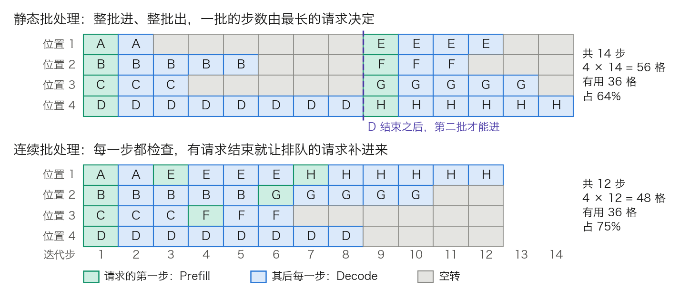
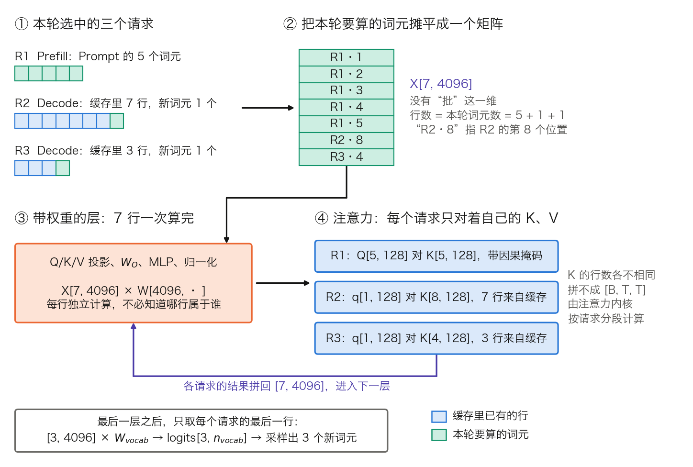
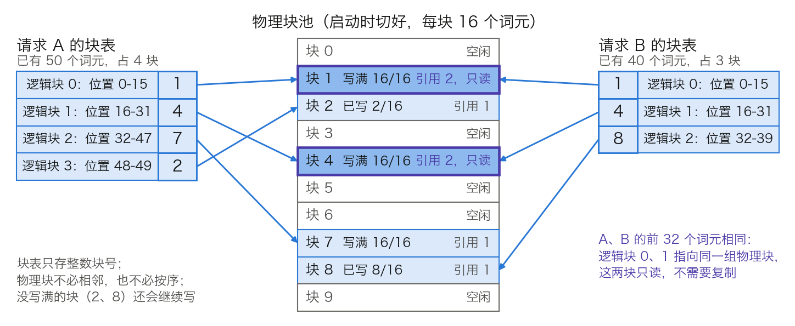
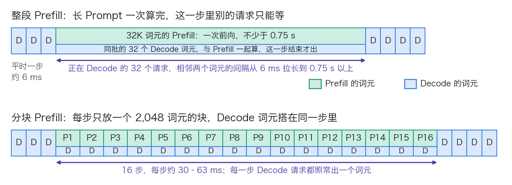

## 11.2 连续批处理与 PagedAttention

静态批处理的有效占比等于“平均输出长度 ÷ 最长输出长度”，输出长度的分布越偏，浪费越重。连续批处理把调度粒度降到一次前向：谁结束谁退出，有空位就补。它能成立，是因为线性层逐行独立，不同阶段的词元可以摊平成一个矩阵一起算；注意力没有权重，各读各的 KV，分开算并不吃亏。批能开多大由 KV 显存决定，定长块按需分配把这块显存的利用率从两三成提到接近 100%。长 Prompt 会挡住同批的 Decode，按词元预算分块把一次长停顿换成一个可调的上界；相同前缀的满块只读共享，就是前缀缓存。这四个想法在 vLLM 与 SGLang 里都默认开启，留给部署者的旋钮是词元预算、并发上限和显存比例。

每个想法在这里只讲到为什么成立、值多少、代价在哪；调度器、块表与恢复、前缀索引的机制分别在 [11.3](11.3_scheduler_loop.md)、[11.4](11.4_kv_memory_management.md)、[11.5](11.5_prefix_reuse.md) 三节。

### 11.2.1 静态批处理浪费了多少

**静态批处理**（Static Batching）把一批请求打包送进模型，等这一批全部生成完，才处理下一批。一批要跑多少步，由其中最长的请求决定；先结束的请求占着位置空转。

设一批有 4 个请求，输出长度分别是 10、50、200、2,000 个词元。这一批要跑 2,000 步，共 `4 × 2,000 = 8,000` 个“请求·步”的位置，产出词元的只有 2,260 个：

$$
\text{有效占比} = \frac{\text{各请求输出长度之和}}{\text{批大小} \times \text{最长输出长度}} = \frac{2{,}260}{8{,}000} = 28.25\%
$$

这个比值就是“平均输出长度 ÷ 最长输出长度”。线上对话的输出从几个词元到几千个词元不等，分布很偏，比值因此很低。另有两笔代价不在比值里：新请求哪怕只晚到一步，也要等整批结束；Prompt 长短不一，要补齐到同一长度才能堆成 `[B, T, d_model]` 的张量，补上去的位置白算。

反过来，各请求的步数相同（只做一次前向的嵌入与打分），或离线任务按长度分桶之后，这个比值接近 1，静态批处理已经够用，不必为迭代级调度付每步的 CPU 开销。

### 11.2.2 连续批处理：迭代级调度

**连续批处理**（Continuous Batching）把调度的粒度从“一批请求”降到“一次前向”。这个想法出自 [Orca](https://www.usenix.org/conference/osdi22/presentation/yu)，原文称**迭代级调度**（iteration-level scheduling）。调度器每次只让执行器跑一步，跑完立刻重新决定下一步的批里有谁。每一步做三件事：

1. 把上一步已经结束的请求移出批，释放它的 KV 缓存。
2. 在预算之内放行等待队列里的请求。预算有两项：本步词元总数的上限，和还能分给 KV 缓存的显存。
3. 对选中的全部请求做一次前向。新放行的请求这一步做 Prefill，其余请求各做一步 Decode。

图 11-2 用 8 个请求对比两种做法。静态批处理要 14 步，56 个位置里有用的占 64%，请求 E 到第 9 步才开始；连续批处理只要 12 步，有用的占 75%，E 在第 3 步就开始。后者尾部的空位来自队列已空；只要队列里一直有请求，每个位置一空就被补上，占比趋近 100%。对 11.2.1 的 4 请求例子，这相当于同样步数下多产出 `1 ÷ 0.2825 ≈ 3.5` 倍的词元。

图 11-2：同样 8 个请求，静态批处理与连续批处理各占用多少步（[生成脚本](https://github.com/yeasy/llm_internals/blob/main/tools/figures/ch11a_batching_gantt.py)）。各请求占用的步数为 A2、B5、C3、D8、E4、F3、G5、H6，合计 36 格。图中画成 4 行只为便于比较：真实引擎约束的是每轮词元数和空闲 KV 块数，不是固定的行数。

公开论文里的加速倍数取决于和谁比，不能互相换算：Orca 相对 FasterTransformer 的 36.9 倍来自迭代级调度，[vLLM 论文](https://arxiv.org/abs/2309.06180)相对 Orca 的 2 到 4 倍来自 11.2.3 的显存管理。

**不同阶段的请求怎样放进同一次前向。** 设同一步里 R1 在做 Prefill，要算 5 个词元；R2、R3 在做 Decode，各算 1 个词元，缓存里分别已有 7 行和 3 行。三者堆不成 `[B, T, d_model]`。Orca 的解法叫**选择性批处理**（selective batching），主流引擎沿用至今，形状变化见图 11-3：

- **摊平**：把本步要算的全部词元排成一个没有批维度的矩阵，行数是各请求本步词元数之和：`X[5 + 1 + 1, 4096] = X[7, 4096]`（形状按 Llama 3 8B）。
- **带权重的层**：7 行一次算完，例如 `X[7, 4096] × W_Q[4096, 4096] → Q[7, 4096]`。线性层、归一化、激活函数都是逐行独立的，不需要知道哪一行属于哪个请求。新算出的 K、V 各自追加到所属请求的缓存里。
- **注意力**：各请求对着自己的 K、V。每个头上，R1 是 `Q[5, 128] × Kᵀ[128, 5] → 分数[5, 5]`，带因果掩码；R2 是 `q[1, 128] × Kᵀ[128, 8] → 分数[1, 8]`；R3 是 `q[1, 128] × Kᵀ[128, 4] → 分数[1, 4]`。K 的行数各不相同，分开算，结果再拼回 `[7, 4096]`。
- **LM head**：只取每个请求的最后一行，`[3, 4096] × W_vocab[4096, n_vocab] → logits[3, n_vocab]`，采样出 3 个新词元。

图 11-3：一轮迭代里的混合批（[生成脚本](https://github.com/yeasy/llm_internals/blob/main/tools/figures/ch11a_mixed_batch_shapes.py)）。③ 与 ④ 在每一层里交替出现：Q/K/V 投影在注意力之前，`W_O` 与 MLP 在注意力之后，图中合画为一个方框。

注意力不合批并不吃亏。批处理的收益来自“读一遍权重，服务多行数据”，而注意力这一步没有权重，它读的是各请求自己的 K、V，合不合批要读的字节数一样。实现上，这一步交给支持变长输入的注意力内核：一次启动处理全部请求，各请求的边界由一个累计长度数组给出。

连续批处理不保证任何时刻都满载。到达率低时队列是空的；显存用尽时新请求进不来，甚至要牺牲已在运行的请求（11.3.5）；一个长 Prefill 会让同批的 Decode 全部陪着变慢（11.2.5）。

### 11.2.3 PagedAttention：按块分配 KV 缓存

批能开多大，取决于显存里放得下多少请求的 KV 缓存。分页之前的系统为每个请求预分配一段连续显存，长度按最大序列长度取。浪费有三类：为尚未生成的词元预留的空位；**内部碎片**，即已经分给某个请求、却始终没有用上的空间；**外部碎片**，即空闲空间的总量足够，却被切成不相邻的小段，凑不出一段够长的连续空间。池里剩两段各能放 3,200 个词元的空隙，一个要 5,000 个连续位置的请求仍然放不进去。vLLM 论文实测，当时几个系统的 KV 显存里真正存着词元状态的只有 20.4% 到 38.2%。

**做法。** [PagedAttention](https://arxiv.org/abs/2309.06180) 借用操作系统分页的思路。操作系统把内存切成等长的**页**，程序看到的是一段连续的地址，实际的页可以散落在物理内存的任何位置，由一张页表把“第几页”翻译成“物理上的哪一页”，用到哪一页才分配哪一页。PagedAttention 对 KV 显存做同一件事：块相当于页，词元相当于字节，请求相当于进程。

1. 启动时把留给 KV 缓存的显存一次性切成大小相同的**块**（block），每块容纳固定个数词元的 K、V。
2. 每个请求持有一张**块表**（block table），把“第 0、1、2……个逻辑块”映射到物理块号。物理块不必相邻。
3. 请求每写满一块，才向管理器再要一块。
4. 请求结束，归还全部块。

块大小相同，任何一个空闲块都能分给任何请求，所以没有外部碎片：前面那两段各 3,200 个词元的空隙，按 16 个词元一块是 400 个可以任意取用的块，5,000 个词元的请求取走其中 313 块即可。按需分配，所以没有预留，内部碎片只剩每个请求最后一块里的空位。这只是类比：GPU 上并没有用到硬件的虚拟内存，映射关系是引擎自己维护的一张整数表，注意力内核按这张表到各个物理块里取 K、V。图 11-4 给出一个两请求的例子。

图 11-4：两个请求的块表指向同一个物理块池（[生成脚本](https://github.com/yeasy/llm_internals/blob/main/tools/figures/ch11a_block_table_mapping.py)）。请求 A 已有 50 个词元，占块 1、4、7、2；B 已有 40 个词元，占块 1、4、8；前两块写满、只读、引用计数 2。

**值多少。** 11.1.1 的 KV 池约 41 万个词元。按最大长度 8,192 预分配，只能同时放 50 个请求；按 16 个词元一块、用多少分多少，平均 1,000 个词元的请求能放 408 个，每个请求只在末块里浪费平均 7.5 个槽位（通式见 [11.4.2](11.4_kv_memory_management.md)）。并发是 8.2 倍，吞吐上界按 11.1.1 的算法只到 2.7 倍（7,407 对 19,655 词元/秒），每个请求的每一步却慢到 3.1 倍（6.75 对 20.76 ms）。分页提供的是“批能开到多大”的上限，开到多大仍由延迟目标决定。

**代价。** 其一，内核多了一层间接寻址。vLLM 论文的微基准里，分页的注意力内核比连续内存的实现慢两成多；这只影响注意力一个算子，端到端仍因批更大而胜出。其二，块取多大是与内核实现绑定的工程取舍：块越小，碎片越少、可共享的粒度越细，寻址的开销越大。vLLM 取 16，SGLang 取 1，依据见 11.4.2。

**共享。** 块表允许多个逻辑块指向同一个物理块，管理器给每个物理块记引用计数。写满的块不再变化，只读加引用计数就能在请求之间共享，这是下一小节的前缀缓存。同一请求的并行采样与束搜索怎样共享 Prompt，见 [11.4.4](11.4_kv_memory_management.md)。

### 11.2.4 前缀缓存：共享只读的满块

因果注意力下，一个位置的 K、V 只取决于它和它左边的词元。两个请求只要开头一段词元完全相同，这一段的 KV 就逐字节相同，后到的请求可以直接引用，跳过这一段的 Prefill（适用场景与提示词的排布原则见 [10.2.5](../10_inference_optimization/10.2_kv_cache.md)）。分页之后，一段前缀的 KV 就是若干个写满的块；让这些块可以按内容查找，就得到**前缀缓存**（Prefix Caching）。请求结束后它的块不立即清空，留在可淘汰的队列里，等新请求命中或被挤掉。索引有按块哈希与前缀树两条路线，见 [11.5 节](11.5_prefix_reuse.md)。

命中省的是 Prefill，量级约为“未命中的词元数 ÷ Prompt 总长”。系统提示加共享文档 2,010 个词元、用户输入 200 个、块大小 16 时，命中 125 个满块共 2,000 个词元，要 Prefill 的词元从 2,210 个降到 210 个，约一成；显存里这 125 块在所有命中它的请求之间只存一份。精确的计算量与 TTFT（首词元时间）的账见 11.5.5。

复用的前提是**词元级完全一致**，差一个词元，其后的块全部失效。凡是会改变 KV 或可见性的因素都要进入缓存的键：模型与版本、LoRA 适配器、多模态输入的内容哈希、区分租户或权限域的盐值。命中与否会反映在 TTFT 上，跨租户复用等于把别人的上下文变成可探测的侧信道，默认应当隔离（11.5.7）。

### 11.2.5 分块 Prefill：防止队头阻塞

连续批处理里，新请求的 Prefill 和别人的 Decode 挤在同一次前向里。Prompt 很长时，这一步的时间由 Prefill 决定，同批所有 Decode 请求都要等它算完，这是一种**队头阻塞**（Head-of-Line blocking）。

**挡多久。** 设 32 个请求正在 Decode，平时每步约 6 ms（表 11-1）。这时来了一个 32,768 个词元的 Prompt，它的 Prefill 约 `7.4 × 10¹⁴` 次运算（算法见 [11.3.4](11.3_scheduler_loop.md)），按峰值算力也要 0.75 秒，按 0.4 的利用率约 1.9 秒。这 32 个用户会看到输出停顿一两秒，相当于平时的一百多到三百步。[Sarathi-Serve](https://arxiv.org/abs/2403.02310) 在当时的 vLLM 上实测到持续数秒的生成停顿。这种停顿在 TPOT（每输出词元时间，请求内的平均值）里会被摊薄，要看相邻两个输出词元的间隔 **TBT**（time between tokens）的高分位；两个指标的定义见 [11.13 节](11.13_best_practices.md)。

**做法。** **分块 Prefill**（Chunked Prefill）把长 Prompt 切成若干块，每一步只放进一块，并让正在 Decode 的请求搭在同一次前向里，用的就是 11.2.2 的混合批。Decode 没有暂停，每一步照常出词元；Prompt 的最后一块算完，这个请求才产出首词元。每一步的词元总数有一个上限，称**词元预算**（token budget）：先装下全部 Decode 词元，剩下的留给 Prefill 块。图 11-5 对比两种时间线。

图 11-5：整段 Prefill 与分块 Prefill 的时间线（[生成脚本](https://github.com/yeasy/llm_internals/blob/main/tools/figures/ch11a_chunked_prefill_timeline.py)）。时间轴为示意，未按比例；毫秒数取自正文算例，按峰值算力估算。上排的 32 个 Decode 词元与整段 Prefill 同在一步里，只在这一步结束时才各出一个。

同一个 Prompt 按 2,048 个词元一块切成 16 块，每步的下界是 30 到 63 ms：后面的块要对前面已算的词元打分，逐块变贵。同批 Decode 的词元间隔被限制在几十毫秒，而不是一次停顿 0.75 秒。搭载的 32 个 Decode 词元只给 2,048 行的矩阵多添 1.6% 的行，权重反正要读一遍，它们几乎不花额外时间。

**代价。** 三条都由预算的大小决定，逐块的账与预算的取法见 11.3.4。

- 长请求自己的 TTFT 变长：各块的计算量之和与整段相同，但要分多步走完。
- 前面各块的 KV 被反复读出；块越小，重读越多，矩阵乘法的效率也越低。
- 预算是一个旋钮：调小，TBT 更稳，TTFT 与效率变差；调大则相反。

Sarathi-Serve 报告的收益以“满足 P99 TBT 目标的前提下可承载的负载”计：Mistral-7B 单张 A100 上是当时 vLLM 的 2.6 倍。DeepSpeed-FastGen 的 [Dynamic SplitFuse](https://github.com/deepspeedai/DeepSpeed/tree/master/blogs/deepspeed-fastgen) 是同一思路，另把短 Prompt 拼起来凑满预算，使每一步的词元数大致恒定。

分块缓解了阻塞，没有消除争用：Prefill 块和 Decode 词元仍共用同一张卡的算力与带宽。把两者放到两组机器上，是 [11.9 节](11.9_disaggregated_serving.md)的分离式架构。

### 11.2.6 缓存感知路由

前缀缓存是每个实例私有的，集群里的路由方式因此直接决定命中率。多轮对话上一轮的 KV 留在某一个实例上，下一轮若随机路由，8 个实例时落回原实例的概率只有 `1 ÷ 8 = 12.5%`，其余情况要把整段历史重新 Prefill。**缓存感知路由**让网关按前缀的亲和性分发：把请求送往已缓存该前缀的实例，没有任何实例缓存时送往最空闲的实例。它在两种情形下失效：热点前缀把流量压向同一个实例，排队时间吃掉省下的 Prefill；网关记录的索引与实例里的真实缓存不一致，请求被送过去却没有命中。路由的做法与取舍见 [11.5.6](11.5_prefix_reuse.md)。

### 11.2.7 四个想法的边界与后续入口

表 11-3 汇总本节的四个想法，各自留下的问题由后面的小节接手。

| 想法 | 消掉的浪费 | 代价与失效情形 | 展开于 |
| --- | --- | --- | --- |
| 迭代级调度 | 短请求陪长请求空转；新请求等整批结束 | 每步都有 CPU 调度开销（11.1.2）；队列空或显存满时仍不满载；批越大每步越慢 | [11.3](11.3_scheduler_loop.md) |
| 分页的 KV 缓存 | 按最大长度预留，内外碎片 | 注意力内核多一层间接寻址；块用完时只能抢占，被抢占的请求丢弃 KV 之后重算，表现为 TBT 的毛刺 | [11.3](11.3_scheduler_loop.md)、[11.4](11.4_kv_memory_management.md) |
| 前缀缓存 | 相同前缀的重复 Prefill 与重复存储 | 只认词元级一致的前缀；键必须含隔离因素；缓存占着的块要和新请求争显存 | [11.5](11.5_prefix_reuse.md) |
| 分块 Prefill | 长 Prompt 造成的队头阻塞 | 长请求自己的 TTFT 变长；块太小则效率下降；同卡争用仍在 | [11.3](11.3_scheduler_loop.md)、[11.9](11.9_disaggregated_serving.md) |

表 11-3：连续批处理、分页、前缀缓存与分块 Prefill 各自的收益、代价与后续小节。

还有一个前提贯穿全节：每一层都保留全部词元的 K、V，所以所有层可以共用同一张块表。滑动窗口或混合注意力的模型（[10.2.8](../10_inference_optimization/10.2_kv_cache.md)）各层需要的缓存长度不同，这个前提不再成立，块要按层的类型分组管理。

读完本节，应能不看正文回答下面六个问题；括号里是回看的位置。

1. 一批 4 个请求的输出长度为 20、40、100、400，静态批处理的有效占比是多少？它为什么等于平均输出长度除以最长输出长度？什么样的负载下静态批处理已经够用？（11.2.1）
2. 混合批里，线性层可以把不同请求的词元摊平一起算，注意力为什么只能各算各的？这样做为什么不吃亏？（11.2.2）
3. KV 池约 41 万个词元、请求平均 1,000 个词元：预分配到 8,192 与按 16 个词元一块分页，各能同时放多少个请求？并发是 8.2 倍，吞吐上界为什么只到 2.7 倍？（11.2.3）
4. 两个请求共享 1,000 个词元的前缀，块大小 16，后到的请求能跳过多少个词元的 Prefill？前缀里改动一个词元，为什么其后的块全部失效？（11.2.4）
5. 分块之后各块的计算量之和与整段相同，同批 Decode 的最长停顿为什么能从 0.75 秒降到几十毫秒？后面的块为什么比前面的贵？（11.2.5）
6. 8 个实例随机路由时，多轮对话的下一轮落回原实例的概率是多少？缓存感知路由在哪两种情形下失效？（11.2.6）
