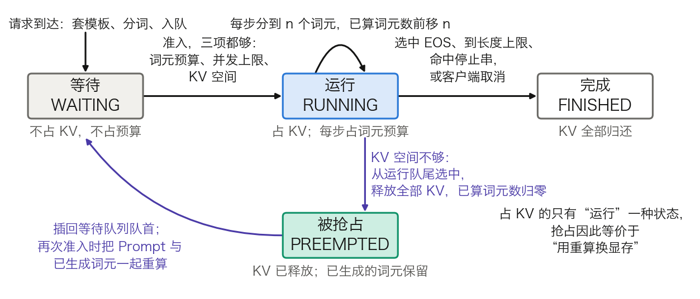
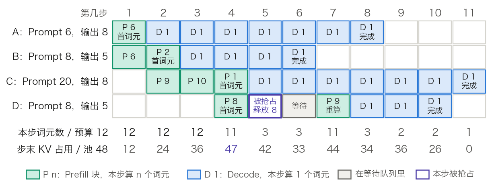
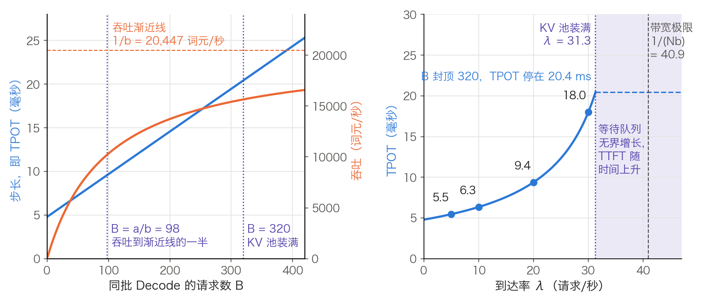

## 11.3 调度循环与抢占：一个请求在引擎里的全过程

**调度器**（scheduler）每一步只回答一个问题：这一步的词元预算分给谁。Prefill、Decode、分块、前缀命中、投机解码不是不同的任务，只是“已算词元数追应算词元数”的差距不同。预算有天然的下限，即一步的访存下界与算力下界相等之处，Llama 3 8B 在 H100 上约 340 个词元；低于它白付读权重的时间，高于它步长随词元数线性增长，所以预算就是词元间隔的上界。输出长度事先未知，按乐观口径准入能多放 33% 到 100% 的请求，代价是抢占；抢占表现为某条流停住而不是全体变慢，靠水位线与“抢占步不准入”抑制。每输出词元时间 TPOT（time per output token）与负载的关系是 `TPOT = a ÷ (1 − λNb)`：接近带宽极限时非线性上升，但先撞上的通常是 KV 容量墙，过墙之后 TTFT（首词元时间）无界，只能限流。vLLM 的默认组合是 Decode 优先加分块 Prefill、先到先服务、被抢占者重算恢复。

算例用 [11.1.1](11.1_engines_overview.md) 的常量。本节把 KV 空间当作一个按词元计数的池子，块怎样分配与回收见 [11.4 节](11.4_kv_memory_management.md)。

### 11.3.1 请求的四个状态

从调度器看，一个请求只有四种状态，图 11-6 画出了它们之间的全部转移。

图 11-6：一个请求在调度器里的状态机（[生成脚本](https://github.com/yeasy/llm_internals/blob/main/tools/figures/ch11_3_request_states.py)）。方框下方的灰字是该状态占用的资源；紫色是显存不足时才走的路径。

- **等待**（waiting）：已分词，排在等待队列里。不占 KV 空间，也不占每步的计算量。
- **运行**（running）：已被准入。它的 KV 留在显存里，每步至少分到一个词元的计算量。
- **被抢占**（preempted）：原本在运行，因 KV 空间不够被调度器中止。KV 全部释放，已生成的词元保留，请求插回等待队列的队首。
- **完成**（finished）：选中 EOS、到达长度上限、命中停止串，或客户端取消。KV 全部归还，结果流回用户。

调度器并不区分“Prefill 阶段”和“Decode 阶段”。每个请求只记两个数：应算词元数（Prompt 加已生成的词元）和已算词元数（KV 已写入缓存的词元）。每一步的任务是让后者追上前者。差距是整条 Prompt 时，这一步就是 Prefill；差距是 1 时，就是 Decode；差距大于本步能分到的量时，就是分块 Prefill；vLLM 的调度器就只按这两个计数工作。前缀缓存命中（[11.5 节](11.5_prefix_reuse.md)）相当于已算词元数的初值不为 0，投机解码相当于差距大于 1，同一套记账都能容纳。

### 11.3.2 一步迭代：调度器做的六件事

调度器选出本步要跑的请求，执行一次前向，收回结果，再选下一步。这个循环出自 [Orca](https://www.usenix.org/conference/osdi22/presentation/yu)，现代引擎沿用，每一步依次做六件事。

1. **回收**。上一步完成或被取消的请求移出运行队列，KV 归还池子。
2. **先排运行中的请求**。按队列顺序，给每个请求分配“应算减已算”个词元，但不超过剩余的**词元预算**（token budget，一步最多处理的词元总数）。Decode 请求各拿 1 个；Prefill 未完成的请求拿走尽量大的一块。
3. **为这些词元申请 KV 空间**。申请失败就触发抢占（11.3.5），腾出空间后重试。
4. **准入等待队列里的请求**。前提是本步没有发生抢占。每准入一个都要同时满足三项：词元预算还有剩余，运行中的请求数未到并发上限，KV 空间放得下。队首不满足就停止，不跳过它去看后面的请求。
5. **执行前向**。所有被选中的词元摊平成一个一维序列，一起过线性层；注意力按各请求自己的长度分别计算（[11.2.2](11.2_continuous_batching.md) 的混合批）。
6. **采样与状态更新**。已算词元数追平应算词元数的请求各采样一个词元，其余请求（Prompt 还没算完）不采样。检查停止条件，更新计数，进入下一步。

线性层的计算量只与本步的词元总数有关，与这些词元来自几个请求无关。词元预算约束的因此是“一步多长”，并发上限与 KV 空间约束的是“显存里同时放几条序列”，三者各管一件事。

第 2 步与第 4 步的先后是一个设计选择。表 11-4 对比三种排法。

| 排法 | 每步怎样组批 | 首词元延迟 | Decode 的词元间隔 |
| --- | --- | --- | --- |
| 请求级批处理 | 一批全部结束才换下一批 | 要等整批结束 | 稳定，但批越跑越空 |
| Prefill 优先 | 有新请求就先做完整 Prefill，Decode 暂停 | 短 | 每来一个长 Prompt 就停顿一次 |
| Decode 优先加分块 Prefill | 先排全部 Decode，再排未完成的 Prefill，最后用剩余预算准入新请求 | 长 Prompt 要分几步 | 有上界，由词元预算决定 |

表 11-4：三种组批顺序的取舍。第三行是 [Sarathi-Serve](https://arxiv.org/abs/2403.02310) 提出的 stall-free batching，第二行是该文记录的 vLLM 早期做法，它造成的停顿被称为 generation stall。

第三种排法是 vLLM 的默认做法，后文都按它讨论。它把“新请求要不要打断老请求”这个矛盾，换成了一个可调的数：词元预算。SGLang 默认仍让 Prefill 批优先、与 Decode 批分开执行，靠分块限制每次停顿的长度（[11.11 节](11.11_sglang_internals.md)）。

### 11.3.3 玩具轨迹：11 步走完四个请求

图 11-7 用一组很小的数字把六件事走一遍：词元预算 12，KV 池 48 个词元，并发上限 4。请求 A、B 在第 1 步前到达，C 在第 2 步前到达，D 在第 4 步前到达。Prompt 与输出长度依次为 A 6/8、B 8/5、C 20/8、D 8/5。最后一个采样出的词元不再送回模型，也就不写入 KV。

图 11-7：玩具调度器的 11 步轨迹（[生成脚本](https://github.com/yeasy/llm_internals/blob/main/tools/figures/ch11_3_schedule_trace.py)，脚本内含调度器并打印同一份轨迹）。格内数字是该请求本步分到的词元数；下方两行是本步用掉的预算与步末的 KV 占用。

- **第 1 到 4 步**：每步先给运行中的请求各分 1 个词元，剩余预算给未算完的 Prompt。A 第 1 步算完 6 个词元并出首词元；B 的 8 个词元分两步；C 的 20 个词元从第 2 步起按 9、10、1 分三步，其间 A、B 每步照常前进。第 4 步预算剩 `12 − 3 = 9`，池子空闲 `48 − 39 = 9`，D 的 8 个词元放得下，准入，步末 KV 占用 47。
- **第 5 步**：四个请求各需要 1 个新位置，池子只剩 1 个。A 拿走后，B 申请失败，调度器抢占运行队列的队尾 D，释放 8 个词元，B、C 得以继续。D 回到等待队列队首，它在第 4 步生成的那个词元保留。本步发生了抢占，不再准入。
- **第 6 步**：A、B、C 各要 1 个新位置后，池子空闲 3 个。D 需要 `8 + 1 = 9` 个词元的空间，仍在等待。B 在步末完成，归还 12 个词元。
- **第 7 步**：D 重新准入，把 Prompt 与已生成的 1 个词元合成 9 个词元一次重算，随即采样出第 2 个词元。

D 的首词元在第 4 步就已流出，第二个词元却到第 7 步才出现。正常间隔是 1 步，这里是 3 步，多出的停顿就是抢占在用户侧的表现。第 4 步准入 D 时调度器只检查了“此刻放得下”，没有为 A、B、C 下一步的增长留余量，这是 11.3.5 要讨论的准入口径问题。

### 11.3.4 词元预算：一步放多少词元

按 [10.1.2](../10_inference_optimization/10.1_bottleneck.md) 的 Roofline，一步的耗时有两个下界，取大者：

$$
t_{\text{step}} \ge \max\left(\frac{\text{本步读出的字节}}{B_{\text{peak}}},\ \frac{\text{本步的 FLOPs}}{F_{\text{peak}}}\right)
$$

**拐点约 340 个词元。** 读一遍权重要 `a = 4.79 ms`，每个词元过一遍 32 层矩阵在峰值算力下要 14.1 µs（11.1.1）。两个下界相等时 `n × 14.1 µs = 4.79 ms`，得 `n ≈ 340`。它比约 300 的拐点（[10.1.2](../10_inference_optimization/10.1_bottleneck.md)）大，是因为要读的 16.06 GB 里有嵌入表与 LM head 两张表，它们不计入每词元的 `2P`：`295 × 16.06 ÷ 13.96 ≈ 340`。一步少于约 340 个词元时，耗时由读权重决定，多加词元几乎不花时间；超过之后，步长随词元数线性增长。实测的拐点因固定开销会后移，Sarathi-Serve 在 A100 上的理论值约 200，实测 500 至 600，量级一致。

一步的 FLOPs 有三项。与权重相乘的部分每词元 `2P = 1.396 × 10¹⁰`。Prefill 的打分与读取，从头算到第 T 个词元共 `2T²dL`（因果掩码折半），中途的一块取首尾两个前缀之差，所以后面的块更贵。Decode 的每个词元对 s 行上下文是 `4sdL`，另加 LM head。以“32 个 Decode 请求、各有 1,000 个词元上下文”为底，向同一步加入一个 Prefill 块，结果列在表 11-5。

| 同步加入的 Prefill 词元 | 访存下界（ms） | 算力下界（ms） | 步长（ms） | 相对纯 Decode |
| ---: | ---: | ---: | ---: | ---: |
| 0 | 6.05 | 0.50 | 6.05 | 1.0 倍 |
| 224 | 6.05 | 3.67 | 6.05 | 1.0 倍 |
| 480 | 6.05 | 7.33 | 7.33 | 1.2 倍 |
| 992 | 6.05 | 14.75 | 14.75 | 2.4 倍 |
| 2,016 | 6.05 | 30.00 | 30.00 | 5.0 倍 |
| 8,192 | 6.05 | 133.78 | 133.78 | 22.1 倍 |

表 11-5：同一步里的 Prefill 词元数怎样拉长步长。Llama 3 8B、H100、理想 Roofline 下界；真实引擎的算力利用率达不到峰值，绝对值更大，倍数关系的形状不变。

最后一行是不分块的后果：一个 8,192 词元的 Prompt 整段进入，同批 32 个用户的下一个词元要等 134 ms，而平时只要 6 ms。这个间隔就是 [11.2.5](11.2_continuous_batching.md) 定义的 TBT；Sarathi-Serve 在 A100 上实测到 28.3 倍，与表中的 22 倍同一量级。

词元预算把最后一行切开。表 11-6 让同一个 8,192 词元的 Prompt 在不同预算下完成 Prefill，每步先扣掉 32 个 Decode 词元。

| 词元预算 | 每步 Prefill 词元 | 步数 | 最长一步（ms） | 长请求的 Prefill 总时长（ms） |
| ---: | ---: | ---: | ---: | ---: |
| 256 | 224 | 37 | 6.4 | 229.5 |
| 512 | 480 | 18 | 9.3 | 147.6 |
| 1,024 | 992 | 9 | 18.4 | 138.9 |
| 2,048 | 2,016 | 5 | 36.5 | 139.3 |
| 4,096 | 4,064 | 3 | 70.9 | 139.5 |
| 不分块 | 8,192 | 1 | 133.8 | 133.8 |

表 11-6：词元预算对 TBT 上界与长请求 Prefill 时长的影响。口径同表 11-5，访存一侧另计长请求已写入的 KV。

从表中读出三点。

- **预算就是 TBT 的上界**。预算在拐点以上时，每减半，最长一步大致减半：表中 4,096 到 512 的三次减半各为 1.9 至 2.0 倍。同批用户感受到的最大停顿随最长一步一起变短。
- **后面的块比前面的贵**。预算 2,048 时，第 4 块要对前 3 块的 KV 打分，注意力一项是第 1 块的 7 倍，步长从 30.0 ms 升到 36.5 ms。前面各块的 KV 还要被反复读出：分成 N 块时，第 1 块的 KV 被读 N − 1 次。
- **预算不能低于拐点**。预算 256 时每步只有约 4 ms 的计算，却要付 6 ms 以上的访存，37 步下来 Prefill 总时长从 139 ms 涨到 230 ms。

**由 TBT 目标反推预算。** 预算在拐点以上时步长近似正比于预算，起点可以直接估：

$$
\text{预算} \approx \frac{\text{TBT 目标} \times \eta \times F_{\text{peak}}}{2P}
$$

TBT 目标 50 ms、`η = 0.4` 时约 1,400 个词元，向下取 2 的幂得 1,024，留出后面各块变贵的余量；按表 11-6 折算，这个预算下最长一步约 `18.4 ÷ 0.4 = 46 ms`。取 2 的幂还避开一个内核层面的坑：矩阵维度不能被 GPU 的分片大小整除时，块大小 257 可能比 256 慢三成（Sarathi-Serve 的实测）。估出的数只是起点，最后按 TBT 的高分位用一次压测校准。

### 11.3.5 显存不足：抢占谁，怎样恢复

问题的根源是输出长度事先未知：准入一个请求时，调度器要为它将来的 KV 留多少空间？设 KV 池为 400,000 个词元（11.1.1 的约 41 万取整），请求的输入为 1,000 个词元，输出上限 1,000 个。表 11-7 对比三种准入口径。

| 准入口径 | 每请求按多少词元计 | 可并发请求数 | 风险 |
| --- | ---: | ---: | --- |
| 悲观：按输入加输出上限预留 | 2,000 | 200 | 无抢占；实际输出较短时空间闲置 |
| 按稳态平均占用 | 1,500 | 266 | 负载波动时偶发抢占 |
| 乐观：只看 Prompt 放不放得下 | 1,000 | 400 | 各请求继续增长，必然抢占 |

表 11-7：三种准入口径下的并发数。第二行假设各请求的进度均匀错开，平均已生成 500 个词元。

Orca 属于第一种：请求首次被调度时按 `max_tokens` 预留全部槽位。[vLLM 论文](https://arxiv.org/abs/2309.06180)选了另一头：KV 按需分配，空间用尽时再抢占。同样的显存，后两种口径能多放 33% 到 100% 的请求，代价是要有一套抢占与恢复的机制。两端之间还有一条中间路线：按一个可调的比例为未生成的词元预留，没有发生抢占时逐步放宽，抢占之后回调，SGLang 的准入就是这样做的（[11.11.4](11.11_sglang_internals.md)）。

**何时触发**。运行中的请求每步至少需要一个新的 KV 位置。11.3.2 的第 3 步申请失败，就是触发点。

**牺牲谁**。先到先服务之下，牺牲最晚到达的请求：它已投入的计算最少，也最不该排在别人前面。实现上取运行队列的队尾；启用优先级时，取优先级最低、同级中到达最晚的那个。

**整条释放**。一条序列的全部 KV 在每一步都会被读到，留下一半没有用处，所以要么全留，要么全放。

**怎样恢复**。今天的做法是**重算**（recomputation）：丢弃 KV，再次准入时把 Prompt 与已生成的词元拼成一条新 Prompt，一次 Prefill 算回来。已生成的词元不会丢，用户看到的只是一次停顿。把 KV 拷到主机内存的**换出**（swapping）是论文时期的另一条路，vLLM 的现行架构已经移除，原因见 [11.4.5](11.4_kv_memory_management.md)。

重算本身不贵。设被抢占的请求已生成 600 个词元，需要重算 1,600 个，计算量是 `1,600 × 2P + 2 × 1,600² × dL = 2.30 × 10¹³` FLOPs，下界 23.2 ms，约 4 个 Decode 步；按 0.4 的利用率约 58 ms。主要代价在另外两项。其一是停顿：被抢占者要等到池子里腾出整条序列的空间才能回来，图 11-7 里 D 空等了第 5、6 两步，线上可以是数秒。其二是预算被挤占：若 10% 的请求各被抢占一次，每个请求平均多占 `0.1 × 1,600 = 160` 个词元的预算，相对基线的 2,000 个多出 8%；比例升到 30% 时多出 24%，系统在重复劳动中空转。

防止抢占连锁发生，靠四道闸。

- 发生抢占的那一步不准入新请求。否则被抢占者腾出的空间刚被新请求占走，下一步又得抢占，如此往复。
- 准入时检查整条 Prompt 放得下，而不是只看第一块。
- 准入时保留一段**水位线**（watermark）：空闲 KV 低于总量的某个比例就停止准入，把余量留给运行中请求的增长。图 11-7 若设 4 个词元的水位线，第 4 步 D 就不会被准入，也就没有第 5 步的抢占和第 7 步的重算；代价是 D 的首词元从第 4 步推迟到第 7 步。取值的判据是盖住运行中请求若干步的增长：并发 B 条序列每步共增长 B 个词元。按 11.3.6 中 `λ = 30` 的稳态批大小 `B = 270`，取 400,000 的 1% 即 4,000 个词元，约够 15 步。水位线越高，抢占越少，可并发的请求也越少。
- 压低并发上限，从源头减少同时增长的序列数。

抢占不总是坏事：图 11-7 里重算用掉的是第 7 步原本闲置的预算，乐观准入反而让 D 更早完成。预算每步都被填满时，重算才会挤占别的请求。

判断是否需要动这些闸，看抢占计数。等待队列里有请求而抢占计数长期为 0、KV 占用率又偏低，说明准入偏保守；抢占计数持续上升，说明准入过于乐观。KV 占用率贴顶不等于用足了显存：抢占频繁时，有效吞吐反而下降。还有一种抢占救不了的情形：单个请求的 Prompt 加输出上限超过整个池子，它永远无法完成，应在入口处按长度直接拒绝。

### 11.3.6 排队论视角：到达率、批大小与延迟

每秒到达 λ 个请求，稳态下同批有多少请求在 Decode，TPOT 是多少？排队论研究的正是到达速率与服务速率怎样决定在途数量与等待时间，本小节用到的两个结论都就地给出。纯 Decode 步由访存决定，步长随批大小线性增长：

$$
t_{\text{step}}(B) = a + bB,\qquad a = \frac{\text{权重字节}}{B_{\text{peak}}},\quad b = \frac{\text{每请求的 KV 字节}}{B_{\text{peak}}}
$$

这里 `B` 是同批的请求数，`B_peak` 是显存带宽。设输入 1,000、输出 `N = 500` 个词元，Decode 期间平均上下文为 1,250，则 `b = 1,250 × 131,072 B ÷ 3.35 TB/s = 0.0489 ms`，`a = 4.79 ms`。

**批大小与吞吐**。吞吐为 `B ÷ (a + bB)`，随 `B` 增大趋于 `1/b ≈ 20,447` 词元/秒，到不了更高：批处理摊薄的只有权重。吞吐达到渐近线一半的位置是 `B = a/b ≈ 98`，此时全批的 KV 字节恰好等于权重字节。过了这一点，批再加大，吞吐的增量越来越小，TPOT 却照旧线性上升：`B = 98` 时 9.6 ms，`B = 320` 时 20.4 ms，吞吐只从 10,222 升到 15,652 词元/秒。

**到达率与批大小**。Little 定律说，稳态下在途请求数等于到达率乘以平均驻留时间。一个请求要在 Decode 批里驻留 `N` 步，故

$$
B = \lambda \cdot N \cdot (a + bB)
\quad\Longrightarrow\quad
B = \frac{\lambda N a}{1-\lambda N b},\qquad
\text{TPOT} = a + bB = \frac{a}{1-\lambda N b}
$$

分母 `1 − λNb` 决定这条曲线的形状。记 `ρ = λNb`，可读作“带宽被各请求的 KV 读取占去的比例”。`ρ` 为 0.5、0.75、0.9 时，TPOT 依次是 `2a`、`4a`、`10a`。排队论里单服务台的等待时间含同一个因子 `1 ÷ (1 − ρ)`，那里的 `ρ` 是利用率，即服务台处于忙碌的时间占比；利用率接近 100% 时等待时间趋于无穷。表 11-8 列出四个到达率。

| 到达率 λ（请求/秒） | ρ = λNb | 稳态批大小 B | TPOT（ms） | KV 占用（词元） |
| ---: | ---: | ---: | ---: | ---: |
| 5 | 0.122 | 13.7 | 5.46 | 17,069 |
| 10 | 0.245 | 31.7 | 6.35 | 39,663 |
| 20 | 0.489 | 93.8 | 9.38 | 117,292 |
| 30 | 0.734 | 270.0 | 18.00 | 337,444 |

表 11-8：到达率怎样决定批大小与 TPOT。KV 占用为 `B × 1,250`。

到达率从 20 升到 30，只多了一半，批大小却从 94 涨到 270，TPOT 接近翻倍。图 11-8 画出了这两条关系。

图 11-8：左，步长随批大小线性上升，吞吐趋于饱和；右，TPOT 随到达率按 `a ÷ (1 − λNb)` 上升，KV 池装满后 `B` 封顶 320、TPOT 停在 20.4 ms，多出的请求进入排队区（[生成脚本](https://github.com/yeasy/llm_internals/blob/main/tools/figures/ch11_3_batch_latency.py)）。

**容量墙**。批大小不能无限增长。400,000 个词元的池子按平均 1,250 个词元一条，装得下 `B_max = 320` 条；此时步长 20.44 ms，可承受的到达率为 `320 ÷ (500 × 0.02044) = 31.3` 请求/秒。公式里的带宽极限 `1 ÷ (Nb) = 40.9` 请求/秒并不会先到：先撞上的是显存容量。

**过墙之后**。到达率超过 31.3，多出来的请求只能留在等待队列。`λ = 35` 时队列每秒净增 3.7 个，一分钟后积压 222 个，新到的请求要排约 7 秒才轮到 Prefill，而且这个数随时间线性增长，没有稳态。TTFT 因此分两段：容量之内，它约等于“等当前一步结束”加自己的 Prefill 步数，是几十毫秒；容量之外，它由排队主导且无界。过载时要靠入口限流与尽早拒绝把队列截短，见 [11.13 节](11.13_best_practices.md)。

**余量**。到达是随机的，在途请求数围绕表 11-8 的均值波动。若到达是泊松过程、各请求的驻留时间又互相独立，在途请求数服从泊松分布，标准差是均值的平方根：`λ = 30` 时均值 270、标准差约 16，均值加两倍标准差为 303，离 320 已经不远。这只是波动的下界。本节的模型里驻留时间是 `N × (a + bB)`，随 `B` 变长，独立性不成立：批一变大，所有请求都驻留得更久，在途数再涨，是正反馈。由 `B = λNa ÷ (1 − ρ)` 可得，到达率的相对变化传到 `B` 上要放大 `1 ÷ (1 − ρ)` 倍以上；`λ` 从 30 升到 33，`B` 从 270 升到 410，已经越过容量墙。工作点因此要定在容量墙以下，留多少余量按到达的突发程度实测，不能只按均值加两倍 `√B` 估。

这套算式有三个前提。其一，步长取的是访存下界，真实值更大，但线性形状不变，`a`、`b` 可以由两次不同批大小的压测反解出来。其二，Prefill 被假定为搭载在 Decode 步里而不改变步长：按每步平均搭载的 Prefill 词元算，表中各行的算力下界都小于 TPOT，平均意义上成立；尖峰有多高由词元预算限制。输入很长、输出很短的负载不满足这一条，应改用 11.3.4 的算法。其三，各请求的长度取了平均值，长尾分布下容量墙会提前到来。

### 11.3.7 公平性与优先级

等待队列按什么顺序出队，决定了过载时谁受损。

**先到先服务**（FCFS）是默认选择，理由是公平且不会饿死。它的弱点是队首阻塞：队首放不下就停止准入，一个超长 Prompt 会挡住身后所有短请求，即使池子里的空间够后者用。

**最短作业优先**能把平均延迟压到最低，但输出长度事先未知。[一项排序学习的工作](https://arxiv.org/abs/2408.15792)指出，预测精确长度不可行，预测一批请求之间的相对长短却可行，据此近似最短作业优先。这类策略必须配防饿死机制，例如给每个请求记被跳过的次数，超过阈值就临时提升优先级。

**优先级调度**把等待队列换成按“优先级、到达时间”排序的堆，抢占时牺牲优先级最低者。它的边界情形是低优先级请求被反复抢占：每次回来都要重算，重算完又被抢占，既拿不到进展，又消耗预算。应对办法是给低优先级流量单独限流，或限制单个请求的被抢占次数。

**多租户公平**针对的是另一个问题：某个租户大量发请求，按请求计数的 FCFS 会让其他租户一起排长队，按请求数限流又会在空闲时浪费容量。[VTC](https://arxiv.org/abs/2401.00588)（Virtual Token Counter）按词元给每个租户记账，准入时从已获服务量最少的租户那里取请求。它只改变出队顺序，不拒绝放得下的请求，空闲容量不会被浪费。

公平与吞吐并不总是一致。缓存感知的调度（11.5.6）倾向于让前缀命中的请求插队，这对吞吐有利，对先到的未命中请求不公平，两者怎样折中是调度策略必须显式决定的事。

### 11.3.8 对到实现：vLLM 调度器的旋钮

部署时要调的只有本节出现过的几个量：词元预算、并发上限、水位线、出队策略；要看的是三个指标：抢占计数（11.3.5）、等待队列长度（11.3.6 的排队区）、KV 占用率（容量墙）。它们在 vLLM 里的参数名、默认值、状态名与指标名见[附录 A.7](../appendix/a7_framework_recipes.md)，名称随版本变动；各约束在引擎里怎样落地见 [11.10 节](11.10_vllm_internals.md)。

读完本节，应能不看正文回答下面五个问题；括号里是回看的位置。

1. 调度器为什么不需要区分 Prefill 与 Decode 两个阶段？（11.3.1）
2. 一步里先排运行中的请求、后准入新请求，换来了什么，代价是什么？（表 11-4）
3. 词元预算为什么既不能太大、也不能低于约 340 个词元？TBT 目标为 50 ms 时，预算的起点怎样估？（11.3.4）
4. 被抢占的请求丢了什么、保留了什么，用户看到的现象是什么？（11.3.5）
5. 到达率只增加一半，TPOT 为什么会接近翻倍；再往上为什么 TTFT 会失去稳态？在途请求数的波动为什么大于 `√B`？（11.3.6）

本节只问“池子里还剩多少词元的位置”。这个池子实际上由等长的块组成，块怎样分配、怎样在几条序列之间共享、装不下时怎样处置，见 [11.4 节](11.4_kv_memory_management.md)。
