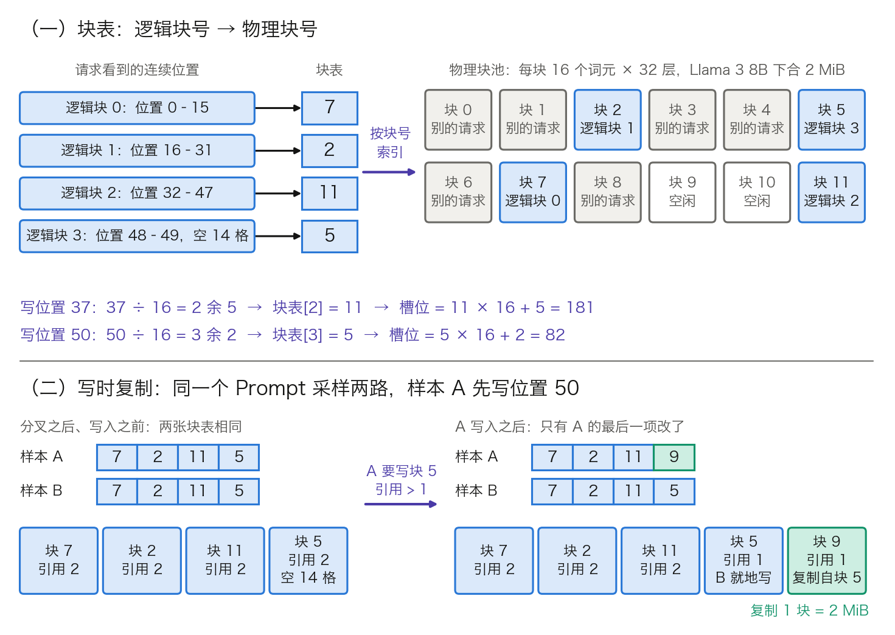
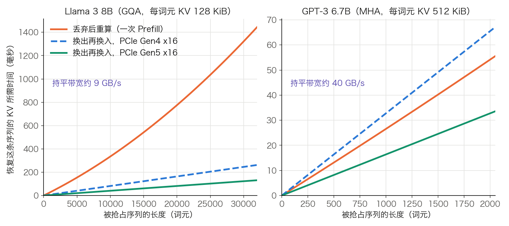

## 11.4 KV 显存管理：块表、换出与重算

KV 池的大小在启动时一次定死：显存乘以占用比例，减去权重与激活峰值。它的单位是词元，并发数等于池容量除以平均驻留长度，所以一切缩小权重或每词元 KV 的手段都能直接换算成并发。池切成定长块、按需分配之后，浪费只剩每条序列末块里平均 `(b − 1) ÷ 2` 个槽位；块取多大是内核实现与碎片、共享粒度之间的工程取舍，vLLM 取 16，SGLang 取 1。块表加引用计数既是寻址，也是一切共享的基础。池满时的症状是排队与抢占，不是溢出。被抢占的序列靠重算恢复而不换出：重算就是一次普通的 Prefill，能分块、能命中前缀缓存；主机内存的角色转为前缀缓存的第二级。

[11.2 节](11.2_continuous_batching.md)只给了分页的想法，本节把它落到数据结构和账上；跨请求的前缀复用留给 [11.5 节](11.5_prefix_reuse.md)。算例用 [11.1.1](11.1_engines_overview.md) 的常量，容量用十进制 GB（10⁹ 字节），块的大小用 KiB、MiB（2¹⁰、2²⁰ 字节）。

### 11.4.1 显存预算：KV 池有多大

一张卡的显存分给三类东西：权重、一次前向的临时张量（激活）、KV 缓存。前两项在启动时就确定，剩余部分一次性划成 **KV 池**，服务期间不再增减：

$$
M_{\text{KV 池}} = M_{\text{显存}} \times u - M_{\text{权重}} - M_{\text{激活峰值}} - M_{\text{其他}}
$$

`u` 是允许引擎占用的显存比例，留出的 `1 − u` 给驱动、其他进程和分配器的碎片。

- **权重**：BF16 下 16.06 GB（11.1.1）。
- **激活**：推理不为反向传播保留中间结果，同一时刻只有当前一层的临时张量占着显存。一步最多处理 8,192 个词元时，最大的一组是 MLP 的 gate、up 两路输出，合计约 470 MB，远小于权重。引擎并不靠公式估它，而是启动时用最大批次的假输入跑一遍前向，实测峰值，再把剩余显存划给 KV 池（[11.10 节](11.10_vllm_internals.md)）。
- **KV 池**：取 `u = 0.9`，激活与其他开销（CUDA Graph、通信缓冲）合留 2 GB，这是算例的假设值，于是 `80 × 0.9 − 16.06 − 2 = 53.94 GB`。每词元 KV 是 128 KiB，池里放得下 411,525 个词元。

表 11-9 把这笔预算换成并发数。

| 项目 | Llama 3 8B（GQA，`n_kv = 8`） | 同样形状、`n_kv = 32` 的 MHA |
| --- | ---: | ---: |
| 每词元 KV | 131,072 B（128 KiB） | 524,288 B（512 KiB） |
| KV 池可存词元 | 411,525 | 102,881 |
| 每条序列 2,000 词元时的并发 | 205 | 51 |
| 每条序列 8,000 词元时的并发 | 51 | 12 |

表 11-9：53.94 GB 的 KV 池能同时容纳多少条序列。并发数按 16 个词元一块的整块计，GQA 一列共 25,720 块，MHA 一列共 6,430 块。MHA 一列只把 `n_kv` 改回 32，权重与池的大小不变。

从这张表读出两点。第一，KV 池的单位是词元，不是请求：并发数等于池容量除以平均驻留长度，请求越长，能同时服务的越少。第二，凡是缩小权重或每词元 KV 的手段，收益都能用这条公式换算。权重改用 FP8 省下 8.03 GB，池里多出约 61,300 个词元；GQA 把每词元 KV 缩到四分之一，并发直接变成 4 倍。

### 11.4.2 块大小：内部碎片与取舍

分页之前按最大长度预留连续显存：按 8,192 预留、实际只用到 2,000 个词元时，利用率只有 24.4%。把 KV 池切成等长的**物理块**（physical block）、按需分配之后，外部碎片消失（[11.2.3](11.2_continuous_batching.md)），剩下的浪费只有每条序列最后一块里没用上的槽位（slot）。设块大小为 `b` 个词元，序列长度除以 `b` 的余数近似均匀分布时，每条序列平均浪费 `(b − 1) / 2` 个槽位，浪费占比是：

$$
\text{浪费占比} = \frac{(b-1)/2}{\bar{\ell} + (b-1)/2}
$$

其中 $\bar{\ell}$ 是序列的平均长度。取 `b = 16`、平均长度 200，得 `7.5 ÷ 207.5 = 3.6%`。表 11-10 列出其余组合。

| 块大小 `b` | 平均浪费槽位 | 平均长度 200 时的浪费 | 平均长度 2,000 时的浪费 | 8,192 词元的块表项数 |
| ---: | ---: | ---: | ---: | ---: |
| 1 | 0 | 0% | 0% | 8,192 |
| 8 | 3.5 | 1.7% | 0.17% | 1,024 |
| 16 | 7.5 | 3.6% | 0.37% | 512 |
| 32 | 15.5 | 7.2% | 0.77% | 256 |
| 128 | 63.5 | 24.1% | 3.08% | 64 |
| 256 | 127.5 | 38.9% | 5.99% | 32 |

表 11-10：块大小与内部碎片。最后一列是一条 8,192 词元的序列在块表里占的项数。

**块大小是与内核实现绑定的工程取舍。** 块越小，浪费越少，跨请求共享的粒度也越细；块表本身也不贵，512 项、每项 4 字节只有 2 KiB。代价在内核一侧。vLLM 的内核按块取 K/V，每跨一个块多一次查表和一次不连续的读取。论文的消融结论是：块太小用不满 GPU 读取和处理 KV 的并行度，块太大则内部碎片上升、可共享的概率下降；对话数据上 16 到 128 表现最好，序列更短的指令数据上只有 16 和 32 表现好，默认值因此取 16。SGLang 换了一种实现：给每个词元记一个槽位下标，页大小取 1，没有内部碎片，共享精确到词元，代价是下标表按词元增长、内核逐词元取数（[11.11.3](11.11_sglang_internals.md)）。两种取值都在生产中使用，块大小没有与实现无关的下限。

### 11.4.3 块表：从逻辑位置到物理槽位

分页管理由四个数据结构组成：

- **物理块池**：每层一个大张量，按物理块号索引。同一个块号在 32 层里各对应一段，所以“一个块”指的是 32 层合起来的那一份。本例一个块在一层里占 `16 × 2 × 8 × 128 × 2 B = 64 KiB`，32 层合计 2 MiB；53.94 GB 的池共 25,720 块。
- **空闲队列**（free queue）：记录当前没人用的物理块号，分配和归还都是队列操作。
- **块表**（block table）：每个请求一张，第 k 项是逻辑块 k 对应的物理块号。
- **引用计数**（reference count）：每个物理块一个整数，记录有几张块表指向它，降到 0 时归还空闲队列。

位置 `i` 的 K/V 写到哪里，由一次整除和一次取余决定：

$$
\text{槽位} = \text{块表}[\lfloor i / b \rfloor] \times b + (i \bmod b)
$$

以一个 50 词元的请求为例，位置从 0 编号，图 11-9 的上半幅画的就是它。它需要 `⌈50 ÷ 16⌉ = 4` 块，调度器从空闲队列取出 4 个块号，假设是 7、2、11、5，块表即 `[7, 2, 11, 5]`；块号的大小和顺序没有含义，只取决于当时哪些块空闲。位置 37 是 `37 ÷ 16 = 2 余 5`，块表第 2 项是 11，槽位为 `11 × 16 + 5 = 181`。引擎在每步前向之前为本步的每个词元算好槽位交给内核，内核按槽位把新算出的 K、V 分散写进各层的池；读的时候按块表依次到块 7、2、11、5 里取，最后一块只取已写入的槽位。

块写满后才追加。首个输出词元落在位置 50，仍在第 4 块里（槽位 `5 × 16 + 2 = 82`），不需要分配。到位置 64，`64 ÷ 16 = 4 余 0`，块表没有第 4 项，调度器再取一个空闲块，假设是 9，块表变为 `[7, 2, 11, 5, 9]`。一条序列每 16 步 Decode 才碰一次分配器。请求结束时各块引用计数减 1，降到 0 的块号回到空闲队列，数据不必清零；开启前缀缓存时，这些块的内容会留到被复用或被淘汰为止（11.5 节）。

图 11-9：块表寻址与写时复制（[生成脚本](https://github.com/yeasy/llm_internals/blob/main/tools/figures/ch11_4_block_table_cow.py)）。上：50 词元的请求经块表 `[7, 2, 11, 5]` 落到物理块池，位置 37 和位置 50 的槽位按整除与取余算出。下：两路并行采样先共用全部 4 块，样本 A 写位置 50 时把块 5 复制到空闲块 9，只改自己块表的最后一项。

间接寻址的代价落在注意力内核上。2023 年论文的微基准里，分页内核比 FasterTransformer 的连续内存实现慢 20% 到 26%，来源是查块表、多出的分支和变长序列的处理；这只影响注意力算子，不影响各个线性层，幅度取决于内核怎样实现。换来的是 KV 池里的浪费降到接近零，论文报告的端到端吞吐，在延迟相当的条件下是此前系统的 2 到 4 倍。

### 11.4.4 写时复制：并行采样与束搜索

并行采样（同一个 Prompt 采 `n` 个回答）和束搜索的各路序列共用一段前缀。今天的做法是把这种共享交给前缀缓存：vLLM 的现行架构把 `n > 1` 的请求[拆成 n 个 `n = 1` 的子请求](https://github.com/vllm-project/vllm/pull/10980)，Prompt 的满块按内容哈希共用（[11.5.2](11.5_prefix_reuse.md)），末尾不满的块由各子请求各自重算。重算量很小：Prompt 有 2,010 个词元、块大小 16 时，每路多算末块的 10 个词元，约 `1.4 × 10¹¹` 次运算，相对 2,010 词元的 Prefill 可以忽略；引擎则少维护一条分叉与复制的路径。

**写时复制**（Copy-on-Write）是论文与旧版 vLLM 的做法，图 11-9 的下半幅画的是它。各路的块表先指向同一组物理块，引用计数记下共享者的数量；某一路要往引用计数大于 1 的块里写时，先把这一块复制到空闲块，再改自己的块表。每次分叉至多复制 `n − 1` 个块，而且只涉及 Prompt 末尾那个不满的块。它留下的是块表加引用计数这套机制，11.5 节的跨请求共享仍建立在上面。

**省多少与用哪种机制无关**，只取决于 Prompt 的满块占多大比例。设 Prompt 长 `p`、每路输出长 `o`。不共享要 `n × ⌈(p + o) / b⌉` 块，共享后是 `⌊p / b⌋ + n × (⌈(p + o) / b⌉ − ⌊p / b⌋)` 块：第一项是只存一份的 Prompt 满块，第二项是每路各自独占的块。取 `p = 2,010`、`o = 200`、`n = 4`，是 556 块对 181 块，省 67.4%；输出变长到 `o = 2,000` 时是 1,004 块对 629 块，只省 37.4%。vLLM 论文实测的并行采样节省量，在 Prompt 平均只有 19 个词元的指令数据上不到一成，在 161 个词元的对话数据上是 16% 到 31%，差别正来自满块的多少；束搜索的各束还共用已生成部分，节省 38% 到 66%。

### 11.4.5 显存不足时：换出还是重算

KV 池用尽而运行中的序列还要写新词元时，调度器必须抢占一部分序列（11.3.5）。被抢占序列的 K/V 有两种处置：**重算**直接释放这些块，恢复时走一次 Prefill；**换出**把块经 PCIe 拷到主机内存，恢复时再拷回来。今天的引擎只做重算：vLLM 的抢占默认就是重算（[优化文档](https://docs.vllm.ai/en/v0.29.0/configuration/optimization.html)），GPU 与 CPU 之间的 KV 换出已从现行架构中[移除](https://docs.vllm.ai/en/v0.29.0/usage/v1_guide.html)。原因有四条。

1. **有效带宽远低于标称值。** 一条 2,000 词元的序列散在 125 个块里，每块每层是独立的一段，换出要拷 `125 × 32 = 4,000` 片、每片 64 KiB。论文的实测是：块小的时候，大量小传输压低了 PCIe 的有效带宽，换出开销过大，重算的开销则与块大小无关；块大小在 16 到 64 之间时，两者的端到端性能相当。
2. **总线共享。** 同一台主机上的多张卡、网卡，以及分离式部署里的 KV 传输（[11.9 节](11.9_disaggregated_serving.md)）都走 PCIe。
3. **路径复用。** 重算不需要新路径：恢复的序列就是一个普通的 Prefill 请求，可以分块、可以与 Decode 混排。开启前缀缓存时，刚释放的块若还没被别的请求覆盖，恢复时可以直接命中，实际重算量更小。
4. **发生频率。** 抢占应当是少数事件，为它维护主机侧分配器、锁页内存和两个方向的拷贝调度，复杂度与收益不相称。

**标称账为什么会误导。** 只比标称数字，换出看上去更快。设序列长 `T`，每词元 KV 为 `m` 字节，PCIe 单向带宽为 `W`；各层矩阵参数共 `P` 个，GPU 峰值算力为 `F`，利用率为 `η`：

$$
t_{\text{换出+换入}} = \frac{2\,T\,m}{W},\qquad
t_{\text{重算}} \approx \frac{2PT + 2T^{2} d_{\text{model}} L}{F\,\eta}
$$

令两者相等并略去重算的平方项，`T` 约掉，得到**持平带宽** `W = m × F × η ÷ P`：实际单向带宽高于它时换出更快，低于它时重算更快。Llama 3 8B 取 `η = 0.5` 时是 9.3 GB/s，而 PCIe 5.0 的 x16 链路单向标称 64 GB/s，Gen4 减半为 32 GB/s，表 11-11 与图 11-10 因此显示换出占优。上面第 1 条说明实际带宽被数千次小传输压到远低于标称值，这笔账高估了换出。

| 配置 | 每词元 KV | 序列 KV | 换出+换入，Gen5 | 换出+换入，Gen4 | 重算 | 持平带宽 |
| --- | ---: | ---: | ---: | ---: | ---: | ---: |
| Llama 3 8B，`T = 2,000` | 128 KiB | 262 MB | 8.2 ms | 16.4 ms | 58.5 ms | 9.3 GB/s |
| Llama 3 8B，`T = 32,000` | 128 KiB | 4,194 MB | 131 ms | 262 ms | 1,445 ms | 9.3 GB/s |
| GPT-3 6.7B，`T = 2,000` | 512 KiB | 1,049 MB | 32.8 ms | 65.5 ms | 54.2 ms | 40.3 GB/s |

表 11-11：换出与重算的耗时，按标称带宽和 0.5 的算力利用率计算。GPT-3 6.7B 是 `n_kv = 32` 的 MHA 形状，`P = 12 × d² × L = 6.44 × 10⁹`。

图 11-10：恢复一条被抢占序列的 K/V 要多久（[生成脚本](https://github.com/yeasy/llm_internals/blob/main/tools/figures/ch11_4_swap_vs_recompute.py)）。口径同表 11-11。左：GQA 模型的 KV 小，标称带宽下换出始终更快，重算还随长度按平方上翘。右：MHA 模型的 KV 是 4 倍，重算落在 Gen4 与 Gen5 两条线之间。

持平带宽的表达式还说明纸面上谁更适合换出。每词元 KV 越小越适合：GQA 把 `m` 缩到四分之一，持平带宽从 MHA 形状的 40.3 GB/s 降到 9.3 GB/s。模型越大越适合：Llama 3 70B 的矩阵参数是 8B 的 9.8 倍，每词元 KV 只是 2.5 倍，持平带宽约 2.4 GB/s。序列越长越适合：重算含 `T²` 项，`T = 32,000` 时注意力项已占重算计算量的 37.5%。

重算的代价是那几十毫秒的算力取自同一张卡，挤占每步的词元预算，被抢占请求的词元间隔出现一次明显的尖峰。抢占频繁说明 KV 池配小了或准入放得太宽，要调的是 11.4.1 的预算与 11.3.5 的准入，不是恢复手段。

**主机内存改做前缀缓存的第二级。** 它不再保存被抢占序列的现场，而是给写满的块另存一份：显存里那份被淘汰后仍能命中，经 PCIe 取回，省掉一次 Prefill。SGLang 的分层缓存（HiCache）是这种设计，需显式开启，还可以再接外部存储作第三级（[11.11.3](11.11_sglang_internals.md)；参数见[附录 A.7](../appendix/a7_framework_recipes.md)）；跨实例共享的 KV 池见 11.9 节。取回是否划算，用的还是上面这笔账，只是只有取回一个方向：2,000 词元的前缀在 Gen5 标称带宽下约 4.1 ms，对比重算的 58.5 ms。值得下沉的因此是重算贵、又可能被再次用到的块，即长的公共前缀；小块传输压低有效带宽的问题在取回时同样存在。

### 11.4.6 KV 量化：同一个池装下更多词元

KV 池的字节数由 11.4.1 定死，每个数占的字节减少，池里的词元数就按同样的倍数增加。表 11-12 沿用 53.94 GB 的池。

| KV 的存储格式 | 有效位宽 | 每词元 KV | 可存词元 | 2,000 词元序列的并发 |
| --- | ---: | ---: | ---: | ---: |
| BF16 | 16 | 131,072 B | 411,525 | 205 |
| FP8，每张量一个缩放因子 | 8 | 65,536 B | 823,051 | 411 |
| 示意：INT4，每 32 个数一组，每组 FP16 的缩放因子与零点 | 5 | 40,960 B | 1,316,881 | 658 |

表 11-12：KV 量化对容量的影响。引擎里现成可用的是 FP8；INT4 一行是分组量化的示意，用来说明元数据怎样抬高有效位宽：有效位宽 = 数据位宽 + 每组元数据位数 ÷ 组大小，即 `4 + 32 ÷ 32 = 5`，容量是 BF16 的 3.2 倍而不是 4 倍。

**容量之外还有带宽。** 批处理摊薄的只是权重，KV 仍是每条序列各读各的。批大小 64、每条 2,000 词元时，一步 Decode 要读的 KV 是 16.78 GB，已超过 16.06 GB 的权重，单步的访存下界是 9.8 ms；KV 改用 FP8 后要读 8.39 GB，下界降到 7.3 ms。

**代价。** 误差常驻缓存、K 与 V 的分组方向不同，见 [10.4.6](../10_inference_optimization/10.4_quantization.md)。收益还要靠内核兑现：注意力内核必须能直接读低精度的 K/V；若要先把整段缓存还原成 BF16 再算，带宽上的好处就没有了。KV 量化与 [10.2 节](../10_inference_optimization/10.2_kv_cache.md)的结构性压缩作用在不同的因子上：GQA、MLA 由模型结构决定，量化是部署时的选择，两者的倍数相乘。

### 11.4.7 边界与常见误解

**分页不减需求。** 分页消除的是碎片。一条 128,000 词元的请求要 8,000 块，合 16.78 GB，占掉本例 KV 池的 31.1%，块表对此无能为力。要降低的是每词元的字节数（10.2 节、11.4.6）或驻留的词元数。

**症状是抢占，不是溢出。** 池的大小在启动时定死，运行中 KV 再多也不会越界；KV 不够时表现为排队和抢占。占用率贴顶而抢占频繁时，算力花在重算上，有效吞吐反而下降。监控因此不能只看池的占用率，还要看抢占次数和等待队列长度（11.3.5）。运行期若出现显存溢出，要查的是预留之外的临时张量，可调的是 `u` 和每步词元上限，与 KV 管理无关。

**混合结构。** “每层每词元一样大”只是全注意力模型的性质。滑动窗口层只需保留窗口内的块，状态空间层和线性注意力层的状态大小与序列长度无关，DeepSeek 的 MLA 每词元每层只存 576 个数（10.2.7）。混合结构的模型要把层分组管理，同一条序列在各组里占的块数不同，池的容量不能再用“块数 × 块大小”一个乘积表示。

**多卡。** 块号只由调度器分配一次，随调度结果下发给各卡，每张卡据此维护自己那份块表。张量并行把 `n_kv` 个头分到各卡，每张卡的池按同样的块号存自己那几个头，每词元每卡的字节数除以并行度（[11.8 节](11.8_multi_gpu_inference.md)）。

读完本节，应能不看正文回答下面六个问题；括号里是回看的位置。

1. 80 GB 的卡取 `u = 0.9`，权重 16.06 GB，激活与其他留 2 GB：KV 池能放多少个词元？为什么说池的单位是词元而不是请求？（11.4.1）
2. 块大小 32、平均长度 500 时，内部碎片的浪费占比是多少？vLLM 取 16、SGLang 取 1，各自换来什么、付出什么？（11.4.2）
3. 块表为 `[7, 2, 11, 5]`、块大小 16，位置 40 的 K/V 写在哪个槽位？位置 64 到来时调度器要做什么？（11.4.3）
4. `p = 1,000`、`o = 100`、`n = 3`、`b = 16` 时，共享前后各要多少块？今天的引擎用什么代替写时复制，Prompt 末尾不满的块怎样处理？（11.4.4）
5. 持平带宽 `m × F × η ÷ P` 是怎样得到的？按标称带宽换出更快，引擎为什么仍只做重算？主机内存现在用来做什么？（11.4.5）
6. KV 由 BF16 改为 FP8，池能存的词元数与 Decode 单步的访存下界各怎样变化？（11.4.6）

块表解决了一个请求内部的寻址。两个互不相识的请求带着相同的系统提示词到来时，怎样发现它们的块可以共用，是 11.5 节的问题。
