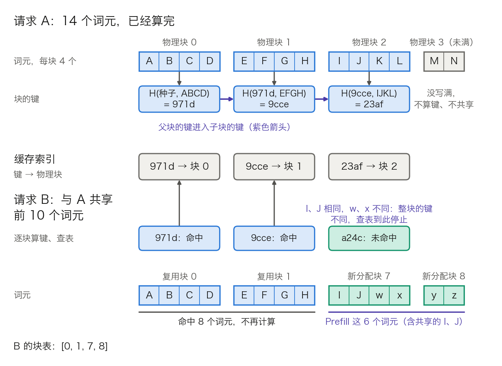
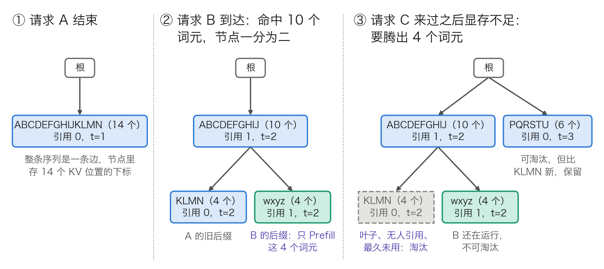

## 11.5 前缀复用：哈希块与前缀树

因果掩码使任何一层位置 i 的 K/V 只取决于前 i 个词元和权重，所以能跨请求复用的只有词元级完全一致的前缀；中间相同、文本相同、语义相近都不算。实现是给 [11.4 节](11.4_kv_memory_management.md)的分页 KV 池加一个按内容寻址的索引：按块链式哈希（vLLM）实现简单，键可以拿到进程外用，粒度是块；前缀树（SGLang）粒度到词元，调度器看得见共享结构。两者都靠引用计数保护正在用的块，都按 LRU 从尾部或叶子淘汰。命中省的是 Prefill，即 TTFT（首词元时间），不省 Decode；省下的计算约为命中词元的占比，但后缀读前缀的一项省不掉，前缀越长，收益越低于这个比例。命中率由提示词的排布和路由决定：多实例时先按会话键做一致性哈希，再考虑缓存感知路由。凡改变 K/V 的因素（适配器、图像内容、租户的盐值）必须进键，不改变的（采样参数）不应进键。

### 11.5.1 能复用的只有前缀

**K/V 由什么决定。** 按 [3.8.3 节](../03_components/3.8_gpt_inference_flow.md)的第 4 步，因果掩码让位置 i 只读位置 1 到 i。第 1 层的 `kᵢ`、`vᵢ` 由第 i 个词元和它的位置算出。第 2 层的 `kᵢ`、`vᵢ` 由第 1 层位置 i 的输出算出，而这个输出已经混入位置 1 到 i 的内容。逐层类推，任何一层位置 i 的 K/V 都只是“前 i 个词元、它们的位置、模型权重”的函数，与位置 i 右边的内容无关。

由此得到复用的条件：两个请求的前 P 个词元逐个相同，这 P 个位置在全部 L 层的 K/V 就相同，可以共用一份。条件里的每一项都不能放松：

- 中间相同不算。同一篇文档出现在两个请求的不同偏移处，位置不同；即使偏移相同，只要左边的内容不同，第 2 层起的 K/V 就不同。
- 文本相同不算，词元相同才算。同一段文字经不同的聊天模板或不同的切分，得到的词元序列可以不同。
- 语义相近不算。向量相似只能用于结果缓存，不能证明 K/V 可复用。

采样参数不在条件里。温度、top-p、随机种子只作用于 logits 之后（见[第九章](../09_decoding/README.md)），不改变任何位置的 K/V。

**命中之后算什么。** 设命中 P 个词元，剩下的后缀有 S 个词元，`T = P + S`。Prefill 只对后缀做：后缀的 S 行 Q 对缓存里的 P 行与新算出的 S 行 K/V 打分，每个头的分数矩阵是 `[S, P + S]`。`P = 0` 时退回完整 Prefill 的 `[T, T]`，`S = 1` 时退回 Decode 的 `[1, s]`；分块 Prefill 的第二块及以后（[11.3.4](11.3_scheduler_loop.md)）也是这个形状，两者都是“带着已有前缀做 Prefill”。

调度器的记账也相同。按 [11.3.1](11.3_scheduler_loop.md)，命中相当于已算词元数的初值为 P：本步只为后缀的 S 个词元申请词元预算和新的 KV 块；前缀的 P 个词元不占预算，只给已有的块各加一次引用。

### 11.5.2 路线一：按块链式哈希

分页之后，K/V 以块为单位存放。最直接的做法是给每个写满的块算一个键，用哈希表记录“键 → 物理块”。vLLM 的[自动前缀缓存](https://docs.vllm.ai/en/latest/design/prefix_caching/)走这条路线。

**键怎样构造。** 一个块可以复用，要求块内词元相同，并且它左边的全部词元也相同。若把左边的全部词元直接放进键，第 k 块要哈希 `k × B` 个词元（B 为块大小），整条序列合计 `O(T²/B)`。**链式哈希**（chained hash）改为把父块的键放进子块的键：

$$
h_k = H\big(h_{k-1},\ \text{第 } k \text{ 块的 } B \text{ 个词元},\ \text{额外键}\big),\qquad h_{-1}=\text{固定种子}
$$

块从 0 编号。忽略哈希碰撞，`h_k` 相同等价于第 0 块到第 k 块的词元与额外键全部相同。每块只哈希 B 个词元和一个定长的父键，整条序列合计 `O(T)`；每个块只在写满时算一次，每 B 步 Decode 才多算一块。额外键放词元 ID 之外、又会改变 K/V 的因素（11.5.7）。

图 11-11：按块链式哈希怎样匹配前缀，教学设定为每块 4 个词元（[生成脚本](https://github.com/yeasy/llm_internals/blob/main/tools/figures/ch11_5_block_hash_chain.py)）。蓝色是已在缓存里的块，青绿色是本次新分配的块；键取 SHA-256 的前 4 位十六进制，仅作示意。

**一次查找的步骤。** 新请求到达后：

1. 把 Prompt 按 B 切块，从第 0 块起逐块算键。
2. 逐块查哈希表。命中则把该物理块的引用计数加 1，写进本请求的块表；遇到第一个未命中即停止，链式构造保证后面的块不可能再命中。
3. 为其余词元分配新块，只对它们做 Prefill。
4. 新块一写满就算键入表，同一批里的其他请求立刻可以复用。Decode 阶段写满的块同样入表，模型的输出因此也能成为后续请求的前缀。

图 11-11 中，请求 B 与 A 共享前 10 个词元。前两块命中 8 个词元；第 3 块里 I、J 相同而 w、x 不同，键不同，整块未命中。B 要 Prefill 6 个词元，其中 2 个本可复用。只有写满的块才有键，A 的最后一块只有 M、N 两个词元，不参与共享。按块哈希的命中长度总是 B 的整数倍，每个请求最多损失 `B − 1` 个词元。

**引用计数与淘汰。** 请求结束时，它的每个块引用计数减 1。减到 0 的块不清空，保留键，挂到空闲队列的尾部。这时它既是可分配的空闲块，又是可命中的缓存块。分配新块时从队首取；取到的块若还带着键，就从哈希表里删掉这个键，这一步就是淘汰。队首是最久未用的块，所以策略是 LRU（least recently used，最近最少使用）。再次命中的块会被移出空闲队列，免于淘汰。

同一请求的块按逆序入队，最后一块排在前面、先被淘汰。理由有两条。越靠后的块，键里概括的词元越多，被别的请求命中的可能越小。再者，查找遇到第一个未命中就停，父块一旦被淘汰，子块即使还在也够不着，只是占着显存等淘汰。先淘汰尾部，就不会留下这种块。

**两个实现细节。** 其一，Prompt 整条命中时仍要重算最后一个词元。缓存里只有 K/V，没有最后位置的 logits，而首个输出词元要由它选出。vLLM 把可命中长度的上限设为 `T − 1`，再向下对齐到块边界：`T = 2000`、`B = 16` 时，上限 1,999 对齐为 1,984，最后一整块 16 个词元重算。其二，哈希碰撞的后果不在性能而在正确性与隐私：两个不同的前缀得到同一个键，后来者会读到别人的 K/V。所以默认用 SHA-256 这类密码学哈希；换成更快的非密码学哈希，多租户环境下有泄露风险。

### 11.5.3 路线二：前缀树（RadixAttention）

[SGLang 论文](https://arxiv.org/abs/2312.07104)提出的 **RadixAttention** 把全部缓存组织成一棵**基数树**（radix tree），即压缩的前缀树：没有分叉的一串边合并成一条，一条边可带任意长的词元序列，节点数只随分叉数增长。每个节点存一段词元、它们的 K/V 在显存池里的位置下标、引用计数和最近访问时间；从根走到某个节点，沿途的词元连起来就是一条已缓存的前缀。K/V 本身仍放在分页的显存池里，页（即前文的块）大小取 1 个词元，所以树可以在任意词元处分叉。

图 11-12：前缀树的匹配、拆分节点与从叶子淘汰，请求 A、B 与图 11-11 相同（[生成脚本](https://github.com/yeasy/llm_internals/blob/main/tools/figures/ch11_5_radix_tree_ops.py)）。读法：① 请求 A 结束后，整条序列是一条边；② 请求 B 匹配到第 10 个词元，节点拆成公共部分 `ABCDEFGHIJ` 与 `KLMN`，B 只 Prefill 新叶子 `wxyz`；③ 显存不足时，淘汰无人引用且最久未用的叶子 `KLMN`。每个节点第一行是这条边上的词元，第二行是引用计数与最近访问时刻 t；青绿色是本次新建的叶子，灰色虚框是被淘汰的节点。

**四个操作。** 图 11-12 按 ①②③ 的顺序画出了它们。

- 匹配：从根出发，按下一个词元找子节点，沿边逐词元比较，走到不一致或 Prompt 用尽为止。走过的长度就是命中长度 P。
- 拆分：匹配若停在一条边的中间，把该节点拆成两段，上半段成为新的父节点，代表公共部分，下半段留作子节点。K/V 不搬动，只是下标数组一分为二。图中请求 B 在第 10 个词元之后与 A 分开，`ABCDEFGHIJKLMN` 被拆成 `ABCDEFGHIJ` 与 `KLMN`，B 命中 10 个词元，比按块哈希多 2 个。
- 插入：分两次。Prefill 完成后先把 Prompt 插入树，运行中的请求因此也能被后到者命中；请求结束时再把输出补进同一条路径，多轮对话的下一轮因此能命中上一轮的输出。
- 淘汰：显存不足时，在引用计数为 0 的叶子里选最久未用的一个，释放它的 K/V。父节点若因此变成叶子且无人引用，就加入候选。重复到腾出足够空间。

**为什么从叶子淘汰。** 一个节点的 K/V 只有在祖先全部存在时才有用，先删中间节点会让整棵子树作废。从叶子删起，公共祖先留到最后，而系统提示、few-shot 示例这类公共祖先正是命中最多的部分。

**引用计数保护整条路径。** 运行中的请求要读它命中的全部 K/V，所以加引用时从命中的最深节点一路加到根，释放时同样一路减回去。图中 ③ 的 `wxyz` 与 `ABCDEFGHIJ` 引用计数都是 1，都不可淘汰。

**共用显存池。** 缓存与运行中的请求共用一个显存池，不划固定配额：空闲时缓存尽量多留，等待的请求足够多时缓存全部让位，换取更大的批。前缀缓存因此是拿闲置显存换计算，代价是高负载时缓存留不住。

**树的 CPU 开销。** 树放在 CPU 内存里，匹配、插入、淘汰都发生在 [11.1.2](11.1_engines_overview.md) 所说的每轮 CPU 段里。SGLang 论文在没有任何复用机会的负载上测得，维护树的时间不到端到端总时长的 0.3%（74.3 秒里的 0.2 秒）。占总时长的比例小，不等于可以留在关键路径上：它与调度、采样后处理一样，靠重叠调度藏到 GPU 前向后面。

### 11.5.4 两条路线的取舍

表 11-13 从七个维度对比两条路线。

| 维度 | 按块链式哈希 | 前缀树 |
| --- | --- | --- |
| 索引结构 | 哈希表“键 → 物理块”；块的父子关系只隐含在键里 | 显式的树：父子指针，每个节点一段词元 |
| 命中粒度 | 块大小 B 的整数倍，每请求最多损失 `B − 1` 个词元 | 页大小为 1 时精确到词元；页更大时同样向下对齐 |
| 查找开销 | 逐块算哈希并查表，`O(T)` | 沿树逐词元比较，`O(T)` |
| 分叉 | 无需处理，分叉点所在的块整块未命中 | 拆分节点 |
| 淘汰 | 取空闲队列队首；靠逆序入队近似“先叶子” | 显式地只淘汰叶子 |
| 调度器能看到什么 | 某个请求命中了几块 | 整棵树：各等待请求的命中长度、哪些请求在同一分支上 |
| 跨进程使用 | 键是定长摘要，可直接当作外部索引的键 | 要同步树结构，或维护一棵近似的副本 |

表 11-13：两种前缀索引的对比。

两条路线是同一机制的两种索引。前缀树在分叉多、分叉点不落在块边界的负载上命中更足，例如树状搜索、多层 few-shot、并行采样之后再追问；块哈希的键是定长摘要，适合拿到进程外做跨实例的索引。页大小大于 1 时，前缀树的匹配长度同样向下对齐，粒度上的差别随之消失。

### 11.5.5 算账：命中率与省下的 Prefill

**命中率**（cache hit rate）是命中的 Prompt 词元数除以 Prompt 词元总数，按词元计，不按请求计。

**算例一：共享系统提示。** 这是 [11.2.4](11.2_continuous_batching.md) 只给了量级的那个例子，精确账在这里算一次。常量取 [11.1.1](11.1_engines_overview.md)。系统提示加共享文档共 2,010 个词元，对所有请求相同；用户输入 200 个词元；块大小 16（[11.4.2](11.4_kv_memory_management.md)）。

先算命中长度。`2010 ÷ 16 = 125` 余 10，前 125 块共 2,000 个词元命中。第 126 块里有 10 个共享词元和 6 个用户词元，键不同，未命中。于是 `P = 2000`，`S = 210`，命中率 `2000 ÷ 2210 = 90.5%`。前缀树按词元匹配，`P = 2010`，`S = 200`。

再算计算量。与权重相乘的部分每词元约 139.6 亿次（11.1.1），只对后缀做。打分与读取一项另算：后缀的第 i 个位置要对 `P + i` 行 K/V 各算一次，每行约 `4d` 次（打分与读取各 `2d`，即 [3.8.8 节](../03_components/3.8_gpt_inference_flow.md)中 Decode 的 `4sd` 每行的份额）。对 S 个位置求和：

$$
\sum_{i=1}^{S} 4d\,(P+i) = 4dPS + 4d\cdot\frac{S(S+1)}{2} \approx 4dPS + 2dS^{2}
$$

每层约 `4dPS + 2dS²`：前一项是后缀读前缀，后一项是后缀读自己。`P = 0` 时它退回 3.8.8 的 `2T²d`。表 11-14 列出三种情形的计算量。

| 项目 | 无缓存：`P = 0`，`S = 2210` | 按块哈希：`P = 2000`，`S = 210` | 前缀树：`P = 2010`，`S = 200` |
| --- | ---: | ---: | ---: |
| 与权重相乘，32 层 | 约 30.85 万亿次 | 约 2.93 万亿次 | 约 2.79 万亿次 |
| 打分与读取，32 层 | 约 1.28 万亿次 | 约 0.232 万亿次 | 约 0.221 万亿次 |
| LM head（只算最后一行） | 约 10.5 亿次 | 约 10.5 亿次 | 约 10.5 亿次 |
| 合计 | 约 32.1 万亿次 | 约 3.16 万亿次 | 约 3.01 万亿次 |
| 相对无缓存 | 100% | 9.8% | 9.4% |

表 11-14：Llama 3 8B 在 2,210 个词元的 Prompt 上，命中与未命中的 Prefill 计算量。第一行是 `139.6 亿 × S`，第二行是 `(4dPS + 2dS²) × 32`。

从表中读出三件事。

第一，与权重相乘的部分严格按 `S ÷ T` 缩小，`210 ÷ 2210 = 9.5%`。

第二，打分与读取只降到 18%。省掉的是前缀自己的 `[P, P]` 那块三角；后缀读前缀的 `4dPS` 一项省不掉，中间一列里它占 0.220 万亿次。令 `4dP` 等于每词元每层与权重相乘的约 4.36 亿次，得 `P = 26,624`。前缀超过约 2.7 万个词元后，后缀每个词元读前缀的开销就超过它过一遍权重的开销。长文档问答的命中收益因此低于按词元比例估计的值。

第三，换算成时间要看瓶颈。Prefill 受算力限制，时间近似与计算量成正比。按 11.1.1 的有效算力（峰值的 0.4，即 396 万亿次/秒），无缓存约 81 ms，命中后约 8 ms，省下约 73 ms。这个比例不能继续外推：命中后每读 1 字节权重只做约 200 次运算，已低于约 300 的拐点（[10.1.2](../10_inference_optimization/10.1_bottleneck.md)），后缀再短，时间也不会低于读一遍权重的 4.79 ms。实际系统里这 210 个词元会与别的请求合成一批。TTFT（分解见 [11.13.1](11.13_best_practices.md)）中的排队、分词和网络几项不受影响。

**显存那一笔。** 每词元 KV 128 KiB（11.1.1），2,000 个词元的前缀约 250 MiB。100 个并发请求各存一份整条 Prompt（2,210 个词元），合计约 27.0 GiB；共享前缀后约 2.8 GiB。省下的显存可以装更多请求，批变大，Decode 的吞吐随之上升。共享只减少容量占用：标准内核下每轮 Decode 仍要为每个请求各读一遍前缀的 K/V；能合并这部分读取的是共享前缀专用的注意力内核（如 cascade attention）。

**算例二：多轮对话。** 系统提示 1,000 个词元，每轮用户输入 100 个、模型输出 300 个，共 10 轮（忽略模板词元与块对齐）。第 k 轮的 Prompt 长 `1000 + 400(k − 1) + 100`，无缓存时十轮合计 Prefill 29,000 个词元，随轮数按平方增长。会话的 K/V 一直留在缓存里时，首轮 1,100 个，其后每轮只有新输入的 100 个，合计 2,000 个，命中率 93.1%；上一轮的输出在 Decode 时已写好 K/V，不需要 Prefill。

**留得住多少会话。** 缓存要留住的是空闲会话，所需容量是“空闲会话数 × 平均长度 × 每词元字节”。算例二的会话到第 10 轮有 5,000 个词元，约 625 MiB；即使整个 41 万词元的池都给空闲会话，也只留得住约 80 个。用户的回复间隔一长，LRU 就会把它们挤掉。会话多、间隔长的负载，要靠主机内存或外部存储作第二、三级缓存（[11.4.5](11.4_kv_memory_management.md)）。

few-shot 评测（同一段示例配上千道题）、智能体（每一步把工具返回追加到历史后重新请求）、并行采样与树状搜索，都是这两种模式的组合：系统提示与示例是第一层共享，单条会话或轨迹的历史是第二层。

线上的命中率低于这些理想值：SGLang 论文在 Chatbot Arena 部署一个月，LLaVA-Next-34B 的命中率为 52.4%，Vicuna-33B 为 74.1%，后者的首词元延迟平均缩短为原来的 1/1.7。

### 11.5.6 缓存感知调度与路由

**实例内：先跑谁。** 缓存容量有限时，执行顺序决定命中率：两组前缀不同的请求交替执行而显存只够留一组时，每次切换都要淘汰再重算。SGLang 论文的调度器让等待队列里的每个请求先各做一次匹配，再按命中长度从长到短排序，称为最长共享前缀优先（longest-shared-prefix-first）。离线批处理、缓存不小于最长请求时，这个顺序等价于对这批请求构成的前缀树做深度优先遍历，命中率最优；论文的在线基准上，实际命中率平均为最优值的 96%。在线服务的默认仍是先到先服务（SGLang 也是如此，[11.11.4](11.11_sglang_internals.md)）：按命中长度排序每轮要为每个等待请求做一次匹配，还会让前缀冷门的请求一直排在后面，是拿尾延迟换吞吐（调度策略的一般讨论见 [11.3.7](11.3_scheduler_loop.md)）。它适合离线批处理与评测。

**实例间：送到哪。** 缓存是每个实例私有的。N 个副本轮询分发时，会话的下一轮落回同一实例的概率只有 `1/N`，8 个副本时是 12.5%（[11.2.6](11.2_continuous_batching.md)），算例二的 93% 无从谈起。

最便宜的一步是**会话亲和**：网关按会话或用户 ID 做一致性哈希，同一会话的各轮总落在同一实例上，多轮对话的命中率回到单实例的水平；实例增减时，也只有约 `1/N` 的会话换到别的实例。它不看请求内容，不需要维护索引，vLLM 的路由器把它列为对话类负载的首选策略（[vLLM Router](https://vllm.ai/blog/vllm-router-release)）。它管不到跨会话的公共前缀，例如不同用户就同一份长文档提问。

下一步是**缓存感知路由**（cache-aware routing）：网关按前缀内容选实例。SGLang 网关的 `cache_aware` 策略为每个实例维护一棵近似前缀树，只根据自己转发过的请求更新，存字符而不存词元以省掉分词；新请求与某棵树的匹配比例超过阈值就送往该实例，否则送往缓存最空的实例；各实例待处理请求数相差过大时，改按最短队列分发，不再看前缀。最后这一条针对亲和与均衡的冲突：所有请求共享同一段系统提示时，只看前缀会把流量全压到一个实例上。取舍可以估算：亲和值得，当且仅当省下的 Prefill 时间大于在目标实例上多排的队。算例一省下约 73 ms，目标实例前面多一个长 Prefill 就抵消了。前缀越长，亲和越值得；系统提示这类短而普遍的前缀，每个实例很快各存一份，无需亲和。

近似索引还有第二种失效：网关的树与实例的真实缓存不一致。实例因显存压力淘汰了某段前缀，网关并不知道，请求仍被送来，既未命中又多排了队。让实例把淘汰事件异步回报给路由器可以缓解，但只是弱一致；[Preble](https://arxiv.org/abs/2407.00023) 则把 K/V 复用与负载均衡放进同一个调度目标里联合优化。

### 11.5.7 键里放什么：失效与隔离

11.5.1 的结论是：凡影响 K/V 的因素都必须进键，不影响的不应进键。表 11-15 逐项对照。

| 因素 | 是否进键 | 原因与做法 |
| --- | --- | --- |
| 词元 ID 及其顺序 | 是 | K/V 的直接输入；链式哈希与树的路径都保证顺序和位置一致 |
| 采样参数（温度、top-p、种子、最大长度） | 否 | 只作用于 logits 之后；放进键只会无谓地降低命中率 |
| LoRA 适配器 | 是 | 适配器改动它所挂接的投影矩阵（见 [8.4 节](../08_alignment/8.4_peft.md)、[11.6 节](11.6_multi_lora_serving.md)），同样的词元算出不同的 K/V。块哈希把适配器标识放进额外键，前缀树按适配器分出不同的命名空间 |
| 多模态输入 | 是，用内容哈希 | 图像在词元序列里只是一串相同的占位词元，实际的输入是编码器给出的嵌入；图像的内容哈希放进含占位符的各块的键 |
| 租户或信任域 | 视部署而定 | 见下文“隔离” |
| 模型、精度与并行切分 | 实例内隐含 | 一个引擎实例只服务一份权重。K/V 一旦存到实例之外（见 [11.9 节](11.9_disaggregated_serving.md)），这些也要进键 |

表 11-15：哪些因素进入前缀缓存的键。

**隔离。** 共享缓存会泄露“某段前缀是否已有人问过”：命中时 TTFT 明显变短，攻击者可以据此逐段试探别人的 Prompt。对策是让请求携带一个盐值（vLLM 的 `cache_salt`），盐进入第 0 块的键；链式构造使其后所有块的键随之改变，只有同盐的请求互相命中。缓存因此可以在一个信任域内共享，在域之间隔离，代价是跨域的公共前缀各存一份。

**常见误解与失效情形。**

- 命中不加速 Decode。省掉的只是 Prefill，每轮 Decode 仍要读全部 K/V，TPOT（每输出词元时间）不变。收益体现在 TTFT，以及共享省下的显存换来的更大批。
- Prompt 开头的可变内容让命中率归零。时间戳、请求 ID、顺序不固定的工具列表若放在最前面，第 0 块的键就变了，其后全部失效。稳定的内容放前面，变化的放后面。
- 重新分词可能破坏多轮命中。客户端把上一轮输出的文本拼回 Prompt 再分词，得到的词元未必等于模型当时生成的词元；从第一个不一致处起，其后全部未命中。
- 需要 Prompt 各位置输出的请求不能命中。例如要求返回 Prompt 的对数概率时，引擎跳过缓存查找：缓存里只有 K/V，没有那些位置的 logits。
- 命中率不是单一的优化目标。为命中而重排队列会造成饥饿，为亲和而集中路由会造成热点，高负载时缓存还要让位给运行中的请求。

两个引擎各自的设计见 [11.10 节](11.10_vllm_internals.md)和 [11.11 节](11.11_sglang_internals.md)，模块名与启动参数见[附录 A.7](../appendix/a7_framework_recipes.md)，Prompt 排布原则见 [10.2.5](../10_inference_optimization/10.2_kv_cache.md)，命中率等监控指标见 [11.13.7](11.13_best_practices.md)。

读完本节，应能不看正文回答下面八个问题；括号里是回看的位置。

1. 两个请求开头不同，中间各有一篇相同的文档，这篇文档的 K/V 为什么不能复用？两个请求的采样温度不同，为什么不妨碍复用？（11.5.1）
2. 链式哈希为什么只需把父块的键放进子块的键？查找遇到第一个未命中的块，为什么可以就此停止？（11.5.2）
3. 两个请求共享前 1,000 个词元，块大小 16：按块哈希与页大小为 1 的前缀树各命中多少个词元？Prompt 整条命中时为什么仍要重算末尾一段？（11.5.2、11.5.3）
4. 前缀树为什么只从叶子淘汰？按块哈希没有显式的树，靠什么得到近似的效果？（11.5.2、11.5.3）
5. `P = 4,000`、`S = 100` 时，与权重相乘的计算量是无缓存时的百分之几？按 `4dPS + 2dS²` 算，打分与读取一项是无缓存时的百分之几，为什么降得少？（11.5.5）
6. 系统提示 500 个词元，每轮输入 100、输出 200，共 5 轮：无缓存与有缓存各要 Prefill 多少个词元？第 5 轮结束时这条会话占多少 KV？（11.5.5）
7. 多轮对话部署在 8 个实例上，会话亲和与缓存感知路由各解决什么问题，各在什么情形下失效？（11.5.6）
8. 命中前缀缓存后 TPOT 为什么不变？LoRA 适配器和采样温度，哪个必须进键，为什么？（11.5.7）
