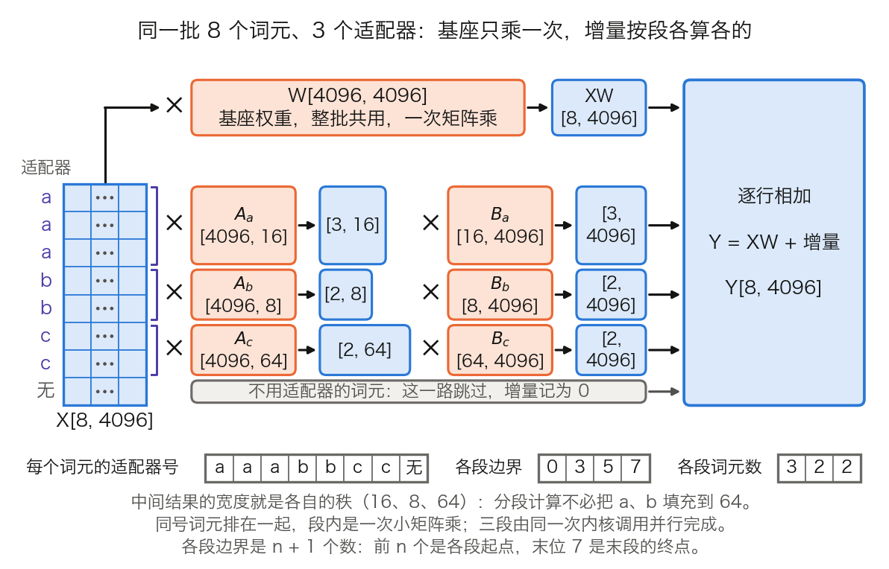
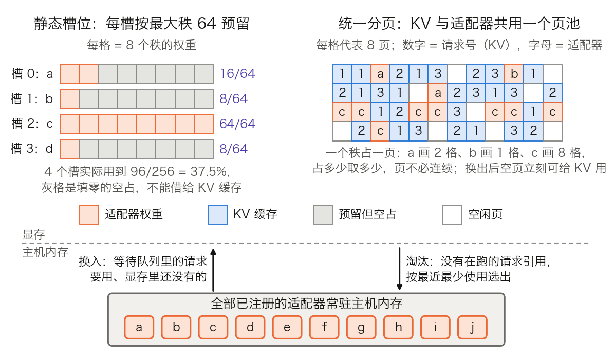

## 11.6 多 LoRA 服务：一份基础权重，许多适配器

LoRA 合并进权重后推理没有额外开销，但 N 个适配器合并就是 N 份完整权重，而且不同的 `W'` 无法共用同一遍权重读取，批处理的收益随之消失。多适配器服务因此一律不合并：基座的大矩阵乘全批算一次，增量 `xAB` 先降到 r 维再升回，批内词元按适配器分段，各段原地读自己的 `A`、`B`。增量的 FLOPs 只占约 0.6%，实际的吞吐损失却是百分之几到十几：多出的是每步几百次小内核调用和按段取数的固定开销，而低秩矩阵乘的算术强度上限约等于秩，加大批也提不上去。适配器只有几十 MB，换入只要毫秒级，可服务的数量受主机内存而不受显存限制；工程代价集中在秩与模块不齐时的填充。流量集中在一两个适配器上时，仍应合并后独占实例。

LoRA 的原理见 [8.4 节](../08_alignment/8.4_peft.md)，这里只用它的形状。算例用 [11.1.1](11.1_engines_overview.md) 的常量，适配器默认取 `r = 16`、覆盖一层全部七个线性投影。

### 11.6.1 适配器有多大，为什么不能合并

**记号。** 本书按行向量书写，线性层是 `x[1, d_in] × W[d_in, d_out] → y[1, d_out]`。LoRA 给 `W` 加一个低秩增量：

$$
y = xW + xAB,\qquad A\in\mathbb{R}^{d_{in}\times r},\quad B\in\mathbb{R}^{r\times d_{out}}
$$

8.4 节按列向量写作 $W_0 + \frac{\alpha}{r}BA$，两种写法互为转置，`A` 都是降到 `r` 维的那一个。缩放系数 $\alpha/r$ 加载时一次乘进 `B`，推理时不再出现。

**适配器的大小。** 一个投影上的适配器有 `r × (d_in + d_out)` 个数。Llama 3 8B 一层七个投影的 `d_in + d_out` 之和是 81,920（`W_Q`、`W_O` 各 8,192，`W_K`、`W_V` 各 5,120，MLP 三个矩阵各 18,432）。`r = 16` 覆盖全部七个投影，32 层共 4,194 万个数，FP16 下 83.9 MB，是基座的 0.52%；只加在 `W_Q`、`W_V` 上则只有 13.6 MB。

**合并的代价之一：副本。** 合并指离线算出 `W' = W + AB`。单个适配器这样做最好；N 个适配器各自合并就是 N 份完整权重，80 GB 的显存放 4 份 Llama 3 8B 就只剩不到 16 GB 给 KV 缓存。不合并时只存一份基座，100 个适配器另占 8.4 GB。

**合并的代价之二：批拆散了。** Decode 的批处理靠多个请求共用同一遍权重读取（[11.1.1](11.1_engines_overview.md)）。合并之后，不同适配器的请求面对的是不同的 `W'`，`X × W'` 无法共用，批只能按适配器拆开；[LoRA 论文](https://arxiv.org/abs/2106.09685)在局限一段里指出了这一点。只留一份权重、换任务时减旧加新也不行：切换一次要把约 14 GB 的线性权重读写一遍，约 8 ms，更要紧的是同一时刻只有一个适配器在位，批依然凑不大。[S-LoRA](https://arxiv.org/abs/2311.03285) 的消融显示，只有一个适配器时合并更快，超过两个之后就因频繁切换而落后于不合并的方案。

由此得到判据：流量集中在一两个适配器上，就合并后独占实例；适配器多而流量分散，就保持不合并，让所有请求共用基座的那一次大矩阵乘。

### 11.6.2 不合并时，一层多出两次小矩阵乘

不合并时从不显式算出 `AB`（它是满尺寸矩阵，算它等于做了一次合并），而是先降维、再升维：以 `W_Q` 为例，`x[1, 4096] × A[4096, 16] → v[1, 16]`，再 `v × B[16, 4096] → [1, 4096]`，与基座结果逐格相加。

**FLOPs。** 增量与基座的计算量之比是 `r × (d_in + d_out) ÷ (d_in × d_out)`：`W_Q` 上是 0.78%，`W_K`、`W_V` 上是 1.95%，MLP 上是 0.50%，一层合计 0.60%，与参数占比同一量级。

**0.6% 不是延迟开销。** 实际开销高出这个比例，来源有两处，性质不同。第一处是固定开销：每个投影多出降维、升维两次内核调用，7 个投影、32 层，一步 Decode 多出约 `7 × 32 × 2 = 448` 次内核启动，另有每段各自取数的开销，这些与矩阵大小无关，小批时占主导；把 Q/K/V、gate/up 打包成一次调用能减少次数，量级不变。静态槽位使这些小内核能随整步录进 CUDA Graph（11.6.5、[11.10.5](11.10_vllm_internals.md)），CPU 逐个提交的成本已经省掉，剩下的是每个内核在 GPU 上的启动、收尾与那一小段计算：若每次只多一两微秒，448 次合 0.5 到 0.9 ms，是批 32 一步 6.0 ms 的 7% 到 15%。第二处是访存：低秩矩阵乘每读 1 字节只做约 1 到 r 次运算（11.6.4），永远处在访存受限区，加大批也不能把它摊薄；但它读的字节本身很少。公开的数字多是跨系统对比：[Punica](https://arxiv.org/abs/2310.18547) 在单张 A100 上带 `r = 16` 适配器跑 Llama 2 7B，比只跑基座的 vLLM 慢约 8%，13B 上约 12%。两个系统的实现不同，这个差只能说明量级：多 LoRA 的代价是百分之几到十几，不是千分之六。

### 11.6.3 同一批里的不同适配器：按段分别算

[11.3 节](11.3_scheduler_loop.md)的调度器每步交出一批词元 `X[B, d_in]`，每行可能属于不同的适配器。基座一路照旧，全批一次大矩阵乘；难点在增量一路，每行要乘的 `A`、`B` 不同，秩也可能不同。直接的做法各有缺陷：逐个适配器循环，内核启动次数乘以适配器数；把各行的 `A` 复制进一个连续张量再做批量矩阵乘，多出复制与重读；补零到最大秩，付 11.6.6 的填充代价。

Punica 的专用内核 **SGMV**（Segmented Gather Matrix-Vector Multiplication，分段聚合矩阵向量乘）分三步：

1. **排序。** 把同一适配器的词元排到相邻位置，批被切成若干段，每段对应一个适配器。
2. **建索引。** 记下各段的起点。索引每步只建一次，供全部 32 层、每层 7 个投影复用。
3. **一次启动，各段并行。** 内核按段号找到该段适配器权重的地址，原地读取，不做复制。降维与升维各启动一次。

图 11-13 画出一个 8 个词元的 Decode 批：3 个词元用适配器 a（`r = 16`），2 个用 b（`r = 8`），2 个用 c（`r = 64`），1 个不用适配器。Punica 论文的文本生成实验统一取秩 16；同一批里混用不同的秩，是 S-LoRA 的内核与 vLLM 的实现明确支持的情形，图按这种更一般的情形画出。

图 11-13：同一批 8 个词元、3 个适配器的一次线性投影，形状按 Llama 3 8B 的 `W_Q` 标注（[生成脚本](https://github.com/yeasy/llm_internals/blob/main/tools/figures/ch11_6_segmented_lora_batch.py)）。橙色是权重，蓝色是数据；基座一路对整批只乘一次，增量一路按段计算，各段中间结果的列数等于各自的秩。底部的“各段边界”是 n + 1 个数，末位 7 是末段的终点。

三段的中间结果分别是 `[3, 16]`、`[2, 8]`、`[2, 64]`，没有任何一段被填充到 64；不用适配器的词元不进入增量一路。分段按词元计，所以 Prefill 与 Decode 可以混在一批里：一个 Decode 请求贡献 1 行，一个正在 Prefill 的请求贡献本步分给它的一整段，段内是矩阵乘矩阵。S-LoRA 为两种情形各写了一个内核，并允许同一批内的秩不同。各引擎里的索引字段与内核文件见[附录 A.7](../appendix/a7_framework_recipes.md)。

### 11.6.4 批处理的收益为何还在

混批是否划算，看每从显存读 1 字节做多少次运算。场景是 Llama 3 8B 的一步 Decode，每个请求的上下文里已有 1,000 个词元。要读的字节有三项：权重 16.06 GB，全批一份；KV 缓存每个请求 131 MB；适配器每个 83.9 MB，批里出现几个就读几个。

| 情形 | 计算量 | 要读的字节 | 每字节运算次数 | H100 带宽下界 |
| --- | ---: | ---: | ---: | ---: |
| 批 32，无适配器 | 4,971 亿 | 20.25 GB | 24.5 | 6.0 ms |
| 批 32，同一个适配器 | 4,998 亿 | 20.34 GB | 24.6 | 6.1 ms |
| 批 32，32 个不同适配器 | 4,998 亿 | 22.94 GB | 21.8 | 6.8 ms |
| 不混批：32 个适配器各跑批 1，共 32 步 | 4,998 亿 | 520.8 GB | 0.96 | 155 ms |

表 11-16：Llama 3 8B 一步 Decode 的访存账。计算量含 LM head 与注意力；“带宽下界”是要读的字节除以 3.35 TB/s，只反映显存带宽一项。

最坏的情形是 32 个请求各用各的适配器：适配器一共多读 2.68 GB，每字节运算次数从 24.5 降到 21.8，约 11%。不能混批时，每个适配器只能以批大小 1 运行，凑齐同样的 32 个词元要把权重读 32 遍，访存是混批的 22.7 倍。批处理的收益来自共用那 16.06 GB 的基座权重，适配器只占其中一小块，所以收益基本保住。

**增量一路自身的算术强度。** 一段 `s` 个词元乘一个 `[h_i, h_o]` 的矩阵，计算量正比于 `s × h_i × h_o`，访存正比于 `s × (h_i + h_o)` 加上权重本身的 `h_i × h_o`。段长趋于无穷时权重一项可以忽略，每字节运算次数趋于 `h_i h_o ÷ (h_i + h_o)`，`r` 远小于 `d` 时约等于 `r`：`r = 16` 的降维是 15.9，远低于约 300 的拐点（[10.1.2](../10_inference_optimization/10.1_bottleneck.md)）。适配器越集中，段越长，这一路越接近这个上限；各行适配器都不同时，每段只有一行，每字节只做约 1 次运算。两种情形下增量一路都受访存限制，加大批不提高它的算术强度。它拖不动全局，是因为读的字节少：表中同一个适配器只比无适配器多读 0.4%。

### 11.6.5 适配器的显存：槽位、分页与换入换出

适配器分三级存放：全部适配器在磁盘或对象存储里，已注册的常驻主机内存，只有当前批用到的在显存里。可服务的适配器总数因此受主机内存限制，而不受显存限制：64 GB 主机内存放得下约 760 个 83.9 MB 的适配器。

**换入很便宜。** PCIe 4.0 x16 约 32 GB/s（[11.4.5](11.4_kv_memory_management.md)），83.9 MB 的适配器传约 2.6 ms，不到一步 Decode；Punica 实测整个适配器约 2 ms。整份基座 16.06 GB 要传 0.5 秒，还不算从磁盘读出的时间。所以多 LoRA 系统的冷启动只是一次小拷贝：新请求的适配器不在显存里时发起一次异步拷贝，当前批照常计算，拷贝结束后新请求并入下一批；S-LoRA 还按等待队列预测下一批要用的适配器，提前取来。

**显存里怎么放，有两种设计。** 图 11-14 把两者并排画出。

图 11-14：适配器权重在显存里的两种放法（[生成脚本](https://github.com/yeasy/llm_internals/blob/main/tools/figures/ch11_6_adapter_memory.py)）。左：静态槽位按最大秩预留，灰格是填零的空占。右：统一分页，适配器与 KV 缓存从同一个页池取页。下：全部适配器常驻主机内存，按需换入，不被引用时淘汰。为便于画出，右图每格代表 8 页，S-LoRA 实际是一个秩一页。

**静态槽位**（vLLM 的做法）在启动时为每个加了 LoRA 的线性层预分配固定个数的槽，每个槽按最大秩开满，秩不足的部分填零。好处是形状固定，内核只需要“基地址加槽号”，便于配合 CUDA Graph 这类要求静态形状的机制；代价是 11.6.6 的空占。**统一分页**（S-LoRA 的 Unified Paging）把 [11.4 节](11.4_kv_memory_management.md)的分页推广到适配器：剩余显存是一个页池，每页存一个隐藏宽度的向量，长度为 `S` 的 KV 张量占 `S` 页，秩为 `R` 的 LoRA 矩阵占 `R` 页，两者交错存放。它没有空占，代价是内核要按页表逐页取数；而且要求 KV 与适配器的那一维都等于隐藏宽度：Llama 3 8B 的 K、V 宽度只有隐藏宽度的四分之一，`W_down` 的 `A` 每个秩合 3.5 页，GQA 模型与 MLP 上的适配器都要重新设计页的大小。

**调度约束。** 一批里能出现的不同适配器个数不超过槽位数。批里的槽已被占满、新请求用的又是另一个适配器时，它只能等，冷门适配器的请求可能被热门适配器挡在队列里。常见的坑是只打开多 LoRA 的开关而不调槽位数：vLLM 的默认值只有 1 个槽，一批里只能出现一个适配器，混批形同虚设，要显式调大。每多一个 `r = 16` 的槽占 83.9 MB，折合 640 个词元的 KV 缓存。另一条路是在路由层把用同一批适配器的请求送到同一实例，缩小每个实例面对的适配器集合。有正在运行的请求引用的适配器不能换出，其余的按 LRU 在显存与主机内存两级淘汰。

### 11.6.6 秩不同、目标模块不同：填充的代价

真实负载里的适配器并不整齐：秩从 8 到 64 甚至更大，有的只加在 `W_Q`、`W_V` 上，有的覆盖全部线性层。凡是要求“同形状”的实现，都要为此付出填充。

**秩不同。** 设一批 32 个请求，24 个用 `r = 8`，6 个用 `r = 16`，2 个用 `r = 64`。有用的秩总和是 416，全部填充到 64 后是 2,048：有效计算只占 20%，实际计算量是有用部分的 4.9 倍。显存一侧，32 个槽按 `r = 64` 预留，空占约 8.6 GB，折合约 6.5 万个词元的 KV 缓存，相当于 65 个 1,000 词元的并发请求。静态槽位的实现两笔都付，因为内核按最大秩计算，不足的部分乘的是零；所以最大秩应按实际用到的最大值设，不要留宽裕的上限。分段内核加统一分页两笔都不付，换来更复杂的内核和不固定的形状。折中的做法是按秩把适配器分到不同实例。

**目标模块不同。** 只加在 `W_Q`、`W_V` 上的 `r = 16` 适配器只占全模块槽位的 16%。引擎若为七个投影都挂上增量一路，其余五个投影上乘的是全零矩阵，照样计算，除非内核按模块跳过；部署时应把增量一路限制在实际用到的模块上。

### 11.6.7 边界与常见误解

- **“LoRA 推理零开销”只对合并后的单适配器成立。** 多 LoRA 服务必然不合并，代价是 11.6.2 所说的百分之几到十几的吞吐。
- **适配器会使前缀缓存失效。** 适配器改了 `W_K`、`W_V`，同一段前缀算出的 K、V 就不同；即使只改 `W_Q`、`W_O`，第 1 层的输出也变了，第 2 层起的 K、V 随之不同。缓存键里必须带上适配器标识（[11.5.7](11.5_prefix_reuse.md) 的表 11-15），同一段系统提示词在 N 个适配器上要各 Prefill 一次、各存一份。
- **量化基座不能无损合并。** 基座是 4 比特、适配器是 FP16 时，`W + AB` 无法无损放回 4 比特的格点：要么反量化后再合并，放弃量化省下的显存；要么即使只有一个适配器也走不合并的路径。
- **多卡下适配器也要切分。** 基座按张量并行切开后，`A`、`B` 的切法决定增量一路多出多少通信。S-LoRA 让这部分通信落在 `r` 维的小张量上，并与基座的 all-reduce 融合。张量并行本身见 [11.8 节](11.8_multi_gpu_inference.md)。
- **多 LoRA 不是多模型。** 全部收益来自共用基座。变体改动了词表、用了不同的基座版本，或者秩大到与 `d_model` 同量级时，本节的账不再成立，需要回到分实例部署。

vLLM 的多 LoRA 配置项与默认值的对照见[附录 A.7](../appendix/a7_framework_recipes.md)，引擎的整体结构见 [11.10 节](11.10_vllm_internals.md)。

读完本节，应能不看正文回答下面五个问题；括号里是回看的位置。

1. 100 个适配器各自合并与不合并，各要多少显存？合并为什么还会让批处理失效？（11.6.1）
2. 增量的 FLOPs 只占 0.6%，实际吞吐为什么会慢百分之几到十几？固定开销与访存各起什么作用？（11.6.2、11.6.4）
3. 一批里有三个秩不同的适配器，按段计算时各段的中间结果是什么形状？为什么不需要填充？（11.6.3）
4. 32 个请求各用不同的适配器时，访存比无适配器多多少？不混批又是多少倍？（11.6.4）
5. 静态槽位与统一分页各付出什么代价？只打开多 LoRA 开关而不调槽位数，会发生什么？（11.6.5、11.6.6）
