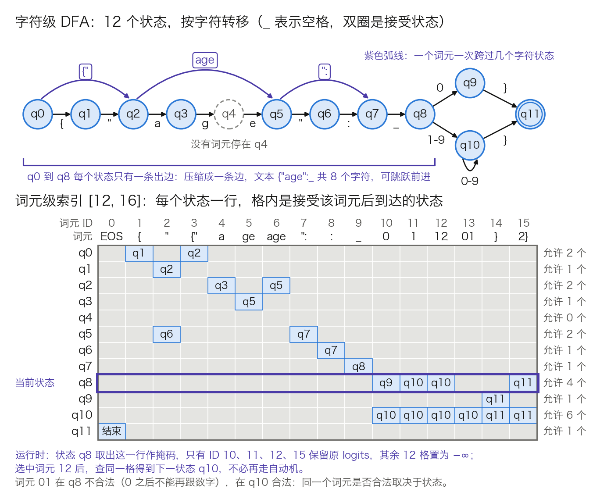
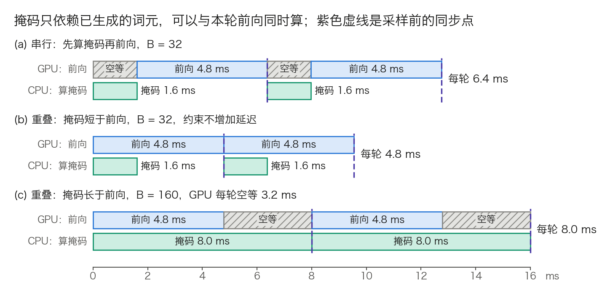

## 11.7 约束解码：让输出必然合乎语法

约束解码不动前向，只在 logits 上加一行随请求、随步变化的词表掩码，GPU 一侧的成本可以忽略；难点全在 CPU：语法定义在字符上，词元跨越语法边界，而整批请求的掩码必须在一步前向的几毫秒内算完。正则可以编译成有限自动机，把“状态 × 词元”的试走预先算成索引，运行时只查表。嵌套语法要带栈，状态不可枚举：要么只预计算与栈无关的绝大多数词元、运行时补判其余，要么不预计算、沿词表前缀树在线遍历，取舍是把成本放在编译期还是每一步。掩码与前向没有数据依赖，可以重叠执行，判据是 `B × t_mask ÷ 线程数 ≤ t_fwd`；语法里的确定性片段可以一次强制填入。今天 vLLM 与 SGLang 默认都以 XGrammar 为后端。它只保证语法，不保证输出分布不变。

自动机、掩码与分布扭曲的原理见 [9.4 节](../09_decoding/9.4_constrained.md)，本节讲引擎一侧：索引怎样建、每步花多少 CPU、与批处理和投机解码怎样接上。

### 11.7.1 约束落在哪一步：logits 上的一行掩码

约束解码不改前向计算。权重、注意力、KV 缓存都照旧，改动只在 LM head 之后、采样之前：`logits[B, 128256] + M[B, 128256]`，合法词元加 0，不合法词元加 −∞（形状按 Llama 3 8B）。这与因果掩码是同一种运算，只是那里遮的是位置，这里遮的是词表。`M` 的每一行属于一个请求，由该请求自己的语法和自己走到的状态决定，行与行互不相同。

掩码只有“留”和“遮”两种取值，一个词元用 1 比特即可，整行压成一张**位图**（bitmask）。[XGrammar](https://github.com/mlc-ai/xgrammar) 的约定是 `bitmask[B, ⌈n_vocab/32⌉]`，元素为 int32，由 CPU 填好后拷到 GPU，再由一个内核就地改写 logits。Llama 3 8B 一行是 4,008 个 int32，约 16 KB；`B = 64` 时每轮拷贝约 1 MB，经 PCIe 只要几十微秒，可以忽略。

**掩码的宽度必须等于嵌入表的行数**，即 128,256 行，其中 256 个特殊词元里有 `<|end_of_text|>`、`<|eot_id|>` 两个停止词元，漏掉它们，模型就能在半截 JSON 上结束。

### 11.7.2 从字符级自动机到词元级索引

语法定义在字符（字节）上，词元边界与语法边界并不对齐（[9.4.3](../09_decoding/9.4_constrained.md)）。每一步把全词表从自动机的当前状态试走一遍太慢（11.7.4）。正则编译出的确定有限自动机（DFA）状态数有限，于是可以在请求开始前，对每个状态、每个词元各试走一次，把结果存成一张表，运行时只按当前状态取一行。这就是 [Outlines 论文](https://arxiv.org/abs/2307.09702)提出的词表索引：建表代价是 `|Q| × n_vocab` 次试走（`|Q|` 是状态数），只付一次；运行时是一次查表。

**一个可手算的例子。** 要求输出形如 `{"age": 12}` 的 JSON，整数不许有前导零。对应的正则是：

```text
\{"age": (0|[1-9][0-9]*)\}
```

它编译成一个 12 个状态的 DFA（不计死状态）：`q0` 到 `q8` 依次吃掉 `{"age": ` 这 8 个字符；`q8` 读到 `0` 去 `q9`，读到 `1-9` 去 `q10`；`q10` 读到数字留在原地；`q9`、`q10` 读到 `}` 去接受状态 `q11`。教学词表取 16 个词元，见表 11-17，其中特意放了多字符词元、同一字符串的不同切法，以及横跨两个语法成分的词元。

| ID | 0 | 1 | 2 | 3 | 4 | 5 | 6 | 7 | 8 | 9 | 10 | 11 | 12 | 13 | 14 | 15 |
| --- | --- | --- | --- | --- | --- | --- | --- | --- | --- | --- | --- | --- | --- | --- | --- | --- |
| 词元 | EOS | `{` | `"` | `{"` | `a` | `ge` | `age` | `":` | `:` | 空格 | `0` | `1` | `12` | `01` | `}` | `2}` |

表 11-17：教学词表，16 个词元。

建索引就是对 12 个状态、15 个非 EOS 词元各试走一次；EOS 不走自动机，只在接受状态合法。以 `q8` 为例：词元 `01` 的 `0` 到 `q9`，`q9` 没有读 `1` 的出边，不合法；`12` 落到 `q10`；`2}` 落到 `q11`。同一个 `01` 从 `q10` 出发则合法：一个词元合不合法取决于状态，掩码因此必须逐步重算。图 11-15 画出完整的自动机和算出的索引。



图 11-15：正则 `\{"age": (0|[1-9][0-9]*)\}` 的字符级 DFA，以及对 16 个词元预计算出的词元级索引 `[12, 16]`（[生成脚本](https://github.com/yeasy/llm_internals/blob/main/tools/figures/ch11_7_token_index.py)）。蓝格内是接受该词元后的落点状态，灰格不合法；紫框是第 5 步用到的那一行。

从这张索引能读出三件事：

1. **词元跨过状态。** `{"` 从 `q0` 直达 `q2`，`age` 从 `q2` 直达 `q5`；`q4` 没有任何词元停留。
2. **同一字符串的各种切法都合法。** `q0` 既允许 `{"`，也允许 `{` 再接 `"`，索引不偏向规范切法，风险见 11.7.7。
3. **EOS 只在接受状态合法。** 生成不会在半截 JSON 上自行结束。

表 11-18 是生成 `{"age": 12}` 的完整轨迹。每一步做两次查表：按当前状态取一行作掩码，采样后按选中的词元取落点状态。

| 步 | 状态 | 掩码（ID 0 到 15） | 合法词元数 | 选中 | 落点 |
| ---: | --- | --- | ---: | --- | --- |
| 1 | `q0` | `0101000000000000` | 2 | `{"` | `q2` |
| 2 | `q2` | `0000101000000000` | 2 | `age` | `q5` |
| 3 | `q5` | `0010000100000000` | 2 | `":` | `q7` |
| 4 | `q7` | `0000000001000000` | 1 | 空格 | `q8` |
| 5 | `q8` | `0000000000111001` | 4 | `12` | `q10` |
| 6 | `q10` | `0000000000111111` | 6 | `}` | `q11` |
| 7 | `q11` | `1000000000000000` | 1 | EOS | 结束 |

表 11-18：逐步轨迹。7 步里只有第 5、6 步存在语义上的选择，其余各步的候选要么唯一，要么只是同一字符串的不同切法，11.7.5 利用的就是这一点。

**还原到真实规模。** 100 个状态的正则配 Llama 3 的词表，建表约 0.3 秒（按 11.7.4 的单次试走 25 ns）：一次性的开销，但必须缓存。存储上每个状态一张 16 KB 的位图，1,000 个状态是 16 MB；落点不必存成稠密表，只为合法词元存即可。字节级 BPE 的词表含全部 256 个单字节词元（[3.1 节](../03_components/3.1_tokenization.md)），任何合法字符串总有一种切法走得通，索引不会出现“语法允许、词表却拼不出”的死路。

### 11.7.3 嵌套结构：下推自动机与上下文独立词元

**为什么整表预计算做不下去。** 有限状态记不住任意深的嵌套（[9.4.4](../09_decoding/9.4_constrained.md)）。不含递归、层数固定的 JSON Schema 可以先展开成正则，Outlines 即走此路，代价是自引用只能按固定深度截断，正则大小随深度指数增长。要接受任意 JSON 或深度不设限的递归，就要上下文无关文法（Context-Free Grammar，CFG），对应的机器是在有限状态之外加一个栈的**下推自动机**（Pushdown Automaton，PDA）：进入子规则时把返回位置压栈，子规则结束时弹栈回到上层。下文把文法规则里的一个位置称为一个**节点**。PDA 的完整状态是“当前节点加整个栈”，栈深不设上限，状态无法枚举；退回每步试走全词表，又太慢。

**XGrammar 的拆分。** [XGrammar 论文](https://arxiv.org/abs/2411.15100)按“只看栈顶能否判定”把词元分成两类。词元从栈顶节点出发逐字节匹配，过程只有三种情形：进入子规则（压栈）、在当前规则内前进、走到当前规则末尾并返回上层（弹栈）。前两种只依赖栈顶节点，称**上下文独立词元**（context-independent token），可以对每个节点预先判好、存入缓存；第三种要看栈里压着什么，称**上下文依赖词元**（context-dependent token），留到运行时带着完整的栈去判。例如位于 JSON 字符串内部时，候选词元 `"}` 先结束字符串、再关一层括号，`}` 是否合法取决于外层是对象还是数组，属于后者；候选词元 `cd` 只在字符串内部前进，属于前者。

论文对 Llama 3.1 的词表和 JSON 文法给出的数字是：上下文依赖词元 1,134 个，不到词表的 1%；再预先算出每条规则返回上层后可能接上的字符串，提前排除注定失败的词元，可降到 120 个。运行时要带着栈去判的词元，由整张词表缩到百余个，其余直接取自缓存。

这个“按位置预计算、运行时补判其余”的骨架，在 XGrammar 的现行实现里没有变；变的是运行时那一半的解析算法。论文用显式栈，[v0.1.21](https://github.com/mlc-ai/xgrammar/releases/tag/v0.1.21) 起改为 Earley 解析器：它是能处理任意上下文无关文法的通用解析算法，不再有状态数指数增长和深递归的问题，预处理也快了数倍。

**另一条路线是不预计算。** [llguidance](https://github.com/guidance-ai/llguidance) 不建缓存，每一步在运行时遍历词表：词表按共享前缀组织成前缀树（trie），前缀相同的词元只走一次；文法同样用 Earley 解析器，词法部分在运行时按需推出自动机的下一个状态。其文档给出的量级是 128k 词表下每张掩码约 50 微秒的单核 CPU 时间，且几乎没有启动开销。两条路线的取舍在于把成本放在编译期还是每一步：语法固定、请求量大时，预计算摊得开；每个请求的 Schema 都不同时（例如工具列表随请求变化），编译缓存命中率低，运行时路线更稳。

### 11.7.4 每步掩码的开销与缓存

约束解码有三笔开销：编译语法（每种语法一次）、生成掩码（每请求每步一次）、施加掩码（GPU 上一次逐元素运算）。第三笔可忽略，前两笔都在 CPU 上。

**每步的预算。** 一轮 Decode 的下界是读一遍权重的时间，约 `16 GB ÷ 3.35 TB/s ≈ 4.8 ms`（[11.1.1](11.1_engines_overview.md)）。掩码若要不拖慢生成，整批请求的掩码必须在这 4.8 ms 内算完。

**朴素做法超出多少。** 假设词元平均 5 字节、一次状态转移 5 ns（一次查表的量级），每请求每步试走全词表是 `128,256 × 5 × 5 ns ≈ 3.21 ms`。`B = 32` 时串行要约 103 ms，是前向的 20 多倍。有索引或缓存之后，每张掩码降到几十微秒：XGrammar 论文报告 JSON Schema 与 JSON 文法每词元低于 40 微秒，llguidance 文档给出约 50 微秒。取 50 微秒，`B = 32` 时一轮是 1.6 ms。

**重叠。** 本轮掩码只依赖已经生成的词元，本轮前向也是，两者没有先后关系，可以让 CPU 与 GPU 同时开工，在采样之前同步一次。图 11-16 比较三种排法。



图 11-16：掩码计算与前向的时序，时间按比例（[生成脚本](https://github.com/yeasy/llm_internals/blob/main/tools/figures/ch11_7_mask_overlap.py)）。前向统一取 4.8 ms 的下界，掩码取每请求 50 微秒、单线程。(a) 串行时每轮 `1.6 + 4.8 = 6.4` ms；(b) 重叠后掩码藏在前向之内，每轮 4.8 ms；(c) `B = 160` 时掩码要 8.0 ms，GPU 每轮空等 3.2 ms。

由此得到一条判据：

$$
\frac{B_{\text{约束}} \times t_{\text{mask}}}{\text{线程数}} \le t_{\text{fwd}}
$$

左边不超过右边，约束对延迟没有影响；超过，掩码就落在关键路径上，每轮时间由 CPU 决定。代入 50 微秒和 4.8 ms，单线程能容纳约 96 个约束请求。批变大时前向也会变长，所以 96 偏保守；再往上靠多线程并行填各行。这条数据依赖还有一个推论：掩码必须等上一步的采样结果，[11.1.2](11.1_engines_overview.md) 的重叠调度遇到约束请求要在采样前多等一次，两个引擎的具体解法见 [11.10 节](11.10_vllm_internals.md)与 [11.11 节](11.11_sglang_internals.md)。

**编译缓存。** 编译结果按“语法加分词器”缓存，同一 Schema 的后续请求直接复用。[SGLang 论文](https://arxiv.org/abs/2312.07104)的消融实验显示，若每个请求都重做预处理，吞吐降为原来的 1/2.4。首个请求的编译时间计入它的 TTFT（首词元时间），可与 Prefill 重叠来遮掉一部分。

### 11.7.5 跳跃前进：确定性片段不必逐词元解码

表 11-18 的前 4 步没有任何信息量：语法已经规定输出以 `{"age": ` 开头，模型却仍要做 4 轮前向把这 8 个字符“生成”出来。**跳跃前进**（jump-forward）省掉这些前向。

**机制。** SGLang 论文的压缩有限状态机先在字符级自动机上找单出边（源状态只有一个后继，边上只有一个可接受字符），把连续的单出边合并成一条压缩边，边上的文本是各字符的拼接。图 11-15 里 `q0` 到 `q8` 的 8 条边压成一条，文本为 `{"age": `。运行时走到压缩边的起点，引擎直接把整段文本追加到序列里，切成词元，交给一次多行的前向补齐 KV，不再经过采样。压缩必须在字符级做：词元级的 `q0` 有 `{` 和 `{"` 两条出边，看上去并不确定。

**省了多少。** 不跳跃时，Prefill 给出第 1 个词元，其后 6 个词元各需一轮 Decode。跳跃时，4 个强制词元直接并入 Prefill，模型只需生成 `12` 和 `}`，EOS 是终态唯一合法的词元，可以直接结束，Decode 由 6 轮降到 1 到 2 轮，省下约 `4 × 4.8 ≈ 19` ms。多算的几行不费时：并入 Prefill 时，4 行远小于 Prompt 的长度；强制片段出现在序列中间时，不跳跃要 `k + 1` 轮单行前向，跳跃是一轮 `k + 1` 行的前向，而 `k + 1` 远低于约 340 个词元的拐点（[11.3.4](11.3_scheduler_loop.md)），步长仍由读权重决定。llguidance 的[文档](https://github.com/guidance-ai/llguidance/blob/main/docs/fast_forward.md)把它概括为“推测 100% 正确的投机解码”。SGLang 论文在 JSON 解码基准上测得吞吐提高到 1.6 倍；字段名越长、自由取值越短的 Schema，收益越大。

**代价。**

- 跳跃的这一轮是一次小的 Prefill，调度器要像分块 Prefill 那样混排：k 个强制词元使应算词元数一次增加 k，这一步占 `k + 1` 个词元的预算（[11.3.1](11.3_scheduler_loop.md)）；它们的 KV 照常写入块，写满的块同样进入前缀缓存。
- 强制文本要重新分词，保证切法与训练时一致；重切若使末尾几个已生成的词元发生合并，这些词元的 KV 要作废重算，语法状态也要同步回退。
- 强制到哪里为止并不显然，见 11.7.7 的词元边界问题。

这几条代价使跳跃前进并非各引擎默认开启的功能，例如 SGLang 的现行版本只保留了接口（[11.11.5](11.11_sglang_internals.md)）。

### 11.7.6 与采样、投机解码、批处理的交互

**采样：掩码先于截断。** Top-k、Top-p、Min-p（[9.3 节](../09_decoding/9.3_sampling.md)）都按概率高低丢弃词元，先截断再加掩码，合法词元可能已被全部丢掉。设某一步只有四个词元有概率：三个不合法，分别为 0.5、0.3、0.15；一个合法，为 0.05。Top-p 取 0.9，累计到第三个才过线，核内三个全不合法；再加掩码，整行都是 −∞，Softmax 得到 NaN。先加掩码则 0.05 先归一化为 1，Top-p 再在合法集合内部截断。温度与掩码的先后无关，因为 −∞ 除以任何正数仍是 −∞。

**批处理：前向共享，状态分管。** 同一批里可以混着不同语法的请求和无约束的请求：前向是同一次，每个约束请求各有一个匹配器，保存自己的语法状态，对应位图里的一行，无约束的行全填 1 或直接跳过。连续批处理每一轮都有请求进出，行号与请求的对应关系要每轮重建。同一串词元的 K、V 与有无约束无关，前缀缓存照常（[11.5 节](11.5_prefix_reuse.md)）。工具调用的常见用法是只在模型写出触发标记之后才给这一行加掩码（[9.4.6](../09_decoding/9.4_constrained.md)），其余步骤这一行与无约束请求无异。

**投机解码：γ + 1 张掩码与回退。** 草稿长度为 $\gamma$ 时（[10.6 节](../10_inference_optimization/10.6_speculative_decoding.md)），目标模型一次验证 `γ + 1` 个位置，第 i 个位置用“依次接受前 i 个草稿词元之后”的掩码。匹配器因此要沿草稿前进 $\gamma$ 步，产出 `γ + 1` 行位图，验证后按被拒绝的词元数回退。三个后果：CPU 开销乘以 `γ + 1`，11.7.4 的判据相应收紧；无损性仍成立，但对象是加掩码后的目标分布；草稿一侧最好也加同一张掩码，否则草稿频繁越出语法，接受率下降。跳跃前进与投机解码省的是同一类词元，确定性片段正是草稿最容易猜对的部分，两者的收益有重叠，不能简单相加。

### 11.7.7 质量风险：分布扭曲与词元边界

**风险一：分布扭曲。** 逐步掩码只看“这一步能否走通”，会系统性高估“走得通但模型不想走”的分支（[9.4.5](../09_decoding/9.4_constrained.md)）。落到 11.7.2 的正则上：模型走到 `q8`，认为答案是 1.5，首选 `1`（0.6），其后想接小数点（0.9）而语法只许整数；次选 `2`（0.4），其后接 `}` 的概率是 0.9。条件分布下输出 `1` 的概率只有 `0.06 ÷ 0.42 ≈ 0.14`，逐步掩码却给它 0.6，高估约 4.2 倍：模型本想写 1.5，被迫截成 1，没能改选它自己更认可的整数。精确修正一般不可行，工程上的对策是减少掩码实际起作用的次数：

- 让语法贴合模型要说的话，可能出现小数的字段就声明为 `number`。
- 把 Schema 同时写进 Prompt。掩码对模型不可见，Schema 不会自动注入 Prompt，llama.cpp 的[文法文档](https://github.com/ggml-org/llama.cpp/blob/master/grammars/README.md)特别提醒了这一点。
- 监控未加掩码时的 argmax 被遮掉的比例。比例高，说明 Prompt 与语法在互相冲突。

**风险二：词元边界。** 字符级自动机接受同一字符串的所有切法，模型却只在训练中见过规范切法。三种情形会把模型推到陌生的词元序列上：

- 强制片段的切法不规范。llguidance 文档的例子：Schema 有 `orderId` 和 `orderName` 两个可选字段，采到 `{"` 之后语法强制 `order`。Llama 3 的词表里 `orderId` 是一个词元，`orderName` 不是；强行填入词元 `order` 后，模型几乎必选 `Name`。安全的做法是只强制到规范切法确定的位置为止。
- 实现把词元对齐到语法终结符，不允许一个词元横跨两个成分。表 11-17 的 `":` 与 `2}` 会被误判为不合法，模型只得改用罕见的拆分；[DOMINO](https://arxiv.org/abs/2403.06988) 称之为**词元错位**（token misalignment），实测下游准确率显著下降。按字节试走的索引没有这个问题。
- 语法允许任意多的空白时，模型可能一直输出空白直到长度上限（OpenAI 的[结构化输出文档](https://developers.openai.com/api/docs/guides/structured-outputs)对 JSON 模式有同样的提醒）。对策是在语法里收紧空白，并在 Prompt 中要求输出 JSON。

**风险三：格式限制拖累推理。** [Let Me Speak Freely?](https://arxiv.org/abs/2408.02442) 观察到推理类任务在格式限制下明显变差，限制越严下降越多。常见的缓解办法是在 Schema 里把推理字段排在答案字段之前，或先自由作答、再用第二次调用转成结构化输出。

前缀合法不等于输出完整、语法合法不等于语义正确、各实现只支持 JSON Schema 的子集，这三条见 9.4.6；不支持的特性被静默跳过时，实际约束比预期弱，却不会报错。

### 11.7.8 对到实现

表 11-19 汇总几种公开实现的路线。

| 实现 | 语法怎样表示 | 掩码怎样得到 | 取舍 |
| --- | --- | --- | --- |
| Outlines（outlines-core） | 正则编译为 DFA；JSON Schema 先转成正则 | 预计算索引：状态到合法词元、词元到下一状态 | 运行时只查表；建表时间与内存随状态数增长；递归只能按固定深度截断 |
| XGrammar | CFG（含 JSON Schema、正则），现行版本用 Earley 解析器 | 上下文独立词元预计算，上下文依赖词元运行时判定 | 缓存命中时每步只补判少量词元；编译要对每个节点过一遍词表，依赖编译缓存 |
| llguidance | CFG，Earley 解析器加运行时推导的词法器 | 运行时沿词表前缀树遍历，不预计算 | 几乎无启动开销，适合 Schema 逐请求变化 |
| llama.cpp（GBNF） | GBNF 文法，显式栈的字符级解析器 | 运行时逐个检查候选词元，不预计算 | 个别写法（如大量重复的可选项）会使采样极慢；JSON Schema 只支持子集 |

表 11-19：约束解码的几种公开实现。

**默认怎么选。** vLLM 与 SGLang 都把这些库当作可替换的后端。SGLang 不指定时用 XGrammar（[文档](https://docs.sglang.io/advanced_features/structured_outputs.html)）；vLLM 的默认值 `auto`（[文档](https://docs.vllm.ai/en/latest/features/structured_outputs.html)）按[源码](https://github.com/vllm-project/vllm/blob/main/vllm/sampling_params.py)里的顺序选：先用 XGrammar，Schema 用到它不支持的特性时退到 llguidance，llguidance 也处理不了时（某些 Schema 特性或部分 Mistral 分词器）再退到 Outlines。不必改默认，除非 Schema 逐请求变化、编译缓存命中率低，这时换到 llguidance 这类运行时路线。本地与边缘部署用 llama.cpp 自带的 GBNF。各库的接口名、引擎的接线方式与配置项见 [11.10 节](11.10_vllm_internals.md)、[11.11 节](11.11_sglang_internals.md)和[附录 A.7](../appendix/a7_framework_recipes.md)。

读完本节，应能不看正文回答下面五个问题；括号里是回看的位置。

1. 位图为什么取 `⌈n_vocab/32⌉` 个 int32？掩码宽度少盖 256 列会出什么问题？（11.7.1）
2. 表 11-18 的第 5 步，`01`、`12`、`2}` 三个词元为什么有的合法、有的不合法？（11.7.2）
3. 上下文独立词元与上下文依赖词元怎样区分？预计算与运行时遍历两条路线各适合什么负载？（11.7.3）
4. 每张掩码 50 微秒、前向 4.8 ms 时，单线程能容纳多少个约束请求？投机解码草稿长 4 时判据怎样变？（11.7.4、11.7.6）
5. 跳跃前进多算的那几行为什么几乎不花时间？强制片段为什么不能随意切成词元？（11.7.5、11.7.7）
